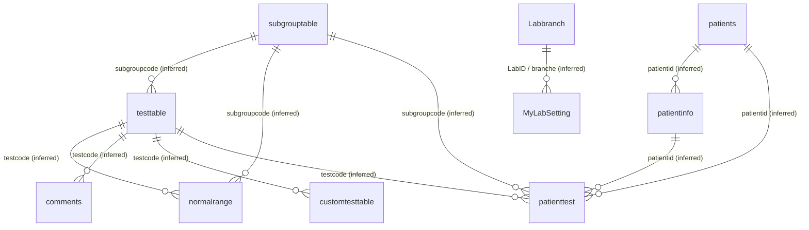

# Patients.mdb — Database Documentation

**Subject:** the V2 clinical laboratory database shipped with the RealLab reference system  
**Target application version:** 1.605 (`real lab system.exe`, `RL_CD2019Access`)  
**Analysis date:** 2026-11-14  
**Analysis mode:** read-only (no execution, no modification of the original)  
**Status:** `COMPLETED AND VERIFIED` for every section that does not carry an explicit limitation.

> This document is a complete, evidence-backed technical reference for the database. It is designed so that
> another engineer can understand the structure, locate every object, inspect every record, and reproduce the
> principal discovery and extraction operations without repeating the investigation.

## 2. Database identity

| Attribute | Value | Class |
|---|---|---|
| Product | RealLab / Real Laboratory System — V-CD-2019 line, version 1.605 | VERIFIED FACT |
| File name | `Patients.mdb` | VERIFIED FACT |
| Role in the product | The live local data store of the laboratory information system: patient master, orders, results, reference data, accounts, configuration | VERIFIED FACT |
| Competing stores in the same payload | `data.mdb` (266,240 B), `Branch_Data.mdb` (970,752 B, branch schema template), `Patients_backup.mdb` (2,146,304 B, CD backup copy) — **not** part of this document's scope except where noted | VERIFIED FACT |
| Engine | Microsoft Access Database Engine (ACE) 12.0 reading a **Jet 4 / Access 2000** `.mdb` container | VERIFIED FACT |
| Container format | `MSCF`-style header with the literal `Standard Jet DB` at file offset 0x04 and the Jet-4 format indicator `0x00000001` at offset 0x14 | VERIFIED FACT |
| Encryption / password | **None.** The file opens read-only with no password; the Jet encrypted-database flag is not set | VERIFIED FACT |
| Corruption indicators | None detected: every one of the 103 tables opened, every one of the 1,682 columns resolved, every `COUNT(*)` succeeded, all 3,809 records were read | VERIFIED FACT |
| Accessibility | Readable through the ACE OLEDB provider (`Microsoft.ACE.OLEDB.12.0`) and through ADOX (`ADOX.Catalog`) | VERIFIED FACT |

## 3. Original path

| Role | Path |
|---|---|
| Actual, verified path | `F:\REAL_LAB_COPY\real lab system\RL_CD2019Access\bin\Patients.mdb` |
| Path as stated in the mission brief | `F:\REAL_LAB_COPY\RL_CD2019Access\bin\Patients.mdb` |
| Difference | The brief's path omits the intermediate `real lab system\` directory level that the authorised source actually contains. The file was located at the verified path above and **only** at that path; the brief's path does not exist |
| Deployment root | `real lab system\RL_CD2019Access\` (the V1.605 payload); the sibling tree `real lab system\` is the earlier build and was excluded from this investigation |

## 4. File metadata

| Attribute | Value |
|---|---|
| Size | 2682880 bytes (2.56 MiB) |
| File header signature | `00 01 00 00` + `Standard Jet DB` |
| Header format indicator | `0x00000001` at 0x14 (Jet 4) |
| Collation / language code | `0x8BA9C155` (0x55C1A98B little-endian) at offset 0x3C |
| Page-level structure | Standard Jet 4 page allocation; no compacting or repair was performed or required |
| Last write time on the authorised copy | 2026-11-09 13:48:33 (unchanged by this investigation) |
| Modification during analysis | **None.** The original was opened read-only throughout; every extraction ran through `Mode=Read` connections |

## 5. SHA-256

```
98D51F5294496E03F352FF329F099572915CCB2E670C1F143D6BA368EEE898A3  Patients.mdb
```

The same hash was recorded before the inventory pass, after the extraction pass and after verification; it was
identical on all three occasions. The original artefact was never rewritten — the only writes performed anywhere
were to the analysis workspace outside `F:\`.

## 6. Actual format and engine compatibility

| Question | Answer | Basis |
|---|---|---|
| Does `.mdb` prove the internal format? | No, and here it did not: the extension, the `Standard Jet DB` magic, the 0x14 format indicator and the successful ACE open were each checked separately and all agree | header parse + engine open |
| Generation | Jet 4 (Access 2000 `.mdb` container) | header parse + 103 `CREATE TABLE` blocks recovered by `mdbtools` from the same file |
| Engine compatibility | Readable by the modern ACE 12.0 engine (backwards compatible with Jet 4) and by the ADOX catalog API | verified by execution |
| Password / encryption | Not encrypted | opened with no password |
| System-table visibility | The ACE provider refuses `MSysObjects` on this Jet 4 file (`no read permission`), but ADOX exposes 114 catalog objects including the `MSys*` system tables. Object enumeration therefore did not depend on `MSysObjects` | two methods, one denied, one working |

## 7. Analysis tools and versions

| Tool | Version | Role | Verified how |
|---|---|---|---|
| Microsoft ACE OLEDB 12.0 provider | 12.0.x (ACE 12) | record extraction, row counts, column metadata | `ServerVersion`/`Provider` read from the live connection; `SELECT COUNT(*)` executed on every table |
| ADOX (`ADOX.Catalog`) | MDAC/ACE component | table, column, index and relation metadata | `Catalog.Tables.Count` = 114, `Catalog.Procedures.Count` = 0 |
| ADO (`ADODB.Connection` / `ADODB.Recordset`) | 6.x COM | read-only record iteration, client cursor | 3,809 rows read with 0 failures |
| Windows PowerShell | 7.6.10 | orchestration of the above | `$PSVersionTable.PSVersion` |
| Python | 3.13.1 | independent reconciliation of the exports, data-quality analysis | `python --version` |
| `mdbtools` (historical) | mdbtools dump present in the evidence archive at `analysis/BATCH-07/db/v2019-Patients.mdb.sql` | independent Access-type reference for the same file | file hash and table count cross-checked against the live engine |
| REA 6.7.0 | CLI + MCP | executable-side analysis (see `Documenting the Executable File.md`) | `rea --version` |

## 8. Methodology

1. **Identity.** Path resolved against the authorised source; size and SHA-256 computed; the file header was parsed
   byte-by-byte to establish the container generation independently of the file extension.
2. **Object enumeration, two methods.** (a) ADOX `Catalog.Tables` — 114 objects; (b) `ADOX.Catalog.Procedures` for saved
   queries and `Catalog.Relations` for relationships. The ACE schema-table route was attempted first and rejected
   because it returned a single unusable row on this provider/file combination.
3. **Structure.** Per table: ADOX `Table.Columns` (position, type, size, required, default, validation rule and text,
   format, input mask, attributes, numeric precision/scale, AutoIncrement) and `Table.Indexes` (name, type, primary,
   unique, ignore-nulls, clustered, ordered column list). Access type names and widths were cross-mapped against an
   independent `mdbtools` dump of the same file.
4. **Record counts.** `SELECT COUNT(*)` executed against every user table through a read-only connection.
5. **Extraction.** `SELECT *` with a client cursor per table; every row and every column written to JSON with explicit
   value typing (null preserved as `null`, empty string preserved as `""`, dates as ISO-8601, binary as base64).
6. **Reconciliation.** Export files were re-counted independently and joined back to the extraction ledger; every
   count had to agree three ways (engine count, ledger count, file content count).
7. **Quality analysis.** Duplicate, orphan, nullability, date-range and empty-value analysis run over the exported
   records rather than over the live database, so that the analysis itself was independently reproducible.
8. **Confidentiality.** Credential, personal-identifier and telephone columns were transformed before publication
   under a declared, per-column policy (§23.4); the untransformed extract was never written outside the restricted
   local workspace.

## 9. Complete object inventory

| Object class | Count | Names | Source of discovery |
|---|---:|---|---|
| User tables (`TABLE`) | 103 | see §10 | ADOX `Catalog.Tables` |
| ACE-generated system tables (`ACCESS TABLE`) | 7 | `MSysAccessObjects`, `MSysAccessXML`, `MSysNameMap`, `MSysNavPaneGroupCategories`, `MSysNavPaneGroups`, `MSysNavPaneGroupToObjects`, `MSysNavPaneObjectIDs` | ADOX `Catalog.Tables` |
| Jet system tables (`SYSTEM TABLE`) | 4 | `MSysACEs`, `MSysObjects`, `MSysQueries`, `MSysRelationships` | ADOX `Catalog.Tables` |
| **Total catalog objects** | **114** | | |
| Saved queries (`Catalog.Procedures`) | 0 | — | ADOX `Catalog.Procedures` |
| Declared relationships (`Catalog.Relations`) | 0 | — | ADOX `Catalog.Relations` |
| Forms / reports / macros / modules | **NOT EXAMINED** | — | ADOX exposes no such object class; no Jet object-catalogue reader was available in this environment (see §29) |
| External data connections / linked tables | 0 | — | ADOX `Catalog.Tables` (no `TABLE_TYPE` outside the three above) |
| Database-level properties | partially | see §20 | header + provider |

**Object-count reconciliation.** The 114 catalog objects decompose into 103 user tables, 7 ACE system tables and 4 Jet
system tables. The user-table figure of **103** agrees exactly with the independent `mdbtools` dump of the same file
(103 `CREATE TABLE` blocks) and with the consolidated Stage 1/2 specification, which recorded 103 tables and 1,682 columns.

## 10. Complete table inventory

All 103 user tables, with their record count, column count and index count.

| # | Table | Rows | Columns | Indexes | State |
|---:|---|---:|---:|---:|---|
| 1 | `ABO` | 0 | 8 | 0 | empty (schema only) |
| 2 | `Abuse` | 0 | 12 | 0 | empty (schema only) |
| 3 | `BILH` | 0 | 9 | 0 | empty (schema only) |
| 4 | `BONEMAR` | 0 | 23 | 1 | empty (schema only) |
| 5 | `BloodGases` | 0 | 10 | 0 | empty (schema only) |
| 6 | `CRP` | 0 | 11 | 0 | empty (schema only) |
| 7 | `CSFT` | 0 | 24 | 2 | empty (schema only) |
| 8 | `CoagFactors` | 0 | 11 | 0 | empty (schema only) |
| 9 | `Drugs` | 0 | 14 | 0 | empty (schema only) |
| 10 | `ESR` | 1 | 5 | 0 | populated |
| 11 | `Electrolytes` | 0 | 20 | 0 | empty (schema only) |
| 12 | `Fertlity` | 0 | 17 | 0 | empty (schema only) |
| 13 | `GLUCOSETOLERANCE` | 0 | 25 | 0 | empty (schema only) |
| 14 | `Gehats` | 0 | 21 | 0 | empty (schema only) |
| 15 | `Helicobacter` | 3 | 6 | 1 | populated |
| 16 | `Hgbectrophoresis` | 0 | 8 | 0 | empty (schema only) |
| 17 | `IMMUNOLOGY` | 0 | 19 | 0 | empty (schema only) |
| 18 | `Immunoglobulin` | 0 | 10 | 0 | empty (schema only) |
| 19 | `Labbranch` | 4 | 2 | 0 | populated |
| 20 | `Lipids` | 0 | 11 | 0 | empty (schema only) |
| 21 | `MyLabSetting` | 5 | 20 | 4 | populated |
| 22 | `PTC` | 35 | 3 | 0 | populated |
| 23 | `Pancreas` | 0 | 13 | 0 | empty (schema only) |
| 24 | `Paste Errors` | 1 | 6 | 0 | populated |
| 25 | `Proelectrophoresis` | 0 | 8 | 0 | empty (schema only) |
| 26 | `SMSSender` | 8 | 8 | 0 | populated |
| 27 | `SMStemplate` | 8 | 2 | 0 | populated |
| 28 | `Suprarenal` | 0 | 16 | 0 | empty (schema only) |
| 29 | `TORCH` | 1 | 13 | 0 | populated |
| 30 | `TUBERCULINT` | 0 | 6 | 1 | empty (schema only) |
| 31 | `Tumors` | 0 | 14 | 0 | empty (schema only) |
| 32 | `Vitamins` | 0 | 15 | 0 | empty (schema only) |
| 33 | `ZN` | 0 | 8 | 2 | empty (schema only) |
| 34 | `abbreviations` | 650 | 3 | 0 | populated |
| 35 | `antibio` | 95 | 2 | 0 | populated |
| 36 | `antibiotic` | 612 | 25 | 0 | populated |
| 37 | `anyreport` | 15 | 26 | 2 | populated |
| 38 | `barcodes` | 35 | 2 | 1 | populated |
| 39 | `cardiac` | 0 | 9 | 0 | empty (schema only) |
| 40 | `cbc` | 0 | 29 | 0 | empty (schema only) |
| 41 | `comments` | 4 | 5 | 0 | populated |
| 42 | `constanttable` | 2 | 8 | 0 | populated |
| 43 | `converts` | 167 | 6 | 0 | populated |
| 44 | `crossmat` | 0 | 84 | 0 | empty (schema only) |
| 45 | `cultureanti` | 0 | 12 | 0 | empty (schema only) |
| 46 | `cultures` | 0 | 35 | 0 | empty (schema only) |
| 47 | `culturesec` | 12 | 3 | 0 | populated |
| 48 | `customgrouptable` | 5 | 2 | 0 | populated |
| 49 | `customtesttable` | 54 | 5 | 0 | populated |
| 50 | `daytip` | 19 | 2 | 0 | populated |
| 51 | `hba1c` | 1 | 5 | 1 | populated |
| 52 | `hepatitis` | 0 | 20 | 0 | empty (schema only) |
| 53 | `history` | 3 | 25 | 2 | populated |
| 54 | `hormones` | 0 | 16 | 0 | empty (schema only) |
| 55 | `instrument` | 0 | 20 | 1 | empty (schema only) |
| 56 | `insulin` | 113 | 2 | 1 | populated |
| 57 | `iron` | 0 | 9 | 0 | empty (schema only) |
| 58 | `kidney` | 0 | 15 | 0 | empty (schema only) |
| 59 | `liver` | 0 | 15 | 0 | empty (schema only) |
| 60 | `loggroup` | 8 | 2 | 0 | populated |
| 61 | `normalrange` | 1,152 | 18 | 0 | populated |
| 62 | `noteic` | 0 | 6 | 0 | empty (schema only) |
| 63 | `patientinfo` | 0 | 39 | 0 | empty (schema only) |
| 64 | `patients` | 2 | 33 | 1 | populated |
| 65 | `patienttest` | 0 | 46 | 0 | empty (schema only) |
| 66 | `patienttestgroup` | 0 | 46 | 0 | empty (schema only) |
| 67 | `patienttotal` | 0 | 15 | 0 | empty (schema only) |
| 68 | `payment` | 0 | 10 | 0 | empty (schema only) |
| 69 | `phone` | 0 | 19 | 0 | empty (schema only) |
| 70 | `pictures` | 6 | 73 | 32 | populated |
| 71 | `postcoitalt` | 0 | 17 | 1 | empty (schema only) |
| 72 | `pregnancy` | 0 | 6 | 0 | empty (schema only) |
| 73 | `pricelist` | 6 | 4 | 0 | populated |
| 74 | `pricemenu` | 2 | 1 | 1 | populated |
| 75 | `prostaticx` | 0 | 53 | 0 | empty (schema only) |
| 76 | `pt` | 0 | 16 | 0 | empty (schema only) |
| 77 | `ratios` | 2 | 12 | 1 | populated |
| 78 | `renalfailure` | 0 | 11 | 1 | empty (schema only) |
| 79 | `reportview` | 1 | 42 | 0 | populated |
| 80 | `sarfeda3` | 0 | 3 | 0 | empty (schema only) |
| 81 | `seana` | 0 | 10 | 0 | empty (schema only) |
| 82 | `semen` | 0 | 60 | 0 | empty (schema only) |
| 83 | `sharekat` | 0 | 6 | 2 | empty (schema only) |
| 84 | `sharekathesab` | 0 | 7 | 2 | empty (schema only) |
| 85 | `shopping` | 0 | 7 | 0 | empty (schema only) |
| 86 | `smsgroups` | 1 | 3 | 0 | populated |
| 87 | `smslist` | 2 | 6 | 0 | populated |
| 88 | `stone` | 0 | 19 | 0 | empty (schema only) |
| 89 | `stool` | 0 | 61 | 0 | empty (schema only) |
| 90 | `subgrouptable` | 48 | 4 | 0 | populated |
| 91 | `sugar` | 0 | 12 | 0 | empty (schema only) |
| 92 | `tasgel` | 0 | 11 | 0 | empty (schema only) |
| 93 | `testlearn` | 29 | 3 | 0 | populated |
| 94 | `testname` | 2 | 8 | 0 | populated |
| 95 | `testtable` | 609 | 38 | 2 | populated |
| 96 | `testtemp` | 1 | 28 | 4 | populated |
| 97 | `testunits` | 70 | 2 | 0 | populated |
| 98 | `titless` | 15 | 3 | 0 | populated |
| 99 | `trace` | 0 | 25 | 0 | empty (schema only) |
| 100 | `urine` | 0 | 60 | 0 | empty (schema only) |
| 101 | `wasl` | 0 | 12 | 2 | empty (schema only) |
| 102 | `widal` | 0 | 16 | 0 | empty (schema only) |
| 103 | `widal2` | 0 | 26 | 0 | empty (schema only) |

**Totals:** 103 tables · 1682 columns · 72 indexes · 3,809 records in 41 populated tables, 62 empty tables.

## 11-12. Detailed table schemas and complete field definitions

Every column of every table, in ordinal position, with its Access type and width, nullability, default,
validation rule, format, input mask and attributes. `Type` is the Access type recovered from an independent
`mdbtools` dump of the same file; `Null` is the required/nullable flag reported by ADOX; `Default` and `Rule` are the
stored defaults and validation rules (blank where the table defines none).

### `ABO`

Rows **0** · Columns **8** · Indexes **0** · empty — schema only

| # | Column | Access type | Null | ADO type | Default | Rule / Format / Mask |
|---:|---|---|---|---:|---|---|
| 1 | `patientid` | Text (13) | no | 202 | not exposed | not exposed |
| 2 | `requestdate` | DateTime | yes | 7 | not exposed | not exposed |
| 3 | `abo` | Text (30) | yes | 202 | not exposed | not exposed |
| 4 | `rhfactor` | Text (30) | yes | 202 | not exposed | not exposed |
| 5 | `direct` | Text (30) | yes | 202 | not exposed | not exposed |
| 6 | `indirect` | Text (30) | yes | 202 | not exposed | not exposed |
| 7 | `rhtitre` | Text (30) | yes | 202 | not exposed | not exposed |

### `Abuse`

Rows **0** · Columns **12** · Indexes **0** · empty — schema only

| # | Column | Access type | Null | ADO type | Default | Rule / Format / Mask |
|---:|---|---|---|---:|---|---|
| 1 | `patientid` | Text (13) | no | 202 | not exposed | not exposed |
| 2 | `requestdate` | DateTime | yes | 7 | not exposed | not exposed |
| 3 | `Alcohol` | Text (10) | yes | 202 | not exposed | not exposed |
| 4 | `Cannabinoid` | Text (10) | yes | 202 | not exposed | not exposed |
| 5 | `Opitate` | Text (10) | yes | 202 | not exposed | not exposed |
| 6 | `Cocaine` | Text (10) | yes | 202 | not exposed | not exposed |
| 7 | `Barbtiurate` | Text (10) | yes | 202 | not exposed | not exposed |
| 8 | `Benzodiazipine` | Text (10) | yes | 202 | not exposed | not exposed |
| 9 | `Amphetamine` | Text (10) | yes | 202 | not exposed | not exposed |
| 10 | `comment` | Memo/Hyperlink (255) | yes | 203 | not exposed | not exposed |
| 11 | `tramadol` | Text (10) | yes | 202 | not exposed | not exposed |

### `BILH`

Rows **0** · Columns **9** · Indexes **0** · empty — schema only

| # | Column | Access type | Null | ADO type | Default | Rule / Format / Mask |
|---:|---|---|---|---:|---|---|
| 1 | `patientid` | Text (13) | no | 202 | not exposed | not exposed |
| 2 | `requestdate` | DateTime | yes | 7 | not exposed | not exposed |
| 3 | `bilh` | Text (30) | yes | 202 | not exposed | not exposed |
| 4 | `fasc` | Text (30) | yes | 202 | not exposed | not exposed |
| 5 | `amob` | Text (30) | yes | 202 | not exposed | not exposed |
| 6 | `hydat` | Text (30) | yes | 202 | not exposed | not exposed |
| 7 | `bilhagurine` | Text (30) | yes | 202 | not exposed | not exposed |
| 8 | `bilhagserum` | Text (30) | yes | 202 | not exposed | not exposed |

### `BONEMAR`

Rows **0** · Columns **23** · Indexes **1** · empty — schema only

| # | Column | Access type | Null | ADO type | Default | Rule / Format / Mask |
|---:|---|---|---|---:|---|---|
| 1 | `patientid` | Text (13) | yes | 202 | not exposed | not exposed |
| 2 | `requestdate` | DateTime | yes | 7 | not exposed | not exposed |
| 3 | `T01` | Text (50) | yes | 202 | not exposed | not exposed |
| 4 | `T02` | Text (50) | yes | 202 | not exposed | not exposed |
| 5 | `T03` | Text (50) | yes | 202 | not exposed | not exposed |
| 6 | `T04` | Text (50) | yes | 202 | not exposed | not exposed |
| 7 | `T05` | Text (50) | yes | 202 | not exposed | not exposed |
| 8 | `T06` | Text (50) | yes | 202 | not exposed | not exposed |
| 9 | `T07` | Text (50) | yes | 202 | not exposed | not exposed |
| 10 | `T08` | Text (50) | yes | 202 | not exposed | not exposed |
| 11 | `T09` | Text (50) | yes | 202 | not exposed | not exposed |
| 12 | `T10` | Text (50) | yes | 202 | not exposed | not exposed |
| 13 | `T11` | Text (50) | yes | 202 | not exposed | not exposed |
| 14 | `T12` | Text (50) | yes | 202 | not exposed | not exposed |
| 15 | `T13` | Text (50) | yes | 202 | not exposed | not exposed |
| 16 | `T14` | Text (50) | yes | 202 | not exposed | not exposed |
| 17 | `T15` | Text (50) | yes | 202 | not exposed | not exposed |
| 18 | `T16` | Text (50) | yes | 202 | not exposed | not exposed |
| 19 | `T17` | Text (50) | yes | 202 | not exposed | not exposed |
| 20 | `T18` | Text (50) | yes | 202 | not exposed | not exposed |
| 21 | `T19` | Text (50) | yes | 202 | not exposed | not exposed |
| 22 | `T20` | Text (50) | yes | 202 | not exposed | not exposed |

### `BloodGases`

Rows **0** · Columns **10** · Indexes **0** · empty — schema only

| # | Column | Access type | Null | ADO type | Default | Rule / Format / Mask |
|---:|---|---|---|---:|---|---|
| 1 | `patientid` | Text (13) | no | 202 | not exposed | not exposed |
| 2 | `requestdate` | DateTime | yes | 7 | not exposed | not exposed |
| 3 | `pH` | Text (10) | yes | 202 | not exposed | not exposed |
| 4 | `PaO2` | Text (10) | yes | 202 | not exposed | not exposed |
| 5 | `PaCO2` | Text (10) | yes | 202 | not exposed | not exposed |
| 6 | `O2` | Text (10) | yes | 202 | not exposed | not exposed |
| 7 | `HCO3` | Text (10) | yes | 202 | not exposed | not exposed |
| 8 | `SO2` | Text (10) | yes | 202 | not exposed | not exposed |
| 9 | `BaseExcess` | Text (10) | yes | 202 | not exposed | not exposed |

### `CRP`

Rows **0** · Columns **11** · Indexes **0** · empty — schema only

| # | Column | Access type | Null | ADO type | Default | Rule / Format / Mask |
|---:|---|---|---|---:|---|---|
| 1 | `patientid` | Text (13) | no | 202 | not exposed | not exposed |
| 2 | `requestdate` | DateTime | yes | 7 | not exposed | not exposed |
| 3 | `aso` | Text (30) | yes | 202 | not exposed | not exposed |
| 4 | `crp` | Text (30) | yes | 202 | not exposed | not exposed |
| 5 | `rf` | Text (30) | yes | 202 | not exposed | not exposed |
| 6 | `Rosewaller` | Text (30) | yes | 202 | not exposed | not exposed |
| 7 | `Monospot` | Text (30) | yes | 202 | not exposed | not exposed |
| 8 | `VDRL` | Text (30) | yes | 202 | not exposed | not exposed |
| 9 | `rpr` | Text (30) | yes | 202 | not exposed | not exposed |
| 10 | `THPA` | Text (30) | yes | 202 | not exposed | not exposed |

### `CSFT`

Rows **0** · Columns **24** · Indexes **2** · empty — schema only

| # | Column | Access type | Null | ADO type | Default | Rule / Format / Mask |
|---:|---|---|---|---:|---|---|
| 1 | `patientid` | Text (13) | yes | 202 | not exposed | not exposed |
| 2 | `requestdate` | DateTime | yes | 7 | not exposed | not exposed |
| 3 | `materi` | Text (50) | yes | 202 | not exposed | not exposed |
| 4 | `color` | Text (50) | yes | 202 | not exposed | not exposed |
| 5 | `aspect` | Text (50) | yes | 202 | not exposed | not exposed |
| 6 | `deposit` | Text (50) | yes | 202 | not exposed | not exposed |
| 7 | `Viscos` | Text (50) | yes | 202 | not exposed | not exposed |
| 8 | `clotting` | Text (50) | yes | 202 | not exposed | not exposed |
| 9 | `PH` | Text (50) | yes | 202 | not exposed | not exposed |
| 10 | `SG` | Text (50) | yes | 202 | not exposed | not exposed |
| 11 | `gluc` | Text (50) | yes | 202 | not exposed | not exposed |
| 12 | `prot` | Text (50) | yes | 202 | not exposed | not exposed |
| 13 | `chlorid` | Text (50) | yes | 202 | not exposed | not exposed |
| 14 | `ldh` | Text (50) | yes | 202 | not exposed | not exposed |
| 15 | `wbc` | Text (50) | yes | 202 | not exposed | not exposed |
| 16 | `wbc2` | Text (10) | yes | 202 | not exposed | not exposed |
| 17 | `rbc` | Text (50) | yes | 202 | not exposed | not exposed |
| 18 | `rbc2` | Text (10) | yes | 202 | not exposed | not exposed |
| 19 | `epithi` | Text (50) | yes | 202 | not exposed | not exposed |
| 20 | `other` | Text (50) | yes | 202 | not exposed | not exposed |
| 21 | `gramdfilm` | Text (50) | yes | 202 | not exposed | not exposed |
| 22 | `znfilm` | Text (50) | yes | 202 | not exposed | not exposed |
| 23 | `Lishman` | Text (50) | yes | 202 | not exposed | not exposed |

### `CoagFactors`

Rows **0** · Columns **11** · Indexes **0** · empty — schema only

| # | Column | Access type | Null | ADO type | Default | Rule / Format / Mask |
|---:|---|---|---|---:|---|---|
| 1 | `patientid` | Text (13) | no | 202 | not exposed | not exposed |
| 2 | `requestdate` | DateTime | yes | 7 | not exposed | not exposed |
| 3 | `FactVIII` | Text (10) | yes | 202 | not exposed | not exposed |
| 4 | `FactIX` | Text (10) | yes | 202 | not exposed | not exposed |
| 5 | `FactXI` | Text (10) | yes | 202 | not exposed | not exposed |
| 6 | `FactXII` | Text (10) | yes | 202 | not exposed | not exposed |
| 7 | `FactII` | Text (10) | yes | 202 | not exposed | not exposed |
| 8 | `FactV` | Text (10) | yes | 202 | not exposed | not exposed |
| 9 | `FactVII` | Text (10) | yes | 202 | not exposed | not exposed |
| 10 | `FactX` | Text (10) | yes | 202 | not exposed | not exposed |

### `Drugs`

Rows **0** · Columns **14** · Indexes **0** · empty — schema only

| # | Column | Access type | Null | ADO type | Default | Rule / Format / Mask |
|---:|---|---|---|---:|---|---|
| 1 | `patientid` | Text (13) | no | 202 | not exposed | not exposed |
| 2 | `requestdate` | DateTime | yes | 7 | not exposed | not exposed |
| 3 | `Digoxin` | Text (10) | yes | 202 | not exposed | not exposed |
| 4 | `Tegretol` | Text (10) | yes | 202 | not exposed | not exposed |
| 5 | `Phenytoin` | Text (10) | yes | 202 | not exposed | not exposed |
| 6 | `Depakene` | Text (10) | yes | 202 | not exposed | not exposed |
| 7 | `Phenobarbitone` | Text (10) | yes | 202 | not exposed | not exposed |
| 8 | `Tacrolimus` | Text (10) | yes | 202 | not exposed | not exposed |
| 9 | `Theophylline` | Text (10) | yes | 202 | not exposed | not exposed |
| 10 | `Cyclosporin` | Text (10) | yes | 202 | not exposed | not exposed |
| 11 | `Methotrexate` | Text (10) | yes | 202 | not exposed | not exposed |
| 12 | `Lithium` | Text (10) | yes | 202 | not exposed | not exposed |
| 13 | `Vancomycin` | Text (10) | yes | 202 | not exposed | not exposed |

### `ESR`

Rows **1** · Columns **5** · Indexes **0** · populated

| # | Column | Access type | Null | ADO type | Default | Rule / Format / Mask |
|---:|---|---|---|---:|---|---|
| 1 | `patientid` | Text (13) | no | 202 | not exposed | not exposed |
| 2 | `requestdate` | DateTime | yes | 7 | not exposed | not exposed |
| 3 | `Fhour` | Text (10) | yes | 202 | not exposed | not exposed |
| 4 | `Shour` | Text (10) | yes | 202 | not exposed | not exposed |

### `Electrolytes`

Rows **0** · Columns **20** · Indexes **0** · empty — schema only

| # | Column | Access type | Null | ADO type | Default | Rule / Format / Mask |
|---:|---|---|---|---:|---|---|
| 1 | `patientid` | Text (13) | no | 202 | not exposed | not exposed |
| 2 | `requestdate` | DateTime | yes | 7 | not exposed | not exposed |
| 3 | `scatot` | Text (10) | yes | 202 | not exposed | not exposed |
| 4 | `scaion` | Text (10) | yes | 202 | not exposed | not exposed |
| 5 | `sph` | Text (10) | yes | 202 | not exposed | not exposed |
| 6 | `sna` | Text (10) | yes | 202 | not exposed | not exposed |
| 7 | `sk` | Text (10) | yes | 202 | not exposed | not exposed |
| 8 | `scl` | Text (10) | yes | 202 | not exposed | not exposed |
| 9 | `smg` | Text (10) | yes | 202 | not exposed | not exposed |
| 10 | `sosmolality` | Text (51) | yes | 202 | not exposed | not exposed |
| 11 | `una` | Text (10) | yes | 202 | not exposed | not exposed |
| 12 | `uk` | Text (10) | yes | 202 | not exposed | not exposed |
| 13 | `ucl` | Text (10) | yes | 202 | not exposed | not exposed |
| 14 | `uca` | Text (10) | yes | 202 | not exposed | not exposed |
| 15 | `uph` | Text (10) | yes | 202 | not exposed | not exposed |
| 16 | `umg` | Text (10) | yes | 202 | not exposed | not exposed |
| 17 | `uosmolality` | Text (10) | yes | 202 | not exposed | not exposed |
| 18 | `csfmg` | Text (10) | yes | 202 | not exposed | not exposed |
| 19 | `csfcl` | Text (10) | yes | 202 | not exposed | not exposed |

### `Fertlity`

Rows **0** · Columns **17** · Indexes **0** · empty — schema only

| # | Column | Access type | Null | ADO type | Default | Rule / Format / Mask |
|---:|---|---|---|---:|---|---|
| 1 | `patientid` | Text (13) | no | 202 | not exposed | not exposed |
| 2 | `requestdate` | DateTime | yes | 7 | not exposed | not exposed |
| 3 | `FSH` | Text (10) | yes | 202 | not exposed | not exposed |
| 4 | `LH` | Text (10) | yes | 202 | not exposed | not exposed |
| 5 | `Prolactin` | Text (10) | yes | 202 | not exposed | not exposed |
| 6 | `TestostT` | Text (10) | yes | 202 | not exposed | not exposed |
| 7 | `TestostF` | Text (10) | yes | 202 | not exposed | not exposed |
| 8 | `DHT` | Text (10) | yes | 202 | not exposed | not exposed |
| 9 | `Progesterone` | Text (10) | yes | 202 | not exposed | not exposed |
| 10 | `E1` | Text (10) | yes | 202 | not exposed | not exposed |
| 11 | `E2` | Text (10) | yes | 202 | not exposed | not exposed |
| 12 | `E3` | Text (10) | yes | 202 | not exposed | not exposed |
| 13 | `DHEAS` | Text (10) | yes | 202 | not exposed | not exposed |
| 14 | `DHEA` | Text (10) | yes | 202 | not exposed | not exposed |
| 15 | `SHBG` | Text (10) | yes | 202 | not exposed | not exposed |
| 16 | `Androstendione` | Text (10) | yes | 202 | not exposed | not exposed |

### `GLUCOSETOLERANCE`

Rows **0** · Columns **25** · Indexes **0** · empty — schema only

| # | Column | Access type | Null | ADO type | Default | Rule / Format / Mask |
|---:|---|---|---|---:|---|---|
| 1 | `patientid` | Text (13) | no | 202 | not exposed | not exposed |
| 2 | `requestdate` | DateTime | yes | 7 | not exposed | not exposed |
| 3 | `given` | Text (50) | yes | 202 | not exposed | not exposed |
| 4 | `FBG` | Text (10) | yes | 202 | not exposed | not exposed |
| 5 | `FBGG` | Text (10) | yes | 202 | not exposed | not exposed |
| 6 | `FBGA` | Text (10) | yes | 202 | not exposed | not exposed |
| 7 | `bg30` | Text (10) | yes | 202 | not exposed | not exposed |
| 8 | `bg30g` | Text (10) | yes | 202 | not exposed | not exposed |
| 9 | `bg30a` | Text (10) | yes | 202 | not exposed | not exposed |
| 10 | `bg1` | Text (10) | yes | 202 | not exposed | not exposed |
| 11 | `bg1g` | Text (10) | yes | 202 | not exposed | not exposed |
| 12 | `bg1a` | Text (10) | yes | 202 | not exposed | not exposed |
| 13 | `bg2` | Text (10) | yes | 202 | not exposed | not exposed |
| 14 | `bg2g` | Text (10) | yes | 202 | not exposed | not exposed |
| 15 | `bg2a` | Text (10) | yes | 202 | not exposed | not exposed |
| 16 | `bg3` | Text (10) | yes | 202 | not exposed | not exposed |
| 17 | `bg3g` | Text (10) | yes | 202 | not exposed | not exposed |
| 18 | `bg3a` | Text (10) | yes | 202 | not exposed | not exposed |
| 19 | `bg15` | Text (10) | yes | 202 | not exposed | not exposed |
| 20 | `bg15g` | Text (10) | yes | 202 | not exposed | not exposed |
| 21 | `bg15a` | Text (10) | yes | 202 | not exposed | not exposed |
| 22 | `bg25` | Text (10) | yes | 202 | not exposed | not exposed |
| 23 | `bg25g` | Text (10) | yes | 202 | not exposed | not exposed |
| 24 | `bg25a` | Text (10) | yes | 202 | not exposed | not exposed |

### `Gehats`

Rows **0** · Columns **21** · Indexes **0** · empty — schema only

| # | Column | Access type | Null | ADO type | Default | Rule / Format / Mask |
|---:|---|---|---|---:|---|---|
| 1 | `gehahid` | Long Integer | yes | 3 | not exposed | not exposed |
| 2 | `gehahsefa` | Text (20) | yes | 202 | not exposed | not exposed |
| 3 | `gehahname` | Text (40) | yes | 202 | not exposed | not exposed |
| 4 | `masolsefa` | Text (10) | yes | 202 | not exposed | not exposed |
| 5 | `masolname` | Text (40) | yes | 202 | not exposed | not exposed |
| 6 | `madina` | Text (40) | yes | 202 | not exposed | not exposed |
| 7 | `addressxc` | Text (100) | yes | 202 | not exposed | not exposed |
| 8 | `phone` | Text (12) | yes | 202 | not exposed | not exposed |
| 9 | `mobil` | Text (12) | yes | 202 | not exposed | not exposed |
| 10 | `fax` | Text (12) | yes | 202 | not exposed | not exposed |
| 11 | `mail` | Text (50) | yes | 202 | not exposed | not exposed |
| 12 | `web` | Text (50) | yes | 202 | not exposed | not exposed |
| 13 | `flose` | Boolean | no | 11 | not exposed | not exposed |
| 14 | `khasm` | Double | yes | 5 | not exposed | not exposed |
| 15 | `omola` | Double | yes | 5 | not exposed | not exposed |
| 16 | `morsel` | Integer | yes | 2 | not exposed | not exposed |
| 17 | `pricemethod` | Text (20) | yes | 202 | not exposed | not exposed |
| 18 | `masolphone` | Text (12) | yes | 202 | not exposed | not exposed |
| 19 | `printorno` | Boolean | no | 11 | not exposed | not exposed |
| 20 | `ReferredPW` | Text (20) | yes | 202 | not exposed | not exposed |

### `Helicobacter`

Rows **3** · Columns **6** · Indexes **1** · populated

| # | Column | Access type | Null | ADO type | Default | Rule / Format / Mask |
|---:|---|---|---|---:|---|---|
| 1 | `patientid` | Text (13) | yes | 202 | not exposed | not exposed |
| 2 | `requestdate` | DateTime | yes | 7 | not exposed | not exposed |
| 3 | `hpigi` | Text (50) | yes | 202 | not exposed | not exposed |
| 4 | `hpigm` | Text (50) | yes | 202 | not exposed | not exposed |
| 5 | `hpag` | Text (50) | yes | 202 | not exposed | not exposed |

### `Hgbectrophoresis`

Rows **0** · Columns **8** · Indexes **0** · empty — schema only

| # | Column | Access type | Null | ADO type | Default | Rule / Format / Mask |
|---:|---|---|---|---:|---|---|
| 1 | `patientid` | Text (13) | no | 202 | not exposed | not exposed |
| 2 | `requestdate` | DateTime | yes | 7 | not exposed | not exposed |
| 3 | `A1` | Text (10) | yes | 202 | not exposed | not exposed |
| 4 | `A2` | Text (10) | yes | 202 | not exposed | not exposed |
| 5 | `F` | Text (10) | yes | 202 | not exposed | not exposed |
| 6 | `C` | Text (10) | yes | 202 | not exposed | not exposed |
| 7 | `S` | Text (10) | yes | 202 | not exposed | not exposed |

### `IMMUNOLOGY`

Rows **0** · Columns **19** · Indexes **0** · empty — schema only

| # | Column | Access type | Null | ADO type | Default | Rule / Format / Mask |
|---:|---|---|---|---:|---|---|
| 1 | `patientid` | Text (13) | no | 202 | not exposed | not exposed |
| 2 | `requestdate` | DateTime | yes | 7 | not exposed | not exposed |
| 3 | `ANA` | Text (25) | yes | 202 | not exposed | not exposed |
| 4 | `DNA` | Text (25) | yes | 202 | not exposed | not exposed |
| 5 | `LKM` | Text (25) | yes | 202 | not exposed | not exposed |
| 6 | `SSA` | Text (25) | yes | 202 | not exposed | not exposed |
| 7 | `SSB` | Text (25) | yes | 202 | not exposed | not exposed |
| 8 | `AntSmith` | Text (25) | yes | 202 | not exposed | not exposed |
| 9 | `AntCentromere` | Text (25) | yes | 202 | not exposed | not exposed |
| 10 | `ANCA` | Text (25) | yes | 202 | not exposed | not exposed |
| 11 | `RNP` | Text (25) | yes | 202 | not exposed | not exposed |
| 12 | `AntScl` | Text (25) | yes | 202 | not exposed | not exposed |
| 13 | `ASMA` | Text (25) | yes | 202 | not exposed | not exposed |
| 14 | `AMA` | Text (25) | yes | 202 | not exposed | not exposed |
| 15 | `AntKeratin` | Text (25) | yes | 202 | not exposed | not exposed |
| 16 | `AntReticulin` | Text (25) | yes | 202 | not exposed | not exposed |
| 17 | `AntSperm` | Text (25) | yes | 202 | not exposed | not exposed |
| 18 | `AntJo1` | Text (25) | yes | 202 | not exposed | not exposed |

### `Immunoglobulin`

Rows **0** · Columns **10** · Indexes **0** · empty — schema only

| # | Column | Access type | Null | ADO type | Default | Rule / Format / Mask |
|---:|---|---|---|---:|---|---|
| 1 | `patientid` | Text (13) | no | 202 | not exposed | not exposed |
| 2 | `requestdate` | DateTime | yes | 7 | not exposed | not exposed |
| 3 | `IgG` | Text (10) | yes | 202 | not exposed | not exposed |
| 4 | `IgA` | Text (10) | yes | 202 | not exposed | not exposed |
| 5 | `IgM` | Text (10) | yes | 202 | not exposed | not exposed |
| 6 | `IgE` | Text (10) | yes | 202 | not exposed | not exposed |
| 7 | `IgD` | Text (10) | yes | 202 | not exposed | not exposed |
| 8 | `C3` | Text (10) | yes | 202 | not exposed | not exposed |
| 9 | `C4` | Text (10) | yes | 202 | not exposed | not exposed |

### `Labbranch`

Rows **4** · Columns **2** · Indexes **0** · populated

| # | Column | Access type | Null | ADO type | Default | Rule / Format / Mask |
|---:|---|---|---|---:|---|---|
| 1 | `branchid` | Long Integer | yes | 3 | not exposed | not exposed |

### `Lipids`

Rows **0** · Columns **11** · Indexes **0** · empty — schema only

| # | Column | Access type | Null | ADO type | Default | Rule / Format / Mask |
|---:|---|---|---|---:|---|---|
| 1 | `patientid` | Text (13) | yes | 202 | not exposed | not exposed |
| 2 | `requestdate` | DateTime | yes | 7 | not exposed | not exposed |
| 3 | `cholest` | Text (10) | yes | 202 | not exposed | not exposed |
| 4 | `trig` | Text (10) | yes | 202 | not exposed | not exposed |
| 5 | `hdl` | Text (10) | yes | 202 | not exposed | not exposed |
| 6 | `ldl` | Text (10) | yes | 202 | not exposed | not exposed |
| 7 | `risk1` | Text (10) | yes | 202 | not exposed | not exposed |
| 8 | `risk2` | Text (10) | yes | 202 | not exposed | not exposed |
| 9 | `vldl` | Text (10) | yes | 202 | not exposed | not exposed |
| 10 | `totallipids` | Text (10) | yes | 202 | not exposed | not exposed |

### `MyLabSetting`

Rows **5** · Columns **20** · Indexes **4** · populated

| # | Column | Access type | Null | ADO type | Default | Rule / Format / Mask |
|---:|---|---|---|---:|---|---|
| 1 | `LabID` | Integer | yes | 2 | not exposed | not exposed |
| 2 | `sendername` | Text (15) | yes | 202 | not exposed | not exposed |
| 3 | `accuntID` | Text (50) | yes | 202 | not exposed | not exposed |
| 4 | `accuntpw` | Text (50) | yes | 202 | not exposed | not exposed |
| 5 | `updateflage` | Byte | yes | 17 | not exposed | not exposed |
| 6 | `Hourflag` | Integer | yes | 2 | not exposed | not exposed |
| 7 | `SMSNo` | Integer | yes | 2 | not exposed | not exposed |
| 8 | `totalsms` | Double | yes | 5 | not exposed | not exposed |
| 9 | `SMSSend` | Double | yes | 5 | not exposed | not exposed |
| 10 | `SMSbakey` | Double | yes | 5 | not exposed | not exposed |
| 11 | `phoneNo1` | Text (15) | yes | 202 | not exposed | not exposed |
| 12 | `phoneNo2` | Text (15) | yes | 202 | not exposed | not exposed |
| 13 | `phoneNo3` | Text (15) | yes | 202 | not exposed | not exposed |
| 14 | `phoneNo4` | Text (15) | yes | 202 | not exposed | not exposed |
| 15 | `phoneNo5` | Text (15) | yes | 202 | not exposed | not exposed |
| 16 | `phoneNo6` | Text (15) | yes | 202 | not exposed | not exposed |
| 17 | `phonenum` | Integer | yes | 2 | not exposed | not exposed |
| 18 | `Timess` | Text (100) | yes | 202 | not exposed | not exposed |
| 19 | `FridaySend` | Byte | yes | 17 | not exposed | not exposed |

### `PTC`

Rows **35** · Columns **3** · Indexes **0** · populated

| # | Column | Access type | Null | ADO type | Default | Rule / Format / Mask |
|---:|---|---|---|---:|---|---|
| 1 | `control` | Double | no | 5 | not exposed | not exposed |
| 2 | `concent` | Double | no | 5 | not exposed | not exposed |

### `Pancreas`

Rows **0** · Columns **13** · Indexes **0** · empty — schema only

| # | Column | Access type | Null | ADO type | Default | Rule / Format / Mask |
|---:|---|---|---|---:|---|---|
| 1 | `patientid` | Text (13) | no | 202 | not exposed | not exposed |
| 2 | `requestdate` | DateTime | yes | 7 | not exposed | not exposed |
| 3 | `InsulinFast` | Text (10) | yes | 202 | not exposed | not exposed |
| 4 | `Insulin30` | Text (10) | yes | 202 | not exposed | not exposed |
| 5 | `Insulin60` | Text (10) | yes | 202 | not exposed | not exposed |
| 6 | `Insulin120` | Text (10) | yes | 202 | not exposed | not exposed |
| 7 | `Insulin180` | Text (10) | yes | 202 | not exposed | not exposed |
| 8 | `Cpeptidefast` | Text (10) | yes | 202 | not exposed | not exposed |
| 9 | `CpeptidePP` | Text (10) | yes | 202 | not exposed | not exposed |
| 10 | `Cpeptideurine` | Text (10) | yes | 202 | not exposed | not exposed |
| 11 | `Glucagon` | Text (10) | yes | 202 | not exposed | not exposed |
| 12 | `Gastrin` | Text (10) | yes | 202 | not exposed | not exposed |

### `Paste Errors`

Rows **1** · Columns **6** · Indexes **0** · populated

| # | Column | Access type | Null | ADO type | Default | Rule / Format / Mask |
|---:|---|---|---|---:|---|---|
| 1 | `Field0` | Memo/Hyperlink (255) | yes | 203 | not exposed | not exposed |
| 2 | `Field1` | Memo/Hyperlink (255) | yes | 203 | not exposed | not exposed |
| 3 | `Field2` | Memo/Hyperlink (255) | yes | 203 | not exposed | not exposed |
| 4 | `Field3` | Memo/Hyperlink (255) | yes | 203 | not exposed | not exposed |
| 5 | `Field4` | Memo/Hyperlink (255) | yes | 203 | not exposed | not exposed |

### `Proelectrophoresis`

Rows **0** · Columns **8** · Indexes **0** · empty — schema only

| # | Column | Access type | Null | ADO type | Default | Rule / Format / Mask |
|---:|---|---|---|---:|---|---|
| 1 | `patientid` | Text (13) | no | 202 | not exposed | not exposed |
| 2 | `requestdate` | DateTime | yes | 7 | not exposed | not exposed |
| 3 | `Albumin` | Text (10) | yes | 202 | not exposed | not exposed |
| 4 | `Alpha1` | Text (10) | yes | 202 | not exposed | not exposed |
| 5 | `Alpha2` | Text (10) | yes | 202 | not exposed | not exposed |
| 6 | `Beta` | Text (10) | yes | 202 | not exposed | not exposed |
| 7 | `Gamma` | Text (10) | yes | 202 | not exposed | not exposed |

### `SMSSender`

Rows **8** · Columns **8** · Indexes **0** · populated

| # | Column | Access type | Null | ADO type | Default | Rule / Format / Mask |
|---:|---|---|---|---:|---|---|
| 1 | `SMSautonum` | Long Integer | yes | 3 | not exposed | not exposed |
| 2 | `username` | Text (50) | yes | 202 | not exposed | not exposed |
| 3 | `patientid` | Text (13) | yes | 202 | not exposed | not exposed |
| 4 | `PatDrName` | Text (60) | yes | 202 | not exposed | not exposed |
| 5 | `requestdate` | DateTime | yes | 7 | not exposed | not exposed |
| 6 | `smsMobile` | Text (100) | yes | 202 | not exposed | not exposed |
| 7 | `SMSLength` | Integer | yes | 2 | not exposed | not exposed |

### `SMStemplate`

Rows **8** · Columns **2** · Indexes **0** · populated

| # | Column | Access type | Null | ADO type | Default | Rule / Format / Mask |
|---:|---|---|---|---:|---|---|
| 1 | `templatenum` | Long Integer | yes | 3 | not exposed | not exposed |

### `Suprarenal`

Rows **0** · Columns **16** · Indexes **0** · empty — schema only

| # | Column | Access type | Null | ADO type | Default | Rule / Format / Mask |
|---:|---|---|---|---:|---|---|
| 1 | `patientid` | Text (13) | no | 202 | not exposed | not exposed |
| 2 | `requestdate` | DateTime | yes | 7 | not exposed | not exposed |
| 3 | `ACTH9AM` | Text (10) | yes | 202 | not exposed | not exposed |
| 4 | `ACTH10PM` | Text (10) | yes | 202 | not exposed | not exposed |
| 5 | `Cortisol9AM` | Text (10) | yes | 202 | not exposed | not exposed |
| 6 | `Cortisol10PM` | Text (10) | yes | 202 | not exposed | not exposed |
| 7 | `CortisolUrine` | Text (10) | yes | 202 | not exposed | not exposed |
| 8 | `CatecholUrine` | Text (10) | yes | 202 | not exposed | not exposed |
| 9 | `Adrenaline` | Text (10) | yes | 202 | not exposed | not exposed |
| 10 | `Noradrenaline` | Text (10) | yes | 202 | not exposed | not exposed |
| 11 | `Dopamine` | Text (10) | yes | 202 | not exposed | not exposed |
| 12 | `Renin` | Text (10) | yes | 202 | not exposed | not exposed |
| 13 | `Aldosterone` | Text (10) | yes | 202 | not exposed | not exposed |
| 14 | `Progesterone17OH` | Text (10) | yes | 202 | not exposed | not exposed |
| 15 | `VMAUrine` | Text (10) | yes | 202 | not exposed | not exposed |

### `TORCH`

Rows **1** · Columns **13** · Indexes **0** · populated

| # | Column | Access type | Null | ADO type | Default | Rule / Format / Mask |
|---:|---|---|---|---:|---|---|
| 1 | `patientid` | Text (13) | no | 202 | not exposed | not exposed |
| 2 | `requestdate` | DateTime | yes | 7 | not exposed | not exposed |
| 3 | `Toxoigm` | Text (30) | yes | 202 | not exposed | not exposed |
| 4 | `Toxoigg` | Text (30) | yes | 202 | not exposed | not exposed |
| 5 | `RubellaIgM` | Text (30) | yes | 202 | not exposed | not exposed |
| 6 | `RubellaIgG` | Text (30) | yes | 202 | not exposed | not exposed |
| 7 | `CMVIgM` | Text (30) | yes | 202 | not exposed | not exposed |
| 8 | `CMVIgG` | Text (30) | yes | 202 | not exposed | not exposed |
| 9 | `HerpesIgMI` | Text (30) | yes | 202 | not exposed | not exposed |
| 10 | `HerpesIgGI` | Text (30) | yes | 202 | not exposed | not exposed |
| 11 | `HerpesIgMII` | Text (30) | yes | 202 | not exposed | not exposed |
| 12 | `HerpesIgGII` | Text (30) | yes | 202 | not exposed | not exposed |

### `TUBERCULINT`

Rows **0** · Columns **6** · Indexes **1** · empty — schema only

| # | Column | Access type | Null | ADO type | Default | Rule / Format / Mask |
|---:|---|---|---|---:|---|---|
| 1 | `patientid` | Text (13) | yes | 202 | not exposed | not exposed |
| 2 | `requestdate` | DateTime | yes | 7 | not exposed | not exposed |
| 3 | `Dose` | Text (50) | yes | 202 | not exposed | not exposed |
| 4 | `Diameter` | Text (50) | yes | 202 | not exposed | not exposed |
| 5 | `Resultr` | Text (50) | yes | 202 | not exposed | not exposed |

### `Tumors`

Rows **0** · Columns **14** · Indexes **0** · empty — schema only

| # | Column | Access type | Null | ADO type | Default | Rule / Format / Mask |
|---:|---|---|---|---:|---|---|
| 1 | `patientid` | Text (13) | no | 202 | not exposed | not exposed |
| 2 | `requestdate` | DateTime | yes | 7 | not exposed | not exposed |
| 3 | `CEA` | Text (10) | yes | 202 | not exposed | not exposed |
| 4 | `AFP` | Text (10) | yes | 202 | not exposed | not exposed |
| 5 | `PSAT` | Text (10) | yes | 202 | not exposed | not exposed |
| 6 | `PSAF` | Text (10) | yes | 202 | not exposed | not exposed |
| 7 | `PSAR` | Text (10) | yes | 202 | not exposed | not exposed |
| 8 | `CA15` | Text (10) | yes | 202 | not exposed | not exposed |
| 9 | `CA19` | Text (10) | yes | 202 | not exposed | not exposed |
| 10 | `CA125` | Text (10) | yes | 202 | not exposed | not exposed |
| 11 | `SMicroglobulin` | Text (10) | yes | 202 | not exposed | not exposed |
| 12 | `UMicroglobulin` | Text (10) | yes | 202 | not exposed | not exposed |
| 13 | `NSE` | Text (10) | yes | 202 | not exposed | not exposed |

### `Vitamins`

Rows **0** · Columns **15** · Indexes **0** · empty — schema only

| # | Column | Access type | Null | ADO type | Default | Rule / Format / Mask |
|---:|---|---|---|---:|---|---|
| 1 | `patientid` | Text (13) | no | 202 | not exposed | not exposed |
| 2 | `requestdate` | DateTime | yes | 7 | not exposed | not exposed |
| 3 | `VitaminA` | Text (10) | yes | 202 | not exposed | not exposed |
| 4 | `VitaminD` | Text (10) | yes | 202 | not exposed | not exposed |
| 5 | `VitaminD3` | Text (10) | yes | 202 | not exposed | not exposed |
| 6 | `VitaminE` | Text (10) | yes | 202 | not exposed | not exposed |
| 7 | `VitaminK` | Text (10) | yes | 202 | not exposed | not exposed |
| 8 | `VitaminB1` | Text (10) | yes | 202 | not exposed | not exposed |
| 9 | `VitaminB2` | Text (10) | yes | 202 | not exposed | not exposed |
| 10 | `VitaminB6` | Text (10) | yes | 202 | not exposed | not exposed |
| 11 | `VitaminB12` | Text (10) | yes | 202 | not exposed | not exposed |
| 12 | `Folic` | Text (10) | yes | 202 | not exposed | not exposed |
| 13 | `Biotin` | Text (10) | yes | 202 | not exposed | not exposed |
| 14 | `VitaminC` | Text (10) | yes | 202 | not exposed | not exposed |

### `ZN`

Rows **0** · Columns **8** · Indexes **2** · empty — schema only

| # | Column | Access type | Null | ADO type | Default | Rule / Format / Mask |
|---:|---|---|---|---:|---|---|
| 1 | `patientid` | Text (13) | yes | 202 | not exposed | not exposed |
| 2 | `requestdate` | DateTime | yes | 7 | not exposed | not exposed |
| 3 | `sample` | Text (50) | yes | 202 | not exposed | not exposed |
| 4 | `Specimen` | Text (50) | yes | 202 | not exposed | not exposed |
| 5 | `Stainfilm` | Text (50) | yes | 202 | not exposed | not exposed |
| 6 | `Numberbacilli` | Text (50) | yes | 202 | not exposed | not exposed |
| 7 | `resultr` | Text (50) | yes | 202 | not exposed | not exposed |

### `abbreviations`

Rows **650** · Columns **3** · Indexes **0** · populated

| # | Column | Access type | Null | ADO type | Default | Rule / Format / Mask |
|---:|---|---|---|---:|---|---|
| 1 | `abbid` | Long Integer | yes | 3 | not exposed | not exposed |
| 2 | `abbre` | Text (30) | yes | 202 | not exposed | not exposed |

### `antibio`

Rows **95** · Columns **2** · Indexes **0** · populated

| # | Column | Access type | Null | ADO type | Default | Rule / Format / Mask |
|---:|---|---|---|---:|---|---|
| 1 | `antisymbol` | Text (20) | no | 202 | not exposed | not exposed |

### `antibiotic`

Rows **612** · Columns **25** · Indexes **0** · populated

| # | Column | Access type | Null | ADO type | Default | Rule / Format / Mask |
|---:|---|---|---|---:|---|---|
| 1 | `antiid` | Long Integer | yes | 3 | not exposed | not exposed |
| 2 | `culutrenum` | Integer | yes | 2 | not exposed | not exposed |
| 3 | `culutretype` | Text (50) | yes | 202 | not exposed | not exposed |
| 4 | `antisymbol` | Text (50) | yes | 202 | not exposed | not exposed |
| 5 | `scientificname` | Text (50) | yes | 202 | not exposed | not exposed |
| 6 | `anticomname1` | Text (50) | yes | 202 | not exposed | not exposed |
| 7 | `anticomname2` | Text (50) | yes | 202 | not exposed | not exposed |
| 8 | `anticomname3` | Text (50) | yes | 202 | not exposed | not exposed |
| 9 | `anticomname4` | Text (50) | yes | 202 | not exposed | not exposed |
| 10 | `anticomname5` | Text (50) | yes | 202 | not exposed | not exposed |
| 11 | `anticomname6` | Text (50) | yes | 202 | not exposed | not exposed |
| 12 | `anticomname7` | Text (50) | yes | 202 | not exposed | not exposed |
| 13 | `anticomname8` | Text (50) | yes | 202 | not exposed | not exposed |
| 14 | `anticomprint1` | Boolean | no | 11 | not exposed | not exposed |
| 15 | `anticomprint2` | Boolean | no | 11 | not exposed | not exposed |
| 16 | `anticomprint3` | Boolean | no | 11 | not exposed | not exposed |
| 17 | `anticomprint4` | Boolean | no | 11 | not exposed | not exposed |
| 18 | `anticomprint5` | Boolean | no | 11 | not exposed | not exposed |
| 19 | `anticomprint6` | Boolean | no | 11 | not exposed | not exposed |
| 20 | `anticomprint7` | Boolean | no | 11 | not exposed | not exposed |
| 21 | `anticomprint8` | Boolean | no | 11 | not exposed | not exposed |
| 22 | `prgnancy` | Boolean | no | 11 | not exposed | not exposed |
| 23 | `child` | Boolean | no | 11 | not exposed | not exposed |
| 24 | `Sensitivity` | Text (50) | yes | 202 | not exposed | not exposed |

### `anyreport`

Rows **15** · Columns **26** · Indexes **2** · populated

| # | Column | Access type | Null | ADO type | Default | Rule / Format / Mask |
|---:|---|---|---|---:|---|---|
| 1 | `patientid` | Text (13) | yes | 202 | not exposed | not exposed |
| 2 | `requestdate` | DateTime | yes | 7 | not exposed | not exposed |
| 3 | `testcode` | Integer | yes | 2 | not exposed | not exposed |
| 4 | `testcodex` | Integer | yes | 2 | not exposed | not exposed |
| 5 | `text1` | Memo/Hyperlink (255) | yes | 203 | not exposed | not exposed |
| 6 | `text2` | Memo/Hyperlink (255) | yes | 203 | not exposed | not exposed |
| 7 | `text3` | Memo/Hyperlink (255) | yes | 203 | not exposed | not exposed |
| 8 | `text4` | Memo/Hyperlink (255) | yes | 203 | not exposed | not exposed |
| 9 | `text5` | Memo/Hyperlink (255) | yes | 203 | not exposed | not exposed |
| 10 | `text6` | Memo/Hyperlink (255) | yes | 203 | not exposed | not exposed |
| 11 | `text7` | Memo/Hyperlink (255) | yes | 203 | not exposed | not exposed |
| 12 | `text8` | Memo/Hyperlink (255) | yes | 203 | not exposed | not exposed |
| 13 | `text9` | Memo/Hyperlink (255) | yes | 203 | not exposed | not exposed |
| 14 | `text10` | Memo/Hyperlink (255) | yes | 203 | not exposed | not exposed |
| 15 | `text11` | Memo/Hyperlink (255) | yes | 203 | not exposed | not exposed |
| 16 | `text12` | Memo/Hyperlink (255) | yes | 203 | not exposed | not exposed |
| 17 | `text13` | Memo/Hyperlink (255) | yes | 203 | not exposed | not exposed |
| 18 | `text14` | Memo/Hyperlink (255) | yes | 203 | not exposed | not exposed |
| 19 | `text15` | Memo/Hyperlink (255) | yes | 203 | not exposed | not exposed |
| 20 | `text16` | Memo/Hyperlink (255) | yes | 203 | not exposed | not exposed |
| 21 | `text17` | Memo/Hyperlink (255) | yes | 203 | not exposed | not exposed |
| 22 | `text18` | Memo/Hyperlink (255) | yes | 203 | not exposed | not exposed |
| 23 | `text19` | Memo/Hyperlink (255) | yes | 203 | not exposed | not exposed |
| 24 | `text20` | Memo/Hyperlink (255) | yes | 203 | not exposed | not exposed |
| 25 | `text21` | Memo/Hyperlink (255) | yes | 203 | not exposed | not exposed |

### `barcodes`

Rows **35** · Columns **2** · Indexes **1** · populated

| # | Column | Access type | Null | ADO type | Default | Rule / Format / Mask |
|---:|---|---|---|---:|---|---|
| 1 | `barcode` | Text (50) | no | 202 | not exposed | not exposed |

### `cardiac`

Rows **0** · Columns **9** · Indexes **0** · empty — schema only

| # | Column | Access type | Null | ADO type | Default | Rule / Format / Mask |
|---:|---|---|---|---:|---|---|
| 1 | `patientid` | Text (13) | no | 202 | not exposed | not exposed |
| 2 | `requestdate` | DateTime | yes | 7 | not exposed | not exposed |
| 3 | `ldh` | Text (10) | yes | 202 | not exposed | not exposed |
| 4 | `cktotal` | Text (10) | yes | 202 | not exposed | not exposed |
| 5 | `ckmb` | Text (10) | yes | 202 | not exposed | not exposed |
| 6 | `Troponin` | Text (10) | yes | 202 | not exposed | not exposed |
| 7 | `TroponinT` | Text (10) | yes | 202 | not exposed | not exposed |
| 8 | `Homocystein` | Text (10) | yes | 202 | not exposed | not exposed |

### `cbc`

Rows **0** · Columns **29** · Indexes **0** · empty — schema only

| # | Column | Access type | Null | ADO type | Default | Rule / Format / Mask |
|---:|---|---|---|---:|---|---|
| 1 | `patientid` | Text (13) | yes | 202 | not exposed | not exposed |
| 2 | `requestdate` | DateTime | yes | 7 | not exposed | not exposed |
| 3 | `hgb` | Text (10) | yes | 202 | not exposed | not exposed |
| 4 | `rbc` | Text (10) | yes | 202 | not exposed | not exposed |
| 5 | `hct` | Text (10) | yes | 202 | not exposed | not exposed |
| 6 | `plt` | Text (10) | yes | 202 | not exposed | not exposed |
| 7 | `hgbper` | Text (10) | yes | 202 | not exposed | not exposed |
| 8 | `mcv` | Text (10) | yes | 202 | not exposed | not exposed |
| 9 | `mch` | Text (10) | yes | 202 | not exposed | not exposed |
| 10 | `mchc` | Text (10) | yes | 202 | not exposed | not exposed |
| 11 | `pct` | Text (10) | yes | 202 | not exposed | not exposed |
| 12 | `mpv` | Text (10) | yes | 202 | not exposed | not exposed |
| 13 | `wbc` | Text (10) | yes | 202 | not exposed | not exposed |
| 14 | `neut` | Text (10) | yes | 202 | not exposed | not exposed |
| 15 | `lymph` | Text (10) | yes | 202 | not exposed | not exposed |
| 16 | `mono` | Text (10) | yes | 202 | not exposed | not exposed |
| 17 | `eosino` | Text (10) | yes | 202 | not exposed | not exposed |
| 18 | `baso` | Text (10) | yes | 202 | not exposed | not exposed |
| 19 | `othercell` | Text (10) | yes | 202 | not exposed | not exposed |
| 20 | `comment` | Memo/Hyperlink (255) | yes | 203 | not exposed | not exposed |
| 21 | `RDW` | Text (10) | yes | 202 | not exposed | not exposed |
| 22 | `PDW` | Text (10) | yes | 202 | not exposed | not exposed |
| 23 | `seg` | Text (10) | yes | 202 | not exposed | not exposed |
| 24 | `bandx` | Text (10) | yes | 202 | not exposed | not exposed |
| 25 | `Juvenile` | Text (10) | yes | 202 | not exposed | not exposed |
| 26 | `Myelocytes` | Text (10) | yes | 202 | not exposed | not exposed |
| 27 | `Promyelocyte` | Text (10) | yes | 202 | not exposed | not exposed |
| 28 | `Blast` | Text (10) | yes | 202 | not exposed | not exposed |

### `comments`

Rows **4** · Columns **5** · Indexes **0** · populated

| # | Column | Access type | Null | ADO type | Default | Rule / Format / Mask |
|---:|---|---|---|---:|---|---|
| 1 | `commentid` | Long Integer | yes | 3 | not exposed | not exposed |
| 2 | `testcode` | Integer | yes | 2 | not exposed | not exposed |
| 3 | `subgroupcode` | Integer | yes | 2 | not exposed | not exposed |
| 4 | `testsimp` | Text (50) | yes | 202 | not exposed | not exposed |

### `constanttable`

Rows **2** · Columns **8** · Indexes **0** · populated

| # | Column | Access type | Null | ADO type | Default | Rule / Format / Mask |
|---:|---|---|---|---:|---|---|
| 1 | `constantdiscrp` | Text (50) | yes | 202 | not exposed | not exposed |
| 2 | `constant1` | Text (50) | yes | 202 | not exposed | not exposed |
| 3 | `constant2` | Text (50) | yes | 202 | not exposed | not exposed |
| 4 | `constant3` | Text (50) | yes | 202 | not exposed | not exposed |
| 5 | `constant4` | Text (50) | yes | 202 | not exposed | not exposed |
| 6 | `constant5` | Text (50) | yes | 202 | not exposed | not exposed |
| 7 | `constant6` | Text (50) | yes | 202 | not exposed | not exposed |

### `converts`

Rows **167** · Columns **6** · Indexes **0** · populated

| # | Column | Access type | Null | ADO type | Default | Rule / Format / Mask |
|---:|---|---|---|---:|---|---|
| 1 | `testsimp` | Text (100) | yes | 202 | not exposed | not exposed |
| 2 | `Funit` | Text (50) | yes | 202 | not exposed | not exposed |
| 3 | `Sunit` | Text (50) | yes | 202 | not exposed | not exposed |
| 4 | `Factors` | Double | yes | 5 | not exposed | not exposed |
| 5 | `Ffix` | Integer | yes | 2 | not exposed | not exposed |

### `crossmat`

Rows **0** · Columns **84** · Indexes **0** · empty — schema only

| # | Column | Access type | Null | ADO type | Default | Rule / Format / Mask |
|---:|---|---|---|---:|---|---|
| 1 | `patientid` | Text (13) | no | 202 | not exposed | not exposed |
| 2 | `requestdate` | DateTime | yes | 7 | not exposed | not exposed |
| 3 | `patabo` | Text (5) | yes | 202 | not exposed | not exposed |
| 4 | `patrh` | Text (10) | yes | 202 | not exposed | not exposed |
| 5 | `donname1` | Text (40) | yes | 202 | not exposed | not exposed |
| 6 | `donname2` | Text (40) | yes | 202 | not exposed | not exposed |
| 7 | `donname3` | Text (40) | yes | 202 | not exposed | not exposed |
| 8 | `donname4` | Text (40) | yes | 202 | not exposed | not exposed |
| 9 | `donname5` | Text (40) | yes | 202 | not exposed | not exposed |
| 10 | `donname6` | Text (40) | yes | 202 | not exposed | not exposed |
| 11 | `donname7` | Text (40) | yes | 202 | not exposed | not exposed |
| 12 | `donname8` | Text (40) | yes | 202 | not exposed | not exposed |
| 13 | `donname9` | Text (40) | yes | 202 | not exposed | not exposed |
| 14 | `donname10` | Text (40) | yes | 202 | not exposed | not exposed |
| 15 | `donabo1` | Text (5) | yes | 202 | not exposed | not exposed |
| 16 | `donabo2` | Text (5) | yes | 202 | not exposed | not exposed |
| 17 | `donabo3` | Text (5) | yes | 202 | not exposed | not exposed |
| 18 | `donabo4` | Text (5) | yes | 202 | not exposed | not exposed |
| 19 | `donabo5` | Text (5) | yes | 202 | not exposed | not exposed |
| 20 | `donabo6` | Text (5) | yes | 202 | not exposed | not exposed |
| 21 | `donabo7` | Text (5) | yes | 202 | not exposed | not exposed |
| 22 | `donabo8` | Text (5) | yes | 202 | not exposed | not exposed |
| 23 | `donabo9` | Text (5) | yes | 202 | not exposed | not exposed |
| 24 | `donabo10` | Text (5) | yes | 202 | not exposed | not exposed |
| 25 | `donrh1` | Text (10) | yes | 202 | not exposed | not exposed |
| 26 | `donrh2` | Text (10) | yes | 202 | not exposed | not exposed |
| 27 | `donrh3` | Text (10) | yes | 202 | not exposed | not exposed |
| 28 | `donrh4` | Text (10) | yes | 202 | not exposed | not exposed |
| 29 | `donrh5` | Text (10) | yes | 202 | not exposed | not exposed |
| 30 | `donrh6` | Text (10) | yes | 202 | not exposed | not exposed |
| 31 | `donrh7` | Text (10) | yes | 202 | not exposed | not exposed |
| 32 | `donrh8` | Text (10) | yes | 202 | not exposed | not exposed |
| 33 | `donrh9` | Text (10) | yes | 202 | not exposed | not exposed |
| 34 | `donrh10` | Text (10) | yes | 202 | not exposed | not exposed |
| 35 | `doncom1` | Text (20) | yes | 202 | not exposed | not exposed |
| 36 | `doncom2` | Text (20) | yes | 202 | not exposed | not exposed |
| 37 | `doncom3` | Text (20) | yes | 202 | not exposed | not exposed |
| 38 | `doncom4` | Text (20) | yes | 202 | not exposed | not exposed |
| 39 | `doncom5` | Text (20) | yes | 202 | not exposed | not exposed |
| 40 | `doncom6` | Text (20) | yes | 202 | not exposed | not exposed |
| 41 | `doncom7` | Text (20) | yes | 202 | not exposed | not exposed |
| 42 | `doncom8` | Text (20) | yes | 202 | not exposed | not exposed |
| 43 | `doncom9` | Text (20) | yes | 202 | not exposed | not exposed |
| 44 | `doncom10` | Text (20) | yes | 202 | not exposed | not exposed |
| 45 | `donhcv1` | Text (20) | yes | 202 | not exposed | not exposed |
| 46 | `donhcv2` | Text (20) | yes | 202 | not exposed | not exposed |
| 47 | `donhcv3` | Text (20) | yes | 202 | not exposed | not exposed |
| 48 | `donhcv4` | Text (20) | yes | 202 | not exposed | not exposed |
| 49 | `donhcv5` | Text (20) | yes | 202 | not exposed | not exposed |
| 50 | `donhcv6` | Text (20) | yes | 202 | not exposed | not exposed |
| 51 | `donhcv7` | Text (20) | yes | 202 | not exposed | not exposed |
| 52 | `donhcv8` | Text (20) | yes | 202 | not exposed | not exposed |
| 53 | `donhcv9` | Text (20) | yes | 202 | not exposed | not exposed |
| 54 | `donhcv10` | Text (20) | yes | 202 | not exposed | not exposed |
| 55 | `donhbv1` | Text (20) | yes | 202 | not exposed | not exposed |
| 56 | `donhbv2` | Text (20) | yes | 202 | not exposed | not exposed |
| 57 | `donhbv3` | Text (20) | yes | 202 | not exposed | not exposed |
| 58 | `donhbv4` | Text (20) | yes | 202 | not exposed | not exposed |
| 59 | `donhbv5` | Text (20) | yes | 202 | not exposed | not exposed |
| 60 | `donhbv6` | Text (20) | yes | 202 | not exposed | not exposed |
| 61 | `donhbv7` | Text (20) | yes | 202 | not exposed | not exposed |
| 62 | `donhbv8` | Text (20) | yes | 202 | not exposed | not exposed |
| 63 | `donhbv9` | Text (20) | yes | 202 | not exposed | not exposed |
| 64 | `donhbv10` | Text (20) | yes | 202 | not exposed | not exposed |
| 65 | `donhiv1` | Text (20) | yes | 202 | not exposed | not exposed |
| 66 | `donhiv2` | Text (20) | yes | 202 | not exposed | not exposed |
| 67 | `donhiv3` | Text (20) | yes | 202 | not exposed | not exposed |
| 68 | `donhiv4` | Text (20) | yes | 202 | not exposed | not exposed |
| 69 | `donhiv5` | Text (20) | yes | 202 | not exposed | not exposed |
| 70 | `donhiv6` | Text (20) | yes | 202 | not exposed | not exposed |
| 71 | `donhiv7` | Text (20) | yes | 202 | not exposed | not exposed |
| 72 | `donhiv8` | Text (20) | yes | 202 | not exposed | not exposed |
| 73 | `donhiv9` | Text (20) | yes | 202 | not exposed | not exposed |
| 74 | `donhiv10` | Text (20) | yes | 202 | not exposed | not exposed |
| 75 | `dontf2` | Boolean | no | 11 | not exposed | not exposed |
| 76 | `dontf3` | Boolean | no | 11 | not exposed | not exposed |
| 77 | `dontf4` | Boolean | no | 11 | not exposed | not exposed |
| 78 | `dontf5` | Boolean | no | 11 | not exposed | not exposed |
| 79 | `dontf6` | Boolean | no | 11 | not exposed | not exposed |
| 80 | `dontf7` | Boolean | no | 11 | not exposed | not exposed |
| 81 | `dontf8` | Boolean | no | 11 | not exposed | not exposed |
| 82 | `dontf9` | Boolean | no | 11 | not exposed | not exposed |
| 83 | `dontf10` | Boolean | no | 11 | not exposed | not exposed |

### `cultureanti`

Rows **0** · Columns **12** · Indexes **0** · empty — schema only

| # | Column | Access type | Null | ADO type | Default | Rule / Format / Mask |
|---:|---|---|---|---:|---|---|
| 1 | `antinum` | Long Integer | yes | 3 | not exposed | not exposed |
| 2 | `patientid` | Text (13) | yes | 202 | not exposed | not exposed |
| 3 | `culutrenum` | Integer | yes | 2 | not exposed | not exposed |
| 4 | `antiid` | Integer | yes | 2 | not exposed | not exposed |
| 5 | `atisens` | Text (2) | yes | 202 | not exposed | not exposed |
| 6 | `arrangnum` | Integer | yes | 2 | not exposed | not exposed |
| 7 | `antisymbol` | Text (50) | yes | 202 | not exposed | not exposed |
| 8 | `scientificname` | Text (50) | yes | 202 | not exposed | not exposed |
| 9 | `anticomname` | Text (150) | yes | 202 | not exposed | not exposed |
| 10 | `Sensitivityvalue` | Text (10) | yes | 202 | not exposed | not exposed |
| 11 | `Sensitiveunit` | Text (10) | yes | 202 | not exposed | not exposed |

### `cultures`

Rows **0** · Columns **35** · Indexes **0** · empty — schema only

| # | Column | Access type | Null | ADO type | Default | Rule / Format / Mask |
|---:|---|---|---|---:|---|---|
| 1 | `patientid` | Text (13) | no | 202 | not exposed | not exposed |
| 2 | `requestdate` | DateTime | yes | 7 | not exposed | not exposed |
| 3 | `cultid` | Integer | no | 2 | not exposed | not exposed |
| 4 | `sample` | Text (50) | yes | 202 | not exposed | not exposed |
| 5 | `organism` | Text (80) | yes | 202 | not exposed | not exposed |
| 6 | `organism2` | Text (80) | yes | 202 | not exposed | not exposed |
| 7 | `condition` | Text (50) | yes | 202 | not exposed | not exposed |
| 8 | `condition2` | Text (50) | yes | 202 | not exposed | not exposed |
| 9 | `colony` | Text (50) | yes | 202 | not exposed | not exposed |
| 10 | `reactions` | Text (50) | yes | 202 | not exposed | not exposed |
| 11 | `pus1` | Text (10) | yes | 202 | not exposed | not exposed |
| 12 | `pus2` | Text (10) | yes | 202 | not exposed | not exposed |
| 13 | `rbc1` | Text (10) | yes | 202 | not exposed | not exposed |
| 14 | `rbc2` | Text (10) | yes | 202 | not exposed | not exposed |
| 15 | `epeth` | Text (50) | yes | 202 | not exposed | not exposed |
| 16 | `fungi` | Text (50) | yes | 202 | not exposed | not exposed |
| 17 | `cryst` | Text (50) | yes | 202 | not exposed | not exposed |
| 18 | `bact` | Text (50) | yes | 202 | not exposed | not exposed |
| 19 | `other` | Text (50) | yes | 202 | not exposed | not exposed |
| 20 | `few1` | Text (10) | yes | 202 | not exposed | not exposed |
| 21 | `few2` | Text (10) | yes | 202 | not exposed | not exposed |
| 22 | `few3` | Text (10) | yes | 202 | not exposed | not exposed |
| 23 | `few4` | Text (10) | yes | 202 | not exposed | not exposed |
| 24 | `direct1` | Text (50) | yes | 202 | not exposed | not exposed |
| 25 | `direct2` | Text (50) | yes | 202 | not exposed | not exposed |
| 26 | `comment` | Memo/Hyperlink (255) | yes | 203 | not exposed | not exposed |
| 27 | `other1` | Text (50) | yes | 202 | not exposed | not exposed |
| 28 | `other2` | Text (50) | yes | 202 | not exposed | not exposed |
| 29 | `other3` | Text (50) | yes | 202 | not exposed | not exposed |
| 30 | `other4` | Text (50) | yes | 202 | not exposed | not exposed |
| 31 | `few5` | Text (10) | yes | 202 | not exposed | not exposed |
| 32 | `few6` | Text (10) | yes | 202 | not exposed | not exposed |
| 33 | `few7` | Text (10) | yes | 202 | not exposed | not exposed |
| 34 | `few8` | Text (10) | yes | 202 | not exposed | not exposed |

### `culturesec`

Rows **12** · Columns **3** · Indexes **0** · populated

| # | Column | Access type | Null | ADO type | Default | Rule / Format / Mask |
|---:|---|---|---|---:|---|---|
| 1 | `secnum` | Integer | yes | 2 | not exposed | not exposed |
| 2 | `secabre` | Text (2) | yes | 202 | not exposed | not exposed |

### `customgrouptable`

Rows **5** · Columns **2** · Indexes **0** · populated

| # | Column | Access type | Null | ADO type | Default | Rule / Format / Mask |
|---:|---|---|---|---:|---|---|
| 1 | `customgroupcode` | Long Integer | yes | 3 | not exposed | not exposed |

### `customtesttable`

Rows **54** · Columns **5** · Indexes **0** · populated

| # | Column | Access type | Null | ADO type | Default | Rule / Format / Mask |
|---:|---|---|---|---:|---|---|
| 1 | `testnum` | Long Integer | yes | 3 | not exposed | not exposed |
| 2 | `customgroupcode` | Integer | no | 2 | not exposed | not exposed |
| 3 | `testcode` | Integer | no | 2 | not exposed | not exposed |
| 4 | `testsimp` | Text (50) | yes | 202 | not exposed | not exposed |

### `daytip`

Rows **19** · Columns **2** · Indexes **0** · populated

| # | Column | Access type | Null | ADO type | Default | Rule / Format / Mask |
|---:|---|---|---|---:|---|---|
| 1 | `daytipnum` | Integer | no | 2 | not exposed | not exposed |

### `hba1c`

Rows **1** · Columns **5** · Indexes **1** · populated

| # | Column | Access type | Null | ADO type | Default | Rule / Format / Mask |
|---:|---|---|---|---:|---|---|
| 1 | `patientid` | Text (13) | yes | 202 | not exposed | not exposed |
| 2 | `requestdate` | DateTime | yes | 7 | not exposed | not exposed |
| 3 | `hba1c` | Double | yes | 5 | not exposed | not exposed |
| 4 | `eag` | Double | yes | 5 | not exposed | not exposed |

### `hepatitis`

Rows **0** · Columns **20** · Indexes **0** · empty — schema only

| # | Column | Access type | Null | ADO type | Default | Rule / Format / Mask |
|---:|---|---|---|---:|---|---|
| 1 | `patientid` | Text (13) | no | 202 | not exposed | not exposed |
| 2 | `requestdate` | DateTime | yes | 7 | not exposed | not exposed |
| 3 | `havigm` | Text (30) | yes | 202 | not exposed | not exposed |
| 4 | `havigg` | Text (30) | yes | 202 | not exposed | not exposed |
| 5 | `hbsag` | Text (30) | yes | 202 | not exposed | not exposed |
| 6 | `hbsab` | Text (30) | yes | 202 | not exposed | not exposed |
| 7 | `hbeag` | Text (30) | yes | 202 | not exposed | not exposed |
| 8 | `hbeab` | Text (30) | yes | 202 | not exposed | not exposed |
| 9 | `hbcigm` | Text (30) | yes | 202 | not exposed | not exposed |
| 10 | `hbcigg` | Text (30) | yes | 202 | not exposed | not exposed |
| 11 | `hcvigg` | Text (30) | yes | 202 | not exposed | not exposed |
| 12 | `hcvigm` | Text (30) | yes | 202 | not exposed | not exposed |
| 13 | `hdvtotal` | Text (30) | yes | 202 | not exposed | not exposed |
| 14 | `hdvigm` | Text (30) | yes | 202 | not exposed | not exposed |
| 15 | `hdvigg` | Text (30) | yes | 202 | not exposed | not exposed |
| 16 | `hevigg` | Text (30) | yes | 202 | not exposed | not exposed |
| 17 | `hevigm` | Text (30) | yes | 202 | not exposed | not exposed |
| 18 | `hcvigg2` | Text (30) | yes | 202 | not exposed | not exposed |
| 19 | `hiv` | Text (30) | yes | 202 | not exposed | not exposed |

### `history`

Rows **3** · Columns **25** · Indexes **2** · populated

| # | Column | Access type | Null | ADO type | Default | Rule / Format / Mask |
|---:|---|---|---|---:|---|---|
| 1 | `selector` | Integer | yes | 2 | not exposed | not exposed |
| 2 | `labid` | Text (50) | yes | 202 | not exposed | not exposed |
| 3 | `requestdate` | DateTime | yes | 7 | not exposed | not exposed |
| 4 | `column1` | Text (25) | yes | 202 | not exposed | not exposed |
| 5 | `column2` | Text (25) | yes | 202 | not exposed | not exposed |
| 6 | `column3` | Text (25) | yes | 202 | not exposed | not exposed |
| 7 | `column4` | Text (25) | yes | 202 | not exposed | not exposed |
| 8 | `column5` | Text (25) | yes | 202 | not exposed | not exposed |
| 9 | `column6` | Text (25) | yes | 202 | not exposed | not exposed |
| 10 | `column7` | Text (25) | yes | 202 | not exposed | not exposed |
| 11 | `column8` | Text (25) | yes | 202 | not exposed | not exposed |
| 12 | `column9` | Text (25) | yes | 202 | not exposed | not exposed |
| 13 | `column10` | Text (25) | yes | 202 | not exposed | not exposed |
| 14 | `column11` | Text (25) | yes | 202 | not exposed | not exposed |
| 15 | `column12` | Text (25) | yes | 202 | not exposed | not exposed |
| 16 | `column13` | Text (25) | yes | 202 | not exposed | not exposed |
| 17 | `column14` | Text (25) | yes | 202 | not exposed | not exposed |
| 18 | `column15` | Text (25) | yes | 202 | not exposed | not exposed |
| 19 | `column16` | Text (25) | yes | 202 | not exposed | not exposed |
| 20 | `column17` | Text (25) | yes | 202 | not exposed | not exposed |
| 21 | `column18` | Text (25) | yes | 202 | not exposed | not exposed |
| 22 | `column19` | Text (25) | yes | 202 | not exposed | not exposed |
| 23 | `column20` | Text (25) | yes | 202 | not exposed | not exposed |
| 24 | `printflag` | Boolean | no | 11 | not exposed | not exposed |

### `hormones`

Rows **0** · Columns **16** · Indexes **0** · empty — schema only

| # | Column | Access type | Null | ADO type | Default | Rule / Format / Mask |
|---:|---|---|---|---:|---|---|
| 1 | `patientid` | Text (13) | no | 202 | not exposed | not exposed |
| 2 | `requestdate` | DateTime | yes | 7 | not exposed | not exposed |
| 3 | `t3` | Text (10) | yes | 202 | not exposed | not exposed |
| 4 | `t4` | Text (10) | yes | 202 | not exposed | not exposed |
| 5 | `freet3` | Text (10) | yes | 202 | not exposed | not exposed |
| 6 | `freet4` | Text (10) | yes | 202 | not exposed | not exposed |
| 7 | `tsh` | Text (10) | yes | 202 | not exposed | not exposed |
| 8 | `fti` | Text (10) | yes | 202 | not exposed | not exposed |
| 9 | `t3up` | Text (10) | yes | 202 | not exposed | not exposed |
| 10 | `pbi` | Text (10) | yes | 202 | not exposed | not exposed |
| 11 | `ThyroidAuto` | Text (10) | yes | 202 | not exposed | not exposed |
| 12 | `AntiMicrosomal` | Text (10) | yes | 202 | not exposed | not exposed |
| 13 | `PTH` | Text (10) | yes | 202 | not exposed | not exposed |
| 14 | `Calcitonin` | Text (10) | yes | 202 | not exposed | not exposed |
| 15 | `Thyroglobulin` | Text (10) | yes | 202 | not exposed | not exposed |

### `instrument`

Rows **0** · Columns **20** · Indexes **1** · empty — schema only

| # | Column | Access type | Null | ADO type | Default | Rule / Format / Mask |
|---:|---|---|---|---:|---|---|
| 1 | `instrumentid` | Long Integer | yes | 3 | not exposed | not exposed |
| 2 | `name` | Text (50) | yes | 202 | not exposed | not exposed |
| 3 | `sn` | Text (50) | yes | 202 | not exposed | not exposed |
| 4 | `masna3` | Text (50) | yes | 202 | not exposed | not exposed |
| 5 | `manshaa` | Text (50) | yes | 202 | not exposed | not exposed |
| 6 | `wazifa` | Text (100) | yes | 202 | not exposed | not exposed |
| 7 | `molahazat1` | Text (100) | yes | 202 | not exposed | not exposed |
| 8 | `dateshera` | DateTime | yes | 7 | not exposed | not exposed |
| 9 | `datesalem` | DateTime | yes | 7 | not exposed | not exposed |
| 10 | `dateshoghl` | DateTime | yes | 7 | not exposed | not exposed |
| 11 | `sherka` | Text (50) | yes | 202 | not exposed | not exposed |
| 12 | `phone1` | Text (20) | yes | 202 | not exposed | not exposed |
| 13 | `phone2` | Text (20) | yes | 202 | not exposed | not exposed |
| 14 | `fax` | Text (20) | yes | 202 | not exposed | not exposed |
| 15 | `address` | Text (100) | yes | 202 | not exposed | not exposed |
| 16 | `molahazat2` | Text (100) | yes | 202 | not exposed | not exposed |
| 17 | `email` | Text (50) | yes | 202 | not exposed | not exposed |
| 18 | `website` | Text (50) | yes | 202 | not exposed | not exposed |
| 19 | `masool` | Text (50) | yes | 202 | not exposed | not exposed |

### `insulin`

Rows **113** · Columns **2** · Indexes **1** · populated

| # | Column | Access type | Null | ADO type | Default | Rule / Format / Mask |
|---:|---|---|---|---:|---|---|
| 1 | `id` | Integer | no | 2 | not exposed | not exposed |

### `iron`

Rows **0** · Columns **9** · Indexes **0** · empty — schema only

| # | Column | Access type | Null | ADO type | Default | Rule / Format / Mask |
|---:|---|---|---|---:|---|---|
| 1 | `patientid` | Text (13) | no | 202 | not exposed | not exposed |
| 2 | `requestdate` | DateTime | yes | 7 | not exposed | not exposed |
| 3 | `iron` | Text (10) | yes | 202 | not exposed | not exposed |
| 4 | `tibc` | Text (10) | yes | 202 | not exposed | not exposed |
| 5 | `uibc` | Text (10) | yes | 202 | not exposed | not exposed |
| 6 | `Saturation` | Text (10) | yes | 202 | not exposed | not exposed |
| 7 | `STransferrin` | Text (10) | yes | 202 | not exposed | not exposed |
| 8 | `Ferritin` | Text (10) | yes | 202 | not exposed | not exposed |

### `kidney`

Rows **0** · Columns **15** · Indexes **0** · empty — schema only

| # | Column | Access type | Null | ADO type | Default | Rule / Format / Mask |
|---:|---|---|---|---:|---|---|
| 1 | `patientid` | Text (13) | no | 202 | not exposed | not exposed |
| 2 | `requestdate` | DateTime | yes | 7 | not exposed | not exposed |
| 3 | `creat` | Text (10) | yes | 202 | not exposed | not exposed |
| 4 | `uric` | Text (10) | yes | 202 | not exposed | not exposed |
| 5 | `urea` | Text (10) | yes | 202 | not exposed | not exposed |
| 6 | `bun` | Text (10) | yes | 202 | not exposed | not exposed |
| 7 | `UVolume` | Text (10) | yes | 202 | not exposed | not exposed |
| 8 | `Creatu` | Text (10) | yes | 202 | not exposed | not exposed |
| 9 | `CreatClear` | Text (10) | yes | 202 | not exposed | not exposed |
| 10 | `Microalbu` | Text (10) | yes | 202 | not exposed | not exposed |
| 11 | `Proteinu` | Text (10) | yes | 202 | not exposed | not exposed |
| 12 | `Bencejp` | Text (10) | yes | 202 | not exposed | not exposed |
| 13 | `Stonecal` | Text (10) | yes | 202 | not exposed | not exposed |
| 14 | `egfr` | Text (10) | yes | 202 | not exposed | not exposed |

### `liver`

Rows **0** · Columns **15** · Indexes **0** · empty — schema only

| # | Column | Access type | Null | ADO type | Default | Rule / Format / Mask |
|---:|---|---|---|---:|---|---|
| 1 | `patientid` | Text (13) | no | 202 | not exposed | not exposed |
| 2 | `requestdate` | DateTime | yes | 7 | not exposed | not exposed |
| 3 | `sgpt` | Text (10) | yes | 202 | not exposed | not exposed |
| 4 | `sgot` | Text (10) | yes | 202 | not exposed | not exposed |
| 5 | `ASTALT` | Text (10) | yes | 202 | not exposed | not exposed |
| 6 | `Alp` | Text (10) | yes | 202 | not exposed | not exposed |
| 7 | `ggt` | Text (10) | yes | 202 | not exposed | not exposed |
| 8 | `totbil` | Text (10) | yes | 202 | not exposed | not exposed |
| 9 | `dirbil` | Text (10) | yes | 202 | not exposed | not exposed |
| 10 | `indbil` | Text (10) | yes | 202 | not exposed | not exposed |
| 11 | `tp` | Text (10) | yes | 202 | not exposed | not exposed |
| 12 | `alb` | Text (10) | yes | 202 | not exposed | not exposed |
| 13 | `glob` | Text (10) | yes | 202 | not exposed | not exposed |
| 14 | `agratio` | Text (10) | yes | 202 | not exposed | not exposed |

### `loggroup`

Rows **8** · Columns **2** · Indexes **0** · populated

| # | Column | Access type | Null | ADO type | Default | Rule / Format / Mask |
|---:|---|---|---|---:|---|---|
| 1 | `logid` | Long Integer | yes | 3 | not exposed | not exposed |

### `normalrange`

Rows **1,152** · Columns **18** · Indexes **0** · populated

| # | Column | Access type | Null | ADO type | Default | Rule / Format / Mask |
|---:|---|---|---|---:|---|---|
| 1 | `normalid` | Long Integer | yes | 3 | not exposed | not exposed |
| 2 | `testcode` | Long Integer | yes | 3 | not exposed | not exposed |
| 3 | `testsimp` | Text (50) | yes | 202 | not exposed | not exposed |
| 4 | `subgroupcode` | Integer | yes | 2 | not exposed | not exposed |
| 5 | `sex` | Text (10) | yes | 202 | not exposed | not exposed |
| 6 | `firstold` | Double | yes | 5 | not exposed | not exposed |
| 7 | `secondold` | Double | yes | 5 | not exposed | not exposed |
| 8 | `ageunit` | Text (10) | yes | 202 | not exposed | not exposed |
| 9 | `pregsmok` | Single | yes | 4 | not exposed | not exposed |
| 10 | `normalrang` | Text (255) | yes | 202 | not exposed | not exposed |
| 11 | `testunit` | Text (15) | yes | 202 | not exposed | not exposed |
| 12 | `lowlimit` | Double | yes | 5 | not exposed | not exposed |
| 13 | `highlimit` | Double | yes | 5 | not exposed | not exposed |
| 14 | `nolowexe` | Text (20) | yes | 202 | not exposed | not exposed |
| 15 | `nohighexe` | Text (20) | yes | 202 | not exposed | not exposed |
| 16 | `lowcomment` | Memo/Hyperlink (255) | yes | 203 | not exposed | not exposed |
| 17 | `highcomment` | Memo/Hyperlink (255) | yes | 203 | not exposed | not exposed |

### `noteic`

Rows **0** · Columns **6** · Indexes **0** · empty — schema only

| # | Column | Access type | Null | ADO type | Default | Rule / Format / Mask |
|---:|---|---|---|---:|---|---|
| 1 | `noteid` | Long Integer | yes | 3 | not exposed | not exposed |
| 2 | `noteuser` | Text (50) | yes | 202 | not exposed | not exposed |
| 3 | `notedate` | DateTime | yes | 7 | not exposed | not exposed |
| 4 | `noteend` | Boolean | no | 11 | not exposed | not exposed |
| 5 | `fromuser` | Text (50) | yes | 202 | not exposed | not exposed |

### `patientinfo`

Rows **0** · Columns **39** · Indexes **0** · empty — schema only

| # | Column | Access type | Null | ADO type | Default | Rule / Format / Mask |
|---:|---|---|---|---:|---|---|
| 1 | `patientsefa` | Text (20) | yes | 202 | not exposed | not exposed |
| 2 | `patientnamear` | Text (40) | yes | 202 | not exposed | not exposed |
| 3 | `patientsex` | Text (7) | yes | 202 | not exposed | not exposed |
| 4 | `patientaddress` | Text (70) | yes | 202 | not exposed | not exposed |
| 5 | `patientphone` | Text (12) | yes | 202 | not exposed | not exposed |
| 6 | `PFax` | Text (15) | yes | 202 | not exposed | not exposed |
| 7 | `PatRPW` | Text (20) | yes | 202 | not exposed | not exposed |
| 8 | `SMSMob` | Text (15) | yes | 202 | not exposed | not exposed |
| 9 | `requestdate` | DateTime | yes | 7 | not exposed | not exposed |
| 10 | `outdate` | DateTime | yes | 7 | not exposed | not exposed |
| 11 | `timein` | Text (10) | yes | 202 | not exposed | not exposed |
| 12 | `referredbysefa` | Text (20) | yes | 202 | not exposed | not exposed |
| 13 | `referredbyname` | Text (40) | yes | 202 | not exposed | not exposed |
| 14 | `gehaName` | Text (50) | yes | 202 | not exposed | not exposed |
| 15 | `pricemethod` | Text (10) | yes | 202 | not exposed | not exposed |
| 16 | `totalprice` | Double | yes | 5 | not exposed | not exposed |
| 17 | `patientageunit` | Text (5) | yes | 202 | not exposed | not exposed |
| 18 | `elmadfoo3` | Double | yes | 5 | not exposed | not exposed |
| 19 | `elbakyma3mal` | Double | yes | 5 | not exposed | not exposed |
| 20 | `totalpricedisc` | Double | yes | 5 | not exposed | not exposed |
| 21 | `patientid` | Text (13) | yes | 202 | not exposed | not exposed |
| 22 | `labid` | Text (13) | yes | 202 | not exposed | not exposed |
| 23 | `patientage` | Double | yes | 5 | not exposed | not exposed |
| 24 | `PBirthDay` | DateTime | yes | 7 | not exposed | not exposed |
| 25 | `discount100` | Double | yes | 5 | not exposed | not exposed |
| 26 | `discount` | Double | yes | 5 | not exposed | not exposed |
| 27 | `mowzaf` | Text (40) | yes | 202 | not exposed | not exposed |
| 28 | `editdate` | Text (40) | yes | 202 | not exposed | not exposed |
| 29 | `completes` | Text (1) | yes | 202 | not exposed | not exposed |
| 30 | `recepnote` | Text (100) | yes | 202 | not exposed | not exposed |
| 31 | `moreinfo` | Text (22) | yes | 202 | not exposed | not exposed |
| 32 | `barcode` | Text (25) | yes | 202 | not exposed | not exposed |
| 33 | `patienttel` | Text (12) | yes | 202 | not exposed | not exposed |
| 34 | `email` | Text (40) | yes | 202 | not exposed | not exposed |
| 35 | `kawmy` | Text (14) | yes | 202 | not exposed | not exposed |
| 36 | `edituser2` | Text (40) | yes | 202 | not exposed | not exposed |
| 37 | `editdate2` | Text (40) | yes | 202 | not exposed | not exposed |
| 38 | `editnum` | Integer | yes | 2 | not exposed | not exposed |

### `patients`

Rows **2** · Columns **33** · Indexes **1** · populated

| # | Column | Access type | Null | ADO type | Default | Rule / Format / Mask |
|---:|---|---|---|---:|---|---|
| 1 | `patientusid` | Long Integer | yes | 3 | not exposed | not exposed |
| 2 | `patientusname` | Text (40) | yes | 202 | not exposed | not exposed |
| 3 | `lastvisit` | Text (40) | yes | 202 | not exposed | not exposed |
| 4 | `patientuscap` | Text (40) | yes | 202 | not exposed | not exposed |
| 5 | `patientword` | Text (40) | yes | 202 | not exposed | not exposed |
| 6 | `patientad` | Boolean | no | 11 | not exposed | not exposed |
| 7 | `patientus` | Boolean | no | 11 | not exposed | not exposed |
| 8 | `grant1` | Boolean | no | 11 | not exposed | not exposed |
| 9 | `grant2` | Boolean | no | 11 | not exposed | not exposed |
| 10 | `grant3` | Boolean | no | 11 | not exposed | not exposed |
| 11 | `grant4` | Boolean | no | 11 | not exposed | not exposed |
| 12 | `grant5` | Boolean | no | 11 | not exposed | not exposed |
| 13 | `grant6` | Boolean | no | 11 | not exposed | not exposed |
| 14 | `grant7` | Boolean | no | 11 | not exposed | not exposed |
| 15 | `grant8` | Boolean | no | 11 | not exposed | not exposed |
| 16 | `grant9` | Boolean | no | 11 | not exposed | not exposed |
| 17 | `grant10` | Boolean | no | 11 | not exposed | not exposed |
| 18 | `grant11` | Boolean | no | 11 | not exposed | not exposed |
| 19 | `grant12` | Boolean | no | 11 | not exposed | not exposed |
| 20 | `showtip` | Boolean | no | 11 | not exposed | not exposed |
| 21 | `tipnum` | Long Integer | yes | 3 | not exposed | not exposed |
| 22 | `startwork` | Text (15) | yes | 202 | not exposed | not exposed |
| 23 | `endwork` | Text (15) | yes | 202 | not exposed | not exposed |
| 24 | `breakyorn` | Boolean | no | 11 | not exposed | not exposed |
| 25 | `breaktime` | Text (15) | yes | 202 | not exposed | not exposed |
| 26 | `khasmlimit` | Long Integer | yes | 3 | not exposed | not exposed |
| 27 | `branche` | Integer | yes | 2 | not exposed | not exposed |
| 28 | `SecWord` | Text (10) | yes | 202 | not exposed | not exposed |
| 29 | `grant13` | Boolean | no | 11 | not exposed | not exposed |
| 30 | `grant14` | Boolean | no | 11 | not exposed | not exposed |
| 31 | `grant15` | Boolean | no | 11 | not exposed | not exposed |
| 32 | `grant16` | Boolean | no | 11 | not exposed | not exposed |

### `patienttest`

Rows **0** · Columns **46** · Indexes **0** · empty — schema only

| # | Column | Access type | Null | ADO type | Default | Rule / Format / Mask |
|---:|---|---|---|---:|---|---|
| 1 | `requestdate` | DateTime | yes | 7 | not exposed | not exposed |
| 2 | `patientid` | Text (13) | yes | 202 | not exposed | not exposed |
| 3 | `testcode` | Integer | yes | 2 | not exposed | not exposed |
| 4 | `testsimp` | Text (50) | yes | 202 | not exposed | not exposed |
| 5 | `subgroupcode` | Integer | yes | 2 | not exposed | not exposed |
| 6 | `testtime` | Integer | yes | 2 | not exposed | not exposed |
| 7 | `testprice` | Double | yes | 5 | not exposed | not exposed |
| 8 | `printwith` | Boolean | no | 11 | not exposed | not exposed |
| 9 | `resultfinsh` | Boolean | no | 11 | not exposed | not exposed |
| 10 | `resultprint` | Boolean | no | 11 | not exposed | not exposed |
| 11 | `testpriceout` | Double | yes | 5 | not exposed | not exposed |
| 12 | `RESULTCASEPRINT` | Text (15) | yes | 202 | not exposed | not exposed |
| 13 | `RESULTT` | Text (50) | yes | 202 | not exposed | not exposed |
| 14 | `resultt1` | Text (50) | yes | 202 | not exposed | not exposed |
| 15 | `resultt2` | Text (50) | yes | 202 | not exposed | not exposed |
| 16 | `resultt3` | Text (50) | yes | 202 | not exposed | not exposed |
| 17 | `resultt4` | Text (50) | yes | 202 | not exposed | not exposed |
| 18 | `arrangnum` | Integer | yes | 2 | not exposed | not exposed |
| 19 | `give` | Boolean | no | 11 | not exposed | not exposed |
| 20 | `edituser` | Text (40) | yes | 202 | not exposed | not exposed |
| 21 | `printuser` | Text (40) | yes | 202 | not exposed | not exposed |
| 22 | `editdate` | Text (40) | yes | 202 | not exposed | not exposed |
| 23 | `printdate` | Text (40) | yes | 202 | not exposed | not exposed |
| 24 | `printnum` | Double | yes | 5 | not exposed | not exposed |
| 25 | `prevuser` | Text (40) | yes | 202 | not exposed | not exposed |
| 26 | `prevdate` | Text (40) | yes | 202 | not exposed | not exposed |
| 27 | `taslimuser` | Text (40) | yes | 202 | not exposed | not exposed |
| 28 | `taslimdate` | Text (40) | yes | 202 | not exposed | not exposed |
| 29 | `loggroup` | Text (50) | yes | 202 | not exposed | not exposed |
| 30 | `resultreview` | Boolean | no | 11 | not exposed | not exposed |
| 31 | `sentout` | Boolean | no | 11 | not exposed | not exposed |
| 32 | `otherlabname` | Text (40) | yes | 202 | not exposed | not exposed |
| 33 | `testpriceoutmadfo` | Double | yes | 5 | not exposed | not exposed |
| 34 | `send` | Boolean | no | 11 | not exposed | not exposed |
| 35 | `commentx` | Memo/Hyperlink (255) | yes | 203 | not exposed | not exposed |
| 36 | `testabrev` | Text (50) | yes | 202 | not exposed | not exposed |
| 37 | `testname` | Text (50) | yes | 202 | not exposed | not exposed |
| 38 | `historyname` | Text (50) | yes | 202 | not exposed | not exposed |
| 39 | `normalrang` | Text (255) | yes | 202 | not exposed | not exposed |
| 40 | `testunit` | Text (15) | yes | 202 | not exposed | not exposed |
| 41 | `lowlimit` | Double | yes | 5 | not exposed | not exposed |
| 42 | `highlimit` | Double | yes | 5 | not exposed | not exposed |
| 43 | `nolowexe` | Text (20) | yes | 202 | not exposed | not exposed |
| 44 | `nohighexe` | Text (20) | yes | 202 | not exposed | not exposed |
| 45 | `Timeout` | Text (10) | yes | 202 | not exposed | not exposed |

### `patienttestgroup`

Rows **0** · Columns **46** · Indexes **0** · empty — schema only

| # | Column | Access type | Null | ADO type | Default | Rule / Format / Mask |
|---:|---|---|---|---:|---|---|
| 1 | `requestdate` | DateTime | yes | 7 | not exposed | not exposed |
| 2 | `patientid` | Text (13) | yes | 202 | not exposed | not exposed |
| 3 | `maintestcode` | Integer | yes | 2 | not exposed | not exposed |
| 4 | `testcode` | Integer | yes | 2 | not exposed | not exposed |
| 5 | `testsimp` | Text (50) | yes | 202 | not exposed | not exposed |
| 6 | `subgroupcode` | Integer | yes | 2 | not exposed | not exposed |
| 7 | `testtime` | Integer | yes | 2 | not exposed | not exposed |
| 8 | `printwith` | Boolean | no | 11 | not exposed | not exposed |
| 9 | `resultfinsh` | Boolean | no | 11 | not exposed | not exposed |
| 10 | `resultprint` | Boolean | no | 11 | not exposed | not exposed |
| 11 | `testpriceout` | Double | yes | 5 | not exposed | not exposed |
| 12 | `RESULTCASEPRINT` | Text (15) | yes | 202 | not exposed | not exposed |
| 13 | `RESULTT` | Text (50) | yes | 202 | not exposed | not exposed |
| 14 | `resultt1` | Text (50) | yes | 202 | not exposed | not exposed |
| 15 | `resultt2` | Text (50) | yes | 202 | not exposed | not exposed |
| 16 | `resultt3` | Text (50) | yes | 202 | not exposed | not exposed |
| 17 | `resultt4` | Text (50) | yes | 202 | not exposed | not exposed |
| 18 | `arrangnum` | Integer | yes | 2 | not exposed | not exposed |
| 19 | `give` | Boolean | no | 11 | not exposed | not exposed |
| 20 | `edituser` | Text (40) | yes | 202 | not exposed | not exposed |
| 21 | `printuser` | Text (40) | yes | 202 | not exposed | not exposed |
| 22 | `editdate` | Text (40) | yes | 202 | not exposed | not exposed |
| 23 | `printdate` | Text (40) | yes | 202 | not exposed | not exposed |
| 24 | `printnum` | Double | yes | 5 | not exposed | not exposed |
| 25 | `prevuser` | Text (40) | yes | 202 | not exposed | not exposed |
| 26 | `prevdate` | Text (40) | yes | 202 | not exposed | not exposed |
| 27 | `taslimuser` | Text (40) | yes | 202 | not exposed | not exposed |
| 28 | `taslimdate` | Text (40) | yes | 202 | not exposed | not exposed |
| 29 | `loggroup` | Text (50) | yes | 202 | not exposed | not exposed |
| 30 | `resultreview` | Boolean | no | 11 | not exposed | not exposed |
| 31 | `sentout` | Boolean | no | 11 | not exposed | not exposed |
| 32 | `otherlabname` | Text (40) | yes | 202 | not exposed | not exposed |
| 33 | `testpriceoutmadfo` | Double | yes | 5 | not exposed | not exposed |
| 34 | `send` | Boolean | no | 11 | not exposed | not exposed |
| 35 | `commentx` | Memo/Hyperlink (255) | yes | 203 | not exposed | not exposed |
| 36 | `testabrev` | Text (50) | yes | 202 | not exposed | not exposed |
| 37 | `testname` | Text (50) | yes | 202 | not exposed | not exposed |
| 38 | `historyname` | Text (50) | yes | 202 | not exposed | not exposed |
| 39 | `normalrang` | Text (255) | yes | 202 | not exposed | not exposed |
| 40 | `testunit` | Text (15) | yes | 202 | not exposed | not exposed |
| 41 | `lowlimit` | Double | yes | 5 | not exposed | not exposed |
| 42 | `highlimit` | Double | yes | 5 | not exposed | not exposed |
| 43 | `nolowexe` | Text (20) | yes | 202 | not exposed | not exposed |
| 44 | `nohighexe` | Text (20) | yes | 202 | not exposed | not exposed |
| 45 | `Timeout` | Text (10) | yes | 202 | not exposed | not exposed |

### `patienttotal`

Rows **0** · Columns **15** · Indexes **0** · empty — schema only

| # | Column | Access type | Null | ADO type | Default | Rule / Format / Mask |
|---:|---|---|---|---:|---|---|
| 1 | `patientid` | Text (13) | no | 202 | not exposed | not exposed |
| 2 | `patientname` | Text (50) | yes | 202 | not exposed | not exposed |
| 3 | `requestdate` | DateTime | yes | 7 | not exposed | not exposed |
| 4 | `t01` | Text (50) | yes | 202 | not exposed | not exposed |
| 5 | `t02` | Text (50) | yes | 202 | not exposed | not exposed |
| 6 | `t03` | Text (50) | yes | 202 | not exposed | not exposed |
| 7 | `t04` | Text (50) | yes | 202 | not exposed | not exposed |
| 8 | `t05` | Text (50) | yes | 202 | not exposed | not exposed |
| 9 | `t06` | Text (50) | yes | 202 | not exposed | not exposed |
| 10 | `t07` | Text (50) | yes | 202 | not exposed | not exposed |
| 11 | `t08` | Text (50) | yes | 202 | not exposed | not exposed |
| 12 | `t09` | Text (50) | yes | 202 | not exposed | not exposed |
| 13 | `t10` | Text (50) | yes | 202 | not exposed | not exposed |
| 14 | `t11` | Text (50) | yes | 202 | not exposed | not exposed |

### `payment`

Rows **0** · Columns **10** · Indexes **0** · empty — schema only

| # | Column | Access type | Null | ADO type | Default | Rule / Format / Mask |
|---:|---|---|---|---:|---|---|
| 1 | `patientid` | Text (13) | yes | 202 | not exposed | not exposed |
| 2 | `paiddate` | DateTime | yes | 7 | not exposed | not exposed |
| 3 | `type` | Integer | yes | 2 | not exposed | not exposed |
| 4 | `gehah` | Text (50) | yes | 202 | not exposed | not exposed |
| 5 | `testsimp` | Text (50) | yes | 202 | not exposed | not exposed |
| 6 | `money` | Double | yes | 5 | not exposed | not exposed |
| 7 | `mowzaf` | Text (40) | yes | 202 | not exposed | not exposed |
| 8 | `editdate` | Text (40) | yes | 202 | not exposed | not exposed |
| 9 | `comment` | Text (100) | yes | 202 | not exposed | not exposed |

### `phone`

Rows **0** · Columns **19** · Indexes **0** · empty — schema only

| # | Column | Access type | Null | ADO type | Default | Rule / Format / Mask |
|---:|---|---|---|---:|---|---|
| 1 | `contactid` | Long Integer | yes | 3 | not exposed | not exposed |
| 2 | `sefa` | Text (20) | yes | 202 | not exposed | not exposed |
| 3 | `name` | Text (50) | yes | 202 | not exposed | not exposed |
| 4 | `phonenumber` | Text (20) | yes | 202 | not exposed | not exposed |
| 5 | `company` | Text (50) | yes | 202 | not exposed | not exposed |
| 6 | `birthday` | DateTime | yes | 7 | not exposed | not exposed |
| 7 | `mail1a` | Text (40) | yes | 202 | not exposed | not exposed |
| 8 | `mail1b` | Text (20) | yes | 202 | not exposed | not exposed |
| 9 | `mail2a` | Text (40) | yes | 202 | not exposed | not exposed |
| 10 | `mail2b` | Text (20) | yes | 202 | not exposed | not exposed |
| 11 | `city` | Text (30) | yes | 202 | not exposed | not exposed |
| 12 | `fax` | Text (20) | yes | 202 | not exposed | not exposed |
| 13 | `tel1` | Text (20) | yes | 202 | not exposed | not exposed |
| 14 | `tel2` | Text (20) | yes | 202 | not exposed | not exposed |
| 15 | `webs` | Text (50) | yes | 202 | not exposed | not exposed |
| 16 | `land1` | Text (20) | yes | 202 | not exposed | not exposed |
| 17 | `land2` | Text (20) | yes | 202 | not exposed | not exposed |
| 18 | `note` | Text (100) | yes | 202 | not exposed | not exposed |

### `pictures`

Rows **6** · Columns **73** · Indexes **32** · populated

| # | Column | Access type | Null | ADO type | Default | Rule / Format / Mask |
|---:|---|---|---|---:|---|---|
| 1 | `patientid` | Text (13) | yes | 202 | not exposed | not exposed |
| 2 | `requestdate` | DateTime | yes | 7 | not exposed | not exposed |
| 3 | `testcode` | Long Integer | yes | 3 | not exposed | not exposed |
| 4 | `pictpix1` | Text (50) | yes | 202 | not exposed | not exposed |
| 5 | `pictpix2` | Text (50) | yes | 202 | not exposed | not exposed |
| 6 | `pictpix3` | Text (50) | yes | 202 | not exposed | not exposed |
| 7 | `pictpix4` | Text (50) | yes | 202 | not exposed | not exposed |
| 8 | `Label1V` | Text (50) | yes | 202 | not exposed | not exposed |
| 9 | `Label1T` | Text (75) | yes | 202 | not exposed | not exposed |
| 10 | `Label2V` | Text (50) | yes | 202 | not exposed | not exposed |
| 11 | `Label2T` | Text (75) | yes | 202 | not exposed | not exposed |
| 12 | `Label3V` | Text (50) | yes | 202 | not exposed | not exposed |
| 13 | `Label3T` | Text (75) | yes | 202 | not exposed | not exposed |
| 14 | `Label4V` | Text (50) | yes | 202 | not exposed | not exposed |
| 15 | `Label4T` | Text (75) | yes | 202 | not exposed | not exposed |
| 16 | `Label5V` | Text (50) | yes | 202 | not exposed | not exposed |
| 17 | `Label5T` | Text (75) | yes | 202 | not exposed | not exposed |
| 18 | `Label6V` | Text (50) | yes | 202 | not exposed | not exposed |
| 19 | `Label6T` | Text (75) | yes | 202 | not exposed | not exposed |
| 20 | `Label7V` | Text (50) | yes | 202 | not exposed | not exposed |
| 21 | `Label7T` | Text (75) | yes | 202 | not exposed | not exposed |
| 22 | `Label8V` | Text (50) | yes | 202 | not exposed | not exposed |
| 23 | `Label8T` | Text (75) | yes | 202 | not exposed | not exposed |
| 24 | `Label9V` | Text (50) | yes | 202 | not exposed | not exposed |
| 25 | `Label9T` | Text (75) | yes | 202 | not exposed | not exposed |
| 26 | `Label10V` | Text (50) | yes | 202 | not exposed | not exposed |
| 27 | `Label10T` | Text (75) | yes | 202 | not exposed | not exposed |
| 28 | `Label11V` | Text (50) | yes | 202 | not exposed | not exposed |
| 29 | `Label11T` | Text (75) | yes | 202 | not exposed | not exposed |
| 30 | `Label12V` | Text (50) | yes | 202 | not exposed | not exposed |
| 31 | `Label12T` | Text (75) | yes | 202 | not exposed | not exposed |
| 32 | `numsx1` | Text (50) | yes | 202 | not exposed | not exposed |
| 33 | `numsx2` | Text (50) | yes | 202 | not exposed | not exposed |
| 34 | `numsx3` | Text (50) | yes | 202 | not exposed | not exposed |
| 35 | `numsx4` | Text (50) | yes | 202 | not exposed | not exposed |
| 36 | `numsx5` | Text (50) | yes | 202 | not exposed | not exposed |
| 37 | `numsx6` | Text (50) | yes | 202 | not exposed | not exposed |
| 38 | `numsx7` | Text (50) | yes | 202 | not exposed | not exposed |
| 39 | `numsx8` | Text (50) | yes | 202 | not exposed | not exposed |
| 40 | `numsx9` | Text (50) | yes | 202 | not exposed | not exposed |
| 41 | `numsx10` | Text (50) | yes | 202 | not exposed | not exposed |
| 42 | `numsx11` | Text (50) | yes | 202 | not exposed | not exposed |
| 43 | `numsx12` | Text (50) | yes | 202 | not exposed | not exposed |
| 44 | `numsx13` | Text (50) | yes | 202 | not exposed | not exposed |
| 45 | `numsx14` | Text (50) | yes | 202 | not exposed | not exposed |
| 46 | `numsx15` | Text (50) | yes | 202 | not exposed | not exposed |
| 47 | `shapesx1` | Text (50) | yes | 202 | not exposed | not exposed |
| 48 | `shapesx2` | Text (50) | yes | 202 | not exposed | not exposed |
| 49 | `shapesx3` | Text (50) | yes | 202 | not exposed | not exposed |
| 50 | `shapesx4` | Text (50) | yes | 202 | not exposed | not exposed |
| 51 | `shapesx5` | Text (50) | yes | 202 | not exposed | not exposed |
| 52 | `shapesx6` | Text (50) | yes | 202 | not exposed | not exposed |
| 53 | `shapesx7` | Text (50) | yes | 202 | not exposed | not exposed |
| 54 | `shapesx8` | Text (50) | yes | 202 | not exposed | not exposed |
| 55 | `shapesx9` | Text (50) | yes | 202 | not exposed | not exposed |
| 56 | `shapesx10` | Text (50) | yes | 202 | not exposed | not exposed |
| 57 | `shapesx11` | Text (50) | yes | 202 | not exposed | not exposed |
| 58 | `shapesx12` | Text (50) | yes | 202 | not exposed | not exposed |
| 59 | `numsxt1` | Text (5) | yes | 202 | not exposed | not exposed |
| 60 | `numsxt2` | Text (5) | yes | 202 | not exposed | not exposed |
| 61 | `numsxt3` | Text (5) | yes | 202 | not exposed | not exposed |
| 62 | `numsxt4` | Text (5) | yes | 202 | not exposed | not exposed |
| 63 | `numsxt5` | Text (5) | yes | 202 | not exposed | not exposed |
| 64 | `numsxt6` | Text (5) | yes | 202 | not exposed | not exposed |
| 65 | `numsxt7` | Text (5) | yes | 202 | not exposed | not exposed |
| 66 | `numsxt8` | Text (5) | yes | 202 | not exposed | not exposed |
| 67 | `numsxt9` | Text (5) | yes | 202 | not exposed | not exposed |
| 68 | `numsxt10` | Text (5) | yes | 202 | not exposed | not exposed |
| 69 | `numsxt11` | Text (5) | yes | 202 | not exposed | not exposed |
| 70 | `numsxt12` | Text (5) | yes | 202 | not exposed | not exposed |
| 71 | `numsxt13` | Text (5) | yes | 202 | not exposed | not exposed |
| 72 | `numsxt14` | Text (5) | yes | 202 | not exposed | not exposed |

### `postcoitalt`

Rows **0** · Columns **17** · Indexes **1** · empty — schema only

| # | Column | Access type | Null | ADO type | Default | Rule / Format / Mask |
|---:|---|---|---|---:|---|---|
| 1 | `patientid` | Text (13) | yes | 202 | not exposed | not exposed |
| 2 | `requestdate` | DateTime | yes | 7 | not exposed | not exposed |
| 3 | `T01` | Text (50) | yes | 202 | not exposed | not exposed |
| 4 | `T02` | Text (50) | yes | 202 | not exposed | not exposed |
| 5 | `T03` | Text (50) | yes | 202 | not exposed | not exposed |
| 6 | `T04` | Text (50) | yes | 202 | not exposed | not exposed |
| 7 | `T05` | Text (50) | yes | 202 | not exposed | not exposed |
| 8 | `T06` | Text (50) | yes | 202 | not exposed | not exposed |
| 9 | `T07` | Text (50) | yes | 202 | not exposed | not exposed |
| 10 | `T08` | Text (50) | yes | 202 | not exposed | not exposed |
| 11 | `T09` | Text (50) | yes | 202 | not exposed | not exposed |
| 12 | `T009` | Text (50) | yes | 202 | not exposed | not exposed |
| 13 | `T10` | Text (50) | yes | 202 | not exposed | not exposed |
| 14 | `T010` | Text (50) | yes | 202 | not exposed | not exposed |
| 15 | `T11` | Text (50) | yes | 202 | not exposed | not exposed |
| 16 | `T12` | Text (50) | yes | 202 | not exposed | not exposed |

### `pregnancy`

Rows **0** · Columns **6** · Indexes **0** · empty — schema only

| # | Column | Access type | Null | ADO type | Default | Rule / Format / Mask |
|---:|---|---|---|---:|---|---|
| 1 | `patientid` | Text (13) | no | 202 | not exposed | not exposed |
| 2 | `requestdate` | DateTime | yes | 7 | not exposed | not exposed |
| 3 | `urine` | Text (30) | yes | 202 | not exposed | not exposed |
| 4 | `serum` | Text (30) | yes | 202 | not exposed | not exposed |
| 5 | `bhcg` | Text (30) | yes | 202 | not exposed | not exposed |

### `pricelist`

Rows **6** · Columns **4** · Indexes **0** · populated

| # | Column | Access type | Null | ADO type | Default | Rule / Format / Mask |
|---:|---|---|---|---:|---|---|
| 1 | `pricenum` | Long Integer | yes | 3 | not exposed | not exposed |
| 2 | `testsimp` | Text (50) | yes | 202 | not exposed | not exposed |
| 3 | `pricelistname` | Text (50) | yes | 202 | not exposed | not exposed |

### `pricemenu`

Rows **2** · Columns **1** · Indexes **1** · populated

| # | Column | Access type | Null | ADO type | Default | Rule / Format / Mask |
|---:|---|---|---|---:|---|---|
| 1 | `pricelistname` | — | yes | 202 | not exposed | not exposed |

### `prostaticx`

Rows **0** · Columns **53** · Indexes **0** · empty — schema only

| # | Column | Access type | Null | ADO type | Default | Rule / Format / Mask |
|---:|---|---|---|---:|---|---|
| 1 | `patientid` | Text (13) | no | 202 | not exposed | not exposed |
| 2 | `requestdate` | DateTime | yes | 7 | not exposed | not exposed |
| 3 | `wbc11` | Text (25) | yes | 202 | not exposed | not exposed |
| 4 | `wbc12` | Text (25) | yes | 202 | not exposed | not exposed |
| 5 | `wbc21` | Text (25) | yes | 202 | not exposed | not exposed |
| 6 | `wbc22` | Text (25) | yes | 202 | not exposed | not exposed |
| 7 | `wbc31` | Text (25) | yes | 202 | not exposed | not exposed |
| 8 | `wbc32` | Text (25) | yes | 202 | not exposed | not exposed |
| 9 | `rbc11` | Text (25) | yes | 202 | not exposed | not exposed |
| 10 | `rbc12` | Text (25) | yes | 202 | not exposed | not exposed |
| 11 | `rbc21` | Text (25) | yes | 202 | not exposed | not exposed |
| 12 | `rbc22` | Text (25) | yes | 202 | not exposed | not exposed |
| 13 | `rbc31` | Text (25) | yes | 202 | not exposed | not exposed |
| 14 | `rbc32` | Text (25) | yes | 202 | not exposed | not exposed |
| 15 | `Trichom` | Text (50) | yes | 202 | not exposed | not exposed |
| 16 | `Monilia` | Text (50) | yes | 202 | not exposed | not exposed |
| 17 | `Epith1` | Text (50) | yes | 202 | not exposed | not exposed |
| 18 | `Epith2` | Text (50) | yes | 202 | not exposed | not exposed |
| 19 | `Epith3` | Text (50) | yes | 202 | not exposed | not exposed |
| 20 | `Other1` | Text (50) | yes | 202 | not exposed | not exposed |
| 21 | `Other2` | Text (50) | yes | 202 | not exposed | not exposed |
| 22 | `Other3` | Text (50) | yes | 202 | not exposed | not exposed |
| 23 | `Other01` | Text (25) | yes | 202 | not exposed | not exposed |
| 24 | `Other02` | Text (25) | yes | 202 | not exposed | not exposed |
| 25 | `Other03` | Text (25) | yes | 202 | not exposed | not exposed |
| 26 | `Other1t` | Boolean | no | 11 | not exposed | not exposed |
| 27 | `Other2t` | Boolean | no | 11 | not exposed | not exposed |
| 28 | `Other3t` | Boolean | no | 11 | not exposed | not exposed |
| 29 | `Otherr1` | Text (50) | yes | 202 | not exposed | not exposed |
| 30 | `Otherr2` | Text (50) | yes | 202 | not exposed | not exposed |
| 31 | `Otherr3` | Text (50) | yes | 202 | not exposed | not exposed |
| 32 | `Otherr01` | Text (25) | yes | 202 | not exposed | not exposed |
| 33 | `Otherr02` | Text (25) | yes | 202 | not exposed | not exposed |
| 34 | `Otherr03` | Text (25) | yes | 202 | not exposed | not exposed |
| 35 | `Crystal1` | Text (50) | yes | 202 | not exposed | not exposed |
| 36 | `Crystal2` | Text (50) | yes | 202 | not exposed | not exposed |
| 37 | `Crystal01` | Text (25) | yes | 202 | not exposed | not exposed |
| 38 | `Crystal02` | Text (25) | yes | 202 | not exposed | not exposed |
| 39 | `Crystal1t` | Boolean | no | 11 | not exposed | not exposed |
| 40 | `Crystal2t` | Boolean | no | 11 | not exposed | not exposed |
| 41 | `Crystalr1` | Text (50) | yes | 202 | not exposed | not exposed |
| 42 | `Crystalr2` | Text (50) | yes | 202 | not exposed | not exposed |
| 43 | `Crystalr01` | Text (25) | yes | 202 | not exposed | not exposed |
| 44 | `Crystalr02` | Text (25) | yes | 202 | not exposed | not exposed |
| 45 | `comment` | Memo/Hyperlink (255) | yes | 203 | not exposed | not exposed |
| 46 | `reactp` | Text (50) | yes | 202 | not exposed | not exposed |
| 47 | `react1` | Text (50) | yes | 202 | not exposed | not exposed |
| 48 | `react2` | Text (50) | yes | 202 | not exposed | not exposed |
| 49 | `Crystalp` | Text (50) | yes | 202 | not exposed | not exposed |
| 50 | `Crystalpr` | Text (25) | yes | 202 | not exposed | not exposed |
| 51 | `Crystalp2` | Text (50) | yes | 202 | not exposed | not exposed |
| 52 | `Crystalp2r` | Text (25) | yes | 202 | not exposed | not exposed |

### `pt`

Rows **0** · Columns **16** · Indexes **0** · empty — schema only

| # | Column | Access type | Null | ADO type | Default | Rule / Format / Mask |
|---:|---|---|---|---:|---|---|
| 1 | `patientid` | Text (13) | no | 202 | not exposed | not exposed |
| 2 | `requestdate` | DateTime | yes | 7 | not exposed | not exposed |
| 3 | `bleedingm` | Text (5) | yes | 202 | not exposed | not exposed |
| 4 | `bleedings` | Text (5) | yes | 202 | not exposed | not exposed |
| 5 | `bleeding` | Text (10) | yes | 202 | not exposed | not exposed |
| 6 | `clottingm` | Text (5) | yes | 202 | not exposed | not exposed |
| 7 | `clottings` | Text (5) | yes | 202 | not exposed | not exposed |
| 8 | `clotting` | Text (10) | yes | 202 | not exposed | not exposed |
| 9 | `pt` | Text (10) | yes | 202 | not exposed | not exposed |
| 10 | `concent` | Text (10) | yes | 202 | not exposed | not exposed |
| 11 | `inr` | Text (10) | yes | 202 | not exposed | not exposed |
| 12 | `ratios` | Text (10) | yes | 202 | not exposed | not exposed |
| 13 | `ptt` | Text (10) | yes | 202 | not exposed | not exposed |
| 14 | `fibro` | Text (10) | yes | 202 | not exposed | not exposed |
| 15 | `fdp` | Text (10) | yes | 202 | not exposed | not exposed |

### `ratios`

Rows **2** · Columns **12** · Indexes **1** · populated

| # | Column | Access type | Null | ADO type | Default | Rule / Format / Mask |
|---:|---|---|---|---:|---|---|
| 1 | `patientid` | Text (13) | yes | 202 | not exposed | not exposed |
| 2 | `requestdate` | DateTime | yes | 7 | not exposed | not exposed |
| 3 | `cacreat` | Text (10) | yes | 202 | not exposed | not exposed |
| 4 | `ptcreat` | Text (10) | yes | 202 | not exposed | not exposed |
| 5 | `uriccreat` | Text (10) | yes | 202 | not exposed | not exposed |
| 6 | `creat` | Text (10) | yes | 202 | not exposed | not exposed |
| 7 | `ca` | Text (10) | yes | 202 | not exposed | not exposed |
| 8 | `pt` | Text (10) | yes | 202 | not exposed | not exposed |
| 9 | `uric` | Text (10) | yes | 202 | not exposed | not exposed |
| 10 | `comment` | Memo/Hyperlink (255) | yes | 203 | not exposed | not exposed |
| 11 | `albu` | Text (10) | yes | 202 | not exposed | not exposed |

### `renalfailure`

Rows **0** · Columns **11** · Indexes **1** · empty — schema only

| # | Column | Access type | Null | ADO type | Default | Rule / Format / Mask |
|---:|---|---|---|---:|---|---|
| 1 | `patientid` | Text (13) | yes | 202 | not exposed | not exposed |
| 2 | `requestdate` | DateTime | yes | 7 | not exposed | not exposed |
| 3 | `creatbef` | Text (10) | yes | 202 | not exposed | not exposed |
| 4 | `creataft` | Text (10) | yes | 202 | not exposed | not exposed |
| 5 | `ureabef` | Text (10) | yes | 202 | not exposed | not exposed |
| 6 | `ureaaft` | Text (10) | yes | 202 | not exposed | not exposed |
| 7 | `nare` | Text (10) | yes | 202 | not exposed | not exposed |
| 8 | `kre` | Text (10) | yes | 202 | not exposed | not exposed |
| 9 | `care` | Text (10) | yes | 202 | not exposed | not exposed |
| 10 | `hgbre` | Text (10) | yes | 202 | not exposed | not exposed |

### `reportview`

Rows **1** · Columns **42** · Indexes **0** · populated

| # | Column | Access type | Null | ADO type | Default | Rule / Format / Mask |
|---:|---|---|---|---:|---|---|
| 1 | `stripnum` | Integer | yes | 2 | not exposed | not exposed |
| 2 | `stripdiscrp` | Memo/Hyperlink (255) | yes | 203 | not exposed | not exposed |
| 3 | `strip1` | Memo/Hyperlink (255) | yes | 203 | not exposed | not exposed |
| 4 | `strip2` | Memo/Hyperlink (255) | yes | 203 | not exposed | not exposed |
| 5 | `strip3` | Memo/Hyperlink (255) | yes | 203 | not exposed | not exposed |
| 6 | `strip4` | Memo/Hyperlink (255) | yes | 203 | not exposed | not exposed |
| 7 | `strip5` | Memo/Hyperlink (255) | yes | 203 | not exposed | not exposed |
| 8 | `strip6` | Memo/Hyperlink (255) | yes | 203 | not exposed | not exposed |
| 9 | `strip7` | Memo/Hyperlink (255) | yes | 203 | not exposed | not exposed |
| 10 | `strip8` | Memo/Hyperlink (255) | yes | 203 | not exposed | not exposed |
| 11 | `strip9` | Memo/Hyperlink (255) | yes | 203 | not exposed | not exposed |
| 12 | `strip10` | Memo/Hyperlink (255) | yes | 203 | not exposed | not exposed |
| 13 | `strip11` | Memo/Hyperlink (255) | yes | 203 | not exposed | not exposed |
| 14 | `strip12` | Memo/Hyperlink (255) | yes | 203 | not exposed | not exposed |
| 15 | `strip13` | Memo/Hyperlink (255) | yes | 203 | not exposed | not exposed |
| 16 | `strip14` | Memo/Hyperlink (255) | yes | 203 | not exposed | not exposed |
| 17 | `strip15` | Memo/Hyperlink (255) | yes | 203 | not exposed | not exposed |
| 18 | `strip16` | Memo/Hyperlink (255) | yes | 203 | not exposed | not exposed |
| 19 | `strip17` | Memo/Hyperlink (255) | yes | 203 | not exposed | not exposed |
| 20 | `strip18` | Memo/Hyperlink (255) | yes | 203 | not exposed | not exposed |
| 21 | `strip19` | Memo/Hyperlink (255) | yes | 203 | not exposed | not exposed |
| 22 | `strip20` | Memo/Hyperlink (255) | yes | 203 | not exposed | not exposed |
| 23 | `strip21` | Memo/Hyperlink (255) | yes | 203 | not exposed | not exposed |
| 24 | `strip22` | Memo/Hyperlink (255) | yes | 203 | not exposed | not exposed |
| 25 | `strip23` | Memo/Hyperlink (255) | yes | 203 | not exposed | not exposed |
| 26 | `strip24` | Memo/Hyperlink (255) | yes | 203 | not exposed | not exposed |
| 27 | `strip25` | Memo/Hyperlink (255) | yes | 203 | not exposed | not exposed |
| 28 | `strip26` | Memo/Hyperlink (255) | yes | 203 | not exposed | not exposed |
| 29 | `strip27` | Memo/Hyperlink (255) | yes | 203 | not exposed | not exposed |
| 30 | `strip28` | Memo/Hyperlink (255) | yes | 203 | not exposed | not exposed |
| 31 | `strip29` | Memo/Hyperlink (255) | yes | 203 | not exposed | not exposed |
| 32 | `strip30` | Memo/Hyperlink (255) | yes | 203 | not exposed | not exposed |
| 33 | `stripb1` | Integer | yes | 2 | not exposed | not exposed |
| 34 | `stripb2` | Integer | yes | 2 | not exposed | not exposed |
| 35 | `stripb3` | Integer | yes | 2 | not exposed | not exposed |
| 36 | `stripb4` | Integer | yes | 2 | not exposed | not exposed |
| 37 | `stripb5` | Integer | yes | 2 | not exposed | not exposed |
| 38 | `stripb6` | Integer | yes | 2 | not exposed | not exposed |
| 39 | `stripb7` | Integer | yes | 2 | not exposed | not exposed |
| 40 | `stripb8` | Integer | yes | 2 | not exposed | not exposed |
| 41 | `stripb9` | Integer | yes | 2 | not exposed | not exposed |

### `sarfeda3`

Rows **0** · Columns **3** · Indexes **0** · empty — schema only

| # | Column | Access type | Null | ADO type | Default | Rule / Format / Mask |
|---:|---|---|---|---:|---|---|
| 1 | `sarfnum` | Long Integer | yes | 3 | not exposed | not exposed |
| 2 | `type` | Long Integer | yes | 3 | not exposed | not exposed |

### `seana`

Rows **0** · Columns **10** · Indexes **0** · empty — schema only

| # | Column | Access type | Null | ADO type | Default | Rule / Format / Mask |
|---:|---|---|---|---:|---|---|
| 1 | `seanaid` | Long Integer | yes | 3 | not exposed | not exposed |
| 2 | `instrumentid` | Long Integer | yes | 3 | not exposed | not exposed |
| 3 | `gehah` | Text (50) | yes | 202 | not exposed | not exposed |
| 4 | `mohands` | Text (50) | yes | 202 | not exposed | not exposed |
| 5 | `seanadate` | DateTime | yes | 7 | not exposed | not exposed |
| 6 | `parts` | Text (100) | yes | 202 | not exposed | not exposed |
| 7 | `price` | Double | yes | 5 | not exposed | not exposed |
| 8 | `notes` | Text (100) | yes | 202 | not exposed | not exposed |
| 9 | `sabab` | Text (100) | yes | 202 | not exposed | not exposed |

### `semen`

Rows **0** · Columns **60** · Indexes **0** · empty — schema only

| # | Column | Access type | Null | ADO type | Default | Rule / Format / Mask |
|---:|---|---|---|---:|---|---|
| 1 | `requestdate` | DateTime | yes | 7 | not exposed | not exposed |
| 2 | `patientid` | Text (13) | no | 202 | not exposed | not exposed |
| 3 | `collection` | Text (20) | yes | 202 | not exposed | not exposed |
| 4 | `period` | Text (20) | yes | 202 | not exposed | not exposed |
| 5 | `timeofcollec` | Text (20) | yes | 202 | not exposed | not exposed |
| 6 | `volume` | Text (5) | yes | 202 | not exposed | not exposed |
| 7 | `color` | Text (20) | yes | 202 | not exposed | not exposed |
| 8 | `Consistency` | Text (20) | yes | 202 | not exposed | not exposed |
| 9 | `Reaction` | Text (10) | yes | 202 | not exposed | not exposed |
| 10 | `Viscosity` | Text (15) | yes | 202 | not exposed | not exposed |
| 11 | `Concentration` | Text (5) | yes | 202 | not exposed | not exposed |
| 12 | `totalsperm` | Text (10) | yes | 202 | not exposed | not exposed |
| 13 | `rbc1` | Text (5) | yes | 202 | not exposed | not exposed |
| 14 | `rbc2` | Text (5) | yes | 202 | not exposed | not exposed |
| 15 | `agglutination` | Text (10) | yes | 202 | not exposed | not exposed |
| 16 | `Spermatogenic` | Text (5) | yes | 202 | not exposed | not exposed |
| 17 | `Spermatogenic2` | Text (5) | yes | 202 | not exposed | not exposed |
| 18 | `Epithelial` | Text (10) | yes | 202 | not exposed | not exposed |
| 19 | `wbc1` | Text (5) | yes | 202 | not exposed | not exposed |
| 20 | `wbc2` | Text (5) | yes | 202 | not exposed | not exposed |
| 21 | `after30` | Text (5) | yes | 202 | not exposed | not exposed |
| 22 | `after1` | Text (5) | yes | 202 | not exposed | not exposed |
| 23 | `after2` | Text (5) | yes | 202 | not exposed | not exposed |
| 24 | `after3` | Text (5) | yes | 202 | not exposed | not exposed |
| 25 | `after4` | Text (5) | yes | 202 | not exposed | not exposed |
| 26 | `Concentration2` | Text (5) | yes | 202 | not exposed | not exposed |
| 27 | `fgradea` | Text (5) | yes | 202 | not exposed | not exposed |
| 28 | `fgradeb` | Text (5) | yes | 202 | not exposed | not exposed |
| 29 | `fgradec` | Text (5) | yes | 202 | not exposed | not exposed |
| 30 | `fgraded` | Text (5) | yes | 202 | not exposed | not exposed |
| 31 | `fgradeab` | Text (5) | yes | 202 | not exposed | not exposed |
| 32 | `sgradea` | Text (5) | yes | 202 | not exposed | not exposed |
| 33 | `sgradeb` | Text (5) | yes | 202 | not exposed | not exposed |
| 34 | `sgradec` | Text (5) | yes | 202 | not exposed | not exposed |
| 35 | `sgraded` | Text (5) | yes | 202 | not exposed | not exposed |
| 36 | `sgradeab` | Text (5) | yes | 202 | not exposed | not exposed |
| 37 | `fdead` | Text (5) | yes | 202 | not exposed | not exposed |
| 38 | `sdead` | Text (5) | yes | 202 | not exposed | not exposed |
| 39 | `abnormal` | Text (5) | yes | 202 | not exposed | not exposed |
| 40 | `head` | Text (5) | yes | 202 | not exposed | not exposed |
| 41 | `mid` | Text (5) | yes | 202 | not exposed | not exposed |
| 42 | `tail` | Text (5) | yes | 202 | not exposed | not exposed |
| 43 | `micro` | Text (5) | yes | 202 | not exposed | not exposed |
| 44 | `comment` | Memo/Hyperlink (255) | yes | 203 | not exposed | not exposed |
| 45 | `abnx1` | Text (5) | yes | 202 | not exposed | not exposed |
| 46 | `abnx2` | Text (5) | yes | 202 | not exposed | not exposed |
| 47 | `abnx3` | Text (5) | yes | 202 | not exposed | not exposed |
| 48 | `abnx4` | Text (5) | yes | 202 | not exposed | not exposed |
| 49 | `abnx5` | Text (5) | yes | 202 | not exposed | not exposed |
| 50 | `abnx6` | Text (5) | yes | 202 | not exposed | not exposed |
| 51 | `abnx7` | Text (5) | yes | 202 | not exposed | not exposed |
| 52 | `abnx8` | Text (5) | yes | 202 | not exposed | not exposed |
| 53 | `abnx9` | Text (5) | yes | 202 | not exposed | not exposed |
| 54 | `abnx10` | Text (5) | yes | 202 | not exposed | not exposed |
| 55 | `abnx11` | Text (5) | yes | 202 | not exposed | not exposed |
| 56 | `abnx12` | Text (5) | yes | 202 | not exposed | not exposed |
| 57 | `abnx13` | Text (5) | yes | 202 | not exposed | not exposed |
| 58 | `fructos` | Text (20) | yes | 202 | not exposed | not exposed |
| 59 | `testcode` | Integer | yes | 2 | not exposed | not exposed |

### `sharekat`

Rows **0** · Columns **6** · Indexes **2** · empty — schema only

| # | Column | Access type | Null | ADO type | Default | Rule / Format / Mask |
|---:|---|---|---|---:|---|---|
| 1 | `sherkaid` | Long Integer | yes | 3 | not exposed | not exposed |
| 2 | `sherkaname` | Text (50) | yes | 202 | not exposed | not exposed |
| 3 | `sherkaadre` | Text (120) | yes | 202 | not exposed | not exposed |
| 4 | `sherkaphone1` | Text (12) | yes | 202 | not exposed | not exposed |
| 5 | `sherkaphone2` | Text (12) | yes | 202 | not exposed | not exposed |

### `sharekathesab`

Rows **0** · Columns **7** · Indexes **2** · empty — schema only

| # | Column | Access type | Null | ADO type | Default | Rule / Format / Mask |
|---:|---|---|---|---:|---|---|
| 1 | `taamelid` | Long Integer | yes | 3 | not exposed | not exposed |
| 2 | `sherkaid` | Long Integer | yes | 3 | not exposed | not exposed |
| 3 | `sherkaname` | Text (50) | yes | 202 | not exposed | not exposed |
| 4 | `taameldate` | DateTime | yes | 7 | not exposed | not exposed |
| 5 | `wareed` | Double | yes | 5 | not exposed | not exposed |
| 6 | `saader` | Double | yes | 5 | not exposed | not exposed |

### `shopping`

Rows **0** · Columns **7** · Indexes **0** · empty — schema only

| # | Column | Access type | Null | ADO type | Default | Rule / Format / Mask |
|---:|---|---|---|---:|---|---|
| 1 | `matlobid` | Long Integer | yes | 3 | not exposed | not exposed |
| 2 | `elmatlob` | Text (100) | yes | 202 | not exposed | not exposed |
| 3 | `notes` | Text (100) | yes | 202 | not exposed | not exposed |
| 4 | `mowzaf` | Text (40) | yes | 202 | not exposed | not exposed |
| 5 | `talbdate` | DateTime | yes | 7 | not exposed | not exposed |
| 6 | `tamtalb` | Boolean | no | 11 | not exposed | not exposed |

### `smsgroups`

Rows **1** · Columns **3** · Indexes **0** · populated

| # | Column | Access type | Null | ADO type | Default | Rule / Format / Mask |
|---:|---|---|---|---:|---|---|
| 1 | `ID` | Long Integer | yes | 3 | not exposed | not exposed |
| 2 | `grouptype` | Integer | yes | 2 | not exposed | not exposed |

### `smslist`

Rows **2** · Columns **6** · Indexes **0** · populated

| # | Column | Access type | Null | ADO type | Default | Rule / Format / Mask |
|---:|---|---|---|---:|---|---|
| 1 | `ID` | Long Integer | yes | 3 | not exposed | not exposed |
| 2 | `smstype` | Integer | yes | 2 | not exposed | not exposed |
| 3 | `smsphone` | Text (20) | yes | 202 | not exposed | not exposed |
| 4 | `smsname` | Text (50) | yes | 202 | not exposed | not exposed |
| 5 | `smsgroup` | Text (50) | yes | 202 | not exposed | not exposed |

### `stone`

Rows **0** · Columns **19** · Indexes **0** · empty — schema only

| # | Column | Access type | Null | ADO type | Default | Rule / Format / Mask |
|---:|---|---|---|---:|---|---|
| 1 | `patientid` | Text (13) | no | 202 | not exposed | not exposed |
| 2 | `requestdate` | DateTime | yes | 7 | not exposed | not exposed |
| 3 | `type` | Text (50) | yes | 202 | not exposed | not exposed |
| 4 | `shape` | Text (50) | yes | 202 | not exposed | not exposed |
| 5 | `color` | Text (50) | yes | 202 | not exposed | not exposed |
| 6 | `size` | Text (50) | yes | 202 | not exposed | not exposed |
| 7 | `texture` | Text (50) | yes | 202 | not exposed | not exposed |
| 8 | `consis` | Text (50) | yes | 202 | not exposed | not exposed |
| 9 | `fibr` | Text (50) | yes | 202 | not exposed | not exposed |
| 10 | `cyst` | Text (50) | yes | 202 | not exposed | not exposed |
| 11 | `Ammon` | Text (50) | yes | 202 | not exposed | not exposed |
| 12 | `uric` | Text (50) | yes | 202 | not exposed | not exposed |
| 13 | `calc` | Text (50) | yes | 202 | not exposed | not exposed |
| 14 | `oxal` | Text (50) | yes | 202 | not exposed | not exposed |
| 15 | `mag` | Text (50) | yes | 202 | not exposed | not exposed |
| 16 | `phos` | Text (50) | yes | 202 | not exposed | not exposed |
| 17 | `Carb` | Text (50) | yes | 202 | not exposed | not exposed |
| 18 | `urat` | Text (50) | yes | 202 | not exposed | not exposed |

### `stool`

Rows **0** · Columns **61** · Indexes **0** · empty — schema only

| # | Column | Access type | Null | ADO type | Default | Rule / Format / Mask |
|---:|---|---|---|---:|---|---|
| 1 | `requestdate` | DateTime | yes | 7 | not exposed | not exposed |
| 2 | `patientid` | Text (13) | no | 202 | not exposed | not exposed |
| 3 | `t01` | Text (50) | yes | 202 | not exposed | not exposed |
| 4 | `t02` | Text (50) | yes | 202 | not exposed | not exposed |
| 5 | `t03` | Text (50) | yes | 202 | not exposed | not exposed |
| 6 | `t04` | Text (50) | yes | 202 | not exposed | not exposed |
| 7 | `t05` | Text (50) | yes | 202 | not exposed | not exposed |
| 8 | `t06` | Text (50) | yes | 202 | not exposed | not exposed |
| 9 | `t07` | Text (50) | yes | 202 | not exposed | not exposed |
| 10 | `t08` | Text (50) | yes | 202 | not exposed | not exposed |
| 11 | `t09` | Text (50) | yes | 202 | not exposed | not exposed |
| 12 | `t10` | Text (50) | yes | 202 | not exposed | not exposed |
| 13 | `t11` | Text (50) | yes | 202 | not exposed | not exposed |
| 14 | `t12` | Text (50) | yes | 202 | not exposed | not exposed |
| 15 | `t13` | Text (50) | yes | 202 | not exposed | not exposed |
| 16 | `t14` | Text (50) | yes | 202 | not exposed | not exposed |
| 17 | `t15` | Text (50) | yes | 202 | not exposed | not exposed |
| 18 | `t16` | Text (50) | yes | 202 | not exposed | not exposed |
| 19 | `t17` | Text (50) | yes | 202 | not exposed | not exposed |
| 20 | `t18` | Text (50) | yes | 202 | not exposed | not exposed |
| 21 | `t19` | Text (50) | yes | 202 | not exposed | not exposed |
| 22 | `t20` | Text (50) | yes | 202 | not exposed | not exposed |
| 23 | `t21` | Text (50) | yes | 202 | not exposed | not exposed |
| 24 | `t22` | Text (50) | yes | 202 | not exposed | not exposed |
| 25 | `t23` | Text (50) | yes | 202 | not exposed | not exposed |
| 26 | `t24` | Text (50) | yes | 202 | not exposed | not exposed |
| 27 | `t25` | Text (50) | yes | 202 | not exposed | not exposed |
| 28 | `t26` | Text (50) | yes | 202 | not exposed | not exposed |
| 29 | `t27` | Text (50) | yes | 202 | not exposed | not exposed |
| 30 | `t28` | Text (50) | yes | 202 | not exposed | not exposed |
| 31 | `t29` | Text (50) | yes | 202 | not exposed | not exposed |
| 32 | `t30` | Text (50) | yes | 202 | not exposed | not exposed |
| 33 | `t31` | Text (50) | yes | 202 | not exposed | not exposed |
| 34 | `t32` | Text (50) | yes | 202 | not exposed | not exposed |
| 35 | `t33` | Text (50) | yes | 202 | not exposed | not exposed |
| 36 | `t34` | Text (50) | yes | 202 | not exposed | not exposed |
| 37 | `t35` | Text (50) | yes | 202 | not exposed | not exposed |
| 38 | `t36` | Text (50) | yes | 202 | not exposed | not exposed |
| 39 | `t37` | Text (50) | yes | 202 | not exposed | not exposed |
| 40 | `t38` | Text (50) | yes | 202 | not exposed | not exposed |
| 41 | `t39` | Text (50) | yes | 202 | not exposed | not exposed |
| 42 | `t40` | Text (50) | yes | 202 | not exposed | not exposed |
| 43 | `t41` | Text (50) | yes | 202 | not exposed | not exposed |
| 44 | `t42` | Text (50) | yes | 202 | not exposed | not exposed |
| 45 | `t43` | Text (50) | yes | 202 | not exposed | not exposed |
| 46 | `t44` | Text (50) | yes | 202 | not exposed | not exposed |
| 47 | `t45` | Text (50) | yes | 202 | not exposed | not exposed |
| 48 | `t46` | Text (50) | yes | 202 | not exposed | not exposed |
| 49 | `t47` | Text (50) | yes | 202 | not exposed | not exposed |
| 50 | `t48` | Text (50) | yes | 202 | not exposed | not exposed |
| 51 | `t49` | Text (50) | yes | 202 | not exposed | not exposed |
| 52 | `t50` | Text (50) | yes | 202 | not exposed | not exposed |
| 53 | `t51` | Text (50) | yes | 202 | not exposed | not exposed |
| 54 | `t52` | Text (50) | yes | 202 | not exposed | not exposed |
| 55 | `t53` | Text (50) | yes | 202 | not exposed | not exposed |
| 56 | `t54` | Text (50) | yes | 202 | not exposed | not exposed |
| 57 | `t55` | Text (50) | yes | 202 | not exposed | not exposed |
| 58 | `t56` | Text (50) | yes | 202 | not exposed | not exposed |
| 59 | `t57` | Text (50) | yes | 202 | not exposed | not exposed |
| 60 | `t58` | Text (50) | yes | 202 | not exposed | not exposed |

### `subgrouptable`

Rows **48** · Columns **4** · Indexes **0** · populated

| # | Column | Access type | Null | ADO type | Default | Rule / Format / Mask |
|---:|---|---|---|---:|---|---|
| 1 | `subgroupcode` | Long Integer | yes | 3 | not exposed | not exposed |
| 2 | `subgroupname` | Text (50) | yes | 202 | not exposed | not exposed |
| 3 | `arname` | Text (50) | yes | 202 | not exposed | not exposed |

### `sugar`

Rows **0** · Columns **12** · Indexes **0** · empty — schema only

| # | Column | Access type | Null | ADO type | Default | Rule / Format / Mask |
|---:|---|---|---|---:|---|---|
| 1 | `patientid` | Text (13) | no | 202 | not exposed | not exposed |
| 2 | `requestdate` | DateTime | yes | 7 | not exposed | not exposed |
| 3 | `FBG` | Text (10) | yes | 202 | not exposed | not exposed |
| 4 | `PBG` | Text (10) | yes | 202 | not exposed | not exposed |
| 5 | `RBG` | Text (10) | yes | 202 | not exposed | not exposed |
| 6 | `glo1` | Text (50) | yes | 202 | not exposed | not exposed |
| 7 | `glo2` | Text (50) | yes | 202 | not exposed | not exposed |
| 8 | `glo3` | Text (50) | yes | 202 | not exposed | not exposed |
| 9 | `act1` | Text (50) | yes | 202 | not exposed | not exposed |
| 10 | `act2` | Text (50) | yes | 202 | not exposed | not exposed |
| 11 | `act3` | Text (50) | yes | 202 | not exposed | not exposed |

### `tasgel`

Rows **0** · Columns **11** · Indexes **0** · empty — schema only

| # | Column | Access type | Null | ADO type | Default | Rule / Format / Mask |
|---:|---|---|---|---:|---|---|
| 1 | `tasgelnum` | Long Integer | yes | 3 | not exposed | not exposed |
| 2 | `tasgeldate` | DateTime | yes | 7 | not exposed | not exposed |
| 3 | `username` | Text (40) | yes | 202 | not exposed | not exposed |
| 4 | `startwork` | Text (15) | yes | 202 | not exposed | not exposed |
| 5 | `endwork` | Text (15) | yes | 202 | not exposed | not exposed |
| 6 | `startbreak` | Text (15) | yes | 202 | not exposed | not exposed |
| 7 | `endbreak` | Text (15) | yes | 202 | not exposed | not exposed |
| 8 | `overtsec` | Integer | yes | 2 | not exposed | not exposed |
| 9 | `delaysec` | Integer | yes | 2 | not exposed | not exposed |
| 10 | `overtime` | Text (10) | yes | 202 | not exposed | not exposed |

### `testlearn`

Rows **29** · Columns **3** · Indexes **0** · populated

| # | Column | Access type | Null | ADO type | Default | Rule / Format / Mask |
|---:|---|---|---|---:|---|---|
| 1 | `testcode` | Integer | no | 2 | not exposed | not exposed |
| 2 | `testsimp` | Text (50) | yes | 202 | not exposed | not exposed |

### `testname`

Rows **2** · Columns **8** · Indexes **0** · populated

| # | Column | Access type | Null | ADO type | Default | Rule / Format / Mask |
|---:|---|---|---|---:|---|---|
| 1 | `groupcode` | Long Integer | yes | 3 | not exposed | not exposed |
| 2 | `subgroupcode` | Long Integer | yes | 3 | not exposed | not exposed |
| 3 | `arrangnum` | Long Integer | yes | 3 | not exposed | not exposed |
| 4 | `testcode` | Long Integer | yes | 3 | not exposed | not exposed |
| 5 | `testname` | Text (50) | yes | 202 | not exposed | not exposed |
| 6 | `testsimp` | Text (50) | yes | 202 | not exposed | not exposed |
| 7 | `testunit` | Text (50) | yes | 202 | not exposed | not exposed |

### `testtable`

Rows **609** · Columns **38** · Indexes **2** · populated

| # | Column | Access type | Null | ADO type | Default | Rule / Format / Mask |
|---:|---|---|---|---:|---|---|
| 1 | `testcode` | Long Integer | yes | 3 | not exposed | not exposed |
| 2 | `testcodebill` | Text (13) | yes | 202 | not exposed | not exposed |
| 3 | `arrangnum` | Integer | yes | 2 | not exposed | not exposed |
| 4 | `subgroupcode` | Integer | yes | 2 | not exposed | not exposed |
| 5 | `testsimp` | Text (50) | yes | 202 | not exposed | not exposed |
| 6 | `testabrev` | Text (50) | yes | 202 | not exposed | not exposed |
| 7 | `testname` | Text (50) | yes | 202 | not exposed | not exposed |
| 8 | `waslname` | Text (50) | yes | 202 | not exposed | not exposed |
| 9 | `waslname2` | Text (50) | yes | 202 | not exposed | not exposed |
| 10 | `historyname` | Text (50) | yes | 202 | not exposed | not exposed |
| 11 | `barcodesymb` | Text (50) | yes | 202 | not exposed | not exposed |
| 12 | `testnamear` | Text (50) | yes | 202 | not exposed | not exposed |
| 13 | `subgroupname` | Text (40) | yes | 202 | not exposed | not exposed |
| 14 | `loggroup` | Text (50) | yes | 202 | not exposed | not exposed |
| 15 | `active` | Boolean | no | 11 | not exposed | not exposed |
| 16 | `inotherlab` | Boolean | no | 11 | not exposed | not exposed |
| 17 | `otherlabname` | Text (50) | yes | 202 | not exposed | not exposed |
| 18 | `otherlabprice` | Double | yes | 5 | not exposed | not exposed |
| 19 | `patientprice` | Double | yes | 5 | not exposed | not exposed |
| 20 | `labprice` | Double | yes | 5 | not exposed | not exposed |
| 21 | `anyqus` | Boolean | no | 11 | not exposed | not exposed |
| 22 | `thequse` | Text (150) | yes | 202 | not exposed | not exposed |
| 23 | `testdiscr` | Text (100) | yes | 202 | not exposed | not exposed |
| 24 | `testeffect` | Text (100) | yes | 202 | not exposed | not exposed |
| 25 | `testusage` | Text (100) | yes | 202 | not exposed | not exposed |
| 26 | `typeofsample` | Text (100) | yes | 202 | not exposed | not exposed |
| 27 | `deleteprotect` | Boolean | no | 11 | not exposed | not exposed |
| 28 | `testtime` | Integer | yes | 2 | not exposed | not exposed |
| 29 | `printwith` | Boolean | no | 11 | not exposed | not exposed |
| 30 | `barcode1` | Text (50) | yes | 202 | not exposed | not exposed |
| 31 | `barcode2` | Text (50) | yes | 202 | not exposed | not exposed |
| 32 | `barcode3` | Text (50) | yes | 202 | not exposed | not exposed |
| 33 | `branch` | Text (50) | yes | 202 | not exposed | not exposed |
| 34 | `seereport` | Text (50) | yes | 202 | not exposed | not exposed |
| 35 | `normaltype` | Text (50) | yes | 202 | not exposed | not exposed |
| 36 | `addorno` | Boolean | no | 11 | not exposed | not exposed |
| 37 | `testorno` | Boolean | no | 11 | not exposed | not exposed |

### `testtemp`

Rows **1** · Columns **28** · Indexes **4** · populated

| # | Column | Access type | Null | ADO type | Default | Rule / Format / Mask |
|---:|---|---|---|---:|---|---|
| 1 | `patientid` | Text (13) | yes | 202 | not exposed | not exposed |
| 2 | `requestdate` | DateTime | yes | 7 | not exposed | not exposed |
| 3 | `testcode` | Long Integer | yes | 3 | not exposed | not exposed |
| 4 | `subgroupcode` | Long Integer | yes | 3 | not exposed | not exposed |
| 5 | `testsimp` | Text (50) | yes | 202 | not exposed | not exposed |
| 6 | `loggroup` | Text (50) | yes | 202 | not exposed | not exposed |
| 7 | `arrangnum` | Long Integer | yes | 3 | not exposed | not exposed |
| 8 | `RESULTT` | Text (50) | yes | 202 | not exposed | not exposed |
| 9 | `testprice` | Double | yes | 5 | not exposed | not exposed |
| 10 | `sentout` | Boolean | no | 11 | not exposed | not exposed |
| 11 | `testpriceout` | Double | yes | 5 | not exposed | not exposed |
| 12 | `otherlabname` | Text (40) | yes | 202 | not exposed | not exposed |
| 13 | `testtime` | Integer | yes | 2 | not exposed | not exposed |
| 14 | `printwith` | Boolean | no | 11 | not exposed | not exposed |
| 15 | `testabrev` | Text (50) | yes | 202 | not exposed | not exposed |
| 16 | `testname` | Text (50) | yes | 202 | not exposed | not exposed |
| 17 | `historyname` | Text (50) | yes | 202 | not exposed | not exposed |
| 18 | `testunit` | Text (15) | yes | 202 | not exposed | not exposed |
| 19 | `lowlimit` | Double | yes | 5 | not exposed | not exposed |
| 20 | `highlimit` | Double | yes | 5 | not exposed | not exposed |
| 21 | `nolowexe` | Text (20) | yes | 202 | not exposed | not exposed |
| 22 | `nohighexe` | Text (20) | yes | 202 | not exposed | not exposed |
| 23 | `detelethis` | Long Integer | yes | 3 | not exposed | not exposed |
| 24 | `resultfinsh` | Boolean | no | 11 | not exposed | not exposed |
| 25 | `resultreview` | Boolean | no | 11 | not exposed | not exposed |
| 26 | `resultprint` | Boolean | no | 11 | not exposed | not exposed |
| 27 | `give` | Boolean | no | 11 | not exposed | not exposed |

### `testunits`

Rows **70** · Columns **2** · Indexes **0** · populated

| # | Column | Access type | Null | ADO type | Default | Rule / Format / Mask |
|---:|---|---|---|---:|---|---|
| 1 | `unitsid` | Long Integer | yes | 3 | not exposed | not exposed |

### `titless`

Rows **15** · Columns **3** · Indexes **0** · populated

| # | Column | Access type | Null | ADO type | Default | Rule / Format / Mask |
|---:|---|---|---|---:|---|---|
| 1 | `titlenum` | Long Integer | yes | 3 | not exposed | not exposed |
| 2 | `titlesex` | Text (10) | yes | 202 | not exposed | not exposed |

### `trace`

Rows **0** · Columns **25** · Indexes **0** · empty — schema only

| # | Column | Access type | Null | ADO type | Default | Rule / Format / Mask |
|---:|---|---|---|---:|---|---|
| 1 | `patientid` | Text (13) | no | 202 | not exposed | not exposed |
| 2 | `requestdate` | DateTime | yes | 7 | not exposed | not exposed |
| 3 | `sAluminium` | Text (10) | yes | 202 | not exposed | not exposed |
| 4 | `uAluminium` | Text (10) | yes | 202 | not exposed | not exposed |
| 5 | `sArsenic` | Text (10) | yes | 202 | not exposed | not exposed |
| 6 | `uArsenic` | Text (10) | yes | 202 | not exposed | not exposed |
| 7 | `sCadmium` | Text (10) | yes | 202 | not exposed | not exposed |
| 8 | `uCadmium` | Text (10) | yes | 202 | not exposed | not exposed |
| 9 | `sChromium` | Text (10) | yes | 202 | not exposed | not exposed |
| 10 | `uChromium` | Text (10) | yes | 202 | not exposed | not exposed |
| 11 | `sCobalt` | Text (10) | yes | 202 | not exposed | not exposed |
| 12 | `uCobalt` | Text (10) | yes | 202 | not exposed | not exposed |
| 13 | `sCopper` | Text (10) | yes | 202 | not exposed | not exposed |
| 14 | `uCopper` | Text (10) | yes | 202 | not exposed | not exposed |
| 15 | `sLead` | Text (10) | yes | 202 | not exposed | not exposed |
| 16 | `uLead` | Text (10) | yes | 202 | not exposed | not exposed |
| 17 | `sMercury` | Text (10) | yes | 202 | not exposed | not exposed |
| 18 | `uMercury` | Text (10) | yes | 202 | not exposed | not exposed |
| 19 | `sNickel` | Text (10) | yes | 202 | not exposed | not exposed |
| 20 | `uNickel` | Text (10) | yes | 202 | not exposed | not exposed |
| 21 | `sZinc` | Text (10) | yes | 202 | not exposed | not exposed |
| 22 | `uZinc` | Text (10) | yes | 202 | not exposed | not exposed |
| 23 | `sSelenium` | Text (10) | yes | 202 | not exposed | not exposed |
| 24 | `uSelenium` | Text (10) | yes | 202 | not exposed | not exposed |

### `urine`

Rows **0** · Columns **60** · Indexes **0** · empty — schema only

| # | Column | Access type | Null | ADO type | Default | Rule / Format / Mask |
|---:|---|---|---|---:|---|---|
| 1 | `requestdate` | DateTime | yes | 7 | not exposed | not exposed |
| 2 | `patientid` | Text (13) | no | 202 | not exposed | not exposed |
| 3 | `t01` | Text (50) | yes | 202 | not exposed | not exposed |
| 4 | `t02` | Text (50) | yes | 202 | not exposed | not exposed |
| 5 | `t03` | Text (50) | yes | 202 | not exposed | not exposed |
| 6 | `t04` | Text (50) | yes | 202 | not exposed | not exposed |
| 7 | `t05` | Text (50) | yes | 202 | not exposed | not exposed |
| 8 | `t06` | Text (50) | yes | 202 | not exposed | not exposed |
| 9 | `t07` | Text (50) | yes | 202 | not exposed | not exposed |
| 10 | `t08` | Text (50) | yes | 202 | not exposed | not exposed |
| 11 | `t09` | Text (50) | yes | 202 | not exposed | not exposed |
| 12 | `t10` | Text (50) | yes | 202 | not exposed | not exposed |
| 13 | `t11` | Text (50) | yes | 202 | not exposed | not exposed |
| 14 | `t12` | Text (50) | yes | 202 | not exposed | not exposed |
| 15 | `t13` | Text (50) | yes | 202 | not exposed | not exposed |
| 16 | `t14` | Text (50) | yes | 202 | not exposed | not exposed |
| 17 | `t15` | Text (50) | yes | 202 | not exposed | not exposed |
| 18 | `t16` | Text (50) | yes | 202 | not exposed | not exposed |
| 19 | `t17` | Text (50) | yes | 202 | not exposed | not exposed |
| 20 | `t18` | Text (50) | yes | 202 | not exposed | not exposed |
| 21 | `t19` | Text (50) | yes | 202 | not exposed | not exposed |
| 22 | `t20` | Text (50) | yes | 202 | not exposed | not exposed |
| 23 | `t21` | Text (50) | yes | 202 | not exposed | not exposed |
| 24 | `t22` | Text (50) | yes | 202 | not exposed | not exposed |
| 25 | `t23` | Text (50) | yes | 202 | not exposed | not exposed |
| 26 | `t24` | Text (50) | yes | 202 | not exposed | not exposed |
| 27 | `t25` | Text (50) | yes | 202 | not exposed | not exposed |
| 28 | `t26` | Text (50) | yes | 202 | not exposed | not exposed |
| 29 | `t27` | Text (50) | yes | 202 | not exposed | not exposed |
| 30 | `t28` | Text (50) | yes | 202 | not exposed | not exposed |
| 31 | `t29` | Text (50) | yes | 202 | not exposed | not exposed |
| 32 | `t30` | Text (50) | yes | 202 | not exposed | not exposed |
| 33 | `t31` | Text (50) | yes | 202 | not exposed | not exposed |
| 34 | `t32` | Text (50) | yes | 202 | not exposed | not exposed |
| 35 | `t33` | Text (50) | yes | 202 | not exposed | not exposed |
| 36 | `t34` | Text (50) | yes | 202 | not exposed | not exposed |
| 37 | `t35` | Text (50) | yes | 202 | not exposed | not exposed |
| 38 | `t36` | Text (50) | yes | 202 | not exposed | not exposed |
| 39 | `t37` | Text (50) | yes | 202 | not exposed | not exposed |
| 40 | `t38` | Text (50) | yes | 202 | not exposed | not exposed |
| 41 | `t39` | Text (50) | yes | 202 | not exposed | not exposed |
| 42 | `t40` | Text (50) | yes | 202 | not exposed | not exposed |
| 43 | `t41` | Text (50) | yes | 202 | not exposed | not exposed |
| 44 | `t42` | Text (50) | yes | 202 | not exposed | not exposed |
| 45 | `t43` | Text (50) | yes | 202 | not exposed | not exposed |
| 46 | `t44` | Text (50) | yes | 202 | not exposed | not exposed |
| 47 | `t45` | Text (50) | yes | 202 | not exposed | not exposed |
| 48 | `t46` | Text (50) | yes | 202 | not exposed | not exposed |
| 49 | `t47` | Text (50) | yes | 202 | not exposed | not exposed |
| 50 | `t48` | Text (50) | yes | 202 | not exposed | not exposed |
| 51 | `t49` | Text (50) | yes | 202 | not exposed | not exposed |
| 52 | `t50` | Text (50) | yes | 202 | not exposed | not exposed |
| 53 | `t51` | Text (50) | yes | 202 | not exposed | not exposed |
| 54 | `t52` | Text (50) | yes | 202 | not exposed | not exposed |
| 55 | `t53` | Text (50) | yes | 202 | not exposed | not exposed |
| 56 | `t54` | Text (50) | yes | 202 | not exposed | not exposed |
| 57 | `t55` | Text (50) | yes | 202 | not exposed | not exposed |
| 58 | `t56` | Text (50) | yes | 202 | not exposed | not exposed |
| 59 | `t57` | Text (50) | yes | 202 | not exposed | not exposed |

### `wasl`

Rows **0** · Columns **12** · Indexes **2** · empty — schema only

| # | Column | Access type | Null | ADO type | Default | Rule / Format / Mask |
|---:|---|---|---|---:|---|---|
| 1 | `subgroupcode` | Long Integer | yes | 3 | not exposed | not exposed |
| 2 | `testcode` | Long Integer | yes | 3 | not exposed | not exposed |
| 3 | `waslname` | Text (255) | yes | 202 | not exposed | not exposed |
| 4 | `waslname2` | Text (255) | yes | 202 | not exposed | not exposed |
| 5 | `testprice` | Double | yes | 5 | not exposed | not exposed |
| 6 | `testno` | Integer | yes | 2 | not exposed | not exposed |
| 7 | `resultt` | Text (50) | yes | 202 | not exposed | not exposed |
| 8 | `testunit` | Text (50) | yes | 202 | not exposed | not exposed |
| 9 | `RESULTCASEPRINT` | Text (50) | yes | 202 | not exposed | not exposed |
| 10 | `normalrang` | Memo/Hyperlink (255) | yes | 203 | not exposed | not exposed |
| 11 | `testcodex` | Text (50) | yes | 202 | not exposed | not exposed |

### `widal`

Rows **0** · Columns **16** · Indexes **0** · empty — schema only

| # | Column | Access type | Null | ADO type | Default | Rule / Format / Mask |
|---:|---|---|---|---:|---|---|
| 1 | `patientid` | Text (13) | yes | 202 | not exposed | not exposed |
| 2 | `requestdate` | DateTime | yes | 7 | not exposed | not exposed |
| 3 | `widal1a` | Text (20) | yes | 202 | not exposed | not exposed |
| 4 | `widal1b` | Text (20) | yes | 202 | not exposed | not exposed |
| 5 | `widal2a` | Text (20) | yes | 202 | not exposed | not exposed |
| 6 | `widal2b` | Text (20) | yes | 202 | not exposed | not exposed |
| 7 | `widal3a` | Text (20) | yes | 202 | not exposed | not exposed |
| 8 | `widal3b` | Text (20) | yes | 202 | not exposed | not exposed |
| 9 | `widal4a` | Text (20) | yes | 202 | not exposed | not exposed |
| 10 | `widal4b` | Text (20) | yes | 202 | not exposed | not exposed |
| 11 | `bruc1a` | Text (20) | yes | 202 | not exposed | not exposed |
| 12 | `bruc1b` | Text (20) | yes | 202 | not exposed | not exposed |
| 13 | `bruc2a` | Text (20) | yes | 202 | not exposed | not exposed |
| 14 | `bruc2b` | Text (20) | yes | 202 | not exposed | not exposed |
| 15 | `widalresult` | Text (50) | yes | 202 | not exposed | not exposed |

### `widal2`

Rows **0** · Columns **26** · Indexes **0** · empty — schema only

| # | Column | Access type | Null | ADO type | Default | Rule / Format / Mask |
|---:|---|---|---|---:|---|---|
| 1 | `patientid` | Text (13) | yes | 202 | not exposed | not exposed |
| 2 | `requestdate` | DateTime | yes | 7 | not exposed | not exposed |
| 3 | `widal1a` | Text (20) | yes | 202 | not exposed | not exposed |
| 4 | `widal1b` | Text (20) | yes | 202 | not exposed | not exposed |
| 5 | `widal2a` | Text (20) | yes | 202 | not exposed | not exposed |
| 6 | `widal2b` | Text (20) | yes | 202 | not exposed | not exposed |
| 7 | `widal3a` | Text (20) | yes | 202 | not exposed | not exposed |
| 8 | `widal3b` | Text (20) | yes | 202 | not exposed | not exposed |
| 9 | `widal4a` | Text (20) | yes | 202 | not exposed | not exposed |
| 10 | `widal4b` | Text (20) | yes | 202 | not exposed | not exposed |
| 11 | `widal5a` | Text (20) | yes | 202 | not exposed | not exposed |
| 12 | `widal5b` | Text (20) | yes | 202 | not exposed | not exposed |
| 13 | `widal6a` | Text (20) | yes | 202 | not exposed | not exposed |
| 14 | `widal6b` | Text (20) | yes | 202 | not exposed | not exposed |
| 15 | `widal7a` | Text (20) | yes | 202 | not exposed | not exposed |
| 16 | `widal7b` | Text (20) | yes | 202 | not exposed | not exposed |
| 17 | `widal8a` | Text (20) | yes | 202 | not exposed | not exposed |
| 18 | `widal8b` | Text (20) | yes | 202 | not exposed | not exposed |
| 19 | `widalresult` | Text (50) | yes | 202 | not exposed | not exposed |
| 20 | `weilfelix1a` | Text (20) | yes | 202 | not exposed | not exposed |
| 21 | `weilfelix1b` | Text (20) | yes | 202 | not exposed | not exposed |
| 22 | `weilfelix2a` | Text (20) | yes | 202 | not exposed | not exposed |
| 23 | `weilfelix2b` | Text (20) | yes | 202 | not exposed | not exposed |
| 24 | `weilfelix3a` | Text (20) | yes | 202 | not exposed | not exposed |
| 25 | `weilfelix3b` | Text (20) | yes | 202 | not exposed | not exposed |

## 13. Primary keys

0 of the 103 user tables declare a primary index. The remaining 103 tables have **no primary key at all** —
in this schema the `testcode`/`subgroupcode`/`patientid` columns are *business* identifiers, not enforced keys.

| Table | Primary index | Columns | Unique |
|---|---|---|---|

## 14. Indexes

72 indexes across 25 tables.

| Table | Index | Type | Primary | Unique | IgnoreNulls | Clustered | Columns (ordered) |
|---|---|---|---|---|---|---|---|
| `BONEMAR` | `patientid` |  |  | False |  | False | patientid ASC |
| `CSFT` | `chlorid` |  |  | False |  | False | chlorid ASC |
| `CSFT` | `patientid` |  |  | False |  | False | patientid ASC |
| `Helicobacter` | `patientid` |  |  | False |  | False | patientid ASC |
| `MSysAccessObjects` | `AOIndex` |  |  | True |  | False | ID ASC |
| `MSysAccessXML` | `Id` |  |  | True |  | False | Id ASC |
| `MSysAccessXML` | `ObjectGuidProperty` |  |  | True |  | False | ObjectGuid ASC, Property ASC |
| `MSysAccessXML` | `ObjectNameProperty` |  |  | True |  | False | ObjectName ASC, Property ASC |
| `MyLabSetting` | `accuntID` |  |  | False |  | False | accuntID ASC |
| `MyLabSetting` | `LabID` |  |  | False |  | False | LabID ASC |
| `MyLabSetting` | `phonenum` |  |  | False |  | False | phonenum ASC |
| `MyLabSetting` | `SMSbakey` |  |  | False |  | False | SMSbakey ASC |
| `TUBERCULINT` | `patientid` |  |  | False |  | False | patientid ASC |
| `ZN` | `Numberbacilli` |  |  | False |  | False | Numberbacilli ASC |
| `ZN` | `patientid` |  |  | False |  | False | patientid ASC |
| `anyreport` | `patientid` |  |  | False |  | False | patientid ASC |
| `anyreport` | `testcode` |  |  | False |  | False | testcode ASC |
| `barcodes` | `barcodeid` |  |  | True |  | False | barcodeid ASC |
| `hba1c` | `patientid` |  |  | False |  | False | patientid ASC |
| `history` | `id` |  |  | False |  | False | selector ASC |
| `history` | `labid` |  |  | False |  | False | labid ASC |
| `instrument` | `PrimaryKey` |  |  | True |  | False | instrumentid ASC |
| `insulin` | `id` |  |  | False |  | False | id ASC |
| `patients` | `patientusid` |  |  | True |  | False | patientusid ASC |
| `pictures` | `numsx1` |  |  | False |  | False | numsx1 ASC |
| `pictures` | `numsx10` |  |  | False |  | False | numsx10 ASC |
| `pictures` | `numsx11` |  |  | False |  | False | numsx11 ASC |
| `pictures` | `numsx12` |  |  | False |  | False | numsx12 ASC |
| `pictures` | `numsx13` |  |  | False |  | False | numsx13 ASC |
| `pictures` | `numsx14` |  |  | False |  | False | numsx14 ASC |
| `pictures` | `numsx15` |  |  | False |  | False | numsx15 ASC |
| `pictures` | `numsx2` |  |  | False |  | False | numsx2 ASC |
| `pictures` | `numsx3` |  |  | False |  | False | numsx3 ASC |
| `pictures` | `numsx4` |  |  | False |  | False | numsx4 ASC |
| `pictures` | `numsx5` |  |  | False |  | False | numsx5 ASC |
| `pictures` | `numsx6` |  |  | False |  | False | numsx6 ASC |
| `pictures` | `numsx7` |  |  | False |  | False | numsx7 ASC |
| `pictures` | `numsx8` |  |  | False |  | False | numsx8 ASC |
| `pictures` | `numsx9` |  |  | False |  | False | numsx9 ASC |
| `pictures` | `numsxt1` |  |  | False |  | False | numsxt1 ASC |
| `pictures` | `numsxt10` |  |  | False |  | False | numsxt10 ASC |
| `pictures` | `numsxt11` |  |  | False |  | False | numsxt11 ASC |
| `pictures` | `numsxt12` |  |  | False |  | False | numsxt12 ASC |
| `pictures` | `numsxt13` |  |  | False |  | False | numsxt13 ASC |
| `pictures` | `numsxt14` |  |  | False |  | False | numsxt14 ASC |
| `pictures` | `numsxt15` |  |  | False |  | False | numsxt15 ASC |
| `pictures` | `numsxt2` |  |  | False |  | False | numsxt2 ASC |
| `pictures` | `numsxt3` |  |  | False |  | False | numsxt3 ASC |
| `pictures` | `numsxt4` |  |  | False |  | False | numsxt4 ASC |
| `pictures` | `numsxt5` |  |  | False |  | False | numsxt5 ASC |
| `pictures` | `numsxt6` |  |  | False |  | False | numsxt6 ASC |
| `pictures` | `numsxt7` |  |  | False |  | False | numsxt7 ASC |
| `pictures` | `numsxt8` |  |  | False |  | False | numsxt8 ASC |
| `pictures` | `numsxt9` |  |  | False |  | False | numsxt9 ASC |
| `pictures` | `patientid` |  |  | False |  | False | patientid ASC |
| `pictures` | `testcode` |  |  | False |  | False | testcode ASC |
| `postcoitalt` | `patientid` |  |  | False |  | False | patientid ASC |
| `pricemenu` | `PrimaryKey` |  |  | True |  | False | pricelistname ASC |
| `ratios` | `patientid` |  |  | False |  | False | patientid ASC |
| `renalfailure` | `patientid` |  |  | False |  | False | patientid ASC |
| `sharekat` | `PrimaryKey` |  |  | True |  | False | sherkaid ASC |
| `sharekat` | `sherkaid` |  |  | False |  | False | sherkaid ASC |
| `sharekathesab` | `sherkaid` |  |  | False |  | False | sherkaid ASC |
| `sharekathesab` | `taamelid` |  |  | False |  | False | taamelid ASC |
| `testtable` | `PrimaryKey` |  |  | True |  | False | testcode ASC |
| `testtable` | `testcode` |  |  | True |  | False | testcode ASC |
| `testtemp` | `PrimaryKey` |  |  | True |  | False | testcode ASC |
| `testtemp` | `arrangnum` |  |  | False |  | False | arrangnum ASC |
| `testtemp` | `patientid` |  |  | False |  | False | patientid ASC |
| `testtemp` | `subgroupcode` |  |  | False |  | False | subgroupcode ASC |
| `wasl` | `subgroupcode` |  |  | False |  | False | subgroupcode ASC |
| `wasl` | `testcode` |  |  | False |  | False | testcode ASC |

**Index-design observation (STRONGLY SUPPORTED).** The index set is small and deliberately narrow: the
configuration tables that the application maintains by hand carry no index at all, while the tables the
application reads most often — `testtable` (2), `pictures` (32), `normalrange` (0), `testtemp` (4), `MyLabSetting` (4),
`patients` (1), `history` (2), `insulin` (1), `barcodes` (1), `hba1c` (1), `Helicobacter` (1), `anyreport` (2),
`pricemenu` (1), `ratios` (1) — are indexed. `pictures` with 32 indexes is an outlier and suggests a
per-column index strategy on that table rather than a relational design.

## 15. Relationships

| Relationship | Source table | Source field(s) | Destination table | Destination field(s) | Enforced |
|---|---|---|---|---|---|
| — | — | — | — | — | **None declared** |

**Declared relationships: zero.** The database contains **no referential-integrity metadata whatsoever** — no
foreign keys, no cascade rules, no relationship objects. This is a deliberate design of the reference
application: the Jet engine stores the relationships in the application code, not in the catalogue.

### 15.1 Inferred relationships (NOT verified foreign keys)

The following correspondences were established by **name and value agreement** in the exported records. They are
**inferences**, not declared constraints, and must not be treated as enforced referential integrity.

| Child table | Child column | Parent table | Parent column | Distinct child values | Values missing from parent | Class |
|---|---|---|---|---:|---:|---|
| `normalrange` | `testcode` | `testtable` | `testcode` | 318 | 0 | INFERENCE |
| `normalrange` | `subgroupcode` | `subgrouptable` | `subgroupcode` | 33 | 1 (e.g. `0`) | INFERENCE |
| `testtable` | `subgroupcode` | `subgrouptable` | `subgroupcode` | 49 | 1 (e.g. `0`) | INFERENCE |
| `comments` | `testcode` | `testtable` | `testcode` | 4 | 0 | INFERENCE |
| `customtesttable` | `testcode` | `testtable` | `testcode` | 16 | 0 | INFERENCE |

## 16. Relationship diagrams



*Diagram basis: name-and-value agreement in the exported records (§15.1) plus the table/column naming of the
schema dump. Every edge is an INFERENCE. The database declares no relationships (§15).*

## 17. Query definitions

| Query name | Type | Definition |
|---|---|---|
| — | — | **No saved queries exist.** `ADOX.Catalog.Procedures` returned 0 entries. |

The `MSysQueries` system table is present in the catalogue, so the storage class exists; it is simply empty in
the shipped file. The application therefore issues every statement directly rather than storing query
definitions in the database.

## 18. SQL definitions

There are no stored procedures, no functions and no data-definition objects in the database. The executable
supplies its SQL at run time; the statements it issues are catalogued in `Documenting the Executable File.md`
(§ Database integration).

## 19. Other database objects

| Object class | Present? | Evidence |
|---|---|---|
| Form / report / macro / module definitions | **Not exposed** | ADOX has no such object class for this provider; no Jet object-catalogue reader was available (§29) |
| Saved queries | No | `Catalog.Procedures` = 0 |
| Linked tables / external data | No | no link object type in the catalogue |
| Indexes | Yes — 72 | ADOX `Table.Indexes` |
| Triggers | No (Jet has none) | — |
| Views | No (Jet has none) | — |
| Primary keys | 0 tables only | ADOX index flags |
| Database-level properties | see §20 | header + provider |

## 20. Database configuration and internal properties

| Property | Value | How established |
|---|---|---|
| Container format | Jet 4 (Access 2000 `.mdb`) | header magic + format indicator |
| Engine used for the analysis | Microsoft ACE OLEDB 12.0 (Jet-4-compatible read path) | provider string |
| Collation / text-comparison code | `0x55C1A98B` | bytes at offset 0x3C |
| Encryption | none | opens without a password |
| Referential integrity | none declared | `Catalog.Relations` = 0 |
| AutoCompact | not set / not observable from a read-only path | provider limitation |
| Attached-file registry (`.frm` + `attach` table) | not present | no such table in the catalogue |
| Database-level user/permissions | the shipped file carries **no** database-level security descriptor; authorisation is application-level (§26) | catalogue + `patients` contents |
| System tables exposed | 11 (`MSys*`) via ADOX | catalogue |
| Locale of text data | Arabic lab names and comments are stored in the Jet code page; several values decode as mojibake under UTF-8, which is a **reading artefact**, not storage damage — the values are intact code-page bytes | export inspection |

## 21. Record-count inventory

| Table | Rows | Columns | Indexes |
|---|---:|---:|---:|
| `ABO` | 0 | 8 | 0 |
| `Abuse` | 0 | 12 | 0 |
| `BILH` | 0 | 9 | 0 |
| `BONEMAR` | 0 | 23 | 1 |
| `BloodGases` | 0 | 10 | 0 |
| `CRP` | 0 | 11 | 0 |
| `CSFT` | 0 | 24 | 2 |
| `CoagFactors` | 0 | 11 | 0 |
| `Drugs` | 0 | 14 | 0 |
| `ESR` | 1 | 5 | 0 |
| `Electrolytes` | 0 | 20 | 0 |
| `Fertlity` | 0 | 17 | 0 |
| `GLUCOSETOLERANCE` | 0 | 25 | 0 |
| `Gehats` | 0 | 21 | 0 |
| `Helicobacter` | 3 | 6 | 1 |
| `Hgbectrophoresis` | 0 | 8 | 0 |
| `IMMUNOLOGY` | 0 | 19 | 0 |
| `Immunoglobulin` | 0 | 10 | 0 |
| `Labbranch` | 4 | 2 | 0 |
| `Lipids` | 0 | 11 | 0 |
| `MyLabSetting` | 5 | 20 | 4 |
| `PTC` | 35 | 3 | 0 |
| `Pancreas` | 0 | 13 | 0 |
| `Paste Errors` | 1 | 6 | 0 |
| `Proelectrophoresis` | 0 | 8 | 0 |
| `SMSSender` | 8 | 8 | 0 |
| `SMStemplate` | 8 | 2 | 0 |
| `Suprarenal` | 0 | 16 | 0 |
| `TORCH` | 1 | 13 | 0 |
| `TUBERCULINT` | 0 | 6 | 1 |
| `Tumors` | 0 | 14 | 0 |
| `Vitamins` | 0 | 15 | 0 |
| `ZN` | 0 | 8 | 2 |
| `abbreviations` | 650 | 3 | 0 |
| `antibio` | 95 | 2 | 0 |
| `antibiotic` | 612 | 25 | 0 |
| `anyreport` | 15 | 26 | 2 |
| `barcodes` | 35 | 2 | 1 |
| `cardiac` | 0 | 9 | 0 |
| `cbc` | 0 | 29 | 0 |
| `comments` | 4 | 5 | 0 |
| `constanttable` | 2 | 8 | 0 |
| `converts` | 167 | 6 | 0 |
| `crossmat` | 0 | 84 | 0 |
| `cultureanti` | 0 | 12 | 0 |
| `cultures` | 0 | 35 | 0 |
| `culturesec` | 12 | 3 | 0 |
| `customgrouptable` | 5 | 2 | 0 |
| `customtesttable` | 54 | 5 | 0 |
| `daytip` | 19 | 2 | 0 |
| `hba1c` | 1 | 5 | 1 |
| `hepatitis` | 0 | 20 | 0 |
| `history` | 3 | 25 | 2 |
| `hormones` | 0 | 16 | 0 |
| `instrument` | 0 | 20 | 1 |
| `insulin` | 113 | 2 | 1 |
| `iron` | 0 | 9 | 0 |
| `kidney` | 0 | 15 | 0 |
| `liver` | 0 | 15 | 0 |
| `loggroup` | 8 | 2 | 0 |
| `normalrange` | 1,152 | 18 | 0 |
| `noteic` | 0 | 6 | 0 |
| `patientinfo` | 0 | 39 | 0 |
| `patients` | 2 | 33 | 1 |
| `patienttest` | 0 | 46 | 0 |
| `patienttestgroup` | 0 | 46 | 0 |
| `patienttotal` | 0 | 15 | 0 |
| `payment` | 0 | 10 | 0 |
| `phone` | 0 | 19 | 0 |
| `pictures` | 6 | 73 | 32 |
| `postcoitalt` | 0 | 17 | 1 |
| `pregnancy` | 0 | 6 | 0 |
| `pricelist` | 6 | 4 | 0 |
| `pricemenu` | 2 | 1 | 1 |
| `prostaticx` | 0 | 53 | 0 |
| `pt` | 0 | 16 | 0 |
| `ratios` | 2 | 12 | 1 |
| `renalfailure` | 0 | 11 | 1 |
| `reportview` | 1 | 42 | 0 |
| `sarfeda3` | 0 | 3 | 0 |
| `seana` | 0 | 10 | 0 |
| `semen` | 0 | 60 | 0 |
| `sharekat` | 0 | 6 | 2 |
| `sharekathesab` | 0 | 7 | 2 |
| `shopping` | 0 | 7 | 0 |
| `smsgroups` | 1 | 3 | 0 |
| `smslist` | 2 | 6 | 0 |
| `stone` | 0 | 19 | 0 |
| `stool` | 0 | 61 | 0 |
| `subgrouptable` | 48 | 4 | 0 |
| `sugar` | 0 | 12 | 0 |
| `tasgel` | 0 | 11 | 0 |
| `testlearn` | 29 | 3 | 0 |
| `testname` | 2 | 8 | 0 |
| `testtable` | 609 | 38 | 2 |
| `testtemp` | 1 | 28 | 4 |
| `testunits` | 70 | 2 | 0 |
| `titless` | 15 | 3 | 0 |
| `trace` | 0 | 25 | 0 |
| `urine` | 0 | 60 | 0 |
| `wasl` | 0 | 12 | 2 |
| `widal` | 0 | 16 | 0 |
| `widal2` | 0 | 26 | 0 |

| **Total** | **3,809** | **1682** | **72** |

## 22. Complete export inventory

| Table | Source rows | Export rows | Failed | Format | File | SHA-256 | Bytes |
|---|---:|---:|---:|---|---|---|---:|
| `ABO` | 0 | 0 | 0 | JSON (UTF-8, no BOM) | `exports\tables\ABO.json` | `1D3C8DF92FDE22284FEF2C1D10DC9B3E08E58BA22BD6E44EB13F5A7521C81AA9` | 3987 |
| `Abuse` | 0 | 0 | 0 | JSON (UTF-8, no BOM) | `exports\tables\Abuse.json` | `816986012ECDDA3BBCF7765B93038AC72CE639A10720090AE9F9CE42786CA2DD` | 5796 |
| `BILH` | 0 | 0 | 0 | JSON (UTF-8, no BOM) | `exports\tables\BILH.json` | `C6787A591C98725DA2D5D214A7C9370E26756538062A832EB0689860C98AED97` | 4434 |
| `BONEMAR` | 0 | 0 | 0 | JSON (UTF-8, no BOM) | `exports\tables\BONEMAR.json` | `1FC7EE6E7E4EAAC087F782693A6315035996278B08F0D03D0CA18229F53F025D` | 10604 |
| `BloodGases` | 0 | 0 | 0 | JSON (UTF-8, no BOM) | `exports\tables\BloodGases.json` | `778B3B7B6D7B95D8EAF9616B7A02950C6E1EC6644938A60176AF8B00DCF2EA5C` | 4870 |
| `CRP` | 0 | 0 | 0 | JSON (UTF-8, no BOM) | `exports\tables\CRP.json` | `27E23539A58ECAF03546EED153FD22D5A0FF6F143C5116C1ACBC7CB383754633` | 5309 |
| `CSFT` | 0 | 0 | 0 | JSON (UTF-8, no BOM) | `exports\tables\CSFT.json` | `1D8AC26C354387CF05F165BE6D642CC5977B6708723A1ABAF44D6B3A69DA2ECB` | 11087 |
| `CoagFactors` | 0 | 0 | 0 | JSON (UTF-8, no BOM) | `exports\tables\CoagFactors.json` | `EE12D64F6FDA9CC5A4A9A6493E5CEC823900C83D5E71734DAEB960EFFBBE3B7A` | 5330 |
| `Drugs` | 0 | 0 | 0 | JSON (UTF-8, no BOM) | `exports\tables\Drugs.json` | `E088321DC6DA80A71B50A546AE8E34F0CCBFF23A140785A53931147E92698E65` | 6699 |
| `ESR` | 1 | 1 | 0 | JSON (UTF-8, no BOM) | `exports\tables\ESR.json` | `5CA585598E3056FDD603138AFCA5BC31572B6EADED0E8790057A4EDFD4803D1E` | 2814 |
| `Electrolytes` | 0 | 0 | 0 | JSON (UTF-8, no BOM) | `exports\tables\Electrolytes.json` | `35B72213A46C1E4334CB83D815A905CAB55B3C3F1D61F30186A37379C6C2409F` | 9307 |
| `Fertlity` | 0 | 0 | 0 | JSON (UTF-8, no BOM) | `exports\tables\Fertlity.json` | `4574134B26FD739721B5F59A688B216103292F7068D136646FDED157B0C075B0` | 7989 |
| `GLUCOSETOLERANCE` | 0 | 0 | 0 | JSON (UTF-8, no BOM) | `exports\tables\GLUCOSETOLERANCE.json` | `E2CF8874D1A8F2A92F0640244F95F2C899C139020AA127740FAA3256CE3F8DA4` | 11522 |
| `Gehats` | 0 | 0 | 0 | JSON (UTF-8, no BOM) | `exports\tables\Gehats.json` | `F754D08B94B1A61BDAE41D2AB30F3EAAECD36658DFD759257216E1E77BE68FE5` | 9777 |
| `Helicobacter` | 3 | 3 | 0 | JSON (UTF-8, no BOM) | `exports\tables\Helicobacter.json` | `A90F87F08F524A1E2260CFF55EC697BB5FFF501F9C057706FD43925005CF2756` | 3687 |
| `Hgbectrophoresis` | 0 | 0 | 0 | JSON (UTF-8, no BOM) | `exports\tables\Hgbectrophoresis.json` | `EACD70BD833B9B1FF12CB0996623433F9A27135AF45818F0A77CAE623CC0F96C` | 3975 |
| `IMMUNOLOGY` | 0 | 0 | 0 | JSON (UTF-8, no BOM) | `exports\tables\IMMUNOLOGY.json` | `5C0CD6AA74302981F50B19DE6FBEB419D65D95F50274AEDC7AF1DA3DC0809D1D` | 8883 |
| `Immunoglobulin` | 0 | 0 | 0 | JSON (UTF-8, no BOM) | `exports\tables\Immunoglobulin.json` | `94115CF29A9D2976B9504ADBD951FEEB9FA70E07C1C2F852D109D32D65E27C99` | 4863 |
| `Labbranch` | 4 | 4 | 0 | JSON (UTF-8, no BOM) | `exports\tables\Labbranch.json` | `DC8121F997005A23D0BCBF288840C21CF3CA1E15602D9C4DFC962DAF2AB19182` | 1616 |
| `Lipids` | 0 | 0 | 0 | JSON (UTF-8, no BOM) | `exports\tables\Lipids.json` | `383F77C0D77A896B3684B40CC26C4AE8F6588E0ADB4BD4768C83B2D0851E3D63` | 5317 |
| `MyLabSetting` | 5 | 5 | 0 | JSON (UTF-8, no BOM) | `exports\tables\MyLabSetting.json` | `7F266E85A744F489A3E3DCE79AB1AA8B077791D711C5D8F4CE6E3B8498BAA7C8` | 11885 |
| `PTC` | 35 | 35 | 0 | JSON (UTF-8, no BOM) | `exports\tables\PTC.json` | `D2FE5FDD84DE623046330A4C365741FB68BA209E9230177469E2C0307A4389B8` | 4687 |
| `Pancreas` | 0 | 0 | 0 | JSON (UTF-8, no BOM) | `exports\tables\Pancreas.json` | `BC60624B0B2BD230C3A1EBF307688B0D4A6D75B8512B17D7B4BA2FEFEEA82A66` | 6254 |
| `Paste Errors` | 1 | 1 | 0 | JSON (UTF-8, no BOM) | `exports\tables\Paste Errors.json` | `C2ADB6056D0A0FDB0746B047B61065AB6AAE92EBB6B162BEC17FE1346DA2A669` | 3240 |
| `Proelectrophoresis` | 0 | 0 | 0 | JSON (UTF-8, no BOM) | `exports\tables\Proelectrophoresis.json` | `F8DE03E5DB037B3F2F83D9F18EA0D3F051EF4B0E9430489DBA4F88668E91AE95` | 3998 |
| `SMSSender` | 8 | 8 | 0 | JSON (UTF-8, no BOM) | `exports\tables\SMSSender.json` | `B25DC3C6B13B431BC8045F3A1149466B173819E9953D2DFB7A88041D87E53217` | 6333 |
| `SMStemplate` | 8 | 8 | 0 | JSON (UTF-8, no BOM) | `exports\tables\SMStemplate.json` | `22082A87087D5E02A10F8B38B8DE49E3540A10143730C5A5748EA77165F8D884` | 2799 |
| `Suprarenal` | 0 | 0 | 0 | JSON (UTF-8, no BOM) | `exports\tables\Suprarenal.json` | `AE9D3AC33DB05D93AD6860715E3D94E128A55A9B8D39384509DB68013AA0F372` | 7609 |
| `TORCH` | 1 | 1 | 0 | JSON (UTF-8, no BOM) | `exports\tables\TORCH.json` | `212C480728F9EB525881D6CA8986FA70CA8A461D6BC1BC26CEF010446B90EE96` | 6625 |
| `TUBERCULINT` | 0 | 0 | 0 | JSON (UTF-8, no BOM) | `exports\tables\TUBERCULINT.json` | `C54A4EB7D37EC8BDB8478B080A9A390F81553B3AD93238D106B9A72F9369A897` | 3104 |
| `Tumors` | 0 | 0 | 0 | JSON (UTF-8, no BOM) | `exports\tables\Tumors.json` | `7EF8EABBA7C9F1F0E20D657340A2212D6C0785312C22402F48D7C4BE6BD130AD` | 6654 |
| `Vitamins` | 0 | 0 | 0 | JSON (UTF-8, no BOM) | `exports\tables\Vitamins.json` | `F9A66710FCBD84D40D5B3FBF1FE116C91A00849F5228EA7942DEB36E156EC555` | 7130 |
| `ZN` | 0 | 0 | 0 | JSON (UTF-8, no BOM) | `exports\tables\ZN.json` | `66D51EE28A7C1F0D078BDDA2C326E83199ED7D5017BB2674A675294C48F33059` | 3997 |
| `abbreviations` | 650 | 650 | 0 | JSON (UTF-8, no BOM) | `exports\tables\abbreviations.json` | `A97BAEA9B08FC8DF2170D2514683B8070441E07CDF3D5838D257DB7467F0C8BA` | 69010 |
| `antibio` | 95 | 95 | 0 | JSON (UTF-8, no BOM) | `exports\tables\antibio.json` | `E06F2337C81D50960FDEF26D7B5575F240C35C3101CFB948D8FC5C419CECF899` | 9247 |
| `antibiotic` | 612 | 612 | 0 | JSON (UTF-8, no BOM) | `exports\tables\antibiotic.json` | `5FF1D2838BF1E2250F4EEEE03CE1F91A567D70F6570369147C1A0071ADE6C390` | 476997 |
| `anyreport` | 15 | 15 | 0 | JSON (UTF-8, no BOM) | `exports\tables\anyreport.json` | `F7604A97CB763EBD0FC286CCB10F42790B2BE2A1A3D9C6D3D11AB59112A0C957` | 21118 |
| `barcodes` | 35 | 35 | 0 | JSON (UTF-8, no BOM) | `exports\tables\barcodes.json` | `FB368D83ED2E65B3C2E8FEB990789BF1F98361060FD5EEF200713D24AE35350D` | 3768 |
| `cardiac` | 0 | 0 | 0 | JSON (UTF-8, no BOM) | `exports\tables\cardiac.json` | `4D0AE5F3AF773D7D370FF806F6D603FF984701E36CC1E90A6D8549863C6EA536` | 4440 |
| `cbc` | 0 | 0 | 0 | JSON (UTF-8, no BOM) | `exports\tables\cbc.json` | `D9B0E091A99AB13687E4DEF92EA350A529CAD5456495FB80F789C358D91884FE` | 13299 |
| `comments` | 4 | 4 | 0 | JSON (UTF-8, no BOM) | `exports\tables\comments.json` | `CE39BA6895BDCA6FB056F57C76ACB06578DD26479D402421667197B4C58FCF77` | 3979 |
| `constanttable` | 2 | 2 | 0 | JSON (UTF-8, no BOM) | `exports\tables\constanttable.json` | `7A2B5A99867A3D2794023BF3534EF0FBF3FEE0901258EE9AB75D188C88B5B237` | 4514 |
| `converts` | 167 | 167 | 0 | JSON (UTF-8, no BOM) | `exports\tables\converts.json` | `5858A0B173390F0A391F45ED806E09BEAF1F3F70DFF54E14042DD5235D0C1931` | 30408 |
| `crossmat` | 0 | 0 | 0 | JSON (UTF-8, no BOM) | `exports\tables\crossmat.json` | `D81B68DEA595F867A6BFFCCF38523D3F05425D995950636BB74F07F876BEB6E7` | 37878 |
| `cultureanti` | 0 | 0 | 0 | JSON (UTF-8, no BOM) | `exports\tables\cultureanti.json` | `A0BFEC13FC019BE18437FA46E360117E10713C96F0A366A2A0E36B8B76D4C669` | 5809 |
| `cultures` | 0 | 0 | 0 | JSON (UTF-8, no BOM) | `exports\tables\cultures.json` | `F9485A335357A734CBEAA1759EAE732AA159BF1B19F7A83788BAB9233E0642E6` | 15993 |
| `culturesec` | 12 | 12 | 0 | JSON (UTF-8, no BOM) | `exports\tables\culturesec.json` | `E0D5AB6440F654FA4F256EFAE20B306C7FD1686DAB7CBCFBF385A39EF8294CB2` | 3010 |
| `customgrouptable` | 5 | 5 | 0 | JSON (UTF-8, no BOM) | `exports\tables\customgrouptable.json` | `839377542773A03DA0F122E7D765C1FA431B7098C4C0F4C096972D9A6D9D5EF0` | 1750 |
| `customtesttable` | 54 | 54 | 0 | JSON (UTF-8, no BOM) | `exports\tables\customtesttable.json` | `7E2E8FB2548CDCD51C6AB2D75FE4418C20E1A147BC0017A3DA6D405B3C3FDAD0` | 10767 |
| `daytip` | 19 | 19 | 0 | JSON (UTF-8, no BOM) | `exports\tables\daytip.json` | `E6A6A409F548943DF6377CC24F2578F2566E158C085691ABDB7A83E86C331875` | 3797 |
| `hba1c` | 1 | 1 | 0 | JSON (UTF-8, no BOM) | `exports\tables\hba1c.json` | `826385584327A1DDCA98C9663C4784899586CD7DAB5C092CE8090743A3AC0749` | 2809 |
| `hepatitis` | 0 | 0 | 0 | JSON (UTF-8, no BOM) | `exports\tables\hepatitis.json` | `BB396C7E449C7F0601626C85EB20B1CEF62A776A4E61F7999ABA8309302DEE5A` | 9327 |
| `history` | 3 | 3 | 0 | JSON (UTF-8, no BOM) | `exports\tables\history.json` | `12DBDF718FB1D94F63BE53924B8110F250B35A03AF32920B2970EE1C2B7B9854` | 13489 |
| `hormones` | 0 | 0 | 0 | JSON (UTF-8, no BOM) | `exports\tables\hormones.json` | `7F3E20E416C5958CDA83DA6E29EA18AE558A336C3F1C897DA6DB695DD848AA6E` | 7552 |
| `instrument` | 0 | 0 | 0 | JSON (UTF-8, no BOM) | `exports\tables\instrument.json` | `54A291D505DD84DAD9D223A08EA0715CD4F9DE74C66BD801F00F5D1D906DD15B` | 9334 |
| `insulin` | 113 | 113 | 0 | JSON (UTF-8, no BOM) | `exports\tables\insulin.json` | `664263730B43833FC7B7D31D9676DFF3286DB0DB385F325E085919150045CC48` | 16348 |
| `iron` | 0 | 0 | 0 | JSON (UTF-8, no BOM) | `exports\tables\iron.json` | `2AA70A1F641C7CA3BB39B57A0C9BF79F3718B85D283B46440A650602AB2D0AE6` | 4437 |
| `kidney` | 0 | 0 | 0 | JSON (UTF-8, no BOM) | `exports\tables\kidney.json` | `C907F0E83776E771E3191C9FB07560215D0688CDFD0DDDCC448394EF8086B4B4` | 7106 |
| `liver` | 0 | 0 | 0 | JSON (UTF-8, no BOM) | `exports\tables\liver.json` | `8C1258D5121B9D0B28EC0C3B8ACF25D602CDECD361F3702FCFB77DCF80D7B1E0` | 7085 |
| `loggroup` | 8 | 8 | 0 | JSON (UTF-8, no BOM) | `exports\tables\loggroup.json` | `38F8DA2006BBEE92F09DB23C58B49BD58829A80114F731FE60380B5D08A5919A` | 1828 |
| `normalrange` | 1152 | 1152 | 0 | JSON (UTF-8, no BOM) | `exports\tables\normalrange.json` | `0E9036AD69D35D39961DE241D1AABCD3BC2B4F0E09C3F5FA13F652C378CC31DA` | 582942 |
| `noteic` | 0 | 0 | 0 | JSON (UTF-8, no BOM) | `exports\tables\noteic.json` | `DEE91873ABCBD3B849636FBE69ECBB540C3EAF75C066005AE78E089DD4D466E4` | 3094 |
| `patientinfo` | 0 | 0 | 0 | JSON (UTF-8, no BOM) | `exports\tables\patientinfo.json` | `78770BCA29C409F82745BC1D32B833727F5032CA5A6E33787E10D2BF6C8E693A` | 17884 |
| `patients` | 2 | 2 | 0 | JSON (UTF-8, no BOM) | `exports\tables\patients.json` | `D9C234CFC63BD28A71C6829C1A82A981792554034B424B8D6EF28309CFC0EF16` | 16962 |
| `patienttest` | 0 | 0 | 0 | JSON (UTF-8, no BOM) | `exports\tables\patienttest.json` | `4AB7E7FE42867C0DA5706541CDD772AD5F1D750B00EE5B04549AC3398484C372` | 21005 |
| `patienttestgroup` | 0 | 0 | 0 | JSON (UTF-8, no BOM) | `exports\tables\patienttestgroup.json` | `52C3DDF80157109B1A15668D23AC919CB76FD0657B88D1DF8836EE20849A9BB3` | 21013 |
| `patienttotal` | 0 | 0 | 0 | JSON (UTF-8, no BOM) | `exports\tables\patienttotal.json` | `D942BCD93B59DFDADE04AD2310120C95E15FDA9742BB6C280D67A8510E25F87C` | 7077 |
| `payment` | 0 | 0 | 0 | JSON (UTF-8, no BOM) | `exports\tables\payment.json` | `DFF5A8B4B5222094CA2D7198EB142C102F65BED68505F57EBA8699906E802394` | 4874 |
| `phone` | 0 | 0 | 0 | JSON (UTF-8, no BOM) | `exports\tables\phone.json` | `33D2B35E7D53C1AEE4ED594177D88F93F4DD2F6FFFE6E715923AF1476B4AB019` | 8864 |
| `pictures` | 6 | 6 | 0 | JSON (UTF-8, no BOM) | `exports\tables\pictures.json` | `1B30D705FF6D0D11CA19C0C63603D1E62C06BBDCC92E039EA18BF0C01B2BCC49` | 50158 |
| `postcoitalt` | 0 | 0 | 0 | JSON (UTF-8, no BOM) | `exports\tables\postcoitalt.json` | `E940E57E53A42F26522BF0DF2E158AB4EE03035703AF91A0633ADAA10B85254E` | 7958 |
| `pregnancy` | 0 | 0 | 0 | JSON (UTF-8, no BOM) | `exports\tables\pregnancy.json` | `676315A264C196933F616EF53DF75D4F7C1278D0BBF7BB513C6AC29D0FB7D5B1` | 3097 |
| `pricelist` | 6 | 6 | 0 | JSON (UTF-8, no BOM) | `exports\tables\pricelist.json` | `65CA06F6F1EF2FC312CFE27827349FB7430BCA097CA816F01368D5D0E673512F` | 2987 |
| `pricemenu` | 2 | 2 | 0 | JSON (UTF-8, no BOM) | `exports\tables\pricemenu.json` | `48F47B8385C8BB5A0FF9B186AB4193046307F23812F148491A4A39292156342E` | 987 |
| `prostaticx` | 0 | 0 | 0 | JSON (UTF-8, no BOM) | `exports\tables\prostaticx.json` | `784C31BA6A403B25ECF880AE90AF429608F6ED10D55FDFEBAD9CC360F691C126` | 24061 |
| `pt` | 0 | 0 | 0 | JSON (UTF-8, no BOM) | `exports\tables\pt.json` | `C8D61AAE8C84190C7509ED621D9EC3201F403CF340810EB0CFE5A26185FA1CA3` | 7547 |
| `ratios` | 2 | 2 | 0 | JSON (UTF-8, no BOM) | `exports\tables\ratios.json` | `2D83C966CBD06F2F49F364DA14F834DB6D4318F6A6AA65E4FE2C41B2AF9E1611` | 6385 |
| `renalfailure` | 0 | 0 | 0 | JSON (UTF-8, no BOM) | `exports\tables\renalfailure.json` | `EE8373B2A517C450E70445C1A9C1B398D36FE98867209DF736F3C83EE429A19E` | 5327 |
| `reportview` | 1 | 1 | 0 | JSON (UTF-8, no BOM) | `exports\tables\reportview.json` | `B9BA95C695030B3AA9AAD9683F41B58D95A575EDFCA0D73E76EEC51F49C2F127` | 20124 |
| `sarfeda3` | 0 | 0 | 0 | JSON (UTF-8, no BOM) | `exports\tables\sarfeda3.json` | `F73B5919AA1209224B7FB2E92E157905F9D569D17C073A3015F617142F347153` | 1755 |
| `seana` | 0 | 0 | 0 | JSON (UTF-8, no BOM) | `exports\tables\seana.json` | `FB7C92215CEB3E64EA61AEBFB6D50E589A055F1D2E509109085C09A3E6235368` | 4867 |
| `semen` | 0 | 0 | 0 | JSON (UTF-8, no BOM) | `exports\tables\semen.json` | `76E518180383ABBBB23ED188031B4AA9FC8F9F093CB2AEC2EF3F5F16A84CB97C` | 27186 |
| `sharekat` | 0 | 0 | 0 | JSON (UTF-8, no BOM) | `exports\tables\sharekat.json` | `9BBB0E7745411BFB63D31BA1782FFED333E4CE055C51DFA07A94500A8574DD21` | 3117 |
| `sharekathesab` | 0 | 0 | 0 | JSON (UTF-8, no BOM) | `exports\tables\sharekathesab.json` | `2F40E8F66CE8067CE5D6530215F95731285F4953DE0BB6ED466CD89E0C667BCD` | 3549 |
| `shopping` | 0 | 0 | 0 | JSON (UTF-8, no BOM) | `exports\tables\shopping.json` | `C2531BABD682988E15FA49B2F57F1CA90A1C0E860C2B297033F07AC4CF93766E` | 3539 |
| `smsgroups` | 1 | 1 | 0 | JSON (UTF-8, no BOM) | `exports\tables\smsgroups.json` | `F5AC2EAE31E10BE118C2FF06D7C4875C8AA4CC256C552C008222692678AD50A7` | 1838 |
| `smslist` | 2 | 2 | 0 | JSON (UTF-8, no BOM) | `exports\tables\smslist.json` | `2ABF2A1E1646D8084FB613D544469F57417E40B0211C9791B52389749E9F78F2` | 3417 |
| `stone` | 0 | 0 | 0 | JSON (UTF-8, no BOM) | `exports\tables\stone.json` | `A2993AA10E443F3365DBEDB4DE0F63AD51AABED6A368853E5B8023F4E143F9A9` | 8857 |
| `stool` | 0 | 0 | 0 | JSON (UTF-8, no BOM) | `exports\tables\stool.json` | `C72FF598C21E4CD766BE4A0B5EC5932EBFBDF8029655A85DFCDBDAEA9D81427E` | 27399 |
| `subgrouptable` | 48 | 48 | 0 | JSON (UTF-8, no BOM) | `exports\tables\subgrouptable.json` | `49EFCDA8328A909681C35E87D58D9B23DDB88F8B3245F75BF4924813565502A4` | 8692 |
| `sugar` | 0 | 0 | 0 | JSON (UTF-8, no BOM) | `exports\tables\sugar.json` | `255820713F68AB3DE69F6C40C908E0BBF74FCC09953260DABD1EBDA24C5E57BF` | 5746 |
| `tasgel` | 0 | 0 | 0 | JSON (UTF-8, no BOM) | `exports\tables\tasgel.json` | `07579BD8514E46844814B53006B3F272425098405C7BFF1BC36046F2E54DD54F` | 5336 |
| `testlearn` | 29 | 29 | 0 | JSON (UTF-8, no BOM) | `exports\tables\testlearn.json` | `EA5912BAFFB52E21C318D025BB9778509F7EEBEF8F94415CD2C05E6F428BB85A` | 4812 |
| `testname` | 2 | 2 | 0 | JSON (UTF-8, no BOM) | `exports\tables\testname.json` | `9543C5ACF35BD81693A784691775BCBB5160543AB704767A9934A4F5702066C0` | 4415 |
| `testtable` | 609 | 609 | 0 | JSON (UTF-8, no BOM) | `exports\tables\testtable.json` | `477E7E44C91B2D2C805E986075A86015DAF2123EFD7C274A076F8472C4B5BA4B` | 656951 |
| `testtemp` | 1 | 1 | 0 | JSON (UTF-8, no BOM) | `exports\tables\testtemp.json` | `E6E12172F58017B956AB6F308AE8009CB7BDDB76784A04D6E98132B7E4CC0E2A` | 13704 |
| `testunits` | 70 | 70 | 0 | JSON (UTF-8, no BOM) | `exports\tables\testunits.json` | `432E1A70656081AC43A2859ED536B9D0F51FB9D6EC96D81BA2706190BBBEF663` | 5927 |
| `titless` | 15 | 15 | 0 | JSON (UTF-8, no BOM) | `exports\tables\titless.json` | `4746422C348E624C552FEDEC4A5FD9AD53FBE581608904587553EB2177180889` | 3305 |
| `trace` | 0 | 0 | 0 | JSON (UTF-8, no BOM) | `exports\tables\trace.json` | `C1C7AB762CE73CC21FBDDA887C3FC076184C7296A991C101E7692334214C2995` | 11586 |
| `urine` | 0 | 0 | 0 | JSON (UTF-8, no BOM) | `exports\tables\urine.json` | `08B9A31E62CD432223B4353DA1CE4098E808450F7A946934142656F713088CE9` | 26957 |
| `wasl` | 0 | 0 | 0 | JSON (UTF-8, no BOM) | `exports\tables\wasl.json` | `9182C43CE9FA71F17B576104FADCFA5A4464DE5A3EE1C865B09AB1C882DF25BA` | 5792 |
| `widal` | 0 | 0 | 0 | JSON (UTF-8, no BOM) | `exports\tables\widal.json` | `AA95878BD4FEF3655EB54E900DFE09806CDB5C4D273D08A18DF7F5B2BE75F97F` | 7560 |
| `widal2` | 0 | 0 | 0 | JSON (UTF-8, no BOM) | `exports\tables\widal2.json` | `B19A8633BA8925439E92919A614414E2B0AE1B7DE746F2FA4E1AD3FDBA923B29` | 12049 |

**Export totals:** 103 files · 3,809 records · **0 failed** · 0 partial tables.

**Index files**

| File | Purpose | SHA-256 |
|---|---|---|
| `export_ledger.csv` | per-table extraction ledger (expected / exported / failed / hash) | `68726760FF68272C17FA91DDDF95BDB5EF6C1D8026C07BD5F3EB03A9DCDFA610` |
| `adox_tables.csv` | table inventory with ADOX type | `86F8517B5CC743FF72D9083CC9D29695F89A222A9DDBE5BCDFA6449993A07DA6` |
| `adox_columns.csv` | per-column ADOX metadata | `2E83288A639277A9A2533771ECA4C3113CA8FC3D26BFDF0CCAEE77A6815889D1` |
| `adox_indexes.csv` | index metadata | `A917D2DA5E2388ADDD9D978913CCF674CA6A9265ECCFA5D21B06B6686C6F534C` |
| `adox_relations.csv` | declared relationships (empty) | `E3B0C44298FC1C149AFBF4C8996FB92427AE41E4649B934CA495991B7852B855` |
| `adox_procedures.csv` | saved queries (empty) | `E3B0C44298FC1C149AFBF4C8996FB92427AE41E4649B934CA495991B7852B855` |
| `rowcounts.csv` | independent row-count pass | `6EF2AAEFF934B5BEC8D2AEB521DC76E27F9F2D57C35A41EA43C4B3FD774F57CC` |
| `pseudonym_map.txt` | restricted mapping for pseudonymised identifiers | `8895A79EC6D39912A21EA632D25AC739DDEAE3A5EB68CA3EEB99229185A7680B` |

## 23. Data extraction methodology

### 23.1 Method

Each user table was opened with `SELECT *` on a **read-only** ACE connection using a client-side cursor, and every
record was serialised column-by-column with the value type preserved at the moment of read:

| Source value kind | Serialised as |
|---|---|
| SQL NULL | `null` |
| empty string | `""` (kept distinct from NULL) |
| Date/Time | ISO-8601 `yyyy-MM-ddTHH:mm:ss.fff` |
| numeric (Integer/Long/Double/Single/Decimal) | JSON number |
| Boolean | JSON boolean |
| binary / OLE | base64 string |
| text | string |

### 23.2 Reconciliation

Three independent counts had to agree for every table: the engine's `COUNT(*)`, the value recorded in the
extraction ledger, and the number of records physically present in the exported file. **All 103 tables and all 3,809
records reconcile with zero mismatches and zero failed records.**

### 23.3 Encoding and escaping

Exports are UTF-8 without a BOM, LF line endings, and are written with the platform JSON serialiser; Arabic and
other code-page text is preserved byte-for-byte as read (a small number of values are stored in a Windows code
page and therefore display as mojibake when decoded as UTF-8 — this affects presentation only).

### 23.4 Confidentiality and redaction policy applied to the published exports

The shipped CD image contains residual patient-level rows in a small number of tables and hard-coded
credentials. The **published** exports therefore apply a declared, per-column transformation; the untransformed
extract was written only to the restricted local analysis workspace and is not part of the deliverable.

| Column class | Columns | Transformation in the published export |
|---|---|---|
| Credentials | `patients.patientword`, `patients.SecWord`, `MyLabSetting.accuntpw`, `MyLabSetting.SMSbakey`, `MyLabSetting.accuntID`, `reportview.strip3`, `reportview.strip4` | non-empty values replaced with `<REDACTED:TYPE>`; empty cells stay empty |
| Patient identifiers | `ratios.patientid`, `history.column1` and every other `patientid` column carrying a 13-digit identifier | stable pseudonym `<PID-nnnn>` / `<REF-nnnn>`; mapping retained only in the restricted workspace |
| Personal telephone numbers | `smslist.smsphone`, `MyLabSetting.phoneNo1..6` | non-empty values replaced with `<MASKED:PHONE>` |
| Everything else | — | verbatim |

Tables that still contain patient-level rows after redaction: `anyreport` (15), `SMSSender` (8), `pictures` (6),
`Helicobacter` (3), `ratios` (2), `ESR` (1), `hba1c` (1), `testtemp` (1), `TORCH` (1). The two principal patient
tables, `patientinfo` and `patienttest`, are **empty** in the shipped image.

## 24. Data-quality findings

Read-only logical analysis over the exported records. Nothing was repaired, normalised or compacted.

### 24.1 Database-enforced violations

| Check | Result |
|---|---|
| NULL in a field declared Required | **0** occurrences across all 3,809 records |
| Duplicate primary-key values | **0** — no duplicate exists in any declared primary index |
| Count(*) inconsistent with the rows actually read | **0** tables |
| Date values outside 1990-01-01 … 2026-12-31 | **0** occurrences |

### 24.2 Logical anomalies discovered by analysis

| # | Finding | Detail | Class |
|---:|---|---|---|
| DQ-01 | **Duplicate test names in `testtable`** | 609 rows carry only **129 distinct** `testname` values; 11 names repeat. The repeats are the parenthesised panel names — `(hemoglobin)` ×6 (testcodes 50, 580–584), `(chlorides)` ×3 (180, 185, 191), `(magnesium)` ×3 (181, 188, 190), and `(adrenocorticotropic hormone)`, `(after)`, `(before)`, `(cmv)`, `(epstein barr virus)`, `(phosphorous)`, `(potassium)`, `(sodium)` ×2 each. The parentheses appear to mark **parent/panel rows** rather than analyte rows | VERIFIED FACT (the duplication) / INFERENCE (the panel interpretation) |
| DQ-02 | **`customtesttable` repeats `testcode` 13 times** | 54 rows over 16 distinct test codes; `testsimp` also repeats 13 times. This is a *per-lab configuration* table, so a test code legitimately appears once per configuration | VERIFIED FACT (the repetition) / INFERENCE (the purpose) |
| DQ-03 | **One orphan `normalrange.subgroupcode`** | 33 distinct subgroup codes are used by `normalrange`; exactly one — the value `0` — has no matching row in `subgrouptable` (48 rows) | VERIFIED FACT |
| DQ-04 | **`SMSSender.patientid` does not hold patient identifiers** | the 8 `SMSSender` rows carry the values 100, 200 and 300 in `patientid` — the same values as `MyLabSetting.LabID`. The column name is misleading: the column is used as a **lab/branch reference** | VERIFIED FACT |
| DQ-05 | **Empty strings, not NULLs, dominate** | the database contains **19,323 empty-string values and 0 NULL values** overall. The 62 empty tables are not “NULL tables” but tables whose rows simply do not exist, and populated tables use `""` for absent values. Any replacement that maps `""` to NULL changes query semantics | VERIFIED FACT |
| DQ-06 | **Sparsely populated template rows** | `Paste Errors` (1 row, 100 % empty cells), `reportview` (1 row, 85.7 % empty), `history` (3 rows, 80 % empty), `testname` (2 rows, 75 % empty), `anyreport` (15 rows, 71.8 % empty) | VERIFIED FACT |
| DQ-07 | **Whole-row duplicates** | none in any table | VERIFIED FACT |
| DQ-08 | **62 of 103 tables carry no rows** | they are the per-profile result tables (`cbc`, `urine`, `cultures`, `lipids`, …) plus the patient tables; they exist as schema and are filled at run time | VERIFIED FACT |

### 24.3 Issues requiring further investigation

| # | Issue | Why it needs more than static reading |
|---:|---|---|
| DQ-09 | Whether `SMSSender.patientid` is also read as a patient key by application code | the executable's SQL must be inspected for `patientid` usage against `SMSSender` |
| DQ-10 | Whether the `0` subgroup code in `normalrange` is a deliberate “no subgroup” marker or a dangling reference | requires the application's range-lookup logic |
| DQ-11 | Whether the 16 patient identifiers left in the shipped image are test data or real records | cannot be determined from the image alone; it should be confirmed before any image is put into service |

## 25. External dependencies

| Dependency | Role | Evidence |
|---|---|---|
| Jet 4 / ACE OLEDB provider | file access | the analysis opened the file through ACE 12.0 |
| `Microsoft.ACE.OLEDB.12.0` connection string | the application reads the same store through OLEDB — the `BASE.ini` `[oledb]` section names `Databasetype=XMSACCESSX`, `DataSource=REAL_LAB`, `InitialCatalog=Patients` | `bin\BASE.ini` |
| ADOX catalog | metadata | used by the analysis |
| MDAC/Jet runtime (shipped in the payload) | the product's own runtime | `SETUP.LST` bootstrap entries |
| `MSys*` system tables | internal catalogue | ADOX |
| SQL Server Express (`MSSQLSERVER`) | the **optional** hosting mode; the same logical schema is expected there, and `Setup.bat` provisions it | `Setup.bat` |

## 26. Application relationships

How the V1.605 executable uses this database. The detailed statement-level mapping is in
`Documenting the Executable File.md`; the database-side facts are:

| Application concern | Database objects |
|---|---|
| Operator accounts and permission flags | `patients` — 2 shipped accounts: `admin` (`patientad` = true, all 17 `grant` bits **false**) and `user` (`patientus` = true, `grant1-4`, `grant6`, `grant8`, `grant10-12` and `grant13` **true**). Authorisation is therefore driven by the **administrator flag**, not by the grant bits, for `admin` |
| Patient master / orders / results | `patientinfo` (39 columns), `patienttest` (46 columns), `patienttestgroup`, `patienttotal`, `payment` — all **empty** in the shipped image |
| Per-profile result storage | 48 profile tables (`cbc`, `urine`, `cultures`, `lipids`, `semen`, `ESR`, `hba1c`, `TORCH`, `Helicobacter`, `antibiotic`/`culturesec`, …), each carrying `patientid` + `requestdate` |
| Reference data | `testtable` (609 tests / 38 columns), `normalrange` (1,152 ranges / 18 columns), `subgrouptable` (48), `testunits` (70), `abbreviations` (650), `converts` (167), `antibiotic` (612 / 25 columns), `antibio` (95), `customtesttable` (54) |
| Clinical constants | `constanttable` — 2 rows: `PTCONS` (12, 35, 1.33, `2CVJW`, 0, " 4021", 94) and `CBCCONS` (0, 6.25, 6.75, 7.5, 8.25, 100, `BD111`) |
| Quality control | `PTC` (35 rows of control/concentration/`ConstID`), `loggroup` (8 work groups), `Labbranch` (4 branches) |
| Printing / report strips | `reportview` (1 row, 42 columns) — **contains the SQL Server account name and password in `strip3`/`strip4`** |
| SMS / notifications | `MyLabSetting` (5 lab settings), `smslist` (2), `smsgroups` (1), `SMSSender` (8), `SMStemplate` (8), `daytip` (19) |
| Branches | `Labbranch` (4), `patients.branche`, `MyLabSetting.LabID` (100/200/300/400/500) |
| Reporting | `anyreport` (15 rows / 26 columns), `comments` (4), `titless`, `testlearn` (29) |

### 26.1 Table-level cross-reference against the application's own SQL

The cumulative evidence base holds **1,797 SQL statements** extracted from the v1.605 executable
(`analysis/BATCH-04/sql_v1605/statements.csv`: 1,381 `SELECT`, 241 `ALTER`, 72 `DELETE FROM`, 27 `CREATE`,
27 `SHAPE`, 49 other). Matching those statements against the live table inventory — **case-insensitively**,
because Jet resolves object names case-insensitively — gives a direct, independent measure of which
database objects the application actually uses.

| Result | Count | Detail |
|---|---:|---|
| Live V2 tables referenced by the application | **101** of 103 | every table except the two below |
| Live V2 tables never named in the extracted SQL | **2** | `Paste Errors`, `patienttestgroup` |
| Tables referenced by the application but **absent** from the shipped database | **7** | `FMF`, `IgEallergy`, `LBC`, `loger`, `samples`, `useraccounts`, `win32_processor` |

The seven absent names are the sharpest cross-check in this document, because they were predicted by the
cumulative specification from the embedded DDL and are now confirmed against the live file:

| Referenced table | Statements | Why it is absent | Cross-reference to the cumulative knowledge |
|---|---:|---|---|
| `FMF` | 1 | one of the 14 tables the embedded DDL creates, but the shipped `Patients.mdb` does not contain it | Consistent with the recorded creation of 14 distinct tables of which 11 ship |
| `IgEallergy` | 1 | likewise DDL-created and not shipped | Consistent |
| `LBC` | 2 | likewise DDL-created and not shipped | Consistent |
| `loger` | 5 | the attendance/event log; it exists only in the SQL-Server hosting mode | Consistent — `loger` is absent from the Access store |
| `useraccounts` | 6 | the SQL-Server account table | Consistent — the Access store keeps accounts in `patients` |
| `win32_processor` | 1 | an OS catalogue relation, not a laboratory table | Consistent |
| `samples` | 4 | referenced by the application but **never created by the embedded DDL** and absent from the store | This is the one **new** structural finding of the cross-check: the application's sample-tracking code addresses a relation the database does not contain |

Two further points follow. First, `Paste Errors` — the paste/import error sink — and `patienttestgroup` — the
grouped-order table — are present in the schema but never named in the extracted statement corpus, which is
consistent with a code path that builds its SQL dynamically (both are reached through the VB6 object layer
rather than through a literal statement). Second, the *existence* of the profile tables in the live store
while the application's SQL addresses them by a different case (`cbc`, `Lipids`, `urine`) confirms the
case-insensitivity trap that the cumulative specification already flags: a naive, case-sensitive
comparison of the statement corpus against the schema makes 59 apparently-absent tables. That false
reading is **reproduced and corrected here**.

### 26.2 Full table-level cross-reference

| Live table | Application usage | Statements | Verbs |
|---|---|---:|---|
| `ABO` | not named in extracted SQL | 0 | — |
| `Abuse` | not named in extracted SQL | 0 | — |
| `BILH` | not named in extracted SQL | 0 | — |
| `BONEMAR` | not named in extracted SQL | 0 | — |
| `BloodGases` | not named in extracted SQL | 0 | — |
| `CRP` | not named in extracted SQL | 0 | — |
| `CSFT` | not named in extracted SQL | 0 | — |
| `CoagFactors` | not named in extracted SQL | 0 | — |
| `Drugs` | not named in extracted SQL | 0 | — |
| `ESR` | not named in extracted SQL | 0 | — |
| `Electrolytes` | not named in extracted SQL | 0 | — |
| `Fertlity` | not named in extracted SQL | 0 | — |
| `GLUCOSETOLERANCE` | not named in extracted SQL | 0 | — |
| `Gehats` | not named in extracted SQL | 0 | — |
| `Helicobacter` | not named in extracted SQL | 0 | — |
| `Hgbectrophoresis` | not named in extracted SQL | 0 | — |
| `IMMUNOLOGY` | not named in extracted SQL | 0 | — |
| `Immunoglobulin` | not named in extracted SQL | 0 | — |
| `Labbranch` | not named in extracted SQL | 0 | — |
| `Lipids` | not named in extracted SQL | 0 | — |
| `MyLabSetting` | not named in extracted SQL | 0 | — |
| `PTC` | not named in extracted SQL | 0 | — |
| `Pancreas` | not named in extracted SQL | 0 | — |
| `Paste Errors` | not named in extracted SQL | 0 | — |
| `Proelectrophoresis` | not named in extracted SQL | 0 | — |
| `SMSSender` | not named in extracted SQL | 0 | — |
| `SMStemplate` | not named in extracted SQL | 0 | — |
| `Suprarenal` | not named in extracted SQL | 0 | — |
| `TORCH` | not named in extracted SQL | 0 | — |
| `TUBERCULINT` | not named in extracted SQL | 0 | — |
| `Tumors` | not named in extracted SQL | 0 | — |
| `Vitamins` | not named in extracted SQL | 0 | — |
| `ZN` | not named in extracted SQL | 0 | — |
| `abbreviations` | referenced | 6 | SELECT=6 |
| `antibio` | referenced | 2 | SELECT=2 |
| `antibiotic` | referenced | 13 | SELECT=13 |
| `anyreport` | referenced | 5 | DELETE FROM=2;SELECT=3 |
| `barcodes` | referenced | 7 | SELECT=7 |
| `cardiac` | referenced | 9 | DELETE FROM=1;SELECT=8 |
| `cbc` | referenced | 10 | DELETE FROM=1;SELECT=9 |
| `comments` | referenced | 28 | SELECT=28 |
| `constanttable` | referenced | 3 | SELECT=3 |
| `converts` | referenced | 2 | SELECT=2 |
| `crossmat` | referenced | 3 | DELETE FROM=1;SELECT=2 |
| `cultureanti` | referenced | 7 | DELETE FROM=2;OTHER=2;SELECT=2;SHAPE=1 |
| `cultures` | referenced | 3 | DELETE FROM=1;SELECT=2 |
| `culturesec` | referenced | 11 | SELECT=10;SHAPE=1 |
| `customgrouptable` | referenced | 6 | SELECT=6 |
| `customtesttable` | referenced | 9 | DELETE FROM=1;OTHER=2;SELECT=5;SHAPE=1 |
| `daytip` | referenced | 2 | SELECT=2 |
| `hba1c` | referenced | 8 | SELECT=8 |
| `hepatitis` | referenced | 3 | DELETE FROM=1;SELECT=2 |
| `history` | referenced | 13 | DELETE FROM=1;SELECT=12 |
| `hormones` | referenced | 9 | DELETE FROM=1;SELECT=8 |
| `instrument` | referenced | 5 | SELECT=5 |
| `insulin` | referenced | 23 | SELECT=23 |
| `iron` | referenced | 8 | DELETE FROM=1;SELECT=7 |
| `kidney` | referenced | 9 | DELETE FROM=1;SELECT=8 |
| `liver` | referenced | 9 | DELETE FROM=1;SELECT=8 |
| `loggroup` | referenced | 7 | SELECT=7 |
| `normalrange` | referenced | 95 | SELECT=91;SHAPE=4 |
| `noteic` | referenced | 5 | SELECT=5 |
| `patientinfo` | referenced | 428 | DELETE FROM=1;SELECT=410;SHAPE=17 |
| `patients` | referenced | 14 | DELETE FROM=1;SELECT=13 |
| `patienttest` | referenced | 343 | DELETE FROM=2;OTHER=26;SELECT=312;SHAPE=3 |
| `patienttestgroup` | not named in extracted SQL | 0 | — |
| `patienttotal` | referenced | 12 | DELETE FROM=2;SELECT=10 |
| `payment` | referenced | 32 | DELETE FROM=3;SELECT=29 |
| `phone` | referenced | 11 | SELECT=11 |
| `pictures` | referenced | 2 | DELETE FROM=1;SELECT=1 |
| `postcoitalt` | referenced | 2 | DELETE FROM=1;SELECT=1 |
| `pregnancy` | referenced | 9 | DELETE FROM=1;SELECT=8 |
| `pricelist` | referenced | 11 | OTHER=2;SELECT=8;SHAPE=1 |
| `pricemenu` | referenced | 2 | SELECT=2 |
| `prostaticx` | referenced | 2 | DELETE FROM=1;SELECT=1 |
| `pt` | referenced | 11 | DELETE FROM=1;SELECT=10 |
| `ratios` | referenced | 8 | SELECT=8 |
| `renalfailure` | referenced | 9 | DELETE FROM=1;SELECT=8 |
| `reportview` | referenced | 2 | SELECT=2 |
| `sarfeda3` | referenced | 2 | SELECT=2 |
| `seana` | referenced | 7 | DELETE FROM=1;SELECT=6 |
| `semen` | referenced | 2 | DELETE FROM=1;SELECT=1 |
| `sharekat` | referenced | 5 | DELETE FROM=1;SELECT=4 |
| `sharekathesab` | referenced | 19 | SELECT=19 |
| `shopping` | referenced | 6 | SELECT=6 |
| `smsgroups` | referenced | 8 | SELECT=8 |
| `smslist` | referenced | 10 | SELECT=10 |
| `stone` | referenced | 2 | DELETE FROM=1;SELECT=1 |
| `stool` | referenced | 2 | DELETE FROM=1;SELECT=1 |
| `subgrouptable` | referenced | 14 | SELECT=12;SHAPE=2 |
| `sugar` | referenced | 9 | DELETE FROM=1;SELECT=8 |
| `tasgel` | referenced | 6 | DELETE FROM=1;SELECT=5 |
| `testlearn` | referenced | 2 | SELECT=2 |
| `testname` | referenced | 7 | DELETE FROM=1;OTHER=1;SELECT=1;SHAPE=4 |
| `testtable` | referenced | 74 | OTHER=4;SELECT=62;SHAPE=8 |
| `testtemp` | referenced | 5 | DELETE FROM=1;SELECT=4 |
| `testunits` | referenced | 7 | SELECT=7 |
| `titless` | referenced | 10 | SELECT=10 |
| `trace` | referenced | 5 | DELETE FROM=1;SELECT=4 |
| `urine` | referenced | 3 | DELETE FROM=1;SELECT=2 |
| `wasl` | referenced | 6 | DELETE FROM=1;SELECT=4;SHAPE=1 |
| `widal` | referenced | 2 | DELETE FROM=1;SELECT=1 |
| `widal2` | referenced | 1 | SELECT=1 |
| `(absent) fmf` | referenced but absent from the database | 1 | SELECT=1 |
| `(absent) igeallergy` | referenced but absent from the database | 1 | SELECT=1 |
| `(absent) lbc` | referenced but absent from the database | 2 | SELECT=2 |
| `(absent) loger` | referenced but absent from the database | 5 | SELECT=5 |
| `(absent) samples` | referenced but absent from the database | 4 | DELETE FROM=1;SELECT=3 |
| `(absent) useraccounts` | referenced but absent from the database | 6 | SELECT=6 |
| `(absent) win32_processor` | referenced but absent from the database | 1 | SELECT=1 |

## 27. Evidence register references

Evidence identifiers are recorded in `evidence/reverse-engineering/reverse-engineering-evidence-register.csv`.
The principal evidence items for this database are:

| Evidence id | Subject | Artefact | Method |
|---|---|---|---|
| `EV-DB-001` | Identity and integrity | `Patients.mdb` | SHA-256 over the original file, before and after analysis |
| `EV-DB-002` | Container format | `Patients.mdb header bytes 0x00-0x60` | byte-level parse |
| `EV-DB-003` | Object inventory | `Patients.mdb` | ADOX Catalog.Tables / .Procedures / .Relations |
| `EV-DB-004` | Column metadata | `Patients.mdb` | ADOX Table.Columns |
| `EV-DB-005` | Index metadata | `Patients.mdb` | ADOX Table.Indexes |
| `EV-DB-006` | Record counts | `Patients.mdb` | SELECT COUNT(*) per table, read-only |
| `EV-DB-007` | Complete record set | `Patients.mdb` | SELECT * per table, client cursor, JSON serialisation |
| `EV-DB-008` | Extraction ledger | `export_ledger.csv` | per-table expected/exported/failed + export SHA-256 |
| `EV-DB-009` | Access type cross-map | `v2019-Patients.mdb.sql (evidence archive)` | independent mdbtools dump of the same file |
| `EV-DB-010` | Data-quality analysis | `exported JSON` | independent re-count and consistency analysis |
| `EV-DB-011` | Configuration context | `bin\BASE.ini, bin\SETING.ini` | text read of the shipped configuration |

## 28. Reproducibility information

Every operation below is read-only and can be repeated against the same artefact.

```powershell
# identity
Get-FileHash -Algorithm SHA256 'F:\REAL_LAB_COPY\real lab system\RL_CD2019Access\bin\Patients.mdb'

# catalogue, columns, indexes, relations, queries
$c = New-Object -ComObject ADODB.Connection
$c.Open('Provider=Microsoft.ACE.OLEDB.12.0;Data Source=F:\REAL_LAB_COPY\real lab system\RL_CD2019Access\bin\Patients.mdb;Mode=Read;','','')
$cat = New-Object -ComObject ADOX.Catalog
$cat.ActiveConnection = 'Provider=Microsoft.ACE.OLEDB.12.0;Data Source=%s;Mode=Read;'
$cat.Tables.Count            # 114
$cat.Procedures.Count        # 0
$cat.Relations.Count         # 0

# full extraction (one file per table, JSON)
# see evidence\reverse-engineering\scripts\mdb_phaseB2.ps1
```

The extraction scripts used for this investigation are stored with the evidence in
`evidence/reverse-engineering/scripts/`, together with the reconciliation and quality-analysis scripts.

## 29. Technical limitations

| # | Limitation | Consequence |
|---:|---|---|
| L-DB-01 | Forms, reports, macros and modules are **not exposed** by ADOX for this provider, and no Jet object-catalogue reader was available in this environment | The database may contain form/report definitions that cannot be listed. The shipped CD image is an application payload, and the application is a VB6 program whose forms live in the executable, so the probability of stored form definitions is low — but this is **not established** |
| L-DB-02 | The ACE provider refuses `MSysObjects` on this Jet 4 file | Direct catalogue queries were impossible; ADOX provided an equivalent and complete object list |
| L-DB-03 | `MSysQueries` could not be read directly, only via ADOX, which reported 0 procedures | A stored query whose ADOX metadata is incomplete would be missed. Cross-checked against the absence of any `Procedure` entries and against the fact that the application issues SQL directly |
| L-DB-04 | The shipped image is a **template**: `patientinfo`, `patienttest` and 60 other tables are empty | Row-level behaviour of the live system (orders, results, billing) cannot be observed from this file |
| L-DB-05 | Several text values are stored in a Windows code page and appear as mojibake when decoded as UTF-8 | Display artefact only; the bytes are intact and were exported verbatim |
| L-DB-06 | The database was read through a 64-bit ACE provider; the product ships its own Jet 4 runtime | Behaviour is equivalent for the structures examined; no engine-version-specific anomaly was observed |
| L-DB-07 | Binary/OLE payloads are exported as base64 but were not decoded into their original container formats | Content is preserved losslessly, but the decoded artefacts are not presented |
| L-DB-08 | No dynamic execution of the application was performed (not authorised for this stage) | Queries that the application issues at run time are not observable from the database alone; they are documented from the executable instead |

## 30. Unresolved questions

| # | Question | Status |
|---:|---|---|
| UQ-01 | Which of the 16 patient identifiers left in the shipped image are test data and which are real? | OPEN — requires the publisher or a live installation to answer |
| UQ-02 | Does the application store form/report/macro definitions inside the `.mdb`? | OPEN — no catalogue reader available (§29, L-DB-01) |
| UQ-03 | Is `normalrange.subgroupcode = 0` a deliberate “no subgroup” sentinel? | OPEN — needs the range-lookup logic from the executable |
| UQ-04 | Is `SMSSender.patientid` read as a patient key anywhere in the code? | OPEN — needs the executable's SQL against that table |
| UQ-05 | What populates `reportview.strip1..4` (the column layout contains the SQL account and password)? | OPEN — the table is a report-strip template; the producer is application code |
| UQ-06 | Are the 8 `SMSSender` rows and 15 `anyreport` rows residue of a demonstration run? | OPEN — needs the publisher's context |

## 31. Completeness assessment

| Area | Status | Evidence |
|---|---|---|
| Identity, integrity, format | `COMPLETED AND VERIFIED` | EV-DB-001, EV-DB-002 |
| Object inventory (tables, queries, relations, indexes) | `COMPLETED AND VERIFIED` | EV-DB-003, EV-DB-005 |
| Complete table and field definitions | `COMPLETED AND VERIFIED` — 103 tables, 1682 columns, each with Access type, width, nullability, default, rule, format and mask | EV-DB-004, EV-DB-009 |
| Keys and relationships | `COMPLETED AND VERIFIED` — **zero declared relationships**; inferred pairs documented and labelled | EV-DB-003, EV-DB-005 |
| Record extraction | `COMPLETED AND VERIFIED` — 3,809 of 3,809 records, 0 failed, three-way reconciliation | EV-DB-006, EV-DB-007, EV-DB-008 |
| Export integrity | `COMPLETED AND VERIFIED` — 103 files, per-file SHA-256 in the ledger | EV-DB-008 |
| Data-quality analysis | `COMPLETED WITH LIMITATIONS` — 8 findings and 3 open issues; all computed over the exported records | EV-DB-010 |
| Database configuration | `COMPLETED WITH LIMITATIONS` — 2 properties not observable read-only (AutoCompact, attach registry) | §20 |
| Forms / reports / macros / modules | `NOT EXAMINED` — no catalogue reader available | L-DB-01 |
| Application relationship mapping | `COMPLETED AND VERIFIED` — documented against the shipped executable's SQL; see `Documenting the Executable File.md` | §26 |
| Dynamic behaviour | `NOT EXAMINED` — execution not authorised | L-DB-08 |

**Overall: `COMPLETED AND VERIFIED`** for the database as a shipped artefact, with the three limitations
L-DB-01, L-DB-03 and L-DB-08 stated explicitly above and the six open questions of §30 carried forward.
