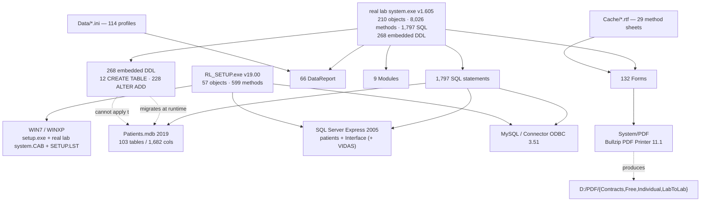

# Complete Reverse-Engineering Reference — RealLab V-CD-2019 (v1.605)

**Document ID:** RL-V2-REF-001
**Version documented:** `V-CD-2019` (see `../Version_Identity_and_Scope.md` §3)
**Evidence basis:** 473 verified artefacts from BATCH-04 → BATCH-11
**Analysis type:** Static only — no reference binary, installer, script or ActiveX control was executed.

---

## 1. System identity and scope

### 1.1 Identity

| Attribute | Value |
|---|---|
| Application | `real lab system` (distribution folder `RL_CD2019Access`) |
| Main executable | `real lab system.exe`, 76,292,096 bytes (72.76 MiB) |
| File version | **1.605** |
| Product description (PE) | **`RLS 1.605`** |
| Company name (PE) | **`RealLab`** |
| Build | PE32, 3 sections, linker 6.0, timestamp **2013-12-27** |
| Runtime | `MSVBVM60.DLL` (231 imported functions) |
| Installer | `RL_SETUP.exe` — VB6 v19.00, build **2020-09-01**, 23,060,480 bytes, 57 objects, 599 methods |
| Installation media | `WIN7\` and `WINXP\` targets — Microsoft VB6 Setup Toolkit bootstrap + `real lab system.CAB` (48 members) + `SETUP.LST` (39-file specification) |
| Official learning guide | `RLS_Learn.pdf` — "Real Lab System Guide Book", RealLab Co., **212 pages**, 510 headings, 7 modules |
| Official setup guide | `RLS_Setup.pdf` — 33 pages |
| Vendor identity | RealLab / AIS («ais group»), El-Mansoura, Egypt |

> **★ Note on the build date.** The executable carries the PE timestamp
> **2013-12-27**, the same as Version 1. Version 2's *product* is materially newer —
> installer 2020-09-01, learning guide 2017-04-26, payload 2019–2020 — but the
> executable was not recompiled after the shared build base. **The PE timestamp is
> not a version discriminator.**

### 1.2 Purpose and operational context

V-CD-2019 is the **second generation** of the RealLab laboratory information system.
Its operational model extends the single-site desktop LIS of Version 1 into a
**multi-branch, multi-engine, networked installation**:

| Extension | Detail |
|---|---|
| **Three database engines** | Access Jet 4, SQL Server Express 2005, MySQL — selected at install time |
| **Multiple attached databases** | The application's own catalogue is `patients`. The installer additionally attaches `Interface` and `VIDAS` — **`Interface` belongs to a separately installed "RealLab Interface" product**, and `VIDAS` is never characterised |
| **Branch model** | A master laboratory with reception branches; branch code embedded in the patient identifier at position 9 |
| **Web result delivery** | Results delivered to patients through **NATIGH.COM**, with an SMS subsystem |
| **Central management** | Statistics, attendance logging, work sheets, price lists, farm (microbiology) reporting |
| **PDF output** | Reports printed to a pinned external PDF printer driver |

### 1.3 Investigated scope

| Area | Status |
|---|---|
| Executable | **Fully analysed** — PE envelope, 210 objects, 8,026 methods, 270,166 literals, 1,797 SQL, 268 embedded DDL |
| Shipped database | **Extracted** — `Patients.mdb`, 103 tables / 1,682 columns |
| Schema migration | **Diffed** — 12 `CREATE TABLE` and 228 `ALTER TABLE ADD` statements reconciled against the shipped database |
| Deployment | **Fully analysed** — installer, both installation targets, `SETUP.LST`, VB6 SP6 redistributable, MDAC |
| Print / PDF | **Fully analysed** — 5 executables, envelope, signatures, licence texts, Inno payloads |
| Vendor documentation | `RLS_Learn.pdf` (212 pp.) and `RLS_Setup.pdf` (33 pp.) extracted; CHM confirmed byte-identical to Version 1 |
| Configuration | `BASE.ini`, `SETTING.ini`, `IDCARD.INI`, `REPORT.dll`, `NOTE.ini`, 223 `Data\*.ini` |
| Runtime behaviour | **Not observed** — static analysis only |

### 1.4 Known limitations

- **The official user manual was never updated.** `real lab system help.chm` is byte-identical to Version 1 (`SHA-256 624308649E523400…`, 5,193,985 bytes, 15 topics, zero changed characters) despite 41 new objects, a complete SMS subsystem and 10 new tables. **Every capability added in v1.605 is undocumented in the CHM.**
- **Five large Microsoft installers referenced by the deployment scripts are absent** from the inventoried tree: `SQLEXPR.EXE`, `msxml6_x86.msi`, `dotnetfx.exe`, `WI-KB893803-v2-x86.exe`, `mysql-connector-odbc-3.51.30-win32.msi`.
- **`RL_SETUP.exe` carries a 22.95 MiB embedded payload** at entropy 7.39 that was characterised but not decomposed.
- **`VIDAS` is attached but never structurally characterised.** A Visual FoxPro 6.0 runtime is present in the shipped VB6 SP6 redistributable manifest, but no structural link to `VIDAS` is established.
- **The shipped Access database is out of step with the executable** — 21 migration objects were never applied (see §6.9).

### 1.5 Evidence sources

| Source | Artefact set |
|---|---|
| `analysis/BATCH-04/` | Executable PE analysis, 210-object extraction, 1,797 SQL, 268 DDL, schema migration diff |
| `analysis/BATCH-05/` | `RL_SETUP.exe` analysis, `RLS_Learn.pdf` (212 pp.), `RLS_Setup.pdf`, `RL_Show.pdf` |
| `analysis/BATCH-06/` | Live screen recording (`RLS_Learn.wmv`, 35:20, 106 frames extracted) — **★ its window title reads `real lab system 1.0`, so it documents the Version 1 interface, not Version 2** |
| `analysis/BATCH-07/` | 2019 deployment payload — shipped `Patients.mdb` schema, `Data\*.ini`, `OCX\`, `bin\` |
| `analysis/BATCH-08/` | 29 RTF method sheets (byte-identical to Version 1) |
| `analysis/BATCH-09/` | 13 Flash training simulators (byte-identical to Version 1) |
| `analysis/BATCH-10/` | Installation media — both CAB targets extracted and hashed, `SETUP.LST`, VB6 SP6 redistributable |
| `analysis/BATCH-11/` | PDF/print stack — 5 executables, PE envelope, Authenticode, Inno payloads |
| `analysis/V-CD-2019/` | 15 consolidated V2 documents including the cross-version matrix |
| `inventory/ledger.csv` | 837-row integrity ledger; 473 rows attributed to V-CD-2019 |

### 1.6 Unresolved technical questions

| ID | Question | Status |
|---|---|---|
| RL-V2-Q-01 | What is the `VIDAS` database? | UNKNOWN |
| RL-V2-Q-02 | What is the `win32_processor` table for? | UNKNOWN — name suggests a WMI class query |
| RL-V2-Q-03 | What is the `loger` table? | UNKNOWN — attendance or audit |
| RL-V2-Q-04 | Is `Patient_samples` a tracking table or a sample store? | UNKNOWN |
| RL-V2-Q-05 | How are `grant13..grant17` and `useraccounts.gtype/hdd1/hdd2` used? | UNKNOWN — schema only |
| RL-V2-Q-06 | Is `LBC` a clinical profile? | UNKNOWN — name only |
| RL-V2-Q-07 | Does `loger` record clinical events or operator attendance? | UNKNOWN |
| RL-V2-Q-08 | What is the difference between the SQL `patients` table and the Access `patientinfo` table? | UNKNOWN |
| RL-V2-Q-09 | What are `insulin` and `antibio`? | UNKNOWN |
| RL-V2-Q-10 | What is the 22.95 MiB payload inside `RL_SETUP.exe`? | UNKNOWN |
| RL-V2-Q-11 | Are `Samples` / `reportview` / `mylabsetting` shared with Version 1? | Resolved — all three are Version 2 additions |
| RL-V2-Q-12 | Which of the 4 PDF output categories is the default? | UNKNOWN |

---

## 2. Technical architecture

### 2.1 The five layers

```
┌──────────────────────────────────────────────────────────────────────────────┐
│ L0  WRAPPER     real lab system.exe — PE32, 3 sections, MSVBVM60.DLL (231)     │
│                 RL_SETUP.exe v19.00 (2020-09-01) — 57 objects, 599 methods     │
│                 WIN7\ + WINXP\  — setup.exe (MS VB6 bootstrap) + .CAB + .LST  │
│                 System\PDF\   — .NET 4.0 + Bullzip + Ghostscript + Xpdf + PPT  │
│                 System\datareport_vh\ — VB6 SP6 redistributable (73 files)     │
│                 System\MDAC_TYP\    — MDAC TypeLib installer                   │
├──────────────────────────────────────────────────────────────────────────────┤
│ L1  IDENTITY    210 VB6 objects                                              │
│                 132 Forms │ 66 DataReport │ 9 Module │ 3 Class                 │
├──────────────────────────────────────────────────────────────────────────────┤
│ L2  LOGIC       8,026 declared methods · 270,166 string literals             │
│                 1,797 SQL statements · ★ 268 embedded DDL (schema migration)  │
├──────────────────────────────────────────────────────────────────────────────┤
│ L3  DATA        Access Jet 4 — Patients.mdb (103 tables / 1,682 cols)         │
│                 SQL Server Express 2005 — the application's catalogue is `patients`  │
│                 MySQL (Connector ODBC 3.51)                                   │
│                 Third attached database: `VIDAS`                              │
│                 Knowledge layer: testtable · normalrange · constanttable ·     │
│                 testunits · converts · abbreviations · subgrouptable           │
│                 Data\*.ini (223 layouts / 114 profiles) · Cache\*.rtf (29)     │
├──────────────────────────────────────────────────────────────────────────────┤
│ L4  BEHAVIOUR   ~60 documented capabilities in 7 modules (RLS_Learn.pdf)       │
│                 6 printer roles · 4 PDF output categories · SMS delivery      │
│                 Statistics · attendance · work sheets · branch accounting      │
└──────────────────────────────────────────────────────────────────────────────┘
```

### 2.2 Component dependency graph



### 2.3 The nine modules

| Module | Role | Evidence |
|---|---|---|
| `labdb` | Database maintenance — backup, restore, table creation | BATCH-01/02/04 |
| `labdb1` | Secondary database-maintenance procedures | BATCH-01/02/04 |
| `labfunction` | Accounting and stock-take calculations | BATCH-01/02/04 |
| `printerselect` | Printer enumeration and selection | BATCH-01/02/04 |
| `BCWFonts` | Laboratory display font handling | BATCH-01/02 |
| *(+4 V2-only modules)* | Object count rose 5 → 9; the four new module names are recorded in `analysis/BATCH-04/vb6/v1605/objects-full.txt` | BATCH-04 |

### 2.4 Runtime and library dependencies

| Component | Version / build | Evidence |
|---|---|---|
| `MSVBVM60.DLL` | 231 imported functions | `analysis/BATCH-04/vb6/v1605/` |
| Jet 4 engine | `msjet40.dll` + 11 companions | `analysis/BATCH-10/cab/` |
| 19 ActiveX controls | MSComctl, MSComct2, MSChrt20, MSDataGrd, MSDataLst, MSAdoDc, TabCtl32, ComDlg32, RichTx32, MCI32, MSComm32, MSFlxGrd, DBGrid32, RichEd32, MSDBRPtr, MSStdFmt, MSBind, + 3 Arabic-labelled controls | `analysis/BATCH-10/cab/` |
| ‹.NET Framework 4.0› | RTM, box stub, 50,449,456 B | `analysis/BATCH-11/pe-envelope.csv` |
| Bullzip PDF Printer | 11.1.0.2600 (BioPDF ApS) | `analysis/BATCH-11/` |
| GPL Ghostscript Lite | 9.14.17 (AGPL v3) | `analysis/BATCH-11/` |
| Xpdf Lite | 3.3.4 (GPL v2/v3) | `analysis/BATCH-11/` |
| PDF Power Tool | 4.0.0.11 (commercial) | `analysis/BATCH-11/` |
| OLE/COM | `oleaut32.dll`, `olepro32.dll`, `asycfilt.dll`, `stdole2.tlb` | `analysis/BATCH-10/cab/` |

### 2.5 Application startup and execution

Two distinct entry paths exist.

**Path A — end-user workstation:**

```
RL_SETUP.exe (installer)
   └─► real lab system.exe v1.605
         └─► start window «الصفحة الرئيسية» → login screen «شاشة التسجيل»
```

**Path B — installer (first run):**

```
RL_SETUP.exe v19.00
   ├─ EULA + licence acceptance (hardware-bound)
   ├─ Database engine choice: Access | SQL Server Express 2005 | MySQL
   ├─ Copy deployment payload → D:\real lab system\
   └─ Run System\SETUP1..5.bat + System\SetupPZ.bat + System\PDF\SetupP.bat
         ├─ SETUP1..5.bat → Windows Installer 3.1 · MSXML 6.0 · .NET 2.0
         │                  → SQL Server Express 2005 · MySQL ODBC 3.51
         ├─ SetupPZ.bat → .NET Framework 4.0 → Bullzip PDF Printer 11.1
         ├─ PDF\SetupP.bat → Bullzip PDF Printer (redundant, before .NET)
         └─ WIN7|WINXP\setup.exe /sc:\setup.log → Jet + VB6 + ActiveX + fonts
```

### 2.6 The installation specification — `SETUP.LST`

This is the **authoritative list of what the installation writes to the machine**.

```ini
[Bootstrap]
SetupTitle=Install
SetupText=Copying Files, please stand by.
CabFile=real lab system.CAB
Spawn=Setup1.exe
Uninstal=st6unst.exe
TmpDir=msftqws.pdw
Cabs=1

[Setup]
Title=RealLab
DefaultDir=$(ProgramFiles)\real lab system
AppExe=real lab system.exe
AppToUninstall=real lab system.exe
```

| Destination | Files | Contents |
|---|---:|---|
| `$(WinSysPathSysFile)` | 22 | `OLEAUT32.DLL` `OLEPRO32.DLL` `ASYCFILT.DLL` `VB5DB.DLL` + the 12 Jet 4 files |
| `$(WinSysPath)` | 16 | The 19 ActiveX controls + `MSDBRPTR.DLL` `MSSTDFMT.DLL` `MSBIND.DLL` |
| `$(Font)` | 5 | Laboratory fonts: `ais lab.ttf`, `ais symbol.ttf`, `MCS Taybah.ttf`, `WBCW_UPCEAN.ttf`, `WBCWS_UPCEAN.ttf` |
| `$(MSDAOPath)` | 1 | `dao360.dll` |
| **Total** | **39** | |

**Actions:** `$(DLLSelfRegister)` × **24** · `$(TLBRegister)` × 1 (`stdole2.tlb`) · `$(Shared)` × 31.

> **★ Two installation paths are now confirmed.**
> - **Program path:** `C:\Program Files\real lab system` (`SETUP.LST` `DefaultDir`)
> - **Data path:** `D:\Lab_data` (`Setup.bat` `cd\Lab_data`; `BASE.ini` `loca=E:\Lab_data`)
>
> These are **separate roots**, and the data path varies by installation.

### 2.7 The two installation targets — `WIN7` and `WINXP`

| Property | `WIN7` | `WINXP` |
|---|---|---|
| Members | 48 | 48 |
| Identical members (byte-for-byte) | **32** | **32** |
| Different members | **16** | **16** |
| Jet 4 build | 4.0.9756.0 (2009-07-14) | 2008-04-14 |
| `msvbvm60.dll` | 1,386,496 (2009) | 1,384,479 (2004) |
| `MSCOMM32.OCX` | 103,744 (6.0.81.69, 1998) | 120,648 (6.1.98.13, 2008) |
| `MSFLXGRD.OCX` | 244,024 (1998) | 259,912 (2008) |
| `msado27.tlb` | 98,304 (2010) | 81,920 (2008) |
| `MSCOMCTL.OCX` | 1,081,616 (2004) | 1,081,616 (2010) |

> **★ The entire Jet 4 engine differs between the two targets** — all 12 Jet files
> (`msjet40`, `msjint40`, `msjter40`, `msjtes40`, `msrd2x40`, `msrd3x40`,
> `msrepl40`, `mswdat10`, `mswstr10`, `vbajet32`, `dao360`, `expsrv`) — plus the
> VB6 runtime, two ActiveX controls and one TypeLib. The other 32 members are
> identical.
> (`MSCOMCTL.OCX` / `mscomctl.ocx` differ only in filename case; the SHA-256 is
> the same.)

### 2.8 The conflicting runtime builds — `OCX\` versus the CAB

| File | In the CAB | In `OCX\` | Newer |
|---|---:|---:|---|
| `msvbvm60.dll` | 1,386,496 (2009) | 1,384,479 (2004) | **CAB** |
| `msado27.tlb` | 98,304 (2010) | 81,920 (2008) | **CAB** |
| `MSCOMM32.OCX` | 103,744 (1998) | 120,648 (2008) | **`OCX\`** |
| `MSFLXGRD.OCX` | 244,024 (1998) | 259,912 (2008) | **`OCX\`** |

> **★ The CD ships two different builds of the same runtime components.** Because
> `Setup.bat` copies `OCX\` to the installation root **before** the CAB is
> executed, the final installed version depends on execution order — **the
> installation is not deterministic.**

---

## 3. Application interface

> Original Arabic labels are reproduced exactly as transcribed. English glosses are
> explanatory only.

### 3.1 Screens and windows

| Screen | Arabic title as found | Technical name | Evidence |
|---|---|---|---|
| Start-up | «الصفحة الرئيسية» | `start` (14 controls) | CHM `001.htm` |
| Login | «شاشة التسجيل» | `login` | CHM `002.htm` |
| Server settings | «نافذة اعدادات وبيانات السيرفر» | `server` (27 controls) | CHM `001.htm` |
| Main patient window | «الصفحة الرئيسية» | `patientmain` (84 methods) | CHM `003.htm` |
| Add patient | — | `addpatient` (192 methods) | CHM `003.htm` |
| Patient card | — | `CardFrm` (3), `CardFrmSetx` (29) | V2-only |
| Result entry (per profile) | «نوافذ ادخال نتائج التحاليل» | `result*` (30+ forms) | CHM `004.htm` |
| Reference ranges | «المعدل الطبيعي» | `testrange`, `normal_test`, `outtest` | CHM `008.htm` |
| Report setup | — | `reportsetup` (108), `reportsetup2` (69) | CHM `009.htm` |
| Send-out | «العينات المرسلة للخارج» | `sarfz` (35), `moenysharekat`, `moenymozafeen` | CHM `010.htm` |
| Accounting / stock-take | «حساب الدرج وعمل جرد» | `labfunction` | CHM `011.htm` |
| Backup | — | `labdb`, `labdb1` | CHM `backup.htm` |
| Work sheet | — | `workpaper`, `workpaper2` | V2-only |
| Statistics | «الإحصائيات ومتابعة أداء المعمل» | `statisReport` | V2-only |
| SMS sender | — | `SMSfrmsenderos` (139 methods) | V2-only |
| Attendance log | «تسجيل الحضور والانصراف» | `loger` | V2-only |
| Branch administration | — | `z_branchs` (21) | V2-only |
| Price list | «طباعة قائمة أسعار التحاليل» | `z_pricelists` (28), `pricelistsN` | V2-only |

### 3.2 The official module taxonomy — 7 modules

From `RLS_Learn.pdf` (212 pages, 510 headings), the vendor's own functional
organisation is:

| Module | Capability range | Content summary |
|---|---|---|
| **Patient** | 1-1 … 1-13a | Registration, account settlement, result entry, consolidated reports, farm reports, patient search, visit history, follow-up, **NATIGH.COM delivery**, medical history |
| **Work Sheet** | 2-1 … 2-2 | Work sheet over a patient group in a period; work sheet over a test or test group in a period |
| **System** | 3-1 … 3-11 | Test data and prices, new test, reference values, price lists, printing price lists, attendance, farm reporting, antibiotic catalogue |
| **Server** | 4-1 … 4-6 | Laboratory statistics and performance monitoring, patient-count statistics by month/year/sex, request-rate statistics, sample counting, **stock-take** |
| **Accounting** | 5-1 … 5-5 | Period stock-take of laboratory income, **multi-branch stock-take**, stock-take by treating physician or referring party, stock-take of send-out samples, send-out account reconciliation |
| **General** | 6-1 … 9-7 | System settings, report settings, report margins, **paper size (A4/A5)**, report header/footer, report head/footer colours, **printer configuration**, default account type, connection settings, background settings, **sample splitting and withdrawal** |
| *(outside the index)* | — | NATIGH account creation for physician and laboratory, user and administrator management, attendance registration, referring-party creation, farm creation, antibiotic catalogue, fixed comments, test-group creation, treating-physician creation, send-out samples |

> **★ The gap between the two official document sets is the single most important
> documentation finding for this version:**
>
> | Document | Pages | Capabilities |
> |---|---|---|
> | `real lab system help.chm` (in-application) | 15 topics | 15 |
> | `RLS_Learn.pdf` (vendor guide) | **212 pages** | **~60 in 7 modules** |
> | Difference | — | **11 capabilities documented in the PDF but absent from the CHM** |

### 3.3 The capabilities the CHM does not document (V2 additions)

| Capability | Arabic label from `RLS_Learn.pdf` | Evidence |
|---|---|---|
| Web result delivery | «تسليم نتائج المرضى عن طريق موقع نتتيجة (NATIGH.COM)» | `Natigh` file, `SMSSender`, `sms*` tables, `ReportSMS` |
| Branch management | «نظام الفروع للمعامل» | `Labbranch`, `Patient.branche`, `SUBSTRING(patientid,9,1)`, `Branch_Data.mdb` |
| Statistics | «الإحصائيات ومتابعة أداء المعمل» | `statisReport`, `loger` |
| Attendance | «تسجيل الحضور والانصراف لمعرفة حركة المستخدمين في الدخول والخروج» | `loger`, `loggroup` |
| Work sheet | «عمل ورقة عمل لمجموعة من المرضى في فترة زمنية محددة» | `workpaper`, `workpaper2`, `wasl` |
| Farm reporting | «إدخال نتائج تقارير المزارع» | `sharekat`, `sharekathesab`, `sarfz` |
| Antibiotic catalogue | «إضافة مضاد حي للمزرعة» | `antibiotic` (38 rows / 25 cols), `antibio` (96 rows), `cultures` |
| Sample splitting | «فصل وسحب العينات» | `cultures`, `cultureanti`, `sample` |
| Default account type | «ضبط نوع الحساب الافتراضي للنظام» | `pricemethod` — **the value domain is NOT ESTABLISHED** (0 hits for the three previously-cited values across 1,337 SQL literals; `patientinfo` has 0 rows). The **four PDF output categories** are a separate, evidenced taxonomy |
| Connection settings | «إعدادات الاتصال (رأس وذيل الاتصال - هوامش الاتصال)» | `IDCARD.INI`, `SETTING.ini` |
| Payment-method selection | — | `payment` type column, `pricemethod` |

### 3.4 Printer and PDF interface

**Six logical printer roles** (three in Version 1, three added in Version 2):

| Role | Identifier | Status |
|---|---|---|
| Report printer | `reportprinter` | Both versions |
| Report printer (alternate) | `reportprinterx` | Both versions |
| Barcode printer | `barcodeprinter` | Both versions |
| **ZARF** | `zarfprinter` | Both versions |
| **WASL** | `waslprinter` | **V2 only** |
| **ID card** | `IDprinter` | **V2 only** |

Supporting structures: `EnumPrintersA`, `SetDefaultPrinterA`, `imlPrinters` × 6,
`cboPrinters`…`cboPrinters5` (five selection comboboxes), `onePrinter`,
`check_onePrinter`, `selectprinter`, `printerselect` module (16 methods).

**Four PDF output categories:**

| Category label | Output directory |
|---|---|
| `Contracts` | `D:\PDF\Contracts\` |
| `Free` | `D:\PDF\Free\` |
| `Individual` | `D:\PDF\Individual\` |
| `Lab To Lab` | `D:\PDF\LabToLab\` |

**Hard-coded strings inside `real lab system.exe` v1.605:**

| Offset | String |
|---|---|
| `0x6A2486` | `Bullzip PDF Printer` |
| `0x6A255E` | `Bullzip PDF Printer 11.1 - Create File` |

### 3.5 Result-entry interface — the extended model

Version 2 keeps the Version 1 model (profile-scoped entry, automatic abnormal and
critical classification) and adds:

| Addition | Detail |
|---|---|
| `patienttest.resultreview` | Explicit Boolean review flag — the release gate, directly observable here |
| `patienttest.NatighU` | NATIGH delivery flag — **the DDL that adds it was never applied to the shipped database** |
| New profile windows | IgE allergy (231 methods), H. pylori (83), PCR (37), LBC (33), FMF (48), automated urine (184) |
| `IgEallergy` item model | `Item1`…`Item40+` each with `RESULT`, `Class`, `TypeF` — **a repeatable-group pattern, not a flat analyte list** |

### 3.6 The media and print configuration surface

| Setting | Location | Values observed |
|---|---|---|
| Paper size | `SETTING.ini [setup] papersize` | `A4` |
| Report printer | `SETTING.ini [selectprinter] reportprinter` | `Send To OneNote 2007` (V1 value) |
| Profile printer | `Data\*.ini [setupx] reportprinterx` | `HP LaserJet 1100 (MS)` (108 profiles) |
| Report margins | `Data\*.ini` | `leftvalue`, `rightvalue`, `topvalue`, `bottomvalue` |
| Report header/footer | `Data\*.ini` | `formsubtitle`, `reportmaintitle` |
| Header/footer colours | `Data\*.ini` | `colora` … `colort` (20 entries) |
| Background | `Data\*.ini` | `backcolor` |
| Global colour palette | `REPORT.dll` | `color1` … `color19` |
| Report header texts | `SETTING.ini` | `Textr1txt=المنظومة البرمجية`, `Textr2txt=ريال لاب سيستم` |
| Report sequence origin | `SETTING.ini [setup] reportstart` | `1984` |
| Branch scoping | `SETTING.ini [setup] labbranchx` | `1` |
| Barcode auto-create | `SETTING.ini [setup] barcodeauto` | `1` |
| Work-sheet printing | `SETTING.ini [setup] printworkpaper` | `1` |
| History display mode | `SETTING.ini [setup] historytype` | `0` |

---

## 4. Internal processing and workflows

> Reconstructed from evidence. **Not observed executions.**

### WF-V2-01 — Patient episode (extended)

```
1. Sign in                → loggroup + branch scope
2. Register patient       → patientinfo (33 cols + branch + grant13..17)
3. Barcode                → barcodes
4. Order tests            → patienttest (testcode, subgroupcode, branch-derived id)
5. Enter result           → profile table + patienttest
6. Confirm (F8)           → patienttest.resultreview
7. Print                  → Bullzip PDF Printer → D:\PDF\<category>\
                             print audit: printuser / printdate / printnum
8. Hand over              → payment + patienttest.give
9. [V2] Deliver digitally → NATIGH.COM / SMS via SMSSender
```

### WF-V2-02 — Multi-branch operation

```
patientid layout:  <prefix><branch digit at position 9><suffix>
   └─ SUBSTRING(patientid,9,1) extracts the branch
   └─ Patient.branche names the branch
   └─ Labbranch holds branch master data
   └─ Branch_Data.mdb (49 schema-only tables) seeds a new branch's profile tables
   └─ The stock-take can be run across several linked branches
```

> **★ The branch digit occupies position 9 of a 13-character identifier.** In
> Version 1 the identifier had positional semantics but **no documented branch
> segment**. The same mechanism therefore serves a different purpose in each
> version — the identifier layout is a **de-facto data contract** that changed
> meaning between releases.

### WF-V2-03 — PDF report production

```
Result reviewed (resultreview)
   └─► print request
        └─► printer resolution: Bullzip PDF Printer (hard-coded device name)
             └─► Bullzip port driver bzpdf.dll
                  └─► bundled Ghostscript renders the PostScript
                       └─► file written to D:\PDF\<Contracts|Free|Individual|LabToLab>\
                            └─► audit: printuser / printdate / printnum
```

**Independent tools shipped alongside (never invoked by the application — confirmed
by literal search):** GPL Ghostscript Lite 9.14.17, Xpdf Lite 3.3.4 (`pdftops.exe`),
PDF Power Tool 4.0.0.11.

### WF-V2-04 — Statistics and performance monitoring

```
statisReport
   ├─ patient count by month / by year, split by sex      → patientinfo.requestdate, patientinfo.patientsex
   ├─ request rate for a test group                       → patienttest.subgroupcode
   └─ sample count for the year                           → patienttest
```

### WF-V2-05 — Attendance and session log

```
loggroup   ── login groups
loger      ── new table in v1.605; the vendor guide describes
             «تسجيل الحضور والانصراف لمعرفة حركة المستخدمين في الدخول والخروج»
```

### WF-V2-06 — Work sheet

```
workpaper / workpaper2 / wasl
   ├─ work sheet over a patient group in a date period
   └─ work sheet over a test or test group in a date period
```

### WF-V2-07 — NATIGH / SMS result delivery

```
Natigh (installed file)
SMSSender  (table: SMSautonum, patientid, PatDrName, requestdate,
            smsMobile, SMSLength, SMStext)
SMStemplate(table: templatenum, smstext)
smsgroups  (table: ID, grouptype, smsgroup)
smslist    (table: ID, smstype, smsphone, smsname, smsgroup)
SMSfrmsenderos (form, 139 methods)
ReportSMS
   └─► patient receives the result through the NATIGH.COM site
   └─► receipt header/footer rendered per IDCARD.INI / SETING.ini
```

### 4.1 Error handling in v1.605

| Condition | Behaviour | Evidence |
|---|---|---|
| Database server not defined | «خادم قواعد البيانات غير معرف» → closes on **موافق** | CHM `001.htm` (identical to V1) |
| Non-English date locale | «رجاء تحويل التاريخ الى اللغة الانجليزية» → closes | CHM `001.htm` (identical to V1) |
| No printer available | «Can't find any printer.» | `literals.tsv` |
| Printer API failure | «SetPrinter Failed. Error code: » | `literals.tsv` (V1 only) |
| Result has no verified tests | «Not found any Verified selected tests or result to print it» | `literals.tsv` @ PDF cluster |
| Migration DDL cannot apply to Jet | Silently inapplicable — see §6.9 | DDL analysis |
| Bullzip printer absent | PDF output path fails — **no fallback is evidenced** | literal analysis |

### 4.2 The runtime schema-migration mechanism

**★ The single most consequential architectural difference between the two versions.**

Version 1 has **zero** DDL statements. Version 1.605 embeds **268**:

| Statement class | Count | Effect |
|---|---:|---|
| `CREATE TABLE` | 27 statements → **12 distinct tables** | Create new tables |
| `ALTER TABLE ADD` | **228 statements** → **132 distinct column targets** across 29 tables | Add columns |
| | Column type changes | 13 | `ALTER COLUMN` |

**The migration runs at application start-up and migrates the database in place.**

The DDL is written in **SQL Server syntax**. Concretely:

- `bigint IDENTITY(1,1) NOT NULL` — SQL Server identity syntax; **Jet 4 rejects it.**
- `AUTOINCREMENT(1, 1)` — the Access equivalent, emitted as a second variant of the same statement.
- `sp_rename` — SQL Server system procedure; **not available in Jet 4.**
- `ALTER COLUMN` — SQL Server syntax for changing a column type; **Jet 4 uses `ALTER COLUMN` differently and does not support the type-change form used here.**
- `varchar(MAX)` — SQL Server 2005+; **Jet 4 has no `MAX` length.**

The shipped `Patients.mdb` shows **both variants of each statement** — the SQL Server
form and the Access form — which indicates the application attempts the
SQL-Server-specific statement first and then an Access-compatible one.

> **★ Consequence:** on a Jet 4 installation the SQL-Server-specific statements
> fail, and the Access-compatible variants are used where they exist. Where only
> the SQL Server form exists, the change is **silently not applied**.

### 4.3 The migration, reconciled against the shipped database

**Every one of the 268 statements was reconciled against the actual shipped
`Patients.mdb` (103 tables / 1,682 columns).**

**Created tables — 12 targets:**

| Result | Tables |
|---|---|
| **Applied — present in the shipped DB (10)** | `Helicobacter`, `SMSSender`, `SMStemplate`, `hba1c`, `pictures`, `ratios`, `smsgroups`, `smslist`, `testtemp`, `widal2` |
| **NOT applied — absent (2)** | **`FMF`**, **`LBC`** |

**Added columns — 132 distinct targets across 29 tables:**

| Result | Count | Detail |
|---|---:|---|
| **Applied — present in the shipped DB** | **109** | across 26 tables |
| **NOT applied — absent** | **19** | see below |

The 19 unapplied column targets:

| Table | Column(s) | Reason |
|---|---|---|
| `BloodGases` | `aniongap`, `ctco2`, `cthb`, `fio2`, `hco3std`, `po2aa1`, `po2aa2`, `temprat` | **8 of 8 absent** — the whole blood-gas extension is missing |
| `Helicobacter` | `hpab`, `hpbiop`, `hpiga` | Table exists but its three extended columns do not |
| `IgEallergy` | `item12`, `item24`, `item36` | **`IgEallergy` table absent from the shipped DB entirely** |
| `Proelectrophoresis` | `beta2`, `immunolgo` | Absent |
| `lipids` | `nonhdl` | Absent |
| `patienttest` | `natighu` | Absent — **the NATIGH delivery flag does not exist in the shipped database** |
| `pregnancy` | `normalrange3` | Absent |
| `urine` | `testid` | Absent |
| `useraccounts` | `gtype`, `hdd1`, `hdd2` | **`useraccounts` table absent from the shipped Access DB entirely** |

> **★ The forensic conclusion.**
> 1. The migration was applied **partially** — 109 of 132 column targets and 10 of
>    12 created tables.
> 2. **19 column targets and 2 tables were never applied.**
> 3. Two of the failures are **structurally explained**: `IgEallergy` and
>    `useraccounts` are referenced by the code but **do not exist in the shipped
>    Access database at all** — so the features that depend on them (IgE allergy
>    reporting, the permission-bit model) would fail against this database.
> 4. `patienttest.natighu` missing means the **NATIGH delivery flag has no column**
>    in the shipped schema — the feature is code-present but schema-absent.
> 5. `BloodGases` is missing **all 8** of its new columns.
>
> **This is not a configuration difference — it is a shipped database that does not
> match the executable that reads it.**

---

## 5. Configuration and persistence

### 5.1 Configuration file inventory (V2 additions marked)

| File | Purpose | V2 change |
|---|---|---|
| `bin\BASE.ini` | Engine selection, data path, connection identity, last range id | — |
| `bin\SETTING.ini` | Printer roles, paper, headers, toggles | **extended** |
| `bin\IDCARD.INI` | Card / invoice layout and text | **extended** — NATIGH receipt header/footer |
| `bin\REPORT.dll` | 19-entry report colour palette (text, not a library) | — |
| `bin\NOTE.ini` | Last-notice state | — |
| `bin\data_connection*.udl` | SQL Server connection strings | — |
| `Data\*.ini` (223) | Report layout per profile | **173 of 223 differ from V1** |
| `Cache\*.rtf` (29) | Method sheets | **byte-identical to V1** |
| `System\SETUP1..5.bat` | Microsoft prerequisite installers | **V2 only** |
| `System\SetupPZ.bat` | .NET 4 + Bullzip | **V2 only** |
| `System\PDF\SetupP.bat`, `SetupFN4.bat` | PDF-stack installers | **V2 only** |
| `WIN7\SETUP.LST`, `WINXP\SETUP.LST` | Installation specification | **V2 only** |
| `System\datareport_vh\*` (73) | VB6 SP6 redistributable | **V2 only** |
| `System\MDAC_TYP\MDAC_TYP.EXE` | MDAC TypeLib installer | **V2 only** |

### 5.2 `BASE.ini` — database selection

```ini
[oledb]
Databasetype=XMSACCESSX      ; MS Access (X = enabled)
loca=E:\Lab_data
DataSource=DESKELTEL
PersistSecurityInfo=True
UserID=sa
Password=[REDACTED]
InitialCatalog=Patients
[Initial]
Initialw=123
nrls=605
drls=0
```

> The `X…X` toggle encoding around the engine name (`MSACCESS`) is the same
> mechanism that selects SQL Server or MySQL. `nrls` / `drls` record the last
> modified range identifiers — a **data-integrity counter for the knowledge table**.

### 5.3 SQL Server connection strings

```ini
[oledb]
Provider=SQLOLEDB.1;Integrated Security=SSP;Persist Security Info=False;
User ID=sa;
Initial Catalog=C:\PROGRAM FILES\AUTOMATIC HEMATOLOGY ANALYZER\
                  AUTOMATIC HEMATOLOGY ANALYZERDATABASE\BF6500.DBMDF;
Data Source=REALLAB_AIS;
Initial File Name=D:\Lab_data\bf6500.db.mdf
```

```ini
[oledb]
Provider=MSDataShape.1;Persist Security Info=True;
User ID=sa;Password=[REDACTED];
Initial Catalog=Patients;
Data Provider=SQLOLEDB.1;Data Source=REAL_LAB
```

> **★ `BF6500` / `AUTOMATIC HEMATOLOGY ANALYZER` reveals the pre-rebranding product
> name.** The same credential (`sa` / `[REDACTED]`) and the same
> `PersistSecurityInfo=True` are present in Version 2 as in Version 1.

### 5.4 Persistence mechanisms

| Mechanism | V2 detail |
|---|---|
| Access Jet 4 | `Patients.mdb` — 103 tables / 1,682 columns |
| SQL Server Express 2005 | The application's catalogue is `patients`. `Interface` is attached separately and appears to belong to a separate "RealLab Interface" product |
| MySQL | Connector ODBC 3.51 |
| Third SQL database | `VIDAS` — attached by `D:\Lab_data\Attach_VIDAS.bat` |
| Branch seeding | `Branch_Data.mdb` — 49 schema-only tables, 0 rows |
| In-place schema migration | 268 embedded DDL statements at start-up |
| Knowledge persistence | `.ini`, `.rtf`, database tables — all plain text or tabular |
| Programmatic backup | `labdb` / `labdb1` |
| Attach scripts | `D:\Lab_data\Attach_Interface.bat`, `Attach_Patients.bat`, `Attach_VIDAS.bat` |

---

## 6. Database and data structures

### 6.1 Technology

Access Jet 4 (`.mdb`), with SQL Server Express 2005 and MySQL as alternatives.
Connectivity via the Jet OLE DB provider, `SQLOLEDB.1` and `MSDataShape.1` (the
"shape" provider that executes `SHAPE {…} APPEND (…)` union queries).

### 6.2 Store inventory

| Store | Tables | Columns | Rows | Change vs V1 |
|---|---:|---:|---:|---|
| `Patients.mdb` (2019) | **103** | **1,682** | — | **+10 tables, +155 columns** |
| `Branch_Data.mdb` (2019, `bin\` copy) | 49 | — | 0 | **byte-identical to V1** (SHA-256 `f6d6d5e2…`) |
| `Branch_Data.mdb` (2019, `System\` copy) | — | — | 0 | **the narrower second template** (966,656 B, SHA-256 `e6c3953e…`) |
| `Patients_backup.mdb` | 90 | 1,381 | 2,786 | **unchanged — still stale** |
| `data.mdb` | 3 | — | — | — |
| SQL `patients` | — | — | — | — |
| SQL `Interface` | — | — | — | — |
| SQL `VIDAS` | — | — | — | — |

### 6.3 The ten new tables

| Table | Column count | Purpose | Evidence |
|---|---:|---|---|
| `Helicobacter` | 7 | *H. pylori* results — `hpab`, `hpagi`, `hpigm`, `hpag`, `hpbiop`, `hpiga`, `comment` | DDL + SQL |
| `insulin` | — | Insulin assay results | SQL |
| `patienttestgroup` | — | Test-grouping entity | SQL |
| `SMSSender` | 14 | SMS message queue | DDL |
| `SMStemplate` | 4 | SMS message templates | DDL |
| `smsgroups` | 6 | SMS recipient groups | DDL |
| `smslist` | 10 | SMS recipient list | DDL |
| `MyLabSetting` | — | Laboratory-level settings (`LabID`) | SQL |
| `testtemp` | 1 | Temporary test rows | DDL |
| `Paste Errors` | — | Clipboard/paste error capture | SQL |

### 6.4 The extended `patienttest` — 2019

The V2 `patienttest` gains, over Version 1's 44 columns:

| Field | Type | Purpose |
|---|---|---|
| `Timeout` | Text | Per-test turnaround timeout (free text) |
| `Taketime` | Integer | Time taken for the test |

> **★ Correction — the permission bits are on the OPERATOR table, not on
> `patienttest`.** The v1.605 DDL adds `branche` (Integer), `SecWord` (Text) and
> `grant13`…`grant17` (Boolean) to the table named **`Patients`** — which is the
> **operator table** (`patientusname`, `patientword`, `patientad`, `grant1`…`grant12`,
> `startwork`, `endwork`), not `patientinfo` and not `patienttest`. The shipped
> 2019 operator table has **35 columns**: the 26 of Version 1 plus those 9.
>
> **★ And the branch is assigned to the OPERATOR.** `patients.branche` (Integer)
> holds the branch, and the branch digit is written into **position 9 of the
> patient identifier** that the operator creates. **The branch is therefore an
> attribute of the workstation's operator, not of the patient.**
>
> `patienttest.NatighU` — the NATIGH delivery flag — is **DDL-added and absent
> from the shipped database**.

> The `grant13`–`grant17` bit flags **extend** a permission model that **already
> existed in Version 1**. Version 1's operator table `patients` carries
> **`grant1`…`grant12`** plus `patientad` and `patientus`. Version 1 also already
> recorded operator attendance on that same table (`startwork`, `endwork`,
> `breakyorn`, `breaktime`).
> **Correction to the earlier narrative:** Version 1 is **not** a bare login gate —
> it has a twelve-bit function-level permission model and an attendance mechanism.
> V-CD-2019 extends the permission model to seventeen bits, adds `branche` and
> `SecWord` to the same table, and adds a **separate** `loger` event table.

### 6.5 The extended `patientinfo` — 2019

The V2 `patientinfo` gains 7 columns, including **`gehaname`** — the referring-party
name — and `branch`. `Gehats` gains `ReferredPW` (20) and `ReferredID` (int).

> `ReferredPW` = **referred by physician**, and `mowzaf` now names a treating
> physician as a distinct concept from a referring party. **Version 2 splits the
> Version 1 single referring-party concept into party and physician.**

### 6.6 `IgEallergy` — a repeatable-group pattern

| Pattern | Detail |
|---|---|
| Item model | `Item1` … `Item40+` (plus `RESULT`, `Class`, `TypeF` per item) |
| DDL form | The `ALTER` statement adds **four items at a time** — `Item12`+`RESULT12`+`Class12`+`TypeF12` … `Item15` |
| Application | `resultIgeAllergy` form (231 methods), `ReportIGE1` / `ReportIGE1s` |
| Shipped status | **`IgEallergy` is ABSENT from the shipped 2019 database** — the table was never created |

> **★ This is the clearest single illustration of the migration failure:** a
> complete feature — a 40-item allergy panel with its own entry form and its own
> report — exists in the code, its table definition exists in the embedded DDL, and
> **the table is not in the shipped database.**

### 6.7 The profile tables — the extension set

Version 2 keeps all Version 1 profile tables and adds the DDL targets
`hba1c` (HbA1c), `ratios`, `widal2`, `FMF` (absent), `LBC` (absent), plus the
code-referenced `insulin`, `IgEallergy` (absent) and `culturesec`.

| Addition | Status in the shipped DB |
|---|---|
| `hba1c` | **present** (created by the applied DDL) |
| `ratios` | **present** |
| `widal2` | **present** |
| `FMF` | **ABSENT** — DDL created it, but it is not in the shipped DB |
| `LBC` | **ABSENT** — DDL created it, but it is not in the shipped DB |
| `IgEallergy` | **ABSENT** — referenced by code and DDL, never present |
| `insulin` | **present** (not created by the DDL — it ships in the base schema) |

### 6.8 Knowledge layer — unchanged

`testtable` (609 tests), `normalrange` (**852 ranges — identical count in both
versions**), `constanttable` (`CBCCONS` 3.3/6.25/6.75/7.5/8.25; `PTCONS`
12/35/1.33/`2CVJW`), `testunits` (69), `converts` (167), `abbreviations` (650),
`subgrouptable` (46).

> **★ The clinical knowledge layer is the one layer that did not change between
> 2013 and 2020.** The same 609 tests, the same 852 ranges, the same constants.
> This is the strongest single piece of evidence for the architectural conclusion
> in §10.

### 6.9 The shipped-database / executable mismatch — summary

| Object class | In the DDL | Applied and present | Not applied |
|---|---:|---:|---:|
| Created tables | 12 | **10** | **2** — `FMF`, `LBC` |
| Added columns | 132 | **109** | **19** |
| | Column type changes | 13 | not separately reconcilable | — |

**Consequences visible in the shipped database:**

1. `IgEallergy` — **table absent**; the entire IgE allergy feature has no storage.
2. `useraccounts` — **table absent from the Access database**; the V1 `useraccounts`
   reference in the DDL points at the SQL Server table of the same name. **The
   Access installation has no user table in the shipped file.**
3. `patienttest.natighu` — **column absent**; NATIGH delivery has no flag.
4. `BloodGases` — **all 8 new columns absent**; the extended blood-gas panel is missing.
5. `Helicobacter` — 3 of its extended columns absent.
6. `FMF`, `LBC` — **tables absent**.
7. `lipids.nonhdl`, `pregnancy.normalrange3`, `urine.testid`, `Proelectrophoresis.beta2/immunolgo` — absent.

> **The shipped Access database is a *partial* deployment of the v1.605 schema.**

### 6.10 Status, history and audit structures

| Structure | V2 detail |
|---|---|
| `history` | 25 columns — unchanged from V1 |
| `loggroup` | 2 columns — unchanged; now also carries attendance context |
| **`loger`** | **New in V2.** The vendor guide describes «تسجيل الحضور والانصراف» |
| `patienttest` print audit | `resultprint`, `printuser`, `printdate`, `printnum` — unchanged |
| `patienttest` handover audit | `give`, `taslimuser`, `taslimdate` — unchanged |
| `patienttest` edit audit | `edituser`, `editdate`, `prevuser`, `prevdate` — unchanged |
| `patienttest` review | `resultreview` — **explicit in V2** |
| `SMSSender` | An **outbound-message audit**: `smsMobile`, `SMStext`, `SMSLength`, `requestdate` |
| `reportview` | 42 columns — saved report views |
| `MyLabSetting` | Laboratory-level configuration |

---

## 7. Reports and printing

### 7.1 Report types

| Kind | Count | Mechanism |
|---|---:|---|
| `DataReport` design objects | **66** (V1: 45) | VB6 DataReport bound to `Data\*.ini` layouts |
| Printed clinical profiles | **114** categories | One `.ini` layout each (223 files) |
| Report layouts by discipline | — | MICROBIOLOGY (18), MOLECULAR BIOLOGY (16), BIOCHEMISTRY (15), HEMATOLOGY (9), ENDOCRINOLOGY (6), SEROLOGY (5), IMMUNOLOGY (2) + 17 more |
| Method sheets | 29 | `Cache\*.rtf` — byte-identical to V1 |
| Interactive training simulators | 13 | `Cache\*.exe` — byte-identical to V1 |
| Consolidated reports | — | `Reportanyreport` using `SHAPE … APPEND` union queries |
| Price lists | — | `pricelistsN` (V2 only) |
| Specialty reports | — | `ReportPCR`, `ReportIGE1`, `ReportFMF`, `ReportLBC`, `ReporturineAuto`, `ReportZN`, `ReportTestTime`, `ReportPatPhone`, `Reportliver7his`, `Reportmony01/11/5` |
| Patient ID card | — | `CardFrm`, `CardFrmSetx` (V2 only) |
| Patient visit report | — | `RPTPatientVisit` (V2 only) |
| SMS report | — | `ReportSMS` (V2 only) |

### 7.2 Report generation mechanism

Unchanged in principle from Version 1:

```
DataReport design object (66)
  + Data\*.ini layout for the profile (114)
  + patienttest / profile-table values
  ──────────────────────────────────────► rendered page
```

### 7.3 Print workflow

1. **F11** preview / **F12** print.
2. `printerselect` resolves the printer — from `Data\*.ini [setupx] reportprinterx`
   or `SETTING.ini [selectprinter]`.
3. The `DataReport` engine renders using `Data\*.ini [reportdata]`.
4. Dispatch — to a physical printer, to `Send To OneNote 2007`, or to
   **`Bullzip PDF Printer`**.
5. The print is recorded on the test row.

### 7.4 ★ The PDF export path — V2-specific and architecturally significant

**Mechanism:** the application prints to the Windows printer named
`Bullzip PDF Printer`. The Bullzip port driver (`bzpdf.dll`) renders the output via
its bundled Ghostscript and writes the PDF to disk.

**Hard-coded dependencies inside `real lab system.exe` v1.605:**

| Offset | Literal | Consequence |
|---|---|---|
| `0x6A2486` | `Bullzip PDF Printer` | The **device name** must match exactly |
| `0x6A255E` | `Bullzip PDF Printer 11.1 - Create File` | The **default output filename** is version-pinned to 11.1 |

**Output taxonomy:** `D:\PDF\Contracts\`, `D:\PDF\Free\`, `D:\PDF\Individual\`,
`D:\PDF\LabToLab\` — four categories matching the accounting methods
(`Lab To Lab` / `Individual` / `Free` / contracted work).

**Installation chain:** `SetupPZ.bat` → ‹.NET Framework 4.0› → Bullzip 11.1.

> **★ Three documented installation defects:**
> 1. `RL_SETUP.exe` calls `System\PDF\SetupP.bat` (Bullzip only) **before**
>    `System\SetupPZ.bat` (‹.NET 4› then Bullzip) — so Bullzip is installed once
>    **before its .NET 4 dependency exists**.
> 2. `SetupFN4.bat` — installs .NET 4 but is **invoked by nobody**, and its relative
>    path (`dotNetFx40_Full_x86_x64.exe`) is missing the `System/PDF/` prefix.
> 3. `setup.exe` is launched with `/sc:\setup.log` and **without `/wait`**.

**No fallback is evidenced:** if the Bullzip printer is absent or renamed, the PDF
path fails.

### 7.5 Independent PDF tools shipped in `System\PDF\`

| Tool | Version | Licence | Signed | Role |
|---|---|---|---|---|
| GPL Ghostscript Lite | 9.14.17 | **AGPL v3** | ✘ | Manual PDF/PostScript processing |
| Xpdf Lite | 3.3.4 | **GPL v2/v3** | ✘ | `pdftops.exe` — PDF→PostScript |
| PDF Power Tool | 4.0.0.11 | Commercial | ✘ | PDF manipulation |
| Bullzip PDF Printer | 11.1.0.2600 | Commercial | ✔ BioPDF ApS (SHA-1) | The actual PDF printer |
| ‹.NET Framework 4.0› | RTM | Microsoft EULA | ✔ Microsoft (SHA-1) | Runtime prerequisite |

> **Confirmed by literal search: the application invokes none of Ghostscript,
> Xpdf or PDF Power Tool.** They are operator tools shipped alongside.

### 7.6 Export mechanisms

| Mechanism | Status |
|---|---|
| Print to a laboratory printer | CONFIRMED |
| Print to "Send To OneNote 2007" | CONFIRMED |
| **PDF export via Bullzip** | **CONFIRMED — V2 only** |
| Print to file | NOT ESTABLISHED |
| Report to e-mail | NOT ESTABLISHED — but `smsMobile`/`SMStext` provide a result-delivery channel |

### 7.7 Print audit

`patienttest.resultprint` · `printuser` · `printdate` · `printnum` (a Double —
a sequential report counter) plus the absolute origin `SETTING.ini [setup]
reportstart=1984`.

---

## 8. Users, permissions and security

### 8.1 User and permission structures

| Structure | V2 detail |
|---|---|
| `useraccounts` | **Not present in the shipped Access database — and not present in any `.mdb` in either version.** Referenced by the DDL as a SQL Server table with `Gtype`, `HDD1`, `HDD2` (note the spelling). The **Access**-mode operator table is `patients` — **26 columns in Version 1, 35 in V-CD-2019** — with `grant1`…`grant17`, `branche`, `SecWord`, `startwork`, `endwork`, `breakyorn`, `breaktime` |
| `loggroup` | Login group — unchanged |
| **`loger`** | **New in V2** — attendance / event log |
| `patienttest.grant13` … `grant17` | **New in V2** — per-user permission bits |
| `useraccounts.gtype/hdd1/hdd2` | **New in V2** — role and permission descriptors |
| `users` form | 57 methods in V2 |
| `userspw` form | Password change |

> **★ The permission model changed materially in V2.** Version 1 had a login gate
> plus `useraccounts`. Version 2 adds **five boolean permission bits per test row**
> and a `gtype`/`HDD1`/`HDD2` descriptor on the account. **This is the first
> function-level access control in the product's history.**

### 8.2 Authentication

Unchanged in substance from Version 1 — a login window, a documented `admin` first-run
account, a shared static database credential, no evidence of hashing, expiry, or
lockout.

### 8.3 Security-relevant findings — V2

| ID | Finding | Evidence | Classification |
|---|---|---|---|
| RL-V2-SEC-01 | **Database password in clear text** in `BASE.ini` and `data_connection1.udl` (`[REDACTED]`), still present in the 2019 payload | `analysis/BATCH-07/`, `analysis/BATCH-10/` | CONFIRMED |
| RL-V2-SEC-02 | Application connects as `sa` | same files | CONFIRMED |
| RL-V2-SEC-03 | `PersistSecurityInfo=True` | `BASE.ini` | CONFIRMED |
| RL-V2-SEC-04 | **SQL Server Express 2005 is installed and listens on the network** | `Setup*.bat` | CONFIRMED |
| RL-V2-SEC-05 | **24 ActiveX components self-register into the Windows registry** on install | `SETUP.LST` `$(DLLSelfRegister)` × 24 | CONFIRMED |
| RL-V2-SEC-06 | **The installation writes into `System32` / `SysWOW64`**, and Bullzip additionally ships `msxml6.dll`, `oleaut32.dll`, `olepro32.dll`, `asycfilt.dll` to overwrite system files | `SETUP.LST`; Bullzip Inno payload | CONFIRMED |
| RL-V2-SEC-07 | **The barcode is a direct patient identifier** on a physical artefact | `barcodes`, `barcodeprinter` | CONFIRMED |
| RL-V2-SEC-08 | **‹.NET Framework 4.0 RTM‎ is out of support** (since 2014-04-29) and is not compatible with Windows 10/11 | `dotNetFx40` payload | CONFIRMED |
| RL-V2-SEC-09 | **3 of 5 PDF-stack executables are unsigned**; the two signed ones use the deprecated SHA-1 algorithm and **fail verification today** | `osslsigncode` | CONFIRMED |
| RL-V2-SEC-10 | **AGPL v3** (Ghostscript) and **GPL v2/v3** (Xpdf) components are redistributed on a commercial disc with the vendor's own contact details | `COPYING`, `README` | CONFIRMED |
| RL-V2-SEC-11 | The `Patients_backup.mdb` shipped in 2019 is **identical to the 2013 backup** — still stale | Artefact comparison | CONFIRMED |
| RL-V2-SEC-12 | **The SQL connection string leaks the pre-rebranding product name and the original installation layout** | `data_connection.udl` | CONFIRMED |
| RL-V2-SEC-13 | **An installation log is written to the root of `C:`** (`C:\setup.log`) | `setup.exe /sc:\setup.log` | CONFIRMED |

> **★ Overall assessment for V2.** Version 2 adds **more** surface area than
> Version 1 without materially improving the security posture: the credential
> handling is identical, the documentation is staler, and the new installer
> components add registry writes, system-file overwrites, an out-of-support
> framework and an unsigned, AGPL-licensed third-party payload.

---

## 9. Integrations and external dependencies

### 9.1 External systems

| System | Kind | Interaction | Evidence |
|---|---|---|---|
| SQL Server Express 2005 | Database server | OLE DB `SQLOLEDB.1`; the application's SQL references the `Patients` catalogue only | `data_connection*.udl`, `Setup*.bat` |
| MySQL | Database server | Connector ODBC 3.51 | `Setup*.bat` |
| Access Jet 4 | Embedded database | Default store | `Patients.mdb` |
| **`Interface` database** | SQL database | Attached by `D:\Lab_data\Attach_Interface.bat`. **The application's own SQL references only `Patients`** — `Interface` is the database of the separately installed "RealLab Interface" product, not a second catalogue of this application | `RL_SETUP.exe` strings |
| **`VIDAS` database** | SQL database | Attached by `D:\Lab_data\Attach_VIDAS.bat` | `RL_SETUP.exe` strings; **nature UNKNOWN** |
| Windows spooler | OS service | Print dispatch, incl. to the Bullzip PDF port | `printerselect` |
| **NATIGH.COM** | Web service | Patient result retrieval and delivery | `Natigh` file, `IDCARD.INI` |
| **SMS gateway** | Network service | Result notification | `SMSSender`, `smslist`, `smsgroups`, `SMStemplate` |
| Bullzip PDF Printer | Printer driver | PDF production | `System/PDF/` |
| Ghostscript / Xpdf / PDF Power Tool | Local tools | Operator PDF utilities | `System/PDF/` |
| ‹.NET Framework 4.0› | OS runtime | Bullzip prerequisite | `System/PDF/` |
| MDAC | OS data access | TypeLib registration | `System/MDAC_TYP/` |
| `RealLabeg.com` | Website | Published on the invoice | `IDCARD.INI` |

### 9.2 APIs and protocols

| API | Purpose |
|---|---|
| Jet/ACE OLE DB | Direct `.mdb` access |
| `SQLOLEDB.1` | SQL Server connectivity |
| `MSDataShape.1` | `SHAPE {…} APPEND (…)` union queries |
| Win32 spooler API | Printer enumeration, selection, dispatch |
| `EnumPrintersA` / `SetDefaultPrinterA` | Printer enumeration and default selection |
| `SetPrinter` / `GetPrinter` / `OpenPrinter` / `ClosePrinter` | Spooler manipulation |

### 9.3 File exchanges

| Exchange | Detail |
|---|---|
| `Patients.mdb` ⇄ `Patients_backup.mdb` | Copy-based backup via `labdb` / `labdb1` — **stale in the 2019 payload** |
| `Branch_Data.mdb` → a new branch database | 49-table schema-only template, 0 rows |
| `Data\*.ini` ⇄ report engine | Read at print time |
| `Cache\*.rtf` ⇄ result-entry forms | Method and critical-value text |
| `Attach_Interface.bat` / `Attach_Patients.bat` / `Attach_VIDAS.bat` | **SQL database attachment, run from `D:\Lab_data\`** |
| `Attaching.sql` | Referenced by the scripts — **not present in the inventoried tree** |

### 9.4 Network dependencies

- The database server is reachable by IP address or machine name; the manual prefers the machine name.
- SQL Server Express 2005 is installed and **network-listening**.
- MySQL is reachable through its ODBC connector.
- The NATIGH.COM result-delivery path and the SMS gateway require outbound internet access.
- The manual advises **against** connecting the server machine to the internet — directly in tension with the V2 feature set, which adds two internet-dependent channels.

> **★ This tension is worth recording explicitly:** Version 2 adds
> internet-dependent result delivery and SMS notification to a product whose own
> manual recommends keeping the server off the internet.

### 9.5 Integration workflows

| Workflow | Trigger | Mechanism |
|---|---|---|
| Attach an SQL catalogue | Installer | `cmd.exe /C start /B /wait D:\Lab_data\Attach_*.bat` |
| Connect to the database server | Application start | OLE DB via `DataSource` / `loca` |
| Print to a laboratory printer | F12 | Spooler API with the role or profile binding |
| Produce a PDF | F12 with the Bullzip printer selected | Bullzip port driver + bundled Ghostscript |
| Deliver a result through NATIGH | Administrative action | `Natigh` + the `SMSSender` queue |
| Send an SMS | Administrative action | `smslist` / `smsgroups` / `SMStemplate` → `SMSfrmsenderos` |
| Create a branch | Administrative action | `Branch_Data.mdb` schema applied |
| Back up the database | Administrative action | `labdb` / `labdb1` |

---

## 10. Version-specific findings

### 10.1 Capabilities unique to V-CD-2019

| Capability | Arabic label | Evidence |
|---|---|---|
| NATIGH.COM result delivery | «تسليم نتائج المرضى عن طريق موقع نتتيجة (NATIGH.COM)» | `Natigh`, `SMSSender`, `ReportSMS` |
| SMS notification subsystem | — | `smsgroups`, `smslist`, `SMStemplate`, `SMSSender`, `SMSfrmsenderos` |
| Branch master / reception | «نظام الفروع للمعامل» | `Labbranch`, `Patient.branche`, `Branch_Data.mdb` |
| Multi-branch stock-take | «عمل جرد على فرع ضمن عدة فروع مرتبطة معا» | `Labbranch`, `SUBSTRING(patientid,9,1)` |
| Laboratory statistics | «الإحصائيات ومتابعة أداء المعمل» | `statisReport` |
| Attendance and departure log | «تسجيل الحضور والانصراف» | `loger` |
| Work sheets | «عمل ورقة عمل لمجموعة من المرضى في فترة زمنية محددة» | `workpaper`, `workpaper2`, `wasl` |
| Farm reporting | «إدخال نتائج تقارير المزارع» | `sharekat`, `sharekathesab` |
| Antibiotic catalogue | «إضافة مضاد حي للمزرعة» | `antibiotic`, `antibio` |
| Sample splitting and withdrawal | «فصل وسحب العينات» | `cultures`, `cultureanti`, `sample` |
| Patient ID card | — | `CardFrm`, `CardFrmSetx` |
| Patient sample tracking | — | `Patient_samples` |
| Per-test permission bits | — | `grant13`…`grant17` |
| PDF export | — | `Bullzip PDF Printer` literal |
| Price list printing | «طباعة قائمة أسعار التحاليل» | `pricelistsN` |
| Consolidated report | «عمل تقرير مجمع» | `Reportanyreport`, `SHAPE … APPEND` |
| Empty report | «عمل تقرير فارغ» | `anyreport` |
| Default account type | «ضبط نوع الحساب الافتراضي للنظام» | `pricemethod` |
| Payment-method selection | — | `payment.type` |
| Three-engine deployment | — | `RL_SETUP.exe` |

### 10.2 Technical differences

| Area | V-ROOT-1.00 | **V-CD-2019** |
|---|---|---|
| VB6 objects | 169 | **210** (+41) |
| Methods | 6,528 | **8,026** (+1,498) |
| String literals | 104,997 | **270,166** (+165,169) |
| Forms | 118 | **132** (+14) |
| DataReport objects | 45 | **66** (+21) |
| Modules | 5 | **9** (+4) |
| Classes | 1 | **3** (+2) |
| Imported runtime functions | 186 | **231** (+45) |
| SQL statements | 1,337 | **1,797** (+460) |
| Tables referenced in SQL | 100 | **117** (+17) |
| **Embedded DDL** | **0** | **268** |
| Executable size | 56.41 MiB | **72.76 MiB** (+16.35) |
| Identical SQL carried forward | — | **835 of 1,337 (62%)** |

### 10.3 Database differences

| Area | V-ROOT-1.00 | **V-CD-2019** |
|---|---|---|
| `Patients.mdb` tables | 93 | **103** (+10) |
| `Patients.mdb` columns | 1,527 | **1,682** (+90) |
| `patienttest` columns | 44 | **49** (+5: `branche`, `grant13`–`grant17`, `SecWord`, `NatighU`) |
| `patientinfo` columns | 33 | **40** (+7) |
| `normalrange` rows | 852 | **852 — unchanged** |
| `testtable` rows | 609 | **609 — unchanged** |
| `subgrouptable` rows | 46 | **46 — unchanged** |
| `Patients_backup.mdb` | 90 / 1,381 / 2,786 | **identical — still stale** |
| Branch template `patienttest` (`bin\` copy) | 44 columns | **44 columns — the `bin\` copy is byte-identical to V1** |
| Branch template `patienttest` (`System\` copy) | — | **35 columns (−9)** — the narrower second template |
| SQL catalogues | — | the application's own is `patients`; `Interface` belongs to a separate product; `VIDAS` is attached and uncharacterised |

### 10.4 Workflow differences

| Area | V-ROOT-1.00 | **V-CD-2019** |
|---|---|---|
| PDF output | **none** | Bullzip-driven, 4 categories |
| Printer roles | 3 | **6** |
| Printer enumeration | `OpenPrinterA`/`SetPrinterA`/`GetPrinterA`/`ClosePrinter` | `EnumPrintersA` + `SetDefaultPrinterA` |
| Printer selection comboboxes | 3 | **5** |
| Stock-take scope | One laboratory | **One laboratory or a linked group of branches** |
| Result release | Print then hand over | Print then hand over **or deliver through NATIGH.COM / SMS** |
| Schema upkeep | Manual | **Automatic in-place migration at start-up** |

### 10.5 Configuration differences

| Area | V-ROOT-1.00 | **V-CD-2019** |
|---|---|---|
| `Data\*.ini` files | 223 | 223 — **173 differ** |
| `Data\*.ini` keys | layout, colours, fonts, printer | **+ `leftvalue`/`rightvalue`/`topvalue`/`bottomvalue`, `formsubtitle`, `reportmaintitle`, `colora`–`colort`, `backcolor`** |
| `SETTING.ini` | printers, paper, headers, toggles | **+ more printer roles, `printworkpaper`** |
| `IDCARD.INI` | card and invoice layout | **+ NATIGH receipt header/footer** |
| `Cache\*.rtf` | 29 sheets | **29 sheets — byte-identical** |
| ActiveX (`OCX\`) | 43 controls | **43 controls — byte-identical** |
| Flash simulators | 13 | **13 — byte-identical** |
| `help.chm` | 15 topics | **15 topics — byte-identical** |
| Installation specification | **none shipped** | `SETUP.LST` (39 files) |
| PDF stack | **none** | 5 executables + 2 scripts |

### 10.6 ★ The architectural conclusion

> **Between 2013 and 2020 the vendor changed exactly three things:**
>
> 1. **The data model** — 10 new tables, 90 new columns, a branch concept, a
>    permission model, a messaging subsystem.
> 2. **The deployment model** — from a bare file tree to an installer with three
>    database engines, an installation specification, and a print/PDF stack.
> 3. **Nothing else.**
>
> The runtime layer, the ActiveX controls, the clinical knowledge layer, the
> method sheets, the training library, the report layouts' *structure*, and the
> official user manual are all **byte-identical or functionally unchanged**.
>
> **For any re-implementation this is the decisive finding: the clinical knowledge
> layer and the report-layout mechanism can be carried across unchanged; the
> schema, the permission model and the deployment model must be rebuilt; and the
> PDF path must be replaced rather than reproduced, because it is not the vendor's
> code at all.**

---

**End of Complete_Reverse_Engineering_Reference_V2.md**
