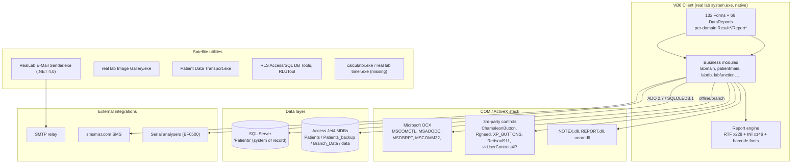
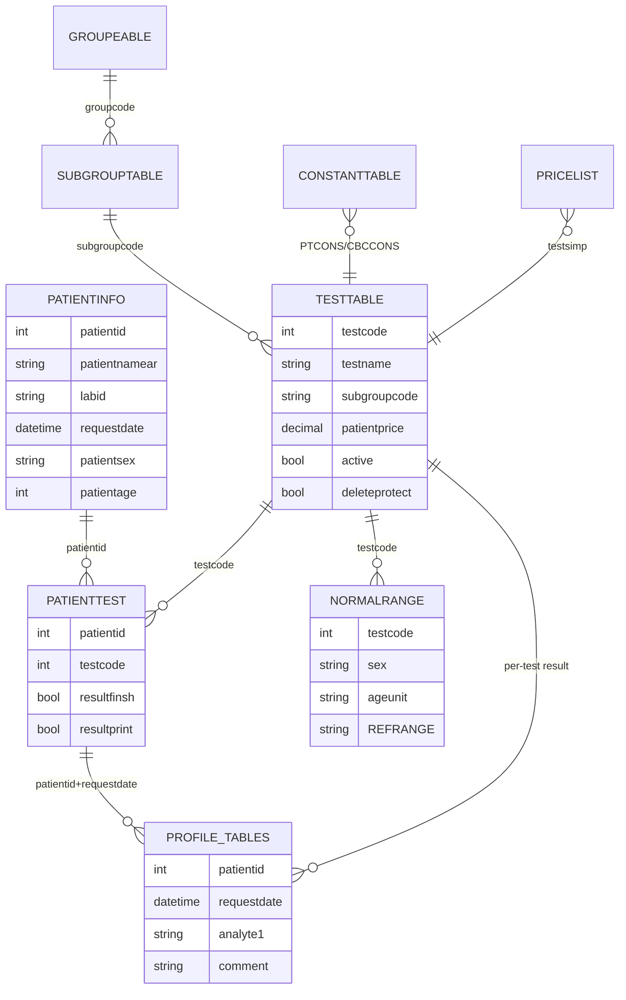
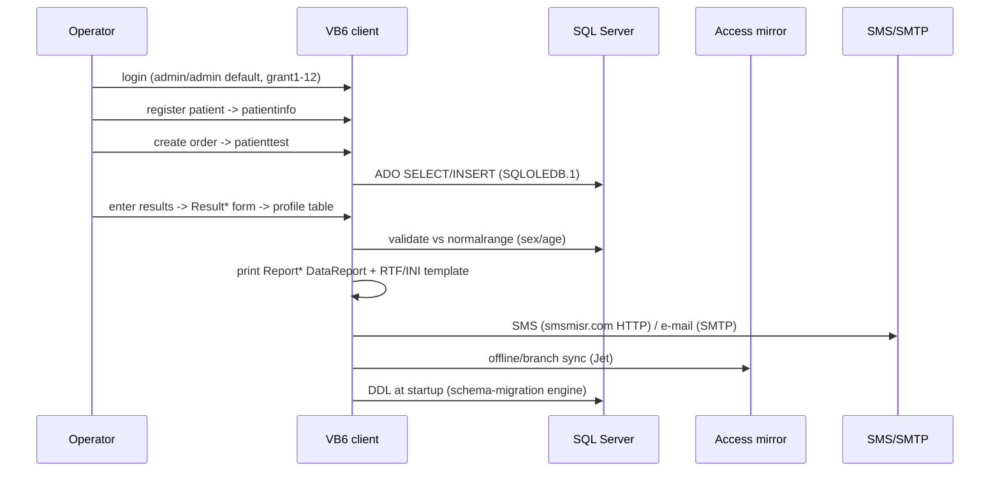

# Cross-Evidence Integration — RealLab v1.605 Unified Engineering Model

**Status:** ✅ M6 COMPLETE · Integrates Evidence Types 1 (Program), 2 (Data), 3 (Synthesis)
**Registries:** `findings_registry.csv` (39), `evidence_registry.csv` (461), `contradiction_registry.csv` (5), `relationship_registry.csv` (15)

---

## 1. Unified system identity

| Property | Value | Class | Evidence |
|---|---|---|---|
| Product | **RealLab v1.605** — "RealLab CD 2019" | 1 | analysis-manifest.json |
| Vendor | ais group corporation (© 2010) | 1 | chm-analysis.json |
| Domain | Clinical Laboratory Information System (LIS) | 1 | Type 2 catalogue; Type 1 help |
| Platform | 32-bit Windows, VB6 native, ActiveX/COM | 1 | FIND-T1-001, FIND-T3-002 |
| Shipped versions | **V-ROOT-1.00** (2013) and **V-CD-2019 / v1.605** (2020) | 1 | FIND-T1-002, FIND-T3-008 |
| UI language | Arabic (RTL) + English | 1 | chm-analysis.json |
| Data layer | SQL Server (primary) + Access/Jet 4 (mirror) | 2 | FIND-T1-005, FIND-T2-001 |

## 2. System architecture

RealLab is a **single mainline VB6 desktop application** (`real lab system.exe`, native code) with a set of **satellite utilities** and a **COM/ActiveX control stack**. It is a classic two-tier client/server LIS: a rich Windows client talking to SQL Server, with a local Access mirror for branch/offline work.

Architecture rationale: the 66 `DataReport` designers plus 228 RTF templates plus 146 per-test INI files confirm a **report-heavy** clinical workflow (per-discipline printed reports), while the 132 forms confirm a data-entry-heavy client. See `architecture.mmd`.

## 3. Component catalogue (abridged)

| Component | Role | Evidence | Confidence |
|---|---|---|---|
| `real lab system.exe` | main VB6 client (native) | FIND-T1-001/002 | High |
| `msvbvm60.dll` | VB6 runtime (build 9782) | FIND-T1-001 | High |
| Microsoft OCX set | ADO data, grids, datareports, comm, chart | FIND-T1-006 | High |
| 5 third-party control packs | themed buttons, XP controls | FIND-T1-006 | High |
| `NOTEX.dll`, `REPORT.dll`, `unrar.dll` | vendor note/report + archive | FIND-T1-006, U-019 | High |
| `RealLab E-Mail Sender.exe` | .NET 4.0 SMTP sender | FIND-T1-007 | Medium |
| `real lab Image Gallery.exe` | image/pictures consumer | FIND-T1-013 (Type1 sibling), upload matrix | Medium |
| `Patient Data Transport.exe` | data transfer utility | Type 1 PE analysis | Medium |
| `RLS Access/SQL Database Tools.exe`, `RLUTool.exe` | DB maintenance / backup | Type 1 dependency text | Medium |
| `calculator.exe`, `real lab timer.exe` | referenced sibling apps | upload_priority_matrix (missing) | Low (gap) |

## 4. Database architecture

Two backends with distinct roles:

- **SQL Server** (`Patients` catalog; servers `REAL_LAB` / `DESKELTEL` / `REALLAB_AIS`) — the **system of record**, reached via ADO 2.7 / `SQLOLEDB.1` (FIND-T1-005).
- **Access Jet 4 MDBs** — the **offline/branch mirror**: `Patients.mdb` (93 tables / 3123 rows), `Patients_backup.mdb` (90), `Branch_Data.mdb` (49, 0 rows, template), `data.mdb` (3, shared masters) (FIND-T2-001).

**Schema shape:** a master/configuration core plus **96 per-test profile result tables**.

**Naming trap (critical):** the table named `patients` is the **operator/user account** table (`patientusname` + `grant1..grant12` + shift schedule), **not** patient demographics — demographics are in `patientinfo` (FIND-T2-003). See `database.mmd`.

## 5. Data flow

## 6. Business logic (evidence-supported)

- **Catalogue & grouping:** 609 tests in 48 subgroups; hierarchical group → subgroup → test (FIND-T2-006).
- **Reference-range validation:** 852 ranges, sex/age stratified (FIND-T2-007).
- **Derived values:** PT/INR (PTCONS) and CBC (CBCCONS) constants (FIND-T2-009).
- **Pricing:** patient / lab / other-lab prices per test; send-out to other labs (`inotherlab`, `otherlabprice`) (testtable columns).
- **Authorisation:** per-patient `grant1..grant12` flags + per-section `IDPassword*` print passwords (FIND-T3-013) — coarse, undocumented.
- **Multi-branch:** `Branch_Data.mdb` template; `branch` column on testtable (FIND-T2-011).
- **Microbiology:** `cultures`, `cultureanti`, `culturesec` tables; CULTURE AND SENSITIVITY subgroup.
- **QC:** `Reportqc` DataReport; QC workflow.

## 7. Interfaces & integrations

| Interface | Mechanism | Evidence | Confidence |
|---|---|---|---|
| SQL Server | ADO 2.7 / SQLOLEDB.1 | FIND-T1-005 | High |
| Access mirror | Jet 4 OLEDB | FIND-T2-001 | High |
| SMTP e-mail | System.Net.Mail (.NET) | FIND-T1-007 | Medium |
| SMS | smsmisr.com cleartext HTTP | FIND-T3-001 U-016 | High |
| Serial analysers | MSCOMM32.OCX; BF6500 | FIND-T1-007 | Medium |
| IE automation | COM (InternetExplorer) | FIND-T3-012 | Medium |
| MySQL (possible) | ODBC connector referenced | FIND-T3-011 | Low (hypothesis) |

## 8. Configuration & runtime

- **Connection:** `BASE.ini` (`Initial Catalog=Patients`), `data_connection*.udl` (`Provider=SQLOLEDB.1`), `SETING.ini`, `IDCARD.INI`, `NOTE.ini`.
- **Report config:** 146 `Data\*.ini` (`reportdata`/`setupx`/`FORM`/`report`), default printer `HP LaserJet 1100 (MS)`, fonts Arial/Tahoma/Times New Roman (FIND-T1-009).
- **Runtime dependencies:** VB6 runtime (out of support), MDAC, Jet, registered COM controls (self-registration, no ASLR/DEP).
- **Startup behaviour:** runs its own DDL schema-migration engine against the clinical DB (FIND-T3-012, U-038).
- **Deployment:** `Setup*.bat` scripts, VS6 Setup Wizard, Bullzip PDF printer, Avira AV engine, unrar 3.50 (FIND-T3-014).

## 9. Contradiction resolutions

| ID | Subject | Resolution | Status | Confidence |
|---|---|---|---|---|
| CON-001 | Jet 3 vs Jet 4 | **Jet 4** (MDB header authoritative) | Resolved | High |
| CON-002 | 169 vs 212 objects | Version difference V1.00 vs v1.605 (provisional) | Provisional | Medium |
| CON-003 | 1,337 vs 1,370 SELECTs | Different extraction passes; immaterial | Resolved | High |
| CON-004 | p-code vs native | **Native code** (F-01 prevails) | Resolved | High |
| CON-005 | 25 vs 20 components | 25 declared / 20 named / 5 unnamed | Resolved | High |

## 10. Confidence summary

- **High confidence (Class 1):** product identity, VB6/native, two builds, dual-DB architecture, schema shape, catalogue/range counts, security findings (inherited but well-evidenced), version matrix.
- **Medium (Class 2):** integrations (SMTP/SMS/serial), business rules (derivation constants), authorisation model, schema-migration behaviour.
- **Low/Provisional (Class 3):** possible MySQL third backend; exact V1.00↔v1.605 object-count reconciliation; mapping of grants/IDPassword* to sections.
- **Unresolved (Class 4):** UNR-002/003/004/005/008 (see Unresolved Issues Register).

## 11. Traceability

Every engineering statement above resolves to `FIND-*` in `findings_registry.csv`, which in turn cites `EVD-*` in `evidence_registry.csv` (SHA-256 + path). Relationships are in `relationship_registry.csv`; contradictions in `contradiction_registry.csv`.