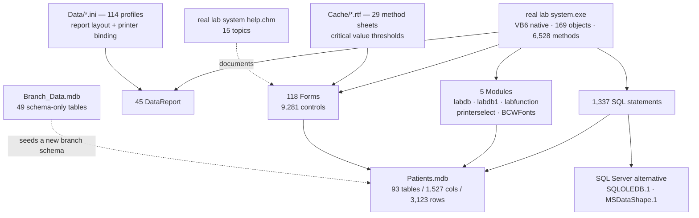

# Complete Reverse-Engineering Reference — RealLab V-ROOT-1.00

**Document ID:** RL-V1-REF-001
**Version documented:** `V-ROOT-1.00` (see `../Version_Identity_and_Scope.md` §2)
**Evidence basis:** 364 verified artefacts from BATCH-01, BATCH-02, BATCH-03
**Analysis type:** Static only — no reference binary, installer, script or ActiveX control was executed.

---

## 1. System identity and scope

### 1.1 Identity

| Attribute | Value |
|---|---|
| Application | `real lab system` |
| Main executable | `real lab system.exe`, 59,150,336 bytes (56.41 MiB) |
| File version | **1.00** |
| Product description (in-app help) | "real lab system version 1.0" |
| Build | PE32, 3 sections, linker 6.0, timestamp **2013-12-27** |
| Runtime | `MSVBVM60.DLL` (186 imported functions) |
| Technology | Visual Basic 6.0, native-code compiled |
| Vendor | RealLab / AIS ("ais group"), El-Mansoura, Egypt |
| Second executable | `real lab Image Gallery.exe`, 10.22 MB, build 2010-06-30 |

### 1.2 Purpose and operational context

RealLab V-ROOT-1.00 is a **medical laboratory information system (LIS)** for clinical
laboratories. Its operational model is a **single-site laboratory** on the Windows
desktop: patient registration, test-order intake, profile-based result entry with
automatic abnormal/critical flagging, reference-range administration, report
printing, result hand-over, cash collection, send-out sample management and periodic
stock/revenue reconciliation.

The shipped user manual (`real lab system help.chm`, 15 topics) frames the product
around the question «كيف يتم تشغيل نظام ريال لاب سيستم ؟» — how to run the RealLab
system — which is the starting point of every operator's workflow.

### 1.3 Investigated scope

| Area | Status |
|---|---|
| Executable (PE, objects, methods, literals, SQL) | **Fully analysed** |
| Primary database `Patients.mdb` | **Fully extracted** (schema + sample rows) |
| Branch template `Branch_Data.mdb` | Schema extracted; 0 rows |
| `data.mdb` | Schema extracted |
| Knowledge layer | **Fully extracted** (test catalogue, ranges, constants, units, conversions, abbreviations, sub-groups) |
| Configuration files | **Fully enumerated** |
| Report layout profiles | 223 `.ini` files across 114 clinical categories |
| Presentation library | 13 Flash simulators, 29 RTF method sheets |
| Official documentation | CHM fully extracted (15 topics, 34,777 Arabic characters) |
| Deployment / installation media | **Not present in Version 1** — installation media ships with Version 2 only |
| Runtime behaviour | **Not observed** — static analysis only |

### 1.4 Known limitations

- No installer, CAB or setup manifest is present in the Version 1 artefact set.
- `Patients.mdb` contains 3,123 rows across 93 tables — sufficient to characterise structure and representative data, but a small operational dataset.
- `Branch_Data.mdb` holds no data, so branch-table semantics are read from DDL alone.
- `RL_SETUP.exe` is absent, so the selection between Access and SQL Server deployment is not observable in Version 1.

### 1.5 Evidence sources

| Source | Artefact set |
|---|---|
| `analysis/BATCH-01/` | Executable PE analysis, VB6 object/method/literal extraction, CHM extraction, SQL inventory, capability inventory |
| `analysis/BATCH-02/` | Full Access database extraction (schema, row counts, sample data), INI catalogue, RTF method-sheet parsing |
| `analysis/BATCH-03/` | 13 Flash simulators — projectors, frame extraction, presentation library |
| `analysis/CUMULATIVE/` | Cumulative cross-batch synthesis for V1 (architecture, data model, capabilities, clinical rules, workflows, configuration, security, unknowns) |
| `inventory/ledger.csv` | 837-row integrity ledger; 364 rows attributed to V1 |

### 1.6 Unresolved technical questions

| ID | Question | Status |
|---|---|---|
| RL-V1-Q-01 | Is `MSDataShape.1` the default connection path, or an alternative? | UNKNOWN |
| RL-V1-Q-02 | Why does `history` differ between `Patients.mdb` (4 rows) and `data.mdb` (0 rows)? | UNKNOWN |
| RL-V1-Q-03 | Is `normalrange.pregsmok` (populated on all 852 rows) actually consulted during range calculation? | UNKNOWN |
| RL-V1-Q-04 | What are the 60 `Data\*.ini` files with no numeric profile name? | UNKNOWN |
| RL-V1-Q-05 | What do `zarf` / `zarfprinter` denote? | UNKNOWN |
| RL-V1-Q-06 | How are `patienttest.nolowexe` / `nohighexe` used — stored exception text or computed? | UNKNOWN |
| RL-V1-Q-07 | Why does `Data\` hold 223 `.ini` files against 46 sub-groups in `subgrouptable`? | UNKNOWN |
| RL-V1-Q-08 | What distinguishes `antibio` (95 rows, 2 columns) from `antibiotic` (38 rows, 25 columns)? | UNKNOWN |
| RL-V1-Q-09 | What are `customtesttable` / `customgrouptable`? | UNKNOWN |

---

## 2. Technical architecture

### 2.1 The five layers

```
┌──────────────────────────────────────────────────────────────────────────────┐
│ L0  WRAPPER     real lab system.exe — PE32, 3 sections, MSVBVM60.DLL (186)     │
│                 real lab Image Gallery.exe — standalone image viewer          │
├──────────────────────────────────────────────────────────────────────────────┤
│ L1  IDENTITY    169 VB6 objects                                              │
│                 118 Forms (9,281 controls) │ 45 DataReport │ 5 Module │ 1 Cls │
├──────────────────────────────────────────────────────────────────────────────┤
│ L2  LOGIC       6,528 declared methods · 104,997 string literals             │
│                 1,337 SQL statements                                         │
├──────────────────────────────────────────────────────────────────────────────┤
│ L3  DATA        Access Jet 4 — Patients.mdb (93 tables / 1,527 cols)         │
│                 + SQL Server alternative (SQLOLEDB.1 / MSDataShape.1)         │
│                 Clinical knowledge layer:                                    │
│                   testtable · normalrange · constanttable · testunits        │
│                   converts · abbreviations · subgrouptable                    │
│                   Data\*.ini (223 layouts / 114 profiles) · Cache\*.rtf (29)  │
├──────────────────────────────────────────────────────────────────────────────┤
│ L4  BEHAVIOUR   15 documented capabilities · 6 reconstructed workflows       │
│                 (reconstructed from evidence; never executed)                │
└──────────────────────────────────────────────────────────────────────────────┘
```

### 2.2 Component dependency graph



### 2.3 Executables and libraries

| Component | Kind | Evidence | Notes |
|---|---|---|---|
| `real lab system.exe` | Application | `analysis/BATCH-01/pe-summary.csv` | 59.15 MB, 3 sections, single import `MSVBVM60.DLL` (186 functions) |
| `real lab Image Gallery.exe` | Utility | `analysis/CUMULATIVE/01-architecture.md` | 10.22 MB, build 2010-06-30, linked to the `pictures` table |
| `real lab system help.chm` | Documentation | `analysis/BATCH-01/help/` | 5,193,985 bytes, 15 topics, 5,193,985 bytes of Arabic help text |
| 43 ActiveX controls (`*.OCX`) | Runtime dependency | `analysis/BATCH-01/` | MSComctl, MSComct2, MSChrt20, MSDataGrd, MSDataLst, MSAdoDc, TabCtl32, ComDlg32, RichTx32, MCI32, MSComm32, MSFlxGrd, DBGrid32, RichEd32, MSDBRPtr, MSStdFmt, MSBind, … |
| `msvbvm60.dll` | VB6 runtime | `analysis/BATCH-10/cab/` | 1,384,479 bytes (2004 build) in `OCX\`; a second, newer build (1,386,496 / 2009) ships in the Version 2 CABs |
| `VB5DB.DLL`, `oleaut32.dll`, `olepro32.dll`, `asycfilt.dll` | OLE/COM | `analysis/BATCH-10/cab/` | COM/OLE infrastructure |
| `sqloledb.1`, `msdatashape.1` | Database providers | `analysis/CUMULATIVE/06-configuration.md` | Referenced in `data_connection*.udl`; SQL Server only |

### 2.4 The five modules

| Module | Methods | Established role |
|---|---:|---|
| `labdb` | 20 | Database maintenance — backup, restore, table creation |
| `labdb1` | 19 | Secondary database-maintenance procedures |
| `labfunction` | 13 | Accounting / stock-take calculations |
| `printerselect` | 16 | Printer enumeration and selection, print dispatch |
| `BCWFonts` | — | Laboratory display font handling |

### 2.5 Internal module inventory by capability area

The 118 forms distribute across the following operational areas (form names as
extracted in `analysis/BATCH-01/vb6/main/forms-blob.txt`):

| Area | Representative forms |
|---|---|
| Start-up and session | `start`, `server`, `login`, `users`, `userspw`, `logindete`, `logindetect` (data) |
| Patient master | `patientmain`, `addpatient`, `patient`, `patientview`, `patienthistory`, `patienthistory2` |
| Barcode | `barcode`, `barcodeform`, `z_barcodes` |
| Result entry | `resulthepatitis`, `resultcbc`, `resultselectro`, `resultTrace`, `resultanytest`, `resultimmun`, `resultbloodgas`, `calctest` |
| Reference ranges | `testrange`, `outtest`, `normal_test` |
| Test catalogue | `setup`, `setup1`, `setup2`, `setup3`, `tools`, `instrument`, `abbrevi`, `converter`, `commentsetup` |
| Report customisation | `reportsetup`, `reportsetup2`, `static1`–`static5` |
| Send-out | `sarfz`, `moenysharekat`, `moenymozafeen` |
| Finance / hand-over | `frm_money`, `moneypaid` |
| Administration | `z_units`, `z_branchs`, `z_logs`, `z_group`, `z_labaccount`, `z_titles`, `z_pricelists`, `z_customgroup` |
| Miscellaneous | `Frm_pic`, `Frm_pic2`, `phone`, `noteic`, `frmTip`, `learntest`, `labtolab` |

### 2.6 Startup and execution

The documented start-up sequence (CHM topic `001.htm`, verbatim):

> «وذلك بالنقر المزدوج على ايقونة البرنامج الموجودة داخل مجلد البرنامج (real lab system)» — or by double-clicking the desktop shortcut.

On launch the application presents a **start-up window** and then a **login screen**.

> «سوف تظهر الشاشة التالية ننتظر التحميل ثم من بعدها ستظهر شاشة التسجيل»

The manual documents a specific failure mode with a specific Arabic message:

> «فى حالة ظهور رسالة "خادم قواعد البيانات غير معرف"»

whose prescribed remediation is to wait for the server machine to finish booting its
start-up programs, then press **موافق** (OK) twice. The manual further states that on a
**client** machine the server must be started manually and that the server application
itself need not be opened:

> «التأكد من عمل "تشغيل" جهاز السيرفر (لا يتتطلب فتح البرنامج على السيرفر ليعمل على باقى الأجهزة)»

A second documented failure message is the **date-locale guard**:

> «فى حالة ظهور رسالة "رجاء تحويل التاريخ الى اللغة الانجليزية"»

with the prescribed fix being to set Windows `Regional Options → Standards and formats`
to English.

> **★ Architectural significance.** These two messages establish that Version 1 is
> designed as a **networked client/server application over a shared database**, with
> the database server reachable by IP address or machine name, and with a **hard
> dependency on the operating system's regional date format**.

### 2.7 The server-configuration window

The manual documents a dedicated window («نافذة اعدادات وبيانات السيرفر») containing
four items, which the manual states must not be changed except the first:

| # | Item | Manual constraint |
|---|---|---|
| 1 | The server's IP address or machine name | «ويفضل على جهاز السيرفر استخدام اسم الجهاز» — the machine name is preferred so the installation survives a NIC or cable failure |
| 2 | The logon-permission type for the system | «وهي ثابتة دائما فى حالة استخدام برنامج التثبيت الخاص بنا» — always fixed when the vendor installer is used |
| 3 | The database user name and password | «ويمنع تغيرها وهى خاصة ببيانات الاتصال بخادم قواعد البيانات» — must not be changed; they are the database-connection credentials |
| 4 | The database name | «ويمنع تغيرها نظرا لأنها من ثوابت النظام» — must not be changed; it is a system constant |

The manual concludes:

> «كل ما سيتم تغيره هو اسم أو أى بي الخاص بالسيرفر»

The security implications of items 2–4 are recorded in §8.

---

## 3. Application interface

> **Convention.** Original Arabic labels are reproduced exactly as transcribed from
> the source artefacts. English glosses are explanatory only and never replace the
> original wording.

### 3.1 Screens and windows

| Screen | Arabic title as found | Technical name | Evidence |
|---|---|---|---|
| Start-up window | «الصفحة الرئيسية» (main page) | `start` | `analysis/BATCH-01/help/help-manual-ar.md` topic `001.htm` |
| Login screen | «شاشة التسجيل» | `login` | topic `002.htm` |
| Server settings | «نافذة اعدادات وبيانات السيرفر» | `server` | topic `001.htm` |
| Main patient window | «الصفحة الرئيسية» | `patientmain` | topic `003.htm` |
| Add-patient window | — | `addpatient` (125 controls) | topic `003.htm` |
| Result-entry window (per profile) | «نوافذ ادخال نتائج التحاليل» | `result*` | topics `004.htm`, `004A.htm` |
| Reference-range window | «المعدل الطبيعي» | `testrange`, `normal_test`, `outtest` | topic `008.htm` |
| Report customisation | — | `reportsetup` (108 controls), `reportsetup2` (69) | topic `009.htm` |
| Send-out management | «العينات المرسلة للخارج» | `sarfz`, `moenysharekat`, `moenymozafeen` | topic `010.htm` |
| Accounting / stock-take | «حساب الدرج وعمل جرد» | `labfunction` | topic `011.htm` |
| Backup | — | `labdb`, `labdb1` | topic `backup.htm` |

### 3.2 Documented navigation structure

The official manual organises the product as a **procedural operating guide**, not a
function catalogue. Its 15 topics follow the operator's task sequence:

```
001  تشغيل النظام
002  تسجيل الدخول
003  إضافة بيانات مريض جديد          (+ 003A طباعة باركود)
004  الوصول لنوافذ إدخال النتائج      (+ 004A إدخال نتائج بروفايل)
005  تسليم نتائج التحاليل للمريض
006  البحث عن مريض
007  إضافة أو تعديل بيانات تحليل
008  إضافة أو تعديل المعدلات الطبيعية
009  التعديل في نصوص وأبعاد وألوان التقرير
010  إدارة العينات المرسلة للخارج
011  معرفة حساب الدرج وعمل جرد لفترة محددة
backup  عمل نسخ احتياطي لقاعدة بيانات النظام
nots  ملاحظات يجب مراعتها عند استخدام نظام ريال لاب سيستم
```

### 3.2a ★ The bilingual interface — verified from the live recording

The live screen recording (`RLS_Learn.wmv`, 106 frames) shows the running application.
**Its window title reads `real lab system 1.0`**, which places it in **this** version.

> **★ The interface is bilingual by deliberate design, not by accident.** The split is
> consistent across every frame examined:
>
> | Zone | Language | Examples |
> |---|---|---|
> | **Left panel** — test catalogue and search | **English** | `Routine test menu`, `Selected Test`, `Test Name`, `Add select test`, `Delete`, `All`, `Blood`, `Stool`, `Urine`, `SGOT (ALT)`, `Albumin` |
> | **Right panel** — patient record | **Arabic** | «بيانات المريض», «الاسم», «الجنس», «العمر», «العنوان», «ملاحظات», «الاختبارات المطلوبة» |
> | **On-screen keypad** | **Arabic** | «حروف», «رموز», «مسافة» |
> | **Printable report** | **English headings + Arabic branding** | `BIOCHEMISTRY REPORT`, `LIVER FUNCTIONS:`, `Reference Range:` alongside «ريال لاب سيستم» and «التقرير المختبرى» |
>
> **The chrome is English; the domain data and the patient-facing surface are Arabic.**
> The **result flags print in English** — `High` · `Low` · `Normal` — so a clinician
> reading a printed report sees English flag words on an Arabic-branded document.
>
> **Commands (Arabic, verbatim):** «حفظ» (Save) · «حذف» (Delete) · «خروج» (Exit) ·
> «بحث» (Search) · «تعديل» (Edit) · «طباعة» (Print) · «الطباعة» (Printing) ·
> «مسح» (Clear) · «تأكيد» (Confirm) · «تسجيل خروج» (Logout).
>
> **Arabic test names as ordered:** «تحليل بول» (Urine analysis) · «صورة دم كاملة»
> (Complete blood count) · «نسبة Sugar» · «صورة ك-diff» · «اختبار حمل» (Pregnancy test).
>
> **★ The printed report renders the reference interval as a sentence** — *"Male Up To
> 45 U/L"*, *"Adult 3.8 - 5.2 g/dL"* — not as raw numbers. This is the print-time
> assembly of the `normalrange` row into prose, and it explains why `normalrang` is a
> Text/Memo field.
>
> **★ "Degits" is an in-product report name.** An observed modal reads «ستتم إضافة اسم
> الملف المختار في التقرير إلى تقرير Degits الخاص بك. هل تريد إضافة تقرير Digits أخر؟»
> ("The name of the file selected in the report will be added to your Degits report.
> Do you want to add another Digits report?"). **Digits is a third-party Arabic
> laboratory information system** — so this is direct evidence that **RealLab coexists
> with, and reports into, another LIS.** Nothing in the schema, the manual or the
> vendor guide mentions it.
>
> **Full verbatim extraction:** `analysis/BATCH-11/ui-labels-verified.md`.

### 3.3 Keyboard interface

Documented in CHM topics `004A.htm`, `008.htm`, `010.htm`, `011.htm`:

| Key | Action as documented |
|---|---|
| **F8** | اعتماد مُراجَع — confirm as reviewed |
| **F9** | حفظ — save |
| **F11** | معاينة طباعة — print preview |
| **F12** | طباعة — print |
| **Enter** | التالي + حفظ — next field and save |
| **Esc** | إلغاء — cancel |
| **F7** | الحسابات / العينات المرسلة — accounting / send-out |

The literal table `daytip` holds **20 Arabic help strings** keyed to the F2/F3/F7
shortcuts (`analysis/BATCH-02/db/daytip.csv`).

### 3.4 Result-entry interface — the normal/abnormal/critical display model

The manual states the behaviour the code implements:

> «يميز النتائج الغير طبيعية والحرجة ويكتب تمييز لها (عالٍ أو منخفضة أو حرجة)»

The implementation is confirmed by the `patienttest` fields `lowlimit`, `highlimit`,
`nolowexe`, `nohighexe` and by `normalrange`'s flag and comment columns (§6.6).

### 3.5 Report customisation interface

Topic `009.htm` covers editing **report text, dimensions and colours**. The three
supporting artefacts are:

| Artefact | Role |
|---|---|
| `reportsetup` (108 controls) / `reportsetup2` (69 controls) | Interactive editors for report text and layout |
| `static1`–`static5` | Static-region editors (the 5 static blocks of a printed report) |
| `Data\*.ini` | The persisted layout for each of 114 clinical profiles |

---

## 4. Internal processing and workflows

> The workflows below are **reconstructed from evidence** — code literals, extracted
> schema, configuration files and the official manual. They are **not** observed
> executions. Confidence is stated per workflow.

### WF-V1-01 — Patient lifecycle

| Step | Action | Entities | Evidence | Confidence |
|---|---|---|---|---|
| 1 | Sign in | `useraccounts`, `loggroup` | CHM `002.htm`; forms `login`, `users`, `userspw` | CONFIRMED |
| 2 | Register a new patient | `patientinfo` (33 columns) | form `addpatient` (125 controls); CHM `003.htm` | CONFIRMED |
| 3 | Generate the patient barcode | `barcodes` (35 rows) | forms `barcode` (71 controls), `z_barcodes`; CHM `003A.htm` | CONFIRMED |
| 4 | Request tests | `patienttest` (`testcode`, `subgroupcode`, `arrangnum`, `testprice`) | SQL inventory | STRONGLY SUPPORTED |
| 5 | Enter the result | per-profile result table + `patienttest` | forms `result*`; CHM `004.htm` | CONFIRMED |
| 6 | Review and confirm | `patienttest` review flag | F8 shortcut; CHM `004A.htm` | STRONGLY SUPPORTED |
| 7 | Print the report | `DataReport` objects + `Data\*.ini` | CHM `009.htm`; F11/F12 | CONFIRMED |
| 8 | Hand over the result | `patienttest.give`, `resultprint` | forms `frm_money`, `moneypaid`; CHM `005.htm` | CONFIRMED |

### WF-V1-02 — Profile result entry

| Step | Detail | Evidence | Confidence |
|---|---|---|---|
| a | Select the patient from the main window | `patientmain` → `patientview` | CONFIRMED |
| b | Select the test twice ⇒ the profile entry window opens | forms `result*` | CONFIRMED |
| c | Tests in the selected group are shown flagged | `.Normalbold` / `Check*x` literals | STRONGLY SUPPORTED |
| d | On entry the value is compared against `lowlimit` / `highlimit` from `normalrange`; the system displays abnormal (highlighted), the exception text (`nolowexe` / `nohighexe`), and critical | `normalrange` schema + `patienttest` columns | CONFIRMED |
| e | Comment entry — typed, or chosen from stored comments, or from the normal-ranges list («زر تعليق (البرتقالي)») | `comments` table; `normal_test` form | STRONGLY SUPPORTED |
| f | F9 save · F8 confirm · F11 preview · F12 print · Enter next-and-save · Esc cancel | CHM `004A.htm` | CONFIRMED |

### WF-V1-03 — Send-out samples

| Step | Detail | Evidence | Confidence |
|---|---|---|---|
| 1 | Tests marked `inotherlab = True` in `testtable` are discovered automatically | `testtable` schema | CONFIRMED |
| 2 | Open via F7 or accounting → send-out samples | `sarfz`, `moenysharekat`, `moenymozafeen` | CONFIRMED |
| 3 | Group by referring laboratory (`otherlabname`) and total | `otherlabname`, `patienttest.sentout`, `patienttest.send` | CONFIRMED |
| 4 | Send — enter the amount settled, «خالص» (mark as sent), «دائماً إليه» (always to it) | CHM `010.htm`; `send` column | STRONGLY SUPPORTED |
| 5 | Follow up unsent and unsettled | `sentout` | STRONGLY SUPPORTED |

### WF-V1-04 — Accounting and stock-take

Reconstructed from CHM topic `011.htm`, `labfunction` and the `payment` / `Gehats`
schema:

1. **Patient accounts for a period** — the manual poses the controlling question
   «هل الفلوس المحصلة من مرضى الفترة فقط؟» (is the money collected only from
   patients of that period?).
2. **Send-out sample accounts** — aggregated or broken down per referring laboratory.
3. **Expenses and remittances** — a separate accounting window for cash withdrawal and deposit.
4. **Patients with residual balances** plus **referring-party commissions** (`Gehats.omola`).
5. **Per-user workload** and the amounts collected with each user.
6. **Claims / volume of dealings with other parties**.

### WF-V1-05 — Reference-range administration

Path in the UI: بيانات النظام → بيانات التحاليل → [test] → «المعدل الطبيعي».
Operations: add a range · edit · save · undo · delete.

The 14 range attributes are documented in the manual and are all present in the
`normalrange` schema (see §6.6): `Test name`, `Test unit`, `Sex`, `Age From`,
`Age To`, `Age unit`, `Normal range`, `Low/High limit`, `Low/High flag`,
`Low/High comment`, `Critical comment`, `Critical range`, critical `Low/High limit`,
`Critical flag`.

> **⚠ Standing restriction.** Topic `nots.htm` states that the urine analysis carries
> test number **4**, and that **neither its number nor its name may be changed**.

### WF-V1-06 — Catalogue interlock

```
normalrange (range)  ←→  converts (unit conversion)  ←→  testunits (unit dictionary)
          ↓
testtable (definition)  ←→  Data\*.ini (report layout)  ←→  Cache\*.rtf (method sheet)
```

### 4.1 Error handling

| Condition | System behaviour | Evidence |
|---|---|---|
| Database server not reachable | Message «خادم قواعد البيانات غير معرف»; the application closes on OK | CHM `001.htm` |
| Non-English date locale | Message «رجاء تحويل التاريخ الى اللغة الانجليزية»; the application closes on OK | CHM `001.htm` |
| No printer available | «Can't find any printer.» (English literal in the executable) | `literals.tsv` |
| Printer API failure | «SetPrinter Failed. Error code: » + error code | `literals.tsv` |
| Client machine, server not started | Manual requires starting the server machine | CHM `001.htm` |
| Network share/permissions suspect | Manual instructs checking switches and share permissions **before** touching data | CHM `001.htm` |

> **★ Design observation.** Two of the six error paths are localisable Arabic
> messages that terminate the application; the other two are English literals in the
> binary. The localisation is partial and inconsistent — relevant to any
> re-implementation that must present uniform messaging.

---

## 5. Configuration and persistence

### 5.1 Configuration file inventory

| File | Section | Purpose |
|---|---|---|
| `bin\BASE.ini` | `[oledb]`, `[Initial]` | Database type selection, data path, connection identity, last range id |
| `bin\SETTING.ini` | `[selectprinter]`, `[setup]` | Printer bindings, paper size, report header text, branch flag, print options |
| `bin\IDCARD.INI` | `[IDdata]`, `[Billdata]` | Patient card / invoice layout and text |
| `bin\REPORT.dll` | `[reportdata]` | **Not a DLL** — a text INI holding the 19-colour report palette |
| `bin\NOTE.ini` | `[NOTICZ]` | Last-notice state (`STATUS`, `NID`, `LOID`) |
| `bin\data_connection.udl` | `[oledb]` | SQL Server OLE DB connection string |
| `bin\data_connection1.udl` | `[oledb]` | SQL Server UNION ("shape") connection string |
| `Data\*.ini` (223 files) | `[reportdata]`, `[setupx]` | Per-profile report layout + printer binding |
| `Data\*.ini` (60 unnamed) | — | Profiles with no numeric name — purpose UNKNOWN |

### 5.2 `BASE.ini` — database selection

```ini
[oledb]
Databasetype=XMSACCESSX      ; MS Access (X = enabled)
loca=E:\Lab_data              ; laboratory data directory
DataSource=DESKELTEL          ; laboratory workstation name
PersistSecurityInfo=True
UserID=sa
Password=12345678
InitialCatalog=Patients
[Initial]
Initialw=123
nrls=605
drls=0
```

The `Databasetype` encoding (`XMSACCESSX`, X = enabled) indicates a **toggle-encoded
multi-engine selector**: the same key selects Access, SQL Server or MySQL by wrapping
the engine name in `X…X`.

### 5.3 `SETTING.ini` — printers, paper, headers

```ini
[selectprinter]
reportport=LPT1:
barcodeport=LPT1:
reportprinter=Send To OneNote 2007
barcodeprinter=…
zarfprinter=…

[setup]
papersize=A4
reportstart=1984
Timeouts=09:00 PM
historytype=0
labbranchx=1
barcodeauto=1
printworkpaper=1
```

Arabic header text is stored in the same file:

```ini
Textr1txt=المنظومة البرمجية
Textr2txt=ريال لاب سيستم
```

`reportstart=1984` is an **absolute report sequence origin** — printed reports are
numbered from a fixed starting point. This is the predecessor of the `printnum`
counter observed in Version 2 (§7.7 of the Version 2 reference).

### 5.4 `IDCARD.INI` — card and invoice

- `[IDdata]` — position (`L`/`T`), font (`F`), bold (`B`) and size (`S`) for three
  fields: name, barcode, password.
- `[Billdata]` — invoice strings: «Welcome To RealLab», «Thank you for visiting
  RealLab!», working hours, address, telephone, website, e-mail, Facebook page.

### 5.5 `Data\*.ini` — report layout profiles

223 files covering **114 clinical categories**. Each file carries:

| Section | Content |
|---|---|
| `[reportdata]` | Report headings, 7 column positions, 7 column widths, 24 colour values, one font per position, print flags |
| `[setupx]` | `reportprinterx=HP LaserJet 1100 (MS)` — the printer bound to that profile |

Printers actually bound across the profiles: `HP LaserJet 1100 (MS)` (108 profiles),
`HP LaserJet 1100` (2), `Send To OneNote 2007` (2).

### 5.6 Persistence mechanisms

| Mechanism | Detail |
|---|---|
| Primary store | `Patients.mdb` — Access Jet 4, `.mdb` container, accessed through the Jet OLE DB provider |
| Secondary store | `data.mdb` — `history` (20 free-form columns), `patientinfo` (3 columns), `wasl` |
| Branch template | `Branch_Data.mdb` — schema-only; used to create a branch's profile tables |
| Knowledge persistence | `.ini` (report layout), `.rtf` (method sheets), database tables (ranges, tests) — all **plain text or tabular**, fully exportable |
| Programmatic backup | `labdb` / `labdb1` modules — documented by CHM topic `backup.htm` |
| No ORM | All access is via raw SQL strings; no object-relational mapper is present |

---

## 6. Database and data structures

### 6.1 Technology

**Microsoft Access, Jet 4 (InnoDB-format MDB).** Connectivity through the Jet/ACE OLE
DB provider; a SQL Server alternative path exists via `SQLOLEDB.1` and the
`MSDataShape.1` "shape" provider (used for `SHAPE {…} APPEND (…)` union queries).

### 6.2 Database inventory

| Database | Tables | Columns | Rows | Purpose |
|---|---:|---:|---:|---|
| `Patients.mdb` | **93** | **1,527** | 3,123 | Primary operational database |
| `Patients_backup.mdb` | 90 | 1,381 | 2,786 | Backup copy |
| `Branch_Data.mdb` | **49** | — | **0** | Schema-only branch template |
| `data.mdb` | 3 | — | — | Dynamic history, slim patient index, work-sheet storage |

### 6.3 Core entities

| Table | Columns | Role |
|---|---:|---|
| `patientinfo` | 33 | **Order/visit header** — demographics, referral, dates, order-level pricing. `patientid` is the order identifier, not the patient key |
| `patienttest` | 44 | One row per requested test — the transactional centre of the system |
| `testtable` | 37 | Test catalogue — 609 rows |
| `normalrange` | 18 | Reference ranges — 852 rows across 304 tests |
| `payment` | 9 | Payment transactions |
| `barcodes` | — | Barcode allocation — 35 rows |
| `history` | 25 (20 dynamic) | Persistent patient attributes — `column1`..`column20` plus `selector`, `labid`, `requestdate`, `printflag`, `noofcol` |
| `useraccounts` | — | User accounts — **referenced by 6 SQL statements but present in no `.mdb` file**. The real operator table is `patients` (`grant1`…`grant12`) |
| `loggroup` | — | Login group / session grouping |
| `instrument` | — | Analyser instruments |
| `abbreviations` | — | Abbreviation dictionary — 650 rows |
| `testunits` | — | Unit dictionary — 69 rows |
| `converts` | — | Unit conversion factors — 167 rows |
| `subgrouptable` | — | Clinical sub-group catalogue — 46 rows |
| `constanttable` | — | Clinical constants |
| `Gehats` | — | Referring parties — 10 rows, including the commission rate `omola` (applied as `SUM(Gehats.omola * patientinfo.elmadfoo3 / 100)`) |
| `anyreport` | — | Report selection — 17 rows |
| `comments` | — | Standard result comments — 12 rows |

### 6.4 Clinical profile tables

46 profile result tables, each carrying the analyte set for one clinical discipline.
The full catalogue and the per-table field detail is in
`Data_Model_and_Workflow_Entities_V1.md` §3.

Representative members: `cbc`, `liver`, `kidney`, `urine`, `stool`, `semen`,
`crossmat`, `trace`, `cultures`, `cultureanti`, `hepatitis`, `IMMUNOLOGY`, `hormones`,
`Lipids`, `TORCH`, `BloodGases`, `Electrolytes`, `iron`, `Diabetes` set,
`Pregnancy`, `ProstaticX`, `Stone`, `Widal`, `CSFT`, `MOH`, `Abuse`, `Drugs`,
`Fertlity`, `Pancreas`, `Suprarenal`, `Tumors`, `Vitamins`, `ZN`, `ESR`, `CRP`,
`Cardiac`, `GlucoseTolerance`, `HgbElectrophoresis`, `ProteinElectrophoresis`,
`TB`/`TUBERCULINT`, `BONEMAR`, `BILH`.

### 6.5 Keys, constraints and relationships

> **Certainty note.** Version 1's Access schema was extracted with `mdb-schema`,
> which reports column names, types and declared indexes. **Foreign-key constraints
> are not enforced by Access Jet 4 in the shipped files** — Access relationships are
> declarative, not enforced. The relationships documented in
> `Data_Model_and_Workflow_Entities_V1.md` §6 are therefore classified as OBSERVED
> (exact column-name pairing plus a real join in an extracted SQL statement) or
> INFERRED (exact column-name pairing only).

### 6.6 Knowledge-layer structures

| Table | Rows | Contents |
|---|---:|---|
| `testtable` | **609** | Test name, abbreviation, price, profile, send-out flag |
| `normalrange` | **852** | Per test: sex × age window; low/high abnormality limits; exception text; critical range and critical comment |
| `constanttable` | 9 | `CBCCONS` (5 values) + `PTCONS` (4 values) — see §6.7 |
| `testunits` | 69 | Unit dictionary |
| `converts` | 167 | Unit conversion factors |
| `abbreviations` | 650 | Abbreviation dictionary |
| `subgrouptable` | 46 | Clinical sub-groups |

**`normalrange` distribution** — sex: `Male` 422 / `Female` 421 / `All` 5 / empty 4;
age unit: `Years` 708 / `Days` 70 / `Mons.` 65 / empty 9; age span: `Years` 0–120,
`Days` 1–120, `Mons.` 0–24; ranges carrying a numeric low limit: 459; high limit: 643;
exception text: 511 low / 581 high; 19 distinct low and 19 distinct high comments;
**51 distinct measurement units**.

> **★ OBSERVED (not a documented rule):** all 852 `normalrange` rows carry a value
> in `pregsmok` (`Single`). This implies a pregnancy/smoking-dependent range
> dimension. The manual does not mention it and the code path that consults it was
> not traced. Recorded as OBSERVED, not as a working rule.

### 6.7 Configuration tables

| Table | Contents |
|---|---|
| `constanttable` | Clinical computation constants (see below) |
| `subgrouptable` | 46 clinical sub-groups, named e.g. `BLOOD GLUCOSE`, `KIDNEY FUNCTIONS`, `LIVER FUNCTIONS`, `LIPIDS PROFILE`, `URINE EXAMINATION`, `STOOL EXAMINATION`, `Autoimmune diseases`, `BLOOD GROUP`, `Erythrocyte Sedimentation Rate`, `CULTURE AND SENSITIVITY`, `BLOOD PICTURE` |
| `patientinfo` price fields | `totalprice`, `totalpricedisc` — the patient account totals |
| `Gehats` | Referring parties, with `omola` = commission |
| `otherlabname` | Send-out destination laboratories |
| `anyreport` | 17 report selections |

### 6.8 Status and history structures

| Structure | Description |
|---|---|
| `history` | 25 columns in `data.mdb` — `selector`, `labid`, `requestdate`, `column1`..`column20` (free-form attribute slots), `printflag`, `noofcol`. One row per patient. Simple EAV-like design; the manual names it «التاريخ المرضي للمريض» (patient medical history) |
| `loggroup` | Login grouping |
| `patienttest.resultprint` / `.printuser` / `.printdate` / `.printnum` | Print audit trail on the test row |
| `SETTING.ini [setup] reportstart=1984` | Absolute report numbering origin |
| `labdb` / `labdb1` | Programmatic backup/restore |

---

## 7. Reports and printing

### 7.1 Report types

| Kind | Count | Mechanism |
|---|---:|---|
| `DataReport` design objects | **45** | VB6 DataReport designer bound to `Data\*.ini` layouts |
| Printed clinical profiles | **114** categories | One `.ini` layout each (223 files total, some profiles carry multiple variants) |
| Report layouts by discipline | — | MICROBIOLOGY (18), MOLECULAR BIOLOGY (16), BIOCHEMISTRY (15), HEMATOLOGY (9), ENDOCRINOLOGY (6), SEROLOGY (5), IMMUNOLOGY (2), CYTOPATHOLOGY, VIROLOGY, CROSS MATCHING, CSF EXAMINATION, BONE MARROW EXAMINATION, SERODIAGNOSIS, SEMEN ANALYSIS, POST-COITAL, PROSTATIC DISCHARGHE, CALCULI, TORCH SCREEN, MANTOUX PPD, URINALYSIS, AUTOMATED URINALYSIS, ZN Film |
| Method sheets | 29 | `Cache\*.rtf` — per-test methodology and critical-value documentation |
| Interactive training simulators | 13 | `Cache\*.exe` — Flash-hosted simulators |
| Patient card / invoice | — | `IDCARD.INI` |

### 7.2 Report generation mechanism

Report content is **assembled at print time from three sources**:

```
DataReport design object  (45)
        +  Data\*.ini layout for the profile   (114)
        +  patienttest / profile-table values
        ───────────────────────────────────────────────►
                    printed page
```

### 7.3 Report data sources

| Report family | Source |
|---|---|
| Patient clinical report | `patientinfo` + `patienttest` + the profile result table |
| Report customisation | `Data\*.ini` `[reportdata]` — headings, 7 column positions/widths, 24 colours, per-position font, print flags |
| Colour palette | `REPORT.dll` `[reportdata]` — `color1`..`color19` as BGR integers |
| Hand-over / receipt | `patienttest.give`, `resultprint`; `IDCARD.INI` `[Billdata]` |
| Method sheet | `Cache\*.rtf` |

### 7.4 Printing workflow

1. The operator presses **F11** for preview or **F12** to print.
2. The `printerselect` module (16 methods) resolves the target printer — from
   `Data\*.ini` `[setupx] reportprinterx` for the profile, or from `SETTING.ini`
   `[selectprinter]` for the role (`reportprinter`, `barcodeprinter`, `zarfprinter`).
3. The page is rendered by the `DataReport` engine and sent to the spooler through
   the Win32 spooler API (`OpenPrinterA`, `SetPrinterA`, `GetPrinterA`, `ClosePrinter`).
4. The print is recorded on the test row (`resultprint`, `printuser`, `printdate`, `printnum`).

### 7.5 Export mechanisms

| Mechanism | Status |
|---|---|
| Print to Windows printer | **CONFIRMED** |
| Print to "Send To OneNote 2007" | **CONFIRMED** — bound as `reportprinter` in `SETTING.ini` and used by 2 profiles |
| PDF export | **NOT PRESENT in V1** — no PDF-capable printer, no PDF code path, zero `PDF` literals in the executable |
| Print to file / image | **NOT ESTABLISHED** |
| `real lab Image Gallery.exe` | **CONFIRMED** as a separate image-browsing executable linked to the `pictures` table |

### 7.6 Templates and restrictions

- Each profile's printer is **fixed inside its `.ini`**, so changing the laboratory
  printer requires editing 223 files or running the report-setup editor.
- Report numbering starts from the absolute value `1984` (`SETTING.ini [setup] reportstart`).
- The colour palette lives in a file named `REPORT.dll` that is **not a binary** — VB6 code opens it as text.
- Five static blocks per report (`static1`–`static5`).

---

## 8. Users, permissions and security

### 8.1 User roles and account structures

| Structure | Role |
|---|---|
| `useraccounts` | User account records and permission flags |
| `loggroup` | Login group — associates a session with a group/branch |
| `users` form (29 controls) | User administration |
| `userspw` form (13 controls) | Password change |

The manual's administrative guidance for the first run of the system (topic `002.htm`):

> «لأول مرة اختر admin … أدخل نفس الكلمة ككلمة مرور»

The literal `admin` is present in the executable at offset `0x7BA378`, confirming a
default administrator account name.

### 8.2 Access-control mechanism

| Layer | Mechanism | Evidence |
|---|---|---|
| Application | `useraccounts` rows + `loggroup`; login form gates entry | CHM `002.htm`; `login`, `users`, `userspw` forms |
| Database connection | A **fixed** database user name and password, identical on every client, set at install time and documented as unchangeable | CHM `001.htm` — «ويمنع تغيرها» |
| Server reachability | Server identified by IP or machine name; the client must be permitted to reach it | CHM `001.htm` |
| Branch scoping | `SETTING.ini [setup] labbranchx=1` | `SETTING.ini` |
| Table-level row security | **NOT ESTABLISHED** — no row-level or column-level security is evidenced |

### 8.3 Authentication mechanism

- A **login window** presenting user name and password.
- A default administrative account named `admin`, whose initial password equals the
  user name.
- The database connection identity is **shared across all client machines** and is
  documented as immutable.
- **No evidence** of password hashing, salting, expiry, lockout, or session timeout.

### 8.4 User-related workflows

1. User administrator creates the account and assigns it to a login group.
2. At each session the operator authenticates at the login window.
3. `loggroup` records the group, and `labbranchx` scopes the session to a branch.
4. `labfunction` (accounting) aggregates per-user workload and per-user collections.

### 8.5 Security-relevant technical findings

> These are properties of the **shipped vendor product**, documented from file
> contents. No exploitation was attempted.

| ID | Finding | Evidence | Classification |
|---|---|---|---|
| RL-V1-SEC-01 | **Database password stored in clear text** in two shipped files | `bin\BASE.ini` `Password=12345678`; `bin\data_connection1.udl` `Password=12345678` | CONFIRMED |
| RL-V1-SEC-02 | **Administrative account `sa`** used as the application connection identity | `bin\BASE.ini` `UserID=sa`; `data_connection*.udl` `User ID=sa` | CONFIRMED |
| RL-V1-SEC-03 | **Default administrator account `admin` with password equal to the user name**, documented in the shipped manual | CHM `002.htm`; literal `admin` @ `0x7BA378` | CONFIRMED |
| RL-V1-SEC-04 | `PersistSecurityInfo=True` — the credential is re-supplied on every connection | `bin\BASE.ini`; `data_connection1.udl` | CONFIRMED |
| RL-V1-SEC-05 | **Connection strings leak the pre-rebranding product identity and the installation layout** | `Initial Catalog=C:\PROGRAM FILES\AUTOMATIC HEMATOLOGY ANALYZER\…\BF6500.DBMDF`; `Initial File Name=D:\Lab_data\bf6500.db.mdf` | CONFIRMED |
| RL-V1-SEC-06 | **Cleartext laboratory data path** | `loca=E:\Lab_data`; `D:\Lab_data\*.mdf` | CONFIRMED |
| RL-V1-SEC-07 | **A shared, immutable database credential across all clients** | CHM `001.htm` — items 2–4 of the server settings window | CONFIRMED |
| RL-V1-SEC-08 | **Vendor contact and site details embedded in a shipped configuration file** | `IDCARD.INI` — address, telephone, website, e-mail, Facebook page | CONFIRMED |
| RL-V1-SEC-09 | **The patient barcode is the patient identifier** — a printed artefact carries a direct identifier | `barcodes` table; `barcode` form; `IDCARD.INI` barcode field layout | CONFIRMED |
| RL-V1-SEC-10 | `history` uses 20 free-form columns as a generic attribute store — no type enforcement | `data.mdb` `history` | CONFIRMED |
| RL-V1-SEC-11 | The manual advises **not connecting the server to the internet** to preserve data confidentiality | CHM `001.htm` — «يفضل عدم توصيل انترنت على جهاز السيرفر … للحفاظ علي سرية البيانات من احتمالية الأختراق» | CONFIRMED |

> **★ Architectural assessment.** Version 1's security model is
> **application-level user accounts over a shared, statically-credentialed database
> connection**. There is no evidence of encryption at rest, per-user database
> identity, password hashing, or network transport protection. The manual itself
> acknowledges exposure by recommending isolation from the internet.

---

## 9. Integrations and external dependencies

### 9.1 External systems

| System | Kind | Interaction | Evidence |
|---|---|---|---|
| SQL Server | Database server | OLE DB `SQLOLEDB.1` connection over the LAN; `MSDataShape.1` for union/shape queries | `data_connection.udl`, `data_connection1.udl` |
| Jet 4 / Access | Embedded database | The default store | `Patients.mdb` |
| Windows spooler | OS service | Print dispatch via `OpenPrinterA`/`SetPrinterA`/`GetPrinterA`/`ClosePrinter` | `printerselect` module |
| Windows regional settings | OS | Date-locale guard | CHM `001.htm` |
| `Send To OneNote 2007` | Local application | Bound as a printer destination | `SETTING.ini`, `Data\*.ini` |
| `RealLabeg.com` | Website | Published in the invoice layout | `IDCARD.INI` |
| Facebook page | Social | Published in the invoice layout | `IDCARD.INI` |

### 9.2 APIs and protocols

| API | Purpose |
|---|---|
| Jet/ACE OLE DB | Direct access to `.mdb` tables |
| `SQLOLEDB.1` | SQL Server connectivity |
| `MSDataShape.1` | `SHAPE {…} APPEND (…)` union queries over SQL Server |
| Win32 spooler API (4 functions) | Printer enumeration, selection, and document dispatch |

### 9.3 File exchanges

| Exchange | Detail |
|---|---|
| `Patients.mdb` ⇄ `Patients_backup.mdb` | Copy-based backup, invoked via `labdb`/`labdb1` |
| `Branch_Data.mdb` → a new branch database | Schema-only template, 0 rows; the branch's profile tables are created from it |
| `Data\*.ini` ⇄ report engine | Configuration read at print time |
| `Cache\*.rtf` ⇄ result-entry forms | Method and critical-value text displayed beside the entry field |
| `Help.chm` ⇄ application | Contextual help, 15 topics |

### 9.4 Network dependencies

- The database server must be reachable by IP or machine name.
- The manual explicitly describes the **server machine's boot delay** as a cause of the
  «خادم قواعد البيانات غير معرف» failure, and instructs the operator to wait for
  start-up programs to finish before launching.
- The manual instructs verifying **switches and share permissions** before suspecting
  data problems — establishing that file-share access over the LAN is part of normal
  operation.

### 9.5 Integration workflows

| Workflow | Trigger | Mechanism |
|---|---|---|
| Attach to the database server | Application start | OLE DB connection using `DataSource` / `loca` |
| Print to a laboratory printer | F12 | Spooler API with the profile-bound printer |
| Create a branch database | Administrative action | `Branch_Data.mdb` schema applied |
| Back up the database | Administrative action (CHM `backup.htm`) | `labdb` / `labdb1` |

---

## 10. Version-specific findings

### 10.1 Capabilities established for V-ROOT-1.00

| ID | Capability | Arabic label as documented | Evidence |
|---|---|---|---|
| V1-CAP-01 | Run the system and sign in | «كيف يتم تشغيل نظام ريال لاب سيستم ؟» / «كيف يتم تسجيل الدخول لنظام ريال لاب سيستم ؟» | CHM `001.htm`, `002.htm` |
| V1-CAP-02 | Register a new patient | «كيف يتم اضافة بيانات مريض جديد ؟» | CHM `003.htm`; `patientinfo` |
| V1-CAP-03 | Print the patient barcode | «كيف يتم طباعة باركود للمريض؟» | CHM `003A.htm`; `barcodes` |
| V1-CAP-04 | Enter results per clinical profile | «كيف يتم الوصول لنوافذ ادخال نتائج التحاليل ؟» / «كيف يتم ادخال نتائج التحاليل (تحاليل الكبد وما شابه مثلاً) ؟» | CHM `004.htm`, `004A.htm`; `patienttest` + 46 profile tables |
| V1-CAP-05 | Hand over results to the patient | «كيف يتم تسليم نتائج التحاليل للمريض ؟» | CHM `005.htm`; `patienttest.give` |
| V1-CAP-06 | Search for a patient | «كيف تتم عملية البحث عن مريض فى نظام ريال لاب سيستم ؟» | CHM `006.htm` |
| V1-CAP-07 | Add / edit test definitions | «كيف يتم اضافة أو تعديل بيانات تحليل ؟» | CHM `007.htm`; `testtable` |
| V1-CAP-08 | Administer normal reference ranges | «كيف يتم اضافة أو تعديل المعدلات الطبيعية لتحليل معين ؟» | CHM `008.htm`; `normalrange` (852 rows) |
| V1-CAP-09 | Customise report text, dimensions and colours | «كيف يتم التعديل فى نصوص وأبعاد وألوان التقرير ؟» | CHM `009.htm`; 45 DataReport + `Data\*.ini` |
| V1-CAP-10 | Manage send-out samples | «كيف يتم ادارة العينات المرسلة للخارج من داخل النظام ؟» | CHM `010.htm`; `sentout`/`send`/`otherlabname` |
| V1-CAP-11 | Accounting and stock-take | «كيف يتم معرفة حساب الدرج وعمل جرد لفترة محددة ؟» | CHM `011.htm`; `payment`, `Gehats.omola` |
| V1-CAP-12 | Back up the database | «كيف يتم عمل نسخ احتياطي لقاعدة بيانات النظام ؟» | CHM `backup.htm`; `labdb`/`labdb1` |
| V1-CAP-13 | Clinical constants and formulas | «ملاحظات يجب مراعتها عند استخدام نظام ريال لاب سيستم» | CHM `nots.htm`; `constanttable` |
| V1-CAP-14 | Fixed test-numbering restriction | «ملاحظات يجب مراعتها عند استخدام نظام ريال لاب سيستم» | CHM `nots.htm`; `testtable.testcode` |
| V1-CAP-15 | Keyboard shortcuts and result-entry interface | — | CHM `004A/008/010/011.htm`; `daytip` |

> The **full functional behaviour** of each capability — workflow steps, inputs,
> outputs, actors, preconditions, exceptions — is documented in
> `Functional_Specification_V1.md`.

### 10.2 Clinical business rules confirmed in V-ROOT-1.00

These are confirmed by the **concordance of three independent sources** — the shipped
manual, the `constanttable` rows, and the extracted schema:

| Group | Slot | Value | Rule as stated in the manual |
|---|---|---:|---|
| `CBCCONS` | constant1 | **3.3** | `Hct = Hgb × 3.3` |
| `CBCCONS` | constant2 | **6.25** | `Hgb% = Hgb × 6.25` (male > 12 years) |
| `CBCCONS` | constant3 | **6.75** | `Hgb% = Hgb × 6.75` (female > 12 years) |
| `CBCCONS` | constant4 | **7.5** | `Hgb% = Hgb × 7.50` (1–12 years) |
| `CBCCONS` | constant5 | **8.25** | `Hgb% = Hgb × 8.25` (< 1 year) |
| `PTCONS` | constant1 | **12** | PT Control Time |
| `PTCONS` | constant2 | **35** | PT Control Time (secondary) |
| `PTCONS` | constant3 | **1.33** | **ISI** |
| `PTCONS` | constant4 | **2CVJW** | **Westgard 2CV rejection rule** |

> The complete rule catalogue, with stable identifiers, is in `Business_Rules_V1.md`.

### 10.3 Critical-value thresholds confirmed in V-ROOT-1.00

From `Cache\*.rtf` method sheets:

| Test | Thresholds as stated |
|---|---|
| CBC (`056.rtf`) | `Hgb < 5` or `> 20 g/dL` · `Hct < 15%` or `> 60%` · `WBC < 500` or `> 50,000/mm³` · `Platelets < 50,000` or `> 999,000/mm³` |
| BUN / Urea (`013.rtf`) | `> 40 mg/dL` (without dehydration / renal history) · `> 100 mg/dL` (renal history) · `> 20 mg/dL` rise over 24 h (acute renal failure) |
| Bilirubin (`015.rtf`) | newborn `> 15 mg/dL` · SI `> 257 µmol/L` |
| Ionised Calcium (`175.rtf`) | `> 6.29 mg/dL` (SI `> 1.57`) · `< 3.1 mg/dL` (SI `< 0.78`) |
| Total Calcium (`176.rtf`) | `> 12 mg/dL` (SI `> 2.99` — coma / death) · `< 7 mg/dL` (SI `< 1.75` — convulsion / death) |
| Sodium (`180.rtf`) | `< 80 mEq/L` · `> 115 mEq/L` |

### 10.4 Version 1 characteristics that later versions do **not** share

| Characteristic | V-ROOT-1.00 status |
|---|---|
| Embedded schema migration DDL | **Absent** (0 statements) |
| PDF output capability | **Absent** (0 literals) |
| `EnumPrintersA` / `SetDefaultPrinterA` | **Absent** — older `OpenPrinterA`/`SetPrinterA`/`GetPrinterA`/`ClosePrinter` API in use |
| `zarfprinter` | **Present** |
| `waslprinter`, `IDprinter` | **Absent** |
| `onePrinter`, `check_onePrinter` | **Absent** |
| `SetPrinter Failed. Error code: ` message | **Present** |
| `PrinterPorts` registry usage | **Present** |
| Printer selection comboboxes | **3** (`cboPrinters`, `cboPrinters2`, `cboPrinters3`, plus `zcboPrinters`) |
| `imlPrinters` references | 4 |

---

**End of Complete_Reverse_Engineering_Reference_V1.md**
