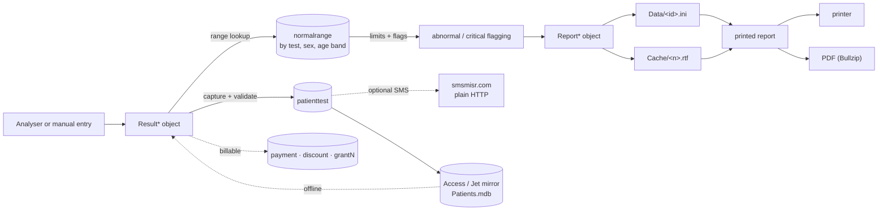
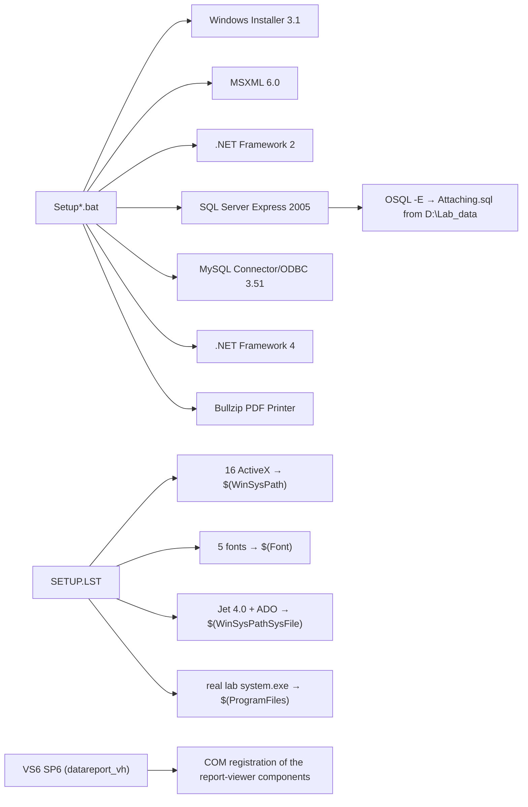

# Unified Application Architecture — RealLab CD 2019 v1.605

**Consolidated:** 2026-10-31 (UTC) · **Static analysis only.**
This document reconstructs the system as **one** application and states, for
each relationship, whether it is **CONFIRMED**, **STRONGLY INFERRED**,
**TENTATIVE** or **UNKNOWN**.

---

## 1. The layered system

```mermaid
flowchart TB
  subgraph HW["Hardware / OS"]
    H1["Windows 32-bit and 64-bit"]
    H2["SQL Server instance on the lab server"]
    H3["Workstations on the LAN"]
    H4["Printer · HP LaserJet 1100 (MS)"]
    H5["PDF printer · Bullzip 11.1.0.2600 (evaluation)"]
  end

  subgraph DEP["Deployment layer — B4"]
    D1["Setup*.bat — 9 prerequisite steps"]
    D2["VB6 Setup Wizard installer — WINXP and WIN7 variants"]
    D3["VS6 Service Pack 6 redistributable — datareport_vh"]
  end

  subgraph PLAT["Platform layer — B2"]
    P1["MSVBVM60.DLL 6.00.9782"]
    P2["16 ActiveX controls — grid · chart · ADO · serial · socket"]
    P3["MSDBRPTR.DLL — Microsoft Data Report"]
    P4["JScript · VBScript · msscript.ocx — HTML designer"]
    P5["OLE Automation · Jet 4.0 · ADO 2.81"]
  end

  subgraph APP["Application layer — B1 and the executable"]
    A1["real lab system.exe<br/>212 objects · 8,026 methods"]
    A2["labmain · patientmain · labdb"]
    A3["Result* family — ~55 disciplines"]
    A4["Report* family — ~40"]
    A5["barcode · workpaper · labtolab"]
    A6["users · login · server · instrument"]
    A7["moneypaid · frm_money · qcfrm"]
  end

  subgraph CONF["Configuration layer — B3"]
    C1["Data/*.ini — 146 per-test layout templates"]
    C2["Cache/*.rtf — 29 clinical reference documents"]
    C3["Fonts/*.ttf — 7 fonts"]
    C4["bin/*.jpg — PCR charts, letterhead"]
    C5["System/datareport_vh/*.gif — 14 HTML designer assets"]
  end

  D1 --> D2
  D2 --> P1
  D2 --> P2
  D3 --> P4
  D1 --> H2
  A1 --> P1
  A1 --> P2
  A3 --> C1
  A3 --> C2
  A4 --> C1
  A4 --> P3
  A4 --> H4
  A4 --> H5
  A5 --> C3
  A6 --> H2
  A1 --> H3
```

---

## 2. Component relationship table

| Relationship | Evidence class | Basis |
|---|---|---|
| The executable imports **only** `MSVBVM60.DLL` | **CONFIRMED** | PE import table, 231 functions |
| The VB6 runtime is deployed by the product's own installer | **CONFIRMED** | B4 `SETUP.LST` → `$(WinSysPathSysFile)`; SHA-256 identity with B2's `OCX/msvbvm60.dll` |
| The 16 ActiveX controls are deployed by the installer and self-register | **CONFIRMED** | B4 `SETUP.LST` `$(DLLSelfRegister)` ×16; SHA-256 identity with B2 |
| `MSDBRPTR.DLL` is the report rendering engine | **CONFIRMED** (B2 inventory) / **INFERRED** (its use by the `Report*` objects) | B2 catalogues it as Microsoft Data Report; the executable does not import it directly (VB6 late binding) |
| The `Report*` objects render the `Data/*.ini` templates | **STRONGLY INFERRED** | the objects exist, the templates exist, the keys correspond one-to-one with the manual's UI — but the call chain was not decompiled (UNR-010) |
| The `Result*` objects capture results into `patienttest` and validate against `normalrange` | **STRONGLY INFERRED** | 138 and 78 SELECT targets respectively; the object's names; the manual's description |
| The report designer is HTML-based and script-capable | **CONFIRMED** | B3's HTML tag assets in the same directory as B2's script engines; B4's SP6 redistributable in that directory |
| The HTML designer renders through `mswless.ocx` | **TENTATIVE** | naming and the SP6 driver descriptor; the control was not re-analysed in this stage |
| The reference library (`Cache/*.rtf`) is bound to specific tests | **UNKNOWN** | the cache is keyed by a separate numeric namespace (006–500) that does not reconcile with the template IDs — B3 DEP-B3-U04 |
| The `winless`/`mswless` control hosts the report preview | **TENTATIVE** | as above |

---

## 3. The two deployment trees

B1 observed "two parallel deployment trees". B3 and B4 measured the
relationship, and it is **not** symmetry:

| Folder | Root tree | `RL_CD2019Access/` tree | Relationship |
| --- | ---: | ---: | --- |
| `bin/` | 5 | 14 | **superset** — the Access tree adds 9 stationery files |
| `Cache/` | 29 | 29 | **byte-identical mirror** |
| `Data/` | 37 | 109 | **superset** — 37 shared + 72 additional |
| `Fonts/` | 7 | 7 | **byte-identical mirror** |
| `System/datareport_vh/` | — | 46+14 | **Access tree only** |

**[STRONGLY INFERRED]** The root tree is the **VB6 client's** working set and
`RL_CD2019Access/` is the **Access-mirror application's** deployment tree.
The 72 additional templates are exactly the microbiology (100–115), molecular
biology (450–465) and four named disciplines — the disciplines whose result
tables live in the mirror.

---

## 4. Data-flow architecture

**The four cross-store flows** and their evidence class:

| Flow | Class | Basis |
|---|---|---|
| Result → `patienttest` → `patientinfo` | **CONFIRMED** (schema) / **INFERRED** (path) | B1's schema; the executable's 138 SELECTs on `patienttest` |
| `normalrange` → flagging → template rendering | **STRONGLY INFERRED** | 78 SELECTs; B4's manual topic 11; B3's `statusflag`/`backcolor` keys |
| SQL Server → Access mirror | **INFERRED** | both connection templates are in the executable; B1's schema shows the mirror's tables |
| Result → SMS gateway | **CONFIRMED** (the code path) | the reconstructed `InternetExplorer.Application` → `navigate2` flow |

---

## 5. Deployment-time relationships

**Every ActiveX control is installed into the 32-bit system directory and
self-registers.** That is the mechanism behind B2's FND-B2-005, and it is why
B2's component inventory and B4's install manifest describe the same set.

---

## 6. The report subsystem — the clearest cross-batch convergence

Three independent bodies of evidence describe the same subsystem:

| Body | What it establishes |
| --- | --- |
| **B3** — the data | 146 INI templates: geometry, colours, per-column fonts, item schemas with visibility flags, interpretive text, the printer binding, and the reference-range text |
| **The executable** — the code | `Result*` (capture) and `Report*` (render) objects per discipline; `reportsetup` (113 methods) and `normal_test` (36); ~40 `Report*` objects with **zero methods** |
| **B4** — the vendor's own description | the Report Settings window editing the report name, side title, reference-range caption, doctor's signature, comment, alignment, colours, vertical spacing, the printer, and five show/hide switches |

**All three agree, field for field.** The manual's "Print Status Flag (Low,
High, Critical)" is B3's `statusflag`; "Show abnormal result background
colour" is `backcolor`; "Print Critical Ranges If Found" is `printcritical`;
"Print Patient History Automatically" is `printhistory`; "Make Normal range
Font Bold" is the `normal` caption; the red/green/yellow geometry boxes are
`leftN` / `widthN` / the sub-heading offsets; and "Printing printer" is
`reportprinterx`.

**That convergence is the strongest single piece of evidence in the project**
that the template layer, the object layer and the vendor's UI are one system.

---

## 7. External integrations

| Integration | Direction | Mechanism | Evidence class |
| --- | --- | --- | --- |
| SQL Server | bidirectional | `SQLOLEDB.1` / `MSDataShape.1` | **CONFIRMED** |
| Access / Jet mirror | bidirectional | `Microsoft.Jet.OLEDB.4.0` | **CONFIRMED** |
| **SMS gateway** `smsmisr.com` | outbound | **Internet Explorer driven by COM**, plain HTTP, credentials in the URL | **CONFIRMED** |
| **Printer** | outbound | `HP LaserJet 1100 (MS)` from the templates | **CONFIRMED** |
| **PDF printer** | outbound | Bullzip 11.1.0.2600 (evaluation) | **CONFIRMED** (B4) |
| **MySQL** | **unknown** | Connector/ODBC 3.51 installed; **no connection string, DSN or code path in the executable** | **UNKNOWN** — an installed driver with no observed use |
| Vendor website / Facebook | reference only | strings in the binary and the manual | **CONFIRMED** (present) / not contacted |

---

## 8. Architectural conclusions

1. **One system, five portions.** B1 (application), B2 (platform), B3
   (content), B4 (deployment) and the executable investigation are five
   **complementary** views of a single product — not versions.
2. **The report subsystem is the spine.** It is where the code, the data and
   the vendor's documentation all meet.
3. **The deployment is the widest attack surface.** Machine-wide COM
   registration, system-directory DLL copies, a font installation that puts a
   renamed Microsoft typeface into every user's profile.
4. **The client is over-privileged.** It owns the server's schema.
5. **The localisation is a live tension** between a mandated English (Canada)
   regional format and Arabic Windows-1256 content.
