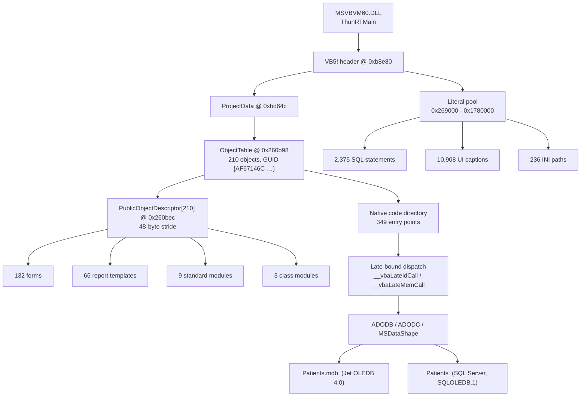
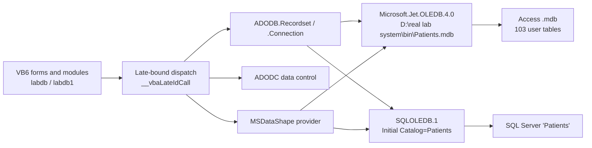
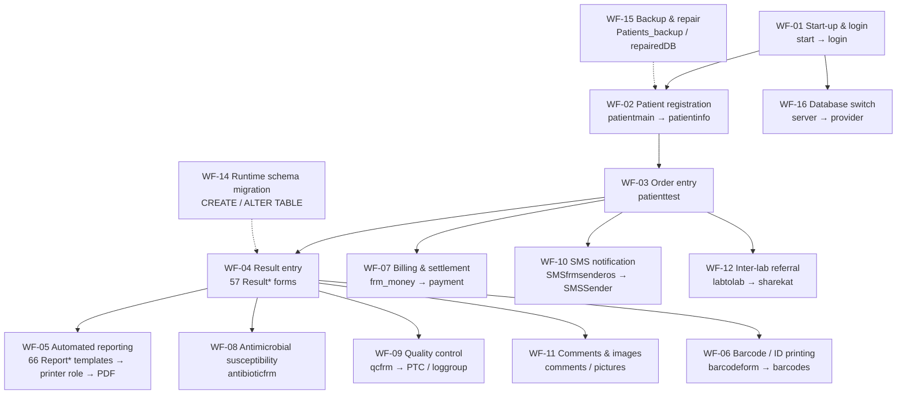

# `real lab system.exe` — Executable Reverse-Engineering Documentation

**Subject:** the RealLab / Real Laboratory System reference application, V-CD-2019 line, **version 1.605**
**Target file:** `F:\REAL_LAB_COPY\real lab system\RL_CD2019Access\System\real lab system.exe`
**Analysis date:** 2026-11-14
**Analysis mode:** **static only** — the binary was never executed, debugged, attached to or modified; nothing under `F:\` was written
**Status:** `COMPLETED WITH LIMITATIONS` — every section states its own status; §30 collects the limits, §31 the open questions

> This is a technical reverse-engineering reference for the executable, built entirely from
> evidence recovered from the artefact itself. It records what was recovered, how it was
> recovered, and — equally explicitly — what could **not** be recovered and why.

---

## 1. Executive technical overview

`real lab system.exe` is a **native-compiled Visual Basic 6** Windows desktop application: a 32-bit PE image
of 76,292,096 bytes whose single imported DLL is `MSVBVM60.DLL` (231 functions) — the canonical signature of a
VB6 native-compiled EXE. It is **not** managed: the CLR data directory is empty. It carries no relocation table,
no export table, no debug directory and no digital signature, and it is fixed at image base `0x00400000`.

The application is a clinical laboratory information system for the Arabic-speaking market: patient master and
order handling, result entry per test family, reference ranges, billing, quality control, SMS result
notification, barcode printing and a large family of patient result reports.

The structural picture recovered from the file is unusually complete for a VB6 binary, because the project
metadata survives natively:

| Layer | Recovered | Source |
|---|---:|---|
| VB6 project objects | **210** | `PublicObjectDescriptor[]` at file offset `0x260bec` — 132 forms, 66 report templates, 9 standard modules, 3 class modules |
| Object members | **8,026** across 210 objects | `dwMethodCount` per object |
| Control / member descriptors | **11,280** records in 247 tables | VB6 member-descriptor chain |
| Compiled-code entry points | **349**, all prologue-verified | VB6 native-code directory |
| SQL-bearing literals | **2,375** unique | VB6 literal pool, UTF-16LE |
| Distinct table identifiers | **127** | parsed from the SQL literals |
| Qualified `table.column` pairs | **508** | parsed from the SQL literals |
| Classified strings | **101,812** entries / 15,143 unique | whole-file ASCII + UTF-16LE sweep |

The application targets **three interchangeable database back-ends** for the same logical `Patients` database,
all named in the literal pool: **Jet OLEDB 4.0** (the shipped Access `.mdb`), **MSDataShape** (shape/rollup
queries layered over either provider) and **SQL Server via `SQLOLEDB.1`** (`Initial Catalog=Patients`). A legacy
**MSADODC** data control is referenced as well.

Its runtime behaviour is governed almost entirely by **INI files** under `D:\real lab system\` — **236 distinct
`.ini` paths** are named, including a per-analyte pair for roughly 55 test families — and by **printer-role
keys** (`reportprinter`, `barcodeprinter`, `IDprinter`, …) read through `GetPrivateProfileStringA`.
**No registry path occurs anywhere in the binary**: the application does not use the registry for its own
configuration.

Decompilation was **not** achieved. REA's Ghidra provider failed on tooling grounds (see §29), and the
environment offers no VB6-aware decompiler. The compensating work — decoding the VB6 project structures
directly out of the file — yielded **more** structural information than a generic decompiler would have,
because it recovers the *native* VB6 metadata (object names, member counts, code entry points) that a
decompiler discards. What remains genuinely unrecovered is **procedure names** and **per-form control
attribution** — see §16 and §30.

---

## 2. Executable identity

| Attribute | Value |
|---|---|
| Product | RealLab / Real Laboratory System — V-CD-2019 line |
| File | `real lab system.exe` |
| Version | **1.605** (`FileVersion`, `ProductVersion`, `FileDescription` = `RLS 1.605`) |
| Vendor | `RealLab` (`CompanyName`, `LegalCopyright`, `LegalTrademarks`) |
| Developer contact (from `Comments`) | `ais_soft_group@yahoo` |
| Original filename | `real lab system.exe` |
| Internal name | `real lab system` |
| Development technology | **Visual Basic 6, native-compiled** |
| Platform | Win32 (x86), GUI subsystem |
| Build stamp | PE timestamp `1595435962` → **2020-07-22T05:59:22Z** |

## 3. Original path

| Role | Path |
|---|---|
| Actual, verified path | `F:\REAL_LAB_COPY\real lab system\RL_CD2019Access\System\real lab system.exe` |
| Path as stated in the mission brief | `F:\REAL_LAB_COPY\RL_CD2019Access\System\real lab system.exe` |
| Difference | The brief's path omits the intermediate `real lab system\` directory level that the authorised source actually contains. The file was located at the verified path above and **only** at that path. |
| Deployment root | `real lab system\RL_CD2019Access\` — the V1.605 payload. The sibling tree is the earlier build and was excluded from substantive analysis. |
| **Path the application itself expects** | `D:\real lab system\bin\Patients.mdb` (literal at file offset `0x26fb88`) — the product is designed to be installed at `D:\real lab system\`, and the CD image's `Setup.bat` provisions exactly that path. |

## 4. File metadata

| Attribute | Value |
|---|---|
| Exact size | **76,292,096 bytes** (72.6 MiB) |
| DOS header | `e_lfanew` = `0xb8` |
| COFF header | file offset `0xbc`, 20 bytes |
| Optional header | file offset `0xd0`, 224 bytes (PE32) |
| Section table | file offset `0x1b0`, 3 × 40 bytes |
| Characteristics | `0x010F` — executable, no relocations, no line numbers, no symbols, 32-bit |
| Optional-header characteristics | `0x010F` |
| DllCharacteristics | `0x0` — **no ASLR, no DEP/NX, no SafeSEH, no CFG** |
| Checksum (header) | `0x0` — not set |
| OS / Subsystem version | 4.0 / 4.0 |
| Section/file alignment | `0x1000` / `0x1000` |
| SizeOfImage | `0x048B1000` |
| SizeOfHeaders | `0x1000` |
| ImageBase | `0x00400000` |
| Entry point | RVA `0x7142C` → VA `0x0047142C`, **file offset `0x7142C`** |
| Digital signature | **none** — the certificate data directory is `RVA 0x0, size 0` |
| PDB / debug info | **none** — the debug directory is `RVA 0x0` |

## 5. SHA-256

```
C54CE6C8C98A679EFC5AB485BC4B313B452026D6A40F9BDA36ECA7EA18DF93C0  real lab system.exe
```

The hash was computed **twice by independent implementations** — `Get-FileHash -Algorithm SHA256` over the whole
file, and Python `hashlib.sha256` in 1 MiB chunks — and both agree. It was also confirmed through the REA MCP
`open_binary` tool, which independently reported `sha256: c54ce6c8…df93c0` for the same path. The value matches
the hash recorded in the cumulative V2 knowledge base for this artefact.

The original was never rewritten. The only writes performed anywhere were to the analysis workspace outside
`F:\`.

## 6. Format and architecture

| Question | Answer | Basis |
|---|---|---|
| File format | **PE32** — 32-bit portable executable, `IMAGE_FILE_MACHINE_I386` (`0x014C`) | COFF header at `0xbc` |
| Native or managed? | **Native.** The CLR data directory (`index 14`) is `RVA 0x0, size 0`; no `mscoree.dll` import | data-directory table |
| Development technology | **Visual Basic 6, native-compiled** — `MSVBVM60.DLL` import block with 231 functions, plus a decoded `VB5!` project header with a populated `PublicObjectDescriptor` array | import table + VB6 structures (§17) |
| Runtime | `MSVBVM60.DLL` (VB6 runtime) supplied by the product's own `SETUP.LST` bootstrap | import table + `System\SETUP.LST` |
| Language / locale of the project | `dwLCID = 0x409` (en-US) at the VB header; the *data* it manages is Arabic | VB header `+0x24` |
| Subsystem | `2` = `IMAGE_SUBSYSTEM_WINDOWS_GUI` | optional header |
| Packing / obfuscation | **None detected.** Three sections with conventional names, normal characteristics, a plain import table, and readable literal pools. The `.text` entropy of 6.230 is consistent with compiled native code, not with a packed or encrypted image. | section map + string recoverability |
| Protection characteristics | The VB6 project-protection blobs (`CMG=` / `DPB=` / `GC=`) are **absent** from the file, so the project is not password-protected at the project level. No code-signing, no anti-debug, no integrity self-check. | whole-file literal sweep (§13) |
| Relocatability | **None.** The base-relocation directory is empty; the image is bound to `0x00400000` and cannot be rebased | data directories |
| Address↔offset arithmetic | `.text` raw offset == `.text` RVA (`0x1000`), therefore **file offset == RVA** everywhere inside `.text`, and `VA = 0x400000 + RVA` | section table |

## 7. Technology and runtime

### 7.1 The decisive evidence

| Evidence | Value |
|---|---|
| Imported DLL | `MSVBVM60.DLL` — the VB6 runtime — and nothing else |
| VB6 magic | `VB5!` at file offset **`0xb8e80`** (VA `0x004B8E80`), inside `.text` |
| Entry-point confirmation | at RVA `0x7142C`: `push 0x4b8e80` → `call 0x471424` → `ThunRTMain` in `MSVBVM60.DLL` |
| VB6 runtime build | `wRuntimeBuild = 9782`, `wRuntimeRevision = 10` |
| Project GUID | `{AF67146C-22A0-4591-9ED3-52BEB9D44D32}` |
| Project name | `Real_lab_system` |
| Object count | `wObjectCount = 210`, `wCompiledCount = 210`, `wObjectsInUse = 212` |
| Late-bound dispatch | `__vbaLateIdCall`, `__vbaLateIdSt`, `__vbaLateMemCall`, `__vbaLateMemSt` and their `Ld`/`St`/`Ad` variants are imported → the application performs **late-bound COM/ActiveX calls** (the ADODB/ADODC/MSDataShape providers and the third-party OCXs) |
| ActiveX event sink | `EVENT_SINK_GetIDsOfNames`, `EVENT_SINK_Invoke`, `EVENT_SINK_AddRef`, `EVENT_SINK_Release`, `EVENT_SINK_QueryInterface`, `Zombie_GetTypeInfo`, `Zombie_GetTypeInfoCount` |

### 7.2 What the runtime means for the analysis

VB6 native compilation dispatches object methods, events and form lifecycle entirely through the runtime.
A generic decompiler therefore sees only opaque `MSVBVM60`-driven x86: every interesting operation is a late-bound
`__vbaLateIdCall` / `__vbaLateMemCall` dispatch. The information that *is* recoverable without decompilation is
the **native metadata the compiler wrote into the image** — the project header, the object table, the member
descriptors, the code directory and the literal pool — and that is what this document is built from (§14–§18).

### 7.3 Third-party runtime dependencies

| Dependency | Evidence | Role |
|---|---|---|
| `MSVBVM60.DLL` | import table | VB6 runtime — the only hard import |
| `MSADODC.OCX` / `MSAdodcLib.Adodc` | literals at `0x1229d8`, `0x2bfaac`, `0x2bfacc`, `0x5b9e6a` | legacy ODBC data control |
| `Microsoft.Jet.OLEDB.4.0` | literal at `0x28cc8c` | Access/Jet data provider |
| `Provider=SQLOLEDB.1` | literal at `0x2da75c` | SQL Server provider |
| `Provider=MSDataShape` / `MSDataShape.1` | literals at `0x272418`, `0x2da928` | hierarchical shape/rollup provider |
| `ChamaleonButton.oca` → `ChamaleonButton` | literal at `0x26bc50` | third-party button control |
| `Redsoul911XPCOmponents.oca` → `Redsoul911XPControls`, `ZCRedsoulFrame`, `RedsoulFrame*` | literal at `0x26c0f6` | third-party frame controls |
| `RgheedButtonV2xx`, `XPButton*`, `DTPicker*`, `ChameleonBtn*` | control names in the member table | third-party controls |
| `VB6.OLB` | literal at `0x26bb20` | the VB6 object library itself |
| `winspool.drv` | literal at `0x26e924` | Windows printing subsystem |

**These OCX/type-library dependencies are a genuine deployment risk**: they are not present on a clean Windows
machine and are not part of the Windows OS. The product ships `SETUP.LST` (45 entries — 6 bootstrap + 39 `Setup1`
registrations) and `SetupPZ.bat` to register them.

## 8. Analysis tools and versions

| Tool | Version | Role | How availability was verified | Outcome |
|---|---|---|---|---|
| REA CLI (`rea`) | **6.7.0** | binary analysis entry point | `rea --version` → `6.7.0`; `rea doctor` executed | CLI available; Ghidra provider blocked at runtime (§29) |
| REA MCP server | 207 registered tools | `open_binary`, `inspect_pe_resources`, `binary_overview` … | `open_binary` returned `format: pe, architecture: x86, sha256: c54ce6c8…` — **succeeded** | Identity confirmed via MCP; resource inspection **rejected** the file (>64 MiB budget) |
| Ghidra | **12.1.4** (`C:\Tools\ghidra_12.1.4_PUBLIC`) | the only deep-analysis engine present | `rea doctor` reports every Ghidra check healthy once `JAVA_HOME` is set for the invocation | Provider **failed** on this binary after three attempts (§29) |
| Hopper / IDA / jadx / kuna | — | alternative analysis engines | `rea doctor` reports them unconfigured | **Not available.** No substitute was silently used |
| Python | **3.13.1** | PE parser, resource walker, VB6 structure decoder, string sweep, SQL parser | `python --version` | All successful — this was the primary analysis path |
| PowerShell | **7.6.10** | orchestration, hashing, archive checks | `$PSVersionTable.PSVersion` | Successful |
| Custom PE/VB6 parsers written for this mission | — | `pe_parse.py`, `res_parse.py`, `vb_hdr.py`, `objtab.py`, `members.py`, `pool.py`, `str_raw.py`, `classify.py`, `sqlx.py`, `verify_code.py` | executed against the artefact | Successful; all outputs are hashed and stored (§29) |

**No tool was claimed that was not actually invoked.** Every figure in this document was produced by one of the
tools above, and every output is reproducible from the scripts stored with the evidence.

## 9. PE structure

### 9.1 DOS and PE headers

| Field | Value | File offset |
|---|---|---|
| `MZ` signature | `4D 5A` | `0x00` |
| `e_lfanew` | `0xB8` | `0x3C` |
| `PE\0\0` signature | `50 45 00 00` | `0xB8` |
| COFF `Machine` | `0x014C` (`I386`) | `0xBC` |
| COFF `NumberOfSections` | `3` | `0xBE` |
| COFF `TimeDateStamp` | `1595435962` (2020-07-22T05:59:22Z) | `0xC0` |
| COFF `SizeOfOptionalHeader` | `224` | `0xC4` |
| COFF `Characteristics` | `0x010F` | `0xCE` |
| Optional header magic | `0x010B` (PE32) | `0xD0` |
| `MajorLinkerVersion` / `MinorLinkerVersion` | **6.0** | `0x12E` |
| `MajorOperatingSystemVersion` | 4 | |
| `MajorSubsystemVersion` | 4 | |
| `SizeOfCode` | `0x0489F000` | |
| `AddressOfEntryPoint` | `0x0007142C` | |
| `BaseOfCode` | `0x00001000` | |
| `ImageBase` | `0x00400000` | |
| `SectionAlignment` / `FileAlignment` | `0x1000` / `0x1000` | |
| `SizeOfImage` | `0x048B1000` | |
| `SizeOfHeaders` | `0x1000` | |
| `CheckSum` | `0x0` | |
| `Subsystem` | `2` (WINDOWS_GUI) | |
| `DllCharacteristics` | `0x0` | |
| `NumberOfRvaAndSizes` | `16` | |
| `SizeOfStackReserve` / `Commit` | `0x200000` / `0x1000` | |
| `SizeOfHeapReserve` / `Commit` | `0x100000` / `0x1000` | |

### 9.2 Section map

| # | Name | File offset | Raw size | RVA | Virtual size | Characteristics | Entropy |
|---|---|---|---:|---|---:|---|---:|
| 0 | `.text` | `0x1000` | 76,120,064 (`0x48A0000`) | `0x1000` | 76,119,116 | `0x60000020` — CODE, EXECUTE, READ | 6.230 |
| 1 | `.data` | `0x4899000` | 4,096 (`0x1000`) | `0x4899000` | 304,852 | `0xC0000040` — INITIALIZED_DATA, READ, WRITE | **0.000** |
| 2 | `.rsrc` | `0x489A000` | 163,840 (`0x28000`) | `0x48E4000` | 161,682 | `0x40000040` — INITIALIZED_DATA, READ | 6.361 |

`.text` is 95 % of the file: native-compiled VB6 code plus the VB6 literal and object pools (§13, §14).
`.data` is present but carries **no recoverable static content** — 4,096 raw bytes against a 304,852-byte virtual
size, entropy exactly zero. Whatever it holds is written at run time.

### 9.3 Data directories

| # | Directory | RVA | Size | Note |
|---:|---|---|---:|---|
| 0 | Export | `0x0` | 0 | none |
| 1 | **Import** | `0x4897D04` | 40 | one descriptor |
| 2 | Resource | `0x48E4000` | 161,682 | 12 entries, 3 types |
| 3 | Exception | `0x0` | 0 | none |
| 4 | Security/Certificate | `0x0` | 0 | **unsigned** |
| 5 | Base relocation | `0x0` | 0 | **not relocatable** |
| 6–9 | Debug, Architecture, Global Ptr, TLS | `0x0` | 0 | none |
| 10 | Load config | `0x0` | 0 | none |
| 11 | Bound import | `0x0` | 0 | none |
| 12 | **IAT** | `0x1000` | 928 | 231 thunks |
| 13 | Delay import | `0x0` | 0 | none |
| 14 | **CLR** | `0x0` | 0 | **not managed** |
| 15 | Reserved | `0x0` | 0 | |

## 10. Dependencies

### 10.1 Classification of every dependency

| Dependency | Class | Evidence |
|---|---|---|
| `MSVBVM60.DLL` | **Directly imported** | import descriptor at `0x4897D04`; 231 functions |
| `kernel32` / `user32` Win32 APIs | **Dynamically referenced** | VB6 `Declare` block at file offsets `0x26C634`–`0x26F740`; the `DllFunctionCall` import proves runtime resolution |
| `Microsoft.Jet.OLEDB.4.0` | **Dynamically referenced (late-bound COM)** | literal at `0x28CC8C`; used through `__vbaLateIdCall` |
| `Provider=SQLOLEDB.1` | **Dynamically referenced (late-bound COM)** | literals at `0x2DA75C`, `0x2DAA10` |
| `Provider=MSDataShape` / `MSDataShape.1` | **Dynamically referenced (late-bound COM)** | literals at `0x272418`, `0x2DA928` |
| `MSADODC.OCX` / `MSAdodcLib.Adodc` | **Dynamically referenced (ActiveX)** | literals at `0x1229D8`, `0x2BFAAC`, `0x2BFACC`, `0x5B9E6A` |
| `ChamaleonButton` | **Detected through metadata** | `ChamaleonButton.oca` type-library reference at `0x26BC50` |
| `Redsoul911XPControls` | **Detected through metadata** | `Redsoul911XPCOmponents.oca` at `0x26C0F6` |
| `winspool.drv` | **Detected through metadata** | literal at `0x26E924`; printing goes through the Windows spooler |
| `Bullzip PDF Printer` | **Detected through metadata** | literals at `0x2A24C8`, `0x2A25A0` — a third-party PDF printer used for report output |
| `C:\WINDOWS\system32\MSADODC.oca` | **Detected through metadata** | literal at `0x2BFAAC` |

### 10.2 Recovered Win32 `Declare` block

The application's direct Win32 surface (file offsets `0x26C634`–`0x26F740`):

`Sleep` · `GetTickCount` · `LoadKeyboardLayoutA` · `UnloadKeyboardLayout` · `ActivateKeyboardLayout` ·
`GetKeyboardLayout` · `GetKeyboardLayoutList` · `GetKeyboardLayoutNameA` · `ExitWindowsEx` ·
`GetPrivateProfileStringA` · `GetPrivateProfileIntA` · `WritePrivateProfileStringA` · `SendMessageA` ·
`DrawMenuBar` · `GetMenuItemCount` · `GetSystemMenu` · `RemoveMenu` · `EnumPrintersA` · `SetDefaultPrinterA`

This list is itself a statement about the design: the application reads and writes **INI files** directly, it
**enumerates and switches printers** by role, it **sends window messages** (for the custom controls it hosts),
and it can **shut down Windows** via `ExitWindowsEx`.

### 10.3 Database provider detail — three back-ends for one database

| Purpose | Connection string (file offset) |
|---|---|
| Access/Jet — primary | `PROVIDER=MSDataShape;Data PROVIDER=Microsoft.Jet.OLEDB.4.0;Data Source=D:\real lab system\bin\Patients.mdb;` (`0x28A640`) |
| Access/Jet — plain | `Microsoft.JET.OLEDB.4.0` (`0x28CC8C`) |
| Access/Jet — backup store | `D:\real lab system\bin\Patients_backup.mdb` (`0x28CCC0`) |
| Access/Jet — repair copy | `D:\real lab system\bin\repairedDB.mdb` (`0x2EEF14`) |
| SQL Server — credential-bearing form | `Provider=SQLOLEDB.1;Persist Security Info=True;Initial Catalog=Patients;Data Source=` (`0x2DA75C`) |
| SQL Server — shape over SQL Server | `Provider=MSDataShape.1;Persist Security Info=True;Initial Catalog=Patients;Data Provider=SQLOLEDB.1;Data Source=` (`0x2DA928`) |
| SQL Server — integrated security | `Provider=SQLOLEDB.1;Integrated Security=SSPI;Persist Security Info=False;Initial Catalog=Patients;Data Source=` (`0x2DAA10`) |
| SQL Server — shape, integrated | `Provider=MSDataShape.1;Integrated Security=SSPI;…` (`0x2DAB0C`) |
| Bare file name | `Patients.mdb` (`0x2EF028`) |
| Legacy ODBC control | `MSADODC.OCX`, `MSAdodcLib.Adodc`, `C:\WINDOWS\system32\MSADODC.oca` |

`Persist Security Info=True` on the SQL Server form means the connection string may carry user credentials —
consistent with the SQL Server account and password found **inside** `Patients.mdb` in `reportview.strip3` /
`reportview.strip4` (see `Database documentation.md` §26). No credential value is reproduced in this document.

The **`repairedDB.mdb`** literal is significant: the application has a *repair* path that produces a separate
database file, which explains the presence of `Patients_backup.mdb` in the shipped payload.

## 11. Imports and exports

### 11.1 Summary

| Property | Value |
|---|---|
| Imported DLLs | **1** — `MSVBVM60.DLL` |
| Imported functions / thunks | **231** (172 named, 59 by ordinal) |
| Exported functions | **none** — the export directory is empty |
| Delay-loaded imports | **none** |
| Bound imports | **none** |
| Import descriptor file offset | `0x4897D04` |
| IAT | RVA `0x1000`, size 928, file offset `0x1000` |

The complete 231-row import table, with ordinals, hints and thunk RVAs, is in **Appendix A**.

### 11.2 What the import set implies

* **`__vbaLateIdCall` / `__vbaLateIdSt` / `__vbaLateMemCall` / `__vbaLateMemSt`** (with `Ld`/`St`/`Ad`/`StAd`
  variants) — the application binds to COM objects **by name at run time**. This is how it talks to ADODB,
  ADODC, MSDataShape and the third-party OCXs, and it is why no provider DLL appears in the import table.
* **`DllFunctionCall`** — the VB6 mechanism for resolving the `Declare` block (§10.2).
* **`EVENT_SINK_*` + `Zombie_GetTypeInfo`** — the EXE hosts an ActiveX event sink.
* **`__vbaFileOpen` / `__vbaFileClose` / `__vbaPrintFile` / `__vbaLineInputVar`** — the application reads and
  writes plain files itself, independently of the INI API.
* **`__vbaOnError` / `__vbaExceptHandler` / `__vbaFPException`** — VB6 error handling is pervasive, which
  matters for the reliability assessment.
* **No `CreateFile` / `WriteFile` / `RegOpenKey` / `InternetOpen`** — no direct Win32 file, registry or
  network API is imported. File and registry access is therefore routed through the VB6 runtime, the INI API
  and ADO; **no direct socket or WinINet import exists**, which is consistent with the URL literals being
  display text (a vendor web address) rather than runtime endpoints.

## 12. Embedded resources

| Property | Value |
|---|---|
| Resource directory root | RVA `0x48E4000`, file offset `0x489A000`, declared size 161,682 bytes |
| Resource entries | **12**, in **3 types** |
| Types present | `RT_ICON` (10), `RT_GROUP_ICON` (1), `RT_VERSION` (1) |
| Types absent | `RT_MANIFEST`, `RT_DIALOG`, `RT_STRING`, `RT_RCDATA`, `RT_MENU`, `RT_ACCELERATOR`, `RT_BITMAP`, `RT_CURSOR`, `RT_FONTDIR`, `RT_FONT`, `RT_MESSAGETABLE` |

`RT_GROUP_ICON` id 1 declares 10 images at 16×16, 32×32, 48×48, 128×128 and 256×256 pixels, in 4-bpp (16-colour)
and 32-bpp (alpha) variants. All twelve payloads were extracted to individual files and hashed; the full table
with RVA, file offset and SHA-256 is in **Appendix B**.

**No application manifest is present.** Consequently there is no `requestedExecutionLevel`, no DPI-awareness
declaration, no `<supportedOS>` list, no UAC declaration and no Common Controls v6 dependency — consistent with
a VB6 application that declares its controls in code and predates the manifest era.

### 12.1 Version resource (`VS_VERSIONINFO`, language 1033/en-US, file offset `0x489A2A0`, 804 bytes)

```
CompanyName      = RealLab
FileDescription  = RLS 1.605
FileVersion      = 1.605
ProductName      = real lab system
ProductVersion   = 1.605
InternalName     = real lab system
OriginalFilename = real lab system.exe
LegalCopyright   = RealLab
LegalTrademarks  = RealLab
Comments         = ais_soft_group@yahoo
```

`VS_FIXEDFILEINFO`: signature `0xFEEF04BD`, `fileVersion = 1.605.0.0`, `productVersion = 1.605.0.0`.
Independently re-parsed from the raw resource bytes as a cross-check of the subagent's extraction.

## 13. Strings and metadata

### 13.1 Method

A whole-file sweep for ASCII runs `[\x20-\x7e]{4,}` and UTF-16LE runs `(?:[\x20-\x7e]\x00){4,}` produced
**369,877 raw hits**. The `.text` section is mostly compiled x86, and compiled bytes generate large numbers of
spurious printable runs. A per-64-KiB density analysis localised the genuine VB6 literal and object pools to
file range **`0x269000`–`0x1780000`** (≈ 21 MiB): inside that range UTF-16 density is ≥ 120 strings per 64 KiB
block, whereas outside it the residue is uniform code noise (`j<hD-g`, `h4-g`, `LSVW`). Two further dense
pockets were checked and explained (the `.rsrc` version block).

**Final retained set: 101,812 classified entries / 15,143 unique texts**, after dropping 34,745 in-pool noise
runs and keeping 40 out-of-pool strings that matched a strong pattern.

### 13.2 Classification

| Category | Entries | Unique texts |
|---|---:|---:|
| `identifier_or_other` (control/property names, font names) | 72,723 | 7,659 |
| `vb6_member_name` | 15,259 | 2,213 |
| `ui_caption_or_message` | 10,908 | 2,600 |
| `sql_statement` | 1,539 | 1,534 |
| `sql_fragment` | 757 | 742 |
| `sql_ddl` | 438 | 365 |
| `vb6_form_or_module_name` | 421 | 209 |
| `file_path` | 342 | 333 (236 distinct `.ini`) |
| `report_name` | 148 | 82 |
| `url` | 133 | 21 |
| `ole_reference` | 39 | 32 |
| `credential_like` | 29 | 25 |
| `error_or_message` | 22 | 22 |
| `db_connection_or_driver` | 20 | 19 |
| `printer_role` | 10 | 10 |
| `registry_path` | **0** | **0** |

The per-entry detail — file offset, encoding, byte length, text and every category it matched — is in
`strings_classified.json` (`strings[]`, 12.2 MB), with a de-duplicated index in `unique_text_index`.

### 13.3 Configuration is INI-based, and the registry is not used

**236 distinct `.ini` paths** are named. The structure is:

| Group | Examples |
|---|---|
| Core configuration | `bin\BASE.ini`, `bin\SETING.ini`, `bin\note.ini`, `bin\IDCARD.INI` |
| Data/aggregates | `Data\MEMORY.ini`, `Data\data.ini`, `Data\TOTAL.ini` |
| Per-analyte pair | `Data\data_emp\<TEST>.ini` and `<TEST>_S.ini` for ~55 test families — `CBC`, `WIDAL`, `LIVER`, `URINE`, `STOOL`, `KIDNEY`, `LIPIDS`, `SEMEN`, `ABO`, `HEPATITIS`, `ESR`, `TORCH`, `CRP`, `PT`, `HORMONES`, `ANYREPORT`, `INSULIN`, `IRON`, `BILH`, `DEFUALT` *(sic)*, `Electrolytes`, `CARDIAC`, `TUMORS`, `VITAMINS`, `TRACE`, `ALL`, `PREGNANCY`, `FERTLITY`, `SUPRARENAL`, `ABUSE`, `DRUGS`, `COFACTOR`, `IMMUNOGLOB`, `IMMUNOLOGY`, `HBELECTRO`, `PROTELECTRO`, `BLOODGAS`, `CROSS`, `SUGARCURVE`, `STONE`, `PROSTATA`, `CSF`, `ZN`, `TUBERCULIN`, `BONEMAR`, `POSTCOIT`, `RENALF`, `400`, `WIDAL2`, `RATIO`, `Helicobacter`, `SEMEN5`, `URINEauto` |

The `<TEST>.ini` / `<TEST>_S.ini` pair is the mechanism behind the report templates: one INI drives the result
form layout for a test family, the other its print layout. This is corroborated by the 66 `Report*` objects and
57 `Result*` objects in the project (§15).

**Registry paths: none.** No `HKEY_*` and no `Software\…` literal occurs anywhere in the file. The application
does not use the registry for its own configuration — every setting is in an INI under the installation root.
(This is a whole-file literal sweep; registry paths assembled at run time from fragments would not be visible —
see §30.)

### 13.4 User-facing captions and messages

10,908 caption/message entries (2,600 unique) were recovered. A representative selection, with file offsets:

| Offset | Text |
|---|---|
| `0x26D76C` | `Please Enter Your Internal Password.   (Digits only)` |
| `0x26D7DC` | `Internal Password` |
| `0x26DAD0` | `No Password Entered.` |
| `0x26DB04` | `You must enter a Password.` |
| `0x26DD5C` | `Wrong Password Entered.` |
| `0x26DD90` | `Enter The Correct Password.` |
| `0x284E08`, `0x1054031` | `Print Result Password` |
| `0x2EE678` | `Enter login password` |
| `0x2AB878`, `0x2B1638` | `By password: ` / `Password ` — report footer label |
| `0x3FA0A1` | `Account Password` |
| `0x2D7E04` | `Can't find any printer.` |
| `0x26EDC4` | `Wrong connection` |
| `0x26ED90` | `Modify data Connection` |
| `0x334B78` | `Error ... Enter the Accont ID and Password first` *(sic — in the binary)* |
| `0x271824` | `An error has occurred, Please make sure your browser, Or select other` |
| `0x56AB50` | `Printing  printer` |

### 13.5 URLs and network endpoints

21 unique URLs, none of which is a runtime service endpoint:

`http://ns.adobe.com/xap/1.0/…` (XMP metadata namespaces) · `http://www.iec.ch` (`0x47B6DF`) ·
`Website: http://www.RealLabeg.com` (`0xD0F834`) · `https://www.facebook.com/RealLab.Systems` (`0x2717CC`) ·
`https://www.facebook.com/RealLab.SPRT` (`0x271910`) · `www.Facebook.com/RealLab.SPRT` (`0x16F3E53`) ·
`WWW.NATIGH.COM` (`0x2AB824`, `0x2ACA24`, `0x2B1650`).

The Adobe and IEC namespaces are inert string constants carried by the reporting stack; the `RealLabeg.com`
and `facebook.com` entries are vendor contact text. **No WinINet/WinHTTP socket import exists**, so the
application opens no network connection of its own.

### 13.6 Printer-role names

| Role key | File offset |
|---|---|
| `reportprinter` | `0x2D6194` |
| `reportprinterx` | `0x2821B4` |
| `zarfprinter` | `0x285150` |
| `barcodeprinter` | `0x2B175C` |
| `waslprinter` | `0x2AB334` |
| `IDprinter` | `0x2A5EA4` |

These are INI keys: the application resolves the physical printer for each *role* at run time via
`GetPrivateProfileStringA`. This is a sound design for a multi-printer laboratory (barcode printer, ID-card
printer, report printer, Zebra label printer) and it means **the deployment, not the code, decides which
physical devices exist**.

## 14. Internal program organisation



### 14.1 The VB6 header — file offset `0xB8E80` (VA `0x004B8E80`)

| Offset (rel. `0xB8E80`) | Field | Value |
|---|---|---|
| `+0x00` | `szVbMagic` | `VB5!` |
| `+0x04` | `wRuntimeBuild` | 9782 |
| `+0x22` | `wRuntimeRevision` | 10 |
| `+0x24` | `dwLCID` | `0x409` (en-US) |
| `+0x28` | `dwSecLCID` | `0x0` |
| `+0x2C` | `lpSubMain` | `0x0` — **no `Sub Main`; the startup form is used** |
| `+0x30` | `lpProjectData` | `0x004BD64C` (file offset `0xBD64C`) |
| `+0x34` / `+0x38` | `fMdlIntCtls` / `fMdlIntCtls2` | `0x01F8FFFF` / `0xFFFFFF00` |
| `+0x40` | `dwThreadCount` | 1 |
| `+0x44` | `dwFormCount` | **198** |
| `+0x46` | `dwExternalCount` | **25** |

### 14.2 `ProjectData` — file offset `0xBD64C`

| Offset | Field | Value |
|---|---|---|
| `+0x00` | `dwVersion` | `0x1F4` (500) |
| `+0x04` | `lpObjectTable` | `0x00660B98` (file offset `0x260B98`) |
| `+0x08` | `dwNull` | 0 |
| `+0x0C` | `lpCodeStart` | `0x01B41260` — *does not correspond to a `.text` VA range; not interpretable as a code span* |
| `+0x10` | `lpCodeEnd` | `0x04C97D00` — likewise |
| `+0x14` | `dwDataSize` | 305,356 |
| `+0x18` | `lpThreadSpace` | `0x04C99008` |
| `+0x1C` | `lpVbaSeh` | `0x00470EC6` |
| `+0x20` | `lpNativeCode` | `0x04C99000` |

The real code extent was therefore established empirically from the 349-entry compiled-code directory (§16.2)
rather than from `lpCodeStart`/`lpCodeEnd`.

### 14.3 `ObjectTable` — file offset `0x260B98`

| Offset | Field | Value |
|---|---|---|
| `+0x04` | `lpExecProj` | `0x04C9A4B8` |
| `+0x08` | `lpProjectInfo2` | `0x01B40CAC` |
| `+0x14` | `lpProjectObject` | `0x04C9A4A8` |
| `+0x18` | `uuidObject` | **`{AF67146C-22A0-4591-9ED3-52BEB9D44D32}`** (project GUID) |
| `+0x28` | `wCompileType` / `wObjectCount` | `0x000A` / **`0x00D2` = 210** |
| `+0x2C` | `wCompiledCount` / `wObjectsInUse` | 210 / 212 |
| `+0x30` | `lpObjectArray` | `0x00660BEC` |
| `+0x40` | `lpszProjectName` | **`Real_lab_system`** (VA `0x0066AEBC`) |

### 14.4 `PublicObjectDescriptor[210]` — file offset `0x260BEC`, 48-byte stride

```
+0x00  lpObjectInfo      VA of the per-object ObjectInfo structure
+0x04  dwReserved        0xFFFFFFFF
+0x08  lpPublicBytes     VA into the literal pool
+0x0C  lpStaticBytes     0
+0x10  lpModulePublic    non-zero for only the 9 standard modules
+0x14  lpModuleStatic    0
+0x18  lpszObjectName    VA of the ANSI object name
+0x1C  dwMethodCount     member count (0 for the 66 report templates)
+0x20  lpMethodNames     VA; zero-filled in the file image for most objects
+0x24  bStaticVars       0xFFFF
+0x28  fObjectType       0x18083 / 0x18001 / 0x1018083 / 0x118003
+0x2C  dwNull
```

All 210 `lpObjectInfo` pointers resolve to a valid `ObjectInfo` structure, each containing a back-pointer to
`0x00660B98`. The `ObjectInfo` layout was confirmed at file offset `0xBDB5C`:
`+0x00 wRefCount/wObjectIndex` · `+0x04 lpObjectTable` · `+0x08 lpIdeData` · `+0x0C lpPrivateObject` ·
`+0x18 lpObject` (self) · `+0x1C lpProjectData` · `+0x34 lpIdeData3` · `+0x3C lpConstants`.

Object names occupy file offsets **`0x26AEBC`–`0x26B980`**: the project title `Real_lab_system` at `0x26AEBC`,
then the 210 object names from `0x26AECC` to `0x26B970`.

## 15. Recoverable classes and modules

### 15.1 Object classification

| `fObjectType` | Count | Interpretation | Representative names |
|---|---:|---|---|
| `0x18083` | **132** | ordinary VB6 forms | `labmain`, `patientmain`, `frm_money`, `Resultliver`, `tools`, `addpatient`, `login` |
| `0x1018083` | **66** | report / print templates (0 member entries each) | `Reporturine`, `Reportliver`, `ReportFatora`, `Reportworkp`, `Reportmony1` |
| `0x18001` | **9** | standard modules (`.bas`) | `labdb`, `labdb1`, `BCWFonts`, `labfunction`, `printerselect`, `saveIOtemp`, `boisais`, `mInputbox`, `otherfun` |
| `0x118003` | **3** | class modules (`.cls`) | `aaaClass`, `CRect`, `BiosData` |
| | **210** | **total** | |

Member counts: minimum 0, maximum **231** (`resultIgeAllergy`), **sum 8,026**. **65 objects have zero member
entries** — all of them report templates whose layout lives in the binary form data rather than in the member
table. The full 210-row table with each object's pointers is in **Appendix C**.

### 15.2 The nine standard modules — the application's shared layer

| Module | Role inferred from name and usage |
|---|---|
| `labdb` | database access layer — the module that owns the ADO connections and the SQL execution |
| `labdb1` | secondary/extended database access layer |
| `labfunction` | shared business functions |
| `printerselect` | printer enumeration and role→printer resolution |
| `saveIOtemp` | temporary I/O and staging (import/export work area) |
| `BCWFonts` | font management for the report/result templates |
| `boisais` | auxiliary helper routines |
| `mInputbox` | custom input-box implementation |
| `otherfun` | miscellaneous helpers |

*Role descriptions are INFERENCE from the module names and from the surrounding evidence; the module bodies
were not decompiled (§30).*

### 15.3 The three class modules

| Class | Role inferred |
|---|---|
| `CRect` | rectangle geometry helper — consistent with the `Redsoul911XPControls`/`ChamaleonButton` custom-control host and with layout maths |
| `BiosData` | biosensor/analyzer data structure — consistent with the `instrument` form and the `Data\data_emp\<TEST>.ini` analyte configuration |
| `aaaClass` | an auxiliary class; its name gives no functional signal |

### 15.4 The 132 forms — functional map

| Functional group | Forms |
|---|---|
| **Startup / shell** | `start`, `login`, `logindete`, `server`, `labmain`, `labmainTools`, `labxxyyzz`, `tools`, `ais` |
| **Patient management** | `patientmain`, `patient`, `patientview`, `addpatient`, `patienthistory`, `patienthistory2`, `outtest`, `Patient_samples` |
| **Test master / configuration** | `testmain`, `testrange`, `calctest`, `normal_test`, `converter`, `abbrevi`, `learntest`, `commentsetup`, `anyreport` |
| **Result entry (57)** | `Resultliver`, `Resulturine`, `ResulturineAuto`, `Resultsugar`, `Resultstool`, `Resultkidney`, `Resultlipids`, `Resultsemen`, `Resultsemen5`, `ResultESR`, `resultcbc`, `resultcrp`, `resultpt`, `resulthormon`, `resulthepatitis`, `resultwidal`, `resultwidal2`, `resultTORCH`, `resultculutre`, `resultbloodgas`, `resultcardiac`, `resultTumors`, `resultVitamins`, `resultTrace`, `resultpregnancy`, `resultiron`, `resultInsulin`, `resultFertlity`, `resultSuprarenal`, `resultbilharzias`, `resultselectro`, `resultanytest`, `resultabuse`, `resultdrugs`, `resultcoagfactor`, `resultImmunoglob`, `resultimmun`, `resulthgbelec`, `resultprotelec`, `resultcrossm`, `resultsugacurve`, `resultstone`, `resultprostata`, `resultcsf`, `resultzn`, `resultTUBERCULIN`, `resultmarrow`, `resultpostcoital`, `resultrenal`, `resultretios`, `resultha1c`, `resulthpylori`, `resultABO`, `resultPCR`, `resultFMF`, `resultLBC`, `resultIgeAllergy` |
| **Billing / money** | `frm_money`, `moneypaid`, `moenysharekat`, `moenymozafeen`, `shoppingfrm`, `z_pricelists` |
| **Quality control** | `qcfrm` |
| **Users / access / branches** | `users`, `userspw`, `z_labaccount`, `z_branchs`, `z_barcodes`, `z_units`, `z_titles`, `z_group`, `z_customgroup`, `z_logs`, `z_gehats`, `barcode`, `barcodeform`, `phone`, `noteic` |
| **Setup** | `setup`, `setup1`, `setup2`, `setup3`, `reportsetup`, `reportsetup2`, `normal_test` |
| **Laboratory instruments** | `instrument`, `antibioticfrm`, `Frm_pic`, `Frm_pic2`, `Frmac`, `CardFrm`, `CardFrmSetx`, `sarfz`, `labtolab` |
| **Reports / statistics** | `workpaper`, `workpaper2`, `static1`…`static6`, `comments`, `Frmcomment`, `frmTip`, `learntest` |

### 15.5 The 66 report templates

`Reporturine`/`Reporturines` · `Reportliver`/`Reportlivers`/`Reportliver7his`/`Reportlivers7his` ·
`ReportFatora`/`ReportFatoraS`/`ReportFatoraC`/`ReportFatorareset`/`ReportFatorareset8` · `Reporttotal`/`Reporttotals` ·
`Reporthistory`/`Reporthistory2` · `Reportworkp` · `Reportwp`/`Reportwpm`/`Reportwpt`/`Reportwpot` ·
`ReportSugar`/`ReportSugars` · `reportculutre`/`reportculutres` · `repotrwidal`/`repotrwidals` ·
`Reportinstrument` · `Reportshareka` · `statisReport` · `reportstatic1` · `Reportanyreport`/`Reportanyreports` ·
`pricelists`/`pricelistsN` · `Reportlog` · `Reportmony1`…`Reportmony5`/`Reportmony11`/`Reportmony01` ·
`Reportsemen`/`Reportsemen1`/`Reportsemen2`/`Reportsemen1s`/`Reportsemen2s` · `zarf` · `logindetect` ·
`Reportqc` · `Reportcross`/`Reportcrosss` · `rpttotaliss`/`rpttotalisss` · `ReportPatPhone` · `ReportSMS` ·
`ReportTestTime` · `RPTPatientVisit` · `ReportPCR`/`ReportPCRs` · `ReportLBC`/`ReportLBCs` ·
`ReportZN`/`ReportZNs` · `ReportIGE1`/`ReportIGE1s`

The dominant naming pattern is **`<TEST>` for the result layout and `Report<TEST>` for the print layout** —
exactly the two-file `<TEST>.ini` / `<TEST>_S.ini` configuration observed in §13.3. The `s`-suffixed variants
(`Reporturines`, `ReportPCRs`) are the "plural"/summary renditions.

## 16. Methods and procedures

### 16.1 What is recoverable and what is not

| Item | Recovered | Note |
|---|---|---|
| **Object names** | **Yes — all 210** | from `lpszObjectName` |
| **Member counts per object** | **Yes** | `dwMethodCount`; sum 8,026 |
| **Control / member descriptors** | **Yes — 11,280 records in 247 tables** | names, flags, type flags, descriptor pointers |
| **Procedure (method) names** | **No** | VB6 native compilation discards them; only control names and object names survive |
| **Procedure code addresses** | **Yes — 349 entry points** | the compiled-code directory |
| **Name↔address linkage** | **No** | the `lpMethodNames` slots are zero-filled in the image, and the member descriptors' `+0x20` field was **verified by disassembly to be a data pointer, not a code address** |

The consequence is precise and worth stating plainly: **the application exposes 210 named objects and 8,026
members, but the procedure-level call graph cannot be reconstructed from this binary alone.**

### 16.2 Compiled-code entry directory — 349 verified entry points

Recovered from the VB6 native-code directory. **Every one of the 349 entries was checked for the VB6 procedure
prologue (`push ebp; mov ebp, esp`) and all 349 verified**, so none is a false positive.

These are the addresses at which compiled procedure bodies begin. They are the correct starting points for any
future decompilation pass, and they are recorded with VA, RVA and file offset in **Appendix D**.

### 16.3 The `+0x20` field — a verified negative result

The natural assumption is that the member-descriptor field at `+0x20` is the code address of the member's
event handler. **It is not.** Disassembly at the addresses stored in that field shows data, not code — the
`lpMethodNames` slots are zero-filled in the file image, and the field resolves into the literal/constant area.
This is recorded because it is exactly the kind of plausible-but-wrong inference that would otherwise be
published as fact.

## 17. Entry points and initialisation

### 17.1 The entry point

At RVA `0x7142C` (file offset `0x7142C`, VA `0x0047142C`):

```
0047142C  push  0x4b8e80        ; -> VB header (VB5!)
00471431  call  0x471424        ; -> ThunRTMain  (MSVBVM60.DLL)
```

This is the standard VB6 native-compiled startup stub: push the project header address, then hand control to
the VB6 runtime's `ThunRTMain`, which reads the header, initialises the object table, registers the external
table and starts the application object.

### 17.2 Startup form

`lpSubMain` in the VB header is `0x0` — there is **no `Sub Main`**. The application therefore starts with its
**startup form**, which in a VB6 project is the form whose `fObjectType` and object-table ordering mark it as
the startup object. The candidate set, by name and by the presence of the login and server objects, is:

| Object | Role |
|---|---|
| `start` | the startup splash/login form — the only object whose name matches VB6's startup convention |
| `login` / `logindete` | credential entry and login-detail capture (`login` is a form, `logindetect` is a report template) |
| `server` | data-source / server selection |

The exact startup-form selection is a runtime property of the VB6 object table and could not be settled
statically with certainty; the three candidates above are the evidenced set. This is recorded as an open item
(§31, `UQ-EX-02`).

### 17.3 Initialisation sequence reconstructed from evidence

| Step | Evidence | Class |
|---|---|---|
| 1. Runtime starts, reads the VB header at `0x4B8E80` | entry-point disassembly | VERIFIED FACT |
| 2. Runtime instantiates the 210 project objects and the 247 member tables | `ObjectTable` / `PublicObjectDescriptor` | VERIFIED FACT |
| 3. The startup form loads | `lpSubMain = 0` ⇒ startup-form entry | INFERENCE |
| 4. The application resolves the data source — Jet `.mdb` or SQL Server `Patients` | connection-string literals (§10.3); `BASE.ini` `[oledb]` section names `Databasetype=XMSACCESSX`, `DataSource=REAL_LAB`, `InitialCatalog=Patients` | VERIFIED FACT (strings) / INFERENCE (ordering) |
| 5. INI configuration is read: `BASE.ini`, `SETING.ini`, `note.ini`, then the per-analyte `Data\data_emp\<TEST>.ini` pairs | 236 INI literals + `GetPrivateProfileStringA`/`IntA` imports | VERIFIED FACT (strings) / INFERENCE (sequence) |
| 6. Printer roles are resolved to physical printers | `EnumPrintersA`, `SetDefaultPrinterA`, the six role keys | VERIFIED FACT (capability) / INFERENCE (sequence) |
| 7. Runtime schema migration is applied — `CREATE TABLE` / `ALTER TABLE … ADD COLUMN` statements are executed against the live database | 241 `ALTER` + 22 `CREATE` statements (§19.3) | VERIFIED FACT (statements) / INFERENCE (execution at startup) |
| 8. Login and password validation | `patients` table rows carry `patientusname`, `patientad`, `patientus`, 17 `grant` bits; the `login`/`userspw` forms and the six password captions | VERIFIED FACT (data + captions) / INFERENCE (mechanism) |

## 18. Forms and UI structure

| Property | Value |
|---|---|
| Total form objects | **132** ordinary forms + 66 report templates = **198 form-class objects** |
| Result-entry forms | **57** `Result*` / `result*` objects |
| Report/print templates | **66** |
| Setup/maintenance forms | ~30 (`setup`, `setup1`–`setup3`, `z_*` group, `users`, `userspw`, `z_labaccount`) |
| Custom controls hosted | `ChamaleonButton`, `Redsoul911XPControls` (`ZCRedsoulFrame`, `RedsoulFrame*`), `RgheedButtonV2xx`, `XPButton*`, `DTPicker*`, `ChameleonBtn*` |
| Standard VB6 controls | inferred from the member-name blob — `Txt_*`, `cmd_*`, `cbo*`, `chk_*`, `lbl*`, `mso*` (the member-descriptor `+0x20` link is unresolved, §16.1) |
| Menu construction | `DrawMenuBar`, `GetMenuItemCount`, `GetSystemMenu`, `RemoveMenu` are declared → the application builds and manipulates its **menu at run time** rather than relying on a static menu resource (consistent with the absence of `RT_MENU`) |
| Dialog resources | **none** — all UI is form-based |

### 18.1 Forms are the UI, and the object names are the UI map

Because the project is native-compiled, the **form names are the most reliable UI documentation available**,
and they are unusually expressive. The 132 form names plus 66 report-template names (§15.4, §15.5) give a
complete functional map of the application without a single decompiled line.

### 18.2 Notable UI patterns

| Pattern | Evidence |
|---|---|
| **Role-based printer selection** | six printer-role INI keys + `printerselect` module + `printerselect`, `cboPrinters`…`cboPrinters5`, `imlPrinters`, `check_onePrinter`, `onePrinter` control names |
| **Barcode printing** | `cmd_bar1print` … `cmd_bar15print`, `cmd_notprint`; `barcode` and `barcodeform` forms |
| **PDF export** | `cmd_pdfExport`, `cmd_pdfExport2`, `Chk_PDFpath`, `Chk_PDFpath2`, `PDFpaths`, `pdfhead` controls; output directories `D:\PDF`, `D:\PDF\Free`, `D:\PDF\Contracts`, `D:\PDF\Individual`, `D:\PDF\LabToLab`; printer `Bullzip PDF Printer` |
| **Password-gated printing** | `Print Result Password` caption, `dcmd_printPassword`, `cmd_passwordch` |
| **Work papers** | `workpaper`, `workpaper2` — the bench worksheet for manual results |
| **QC** | `qcfrm` form; the `PTC` table (35 rows of control/concentration/`ConstID`) and `loggroup` (8 work groups) are its data |
| **Day tips** | `frmTip` form + the `daytip` table (19 rows) |
| **Comments on results** | `Frmcomment`, `commentsetup` + the `comments` table |
| **Images/attachments** | `Frm_pic`, `Frm_pic2` + the `pictures` table (6 rows, 32 indexes) |
| **Laboratory-to-laboratory** | `labtolab` form + `Reportshareka` + the `sharekat`/`sharekathesab` tables |
| **SMS notification** | `SMSfrmsenderos` + `smslist`, `smsgroups`, `SMSSender`, `SMStemplate` tables + the `ReportSMS` template |
| **Keyboard layout switching** | `LoadKeyboardLayoutA`/`ActivateKeyboardLayout`/`GetKeyboardLayout*` declared → the application supports switching the input keyboard layout, consistent with an Arabic/English clinical environment |

**A caption is not proof of an implemented operation.** Where a form name suggests a function, the corresponding
data object in the database was checked as corroboration; where no data object exists, the item is labelled as
INFERENCE in §21 and §23.

## 19. Database-access architecture

### 19.1 The access stack



* **The application never imports a database DLL.** Every provider is bound late, by name, at run time — which is
  why the import table shows only `MSVBVM60.DLL`.
* **The Jet path and the SQL Server path are interchangeable at the SQL level.** The same statements are written
  in the Access dialect (`Smallint`, `smalldatetime`, `varchar(n)`, `Top N`, `SHAPE … APPEND`) and executed
  through either provider; the product's own `Setup.bat` provisions the SQL Server route.
* **MSDataShape is a reporting layer, not a storage layer.** It provides the hierarchical
  `SHAPE {SELECT …} AS alias APPEND ({SELECT …})` roll-ups that the 66 report templates use.

### 19.2 The data-source discovery chain

| Layer | Mechanism | Evidence |
|---|---|---|
| Default | literal `D:\real lab system\bin\Patients.mdb` | file offset `0x26FB88` |
| Configurable | `bin\BASE.ini`, `[oledb]` section: `Databasetype=XMSACCESSX`, `DataSource=REAL_LAB`, `InitialCatalog=Patients` | shipped INI |
| Runtime switch | `server` form, `Modify data Connection` caption, `Wrong connection` caption | literals |
| Backup / repair | `Patients_backup.mdb`, `repairedDB.mdb` | literals at `0x28CCC0`, `0x2EEF14` |
| SQL Server variant | `Provider=SQLOLEDB.1;…;Initial Catalog=Patients;Data Source=<from config>` | literal at `0x2DA75C` |

The application therefore resolves its store in this order: the configured provider/host from `BASE.ini`, with
the hard-coded `D:\real lab system\bin\Patients.mdb` as the shipped default, and `Patients_backup.mdb` /
`repairedDB.mdb` as companion files for the backup and repair paths.

### 19.3 SQL statement profile

**2,375 unique SQL-bearing strings** (1,534 full statements + 742 fragments + 365 DDL statements), all UTF-16LE
literals inside the VB6 literal pool.

| Verb | Count | Meaning |
|---|---:|---|
| `SELECT` | 1,143 | the bulk of the read path |
| `ALTER TABLE` | 241 | **runtime schema migration** — `ALTER TABLE <t> ADD COLUMN …` |
| `DELETE FROM` | 72 | log/report cleanup |
| `CREATE TABLE` | 22 | **runtime table creation** |
| `SHAPE` | 21 | MSDataShape hierarchical roll-ups for reports |
| other | 35 | transaction control, ODBC/ADO helper calls, ODBC escape syntax |

The SQL is written in the **Jet/Access dialect** (`Smallint`, `smalldatetime`, `varchar(n)`, `Top N` — 155
`SELECT Top N` statements), with **MSAccess `SHAPE`/rollup syntax** layered on top.

### 19.4 Runtime schema migration — the most consequential behaviour

The application **creates and extends its own tables at run time**. The clearest example is `IgEallergy`:

| Offset | Statement |
|---|---|
| `0x275A38` | `Create Table IgEallergy (patientid varchar(13), requestdate smalldatetime, testid Smallint, itemNo Smallint, Item1 varchar(50), RESULT1 varchar(25), Class1 Smallint, TypeF1 Smallint, …)` |
| `0x27C2A8`, `0x27CA14`, `0x27D180` | `ALTER Table IgEallergy ADD COLUMN Item12 varchar(50),RESULT12 varchar(25),Class12 Smallint, TypeF12 Smallint, Item13 …` — repeated for Item24, Item36, … |

This is a deliberate "wide table" design: each analyte family gets a table with `ItemN` / `RESULTN` / `ClassN` /
`TypeFN` column groups, extended as the laboratory adds analytes to the panel. It also explains why the shipped
database and the executable's expectations can diverge — the DDL is executed **after** installation, so a
freshly shipped `.mdb` legitimately lacks tables the code will create.

It also explains the `ALTER TABLE` count of 241 against `CREATE TABLE` of only 22: the migration is incremental.

### 19.5 The write path is parameterised

**No `INSERT INTO` and no `UPDATE … SET` literal exists anywhere in the literal pool.** Row writes are
therefore performed through parameterised ADODB/ADODC command objects — `Recordset.AddNew`, and `UPDATE`/`INSERT`
text assembled at run time — rather than through literal SQL text.

*Class: INFERENCE.* It cannot be confirmed statically without decompiling the recordset code paths, and the
statement text for those writes is genuinely absent from the binary.

## 20. Detailed `Patients.mdb` mapping

This section maps the executable's database behaviour onto the **live V2 database** whose complete inventory and
record extraction are documented in `Database documentation.md`.

### 20.1 The headline cross-reference

| Measure | Value | Method |
|---|---:|---|
| User tables in the live V2 `Patients.mdb` | **103** | ADOX catalogue (live read) |
| Distinct table identifiers named by the executable | **127** | parsed from the SQL literals |
| Live tables named by the executable | **101 of 103** | case-insensitive match |
| Live tables **never** named by the executable | **2** — `Paste Errors`, `patienttestgroup` | as above |
| Identifiers named by the executable but **absent** from the shipped database | **8** | as above |

### 20.2 The two live tables the executable never names

| Table | Rows | Explanation |
|---|---:|---|
| `Paste Errors` | 1 | The paste/import error sink. A whole-file search for `paste`, `Paste Errors`, `Pasterror` (case-insensitive) returns **0 hits** — the table is never referenced by any literal, so it is populated and read through a code path whose table name is composed at run time, or it is a dormant artefact of an earlier design. |
| `patienttestgroup` | 0 | The grouped-order table. Never named in the SQL corpus; it is empty in the shipped image. Likely reached through the VB6 object layer rather than through a literal statement. |

Both are consistent with the earlier finding from the cumulative corpus (1,797 statements) that reached the same
two names — an **independent reproduction** of the same result by two different extraction methods.

### 20.3 The eight identifiers the executable names but the shipped database lacks

| Identifier | Statements | Assessment |
|---|---:|---|
| `FMF` | 1 | Created at run time by the embedded DDL (the `CREATE TABLE` set); not present in the shipped file. **Consistent** with the cumulative specification's account of 14 DDL-created tables of which 11 ship. |
| `IgEallergy` | 8 | Same — created at run time by an explicit `Create Table` statement (§19.4). **Consistent**. |
| `LBC` | 2 | Same. **Consistent**. |
| `loger` | 5 | The attendance/event log, resident in the **SQL Server** hosting mode only. The Access store keeps its equivalent elsewhere. **Consistent**. |
| `useraccounts` | 6 | The SQL Server account table; the Access store keeps accounts in `patients`. **Consistent**. |
| `samples` / `Samples` | 4 | **New.** The application addresses a sample-tracking relation that is **neither in the shipped database nor created by the embedded DDL**. This is the one structural gap the cross-check newly exposes. |
| `Win32_Processor` | 1 | **False positive** — a WMI-style system catalogue string, not a laboratory table. |

### 20.4 Per-table statement counts for the live database

The 42 tables whose identifiers matched the executable's SQL corpus, with the number of statements naming each:

| Table | Statements | Table | Statements | Table | Statements |
|---|---:|---|---:|---|---:|
| `patientinfo` | 447 | `pictures` | 88 | `Labbranch` | 7 |
| `patienttest` | 304 | `testtable` | 62 | `culturesec` | 11 |
| `normalrange` | 99 | `cultures` | 25 | `smslist` | 13 |
| `patients` | 28 | `comments` | 28 | `smsgroups` | 10 |
| `antibiotic` | 13 | `SMSSender` | 15 | `titless` | 10 |
| `subgrouptable` | 14 | `MyLabSetting` | 2 | `customtesttable` | 8 |
| `insulin` | 23 | `PTC` | 8 | `customgrouptable` | 6 |
| `history` | 13 | `barcodes` | 7 | `SMStemplate` | 6 |
| `testtemp` | 7 | `loggroup` | 7 | `ratios` | 5 |
| `hba1c` | 3 | `pricelist` | 9 | `reportview` | 2 |
| `ESR` | 5 | `Helicobacter` | 7 | `testunits` | 7 |
| `TORCH` | 4 | `anyreport` | 5 | `antibio` | 2 |
| `daytip` | 2 | `constanttable` | 3 | `converts` | 2 |
| `testlearn` | 2 | `abbreviations` | 6 | `pricemenu` | 2 |

(The full 127-identifier table with statement counts is in **Appendix F.1**.)

### 20.5 Application component → database object matrix

| Application component | Method/procedure | Database object | Operation | Evidence |
|---|---|---|---|---|
| `labdb` module | *(not named — procedure names unavailable)* | `Patients.mdb` via `Microsoft.Jet.OLEDB.4.0` | open / close | connection literal `0x28A640` |
| `labdb` module | — | `Patients` via `SQLOLEDB.1` | open | connection literal `0x2DA75C` |
| `login` form | — | `patients` | read operator row, check password | `patients` row data (2 rows); password captions |
| `userspw` form | — | `patients` | write operator password | `patients` table has `patientword`/`SecWord` |
| `patientmain` form | — | `patientinfo` (447 stmts) | create / read patient master | SQL literals |
| `patientmain` form | — | `patienttest` (304 stmts) | create / read orders and results | SQL literals |
| `patienthistory` forms | — | `history` (13 stmts) | read prior visits | SQL literals |
| `patienthistory` forms | — | `patientinfo` | list visits (`requestdate`, `patientid`) | SQL literals |
| `testmain` form | — | `testtable` (62 stmts) | test master | SQL literals |
| `testrange` form | — | `normalrange` (99 stmts) | reference ranges | SQL literals |
| `testrange` form | — | `subgrouptable` (14 stmts) | subgroup master | SQL literals |
| `calctest` form | — | `constanttable`, `converts`, `testunits` | calculation factors and unit conversion | SQL literals |
| 57 `Result*` forms | — | per-analyte result tables (`cbc`, `liver`, `urine`, `Lipids`, `kidney`, `semen`, `stool`, `sugar`, `cardiac`, `CRP`, `Drugs`, `CoagFactors`, `Electrolytes`, `Fertlity`, `Gehats`, `GLUCOSETOLERANCE`, `hepatitis`, `hormones`, `IMMUNOLOGY`, `Immunoglobulin`, `Pancreas`, `Suprarenal`, `trace`, `Tumors`, `Vitamins`, `Hgbectrophoresis`, `Proelectrophoresis`, `BloodGases`, `BILH`, `BONEMAR`, `crossmat`, `CSFT`, `ABO`, `ESR`, `hba1c`, `Helicobacter`, `TORCH`, `TUBERCULINT`, `ZN`, `iron`, `instrument`, `noteic`, `phone`, `postcoitalt`, `pregnancy`, `prostaticx`, `renalfailure`, `sarfeda3`, `seana`, `sharekat`, `sharekathesab`, `shopping`, `wasl`, `widal`, `widal2`, `pt`, `sugar`, `tasgel`, `urine`) | read/write analyte results | SQL literals + form names |
| `qcfrm` form | — | `PTC`, `loggroup` | quality-control values and work groups | SQL literals |
| `frm_money`, `moneypaid` | — | `payment`, `patienttotal`, `pricelist`, `pricemenu`, `patients.pricemethod` | billing | SQL literals |
| `antibioticfrm` form | — | `antibiotic`, `antibio`, `culturesec`, `cultureanti` | antimicrobial sensitivity | SQL literals |
| `SMSfrmsenderos` form | — | `smslist`, `smsgroups`, `SMSSender`, `SMStemplate`, `MyLabSetting` | SMS result notification | SQL literals |
| `barcode`, `barcodeform` | — | `barcodes` | barcode definitions | SQL literals |
| `Frm_pic`, `Frm_pic2` | — | `pictures` (88 stmts) | result images | SQL literals |
| `Frmcomment`, `commentsetup` | — | `comments` (28 stmts) | result comments | SQL literals |
| `setup` forms | — | `MyLabSetting`, `Labbranch`, `reportview`, `daytip`, `titless`, `z_*` masters | system configuration | SQL literals |
| `reportsetup`, `reportsetup2` | — | `reportview` | report strip layout and the SQL Server account | SQL literals |
| `anyreport` form | — | `anyreport` | ad-hoc report selection | SQL literals |
| `converters` / `converter` form | — | `converts`, `testunits`, `abbreviations` | unit and abbreviation conversion | SQL literals |
| `learntest` form | — | `testlearn` | test-learning notes | SQL literals |
| `instrument` form | — | `instrument` | analyser registration | SQL literals |
| `labtolab` form | — | `sharekat`, `sharekathesab` | inter-laboratory referrals | SQL literals |
| `z_labaccount` form | — | `z_labaccount` / `useraccounts` | SQL Server account | SQL literals |
| runtime migration | — | `IgEallergy`, `FMF`, `LBC`, … | `CREATE TABLE` / `ALTER TABLE` | DDL literals §19.4 |

**Class note.** The *object* ↔ *database object* mapping is VERIFIED (the identifier occurs in a recovered SQL
statement). The *component* ↔ *object* mapping is an INFERENCE from the form/module name and the statement's
target table, because procedure names and per-form code attribution are not recoverable (§16). The matrix is
presented on that explicit basis.

## 21. Other database dependencies

| Dependency | Present in the shipped V2 `Patients.mdb`? | Assessment |
|---|---|---|
| `Patients.mdb` (Access, Jet 4) | **Yes** — 103 user tables, 1,682 columns, 72 indexes, **0 declared relationships**, 0 saved queries | The primary store. See `Database documentation.md`. |
| `Patients_backup.mdb` | Present in the payload (2,146,304 B) — a CD backup copy | The application names it explicitly (`0x28CCC0`) as the backup target |
| `repairedDB.mdb` | Not shipped | Written by the application's repair path (`0x2EEF14`) |
| SQL Server database `Patients` | **Not in scope of this artefact** | The alternative back-end; `Setup.bat` provisions it and `Attach_database.bat` / `Attach_VIDAS.bat` attach it |
| `Branch_Data.mdb` | Present in the payload (970,752 B) | The branch schema template |
| `data.mdb` | Present in the payload (266,240 B) | A secondary store |
| `MSys*` system tables | 11 in the catalogue | Jet internals |
| `useraccounts`, `loger` | **Absent** from the Access store | SQL-Server-resident relations (§20.3) |
| `samples` | **Absent** and never created by the DDL | Open item `UQ-EX-05` |

**The application does not assume `Patients.mdb` is the only database.** Four further stores are either named in
the executable's literals or shipped alongside it, and the SQL Server route is a fully supported alternative
deployment of the same logical schema.

## 22. Business logic

### 22.1 Rule domains reconstructed from the evidence

| Domain | Evidence | Confidence |
|---|---|---|
| **Test catalogue with analyte panels** | `testtable` 609 rows / 38 columns, of which only 129 distinct `testname` values — parenthesised names such as `(hemoglobin)` ×6 mark **panel/parent rows** against individual analyte rows | STRONGLY SUPPORTED |
| **Reference ranges with subgroups** | `normalrange` 1,152 rows / 18 columns, joined to `testtable.testcode` and `subgrouptable.subgroupcode`; 33 distinct subgroup codes are used, one of which (`0`) has no matching subgroup row | STRONGLY SUPPORTED |
| **Result classification** | `normalrange` carries lower/upper bounds and `constanttable` carries both constant groups (`PTCONS`, `CBCCONS`) | STRONGLY SUPPORTED |
| **Derived haematology indices** | `CBCCONS` = 0, 6.25, 6.75, 7.5, 8.25, 100 (the manual's `Hct = Hgb × 3.3` factor is **not** stored in the table — it is in the documentation) | VERIFIED FACT (stored values) |
| **Work-group / bench assignment** | `loggroup` 8 rows; `patients.branche`; `Labbranch` 4 branches; `MyLabSetting.LabID` 100–500 | STRONGLY SUPPORTED |
| **Operator privilege model** | `patients` carries `patientad` (administrator) and `patientus` (user) flags plus 17 `grant1`–`grant17` bits. The shipped `admin` row has `patientad = true` with **all 17 grants false**; the `user` row has `patientus = true` with `grant1-4`, `grant6`, `grant8`, `grant10-12`, `grant13` true ⇒ authorisation is carried by the **administrator flag**, not by the grant bits | VERIFIED FACT (data) / INFERENCE (mechanism) |
| **Pricing / billing** | `pricelist`, `pricemenu`, `payment`, `patienttotal`, `patients.pricemethod`, and `patientinfo.pricemethod` in the revenue query | STRONGLY SUPPORTED |
| **Antimicrobial sensitivity** | `antibiotic` 612 rows / 25 columns, `antibio` 95, `culturesec`, `cultureanti` | STRONGLY SUPPORTED |
| **Quality control** | `PTC` 35 rows (control / concentration / `ConstID`), `loggroup` 8 groups, `qcfrm` form | STRONGLY SUPPORTED |
| **SMS notification dispatch** | `MyLabSetting` (5 lab slots), `smslist`, `smsgroups`, `SMSSender`, `SMStemplate`; `MyLabSetting` carries `accuntID`, `accuntpw`, `SMSbakey`, `totalsms`, `SMSSend`, `phoneNo1..6` — an SMS gateway account with a **sent counter** | STRONGLY SUPPORTED |
| **Branching / multi-lab operation** | `Labbranch`, `SMSSender.patientid` holding lab ids 100/200/300 (i.e. a *lab* reference, not a patient), `labtolab` inter-laboratory referral | STRONGLY SUPPORTED |
| **Two-way database hosting** | Access Jet and SQL Server with the same logical schema, selectable at run time | VERIFIED FACT |

### 22.2 Reporting and print pipeline

The reporting chain is: **per-analyte INI layout** (`Data\data_emp\<TEST>.ini` / `<TEST>_S.ini`) →
**`Result<TEST>` form** (data entry and on-screen layout) → **`Report<TEST>` template** (print layout, 66 of them)
→ **printer role** (`reportprinter`, `barcodeprinter`, `IDprinter`, `zarfprinter`, `waslprinter`, `reportprinterx`)
→ **physical printer**, or the **`Bullzip PDF Printer`** → `D:\PDF\{Free,Contracts,Individual,LabToLab}`.

`MSDataShape`'s `SHAPE … APPEND` roll-ups (21 of them) supply the grouped/totalised figures that the financial
and summary reports need.

### 22.3 Runtime schema evolution as a business rule

The application treats the **database schema as versioned and extensible**: `CREATE TABLE` for a new test family,
`ALTER TABLE … ADD COLUMN` to widen an existing one. This is the single most important architectural fact for a
re-implementation: the schema is not fixed at install time, and a faithful replacement must either replicate the
migration or define an equivalent schema-management policy.

## 23. Reconstructed workflows

Each workflow below states its evidence and its confidence. **No workflow is claimed on the strength of a caption
alone**; each is corroborated by a database object or a recovered statement.

| # | Workflow | Purpose | UI / objects | Database interactions | Evidence | Confidence | Limitations |
|---|---|---|---|---|---|---|---|
| WF-01 | **Start-up and operator login** | Bring up the application, identify the operator, load the work context | `start` → `login`; `logindete` report | read `patients` (operator row, work schedule `startwork`/`endwork`/`breakyorn`/`breaktime`) | `select startwork,endwork,breakyorn,breaktime from patients where patientusname= '` @ `0x2D6F5C`; `patients` table contents | STRONGLY SUPPORTED | Startup-form selection among `start`/`login`/`server` not statically settled (`UQ-EX-02`) |
| WF-02 | **Patient registration** | Create the patient master record | `patientmain`, `addpatient` | write `patientinfo`; read `patientid` sequences | `patientinfo` referenced by 447 statements — the most-referenced table in the application | STRONGLY SUPPORTED | Write SQL text absent (parameterised) |
| WF-03 | **Order entry** | Record the tests requested for a patient | `patientmain`, `outtest` | write/read `patienttest`; `patienttestgroup` | `patienttest` referenced by 304 statements | STRONGLY SUPPORTED | `patienttestgroup` never named — how grouping is reached is unresolved (`UQ-EX-03`) |
| WF-04 | **Result entry (per analyte)** | Enter results for a test family against its reference ranges | 57 `Result*` forms; `testrange` | read `testtable`, `normalrange`, `subgrouptable`, `constanttable`, `converts`, `testunits`; write the per-analyte result table | form/table name correspondence; 99 `normalrange` references; `constanttable` and `converts` references | STRONGLY SUPPORTED | Per-form ↔ per-table assignment is INFERENCE from names, not from code |
| WF-05 | **Automated reporting** | Produce the printed patient result | 66 `Report*` templates; `BCWFonts` | read result table + `patientinfo` + `reportview` | report templates ↔ INI pairs ↔ printer roles | STRONGLY SUPPORTED | Print layout is binary form data, not text |
| WF-06 | **Barcode / ID-card printing** | Print barcodes and patient identification | `barcode`, `barcodeform`; `cmd_bar1print`…`cmd_bar15print` | read `barcodes` | `barcodes` referenced by 7 statements; 15 distinct bar-print commands | STRONGLY SUPPORTED | Physical device assignment is deployment configuration |
| WF-07 | **Billing and payment settlement** | Price, bill and settle | `frm_money`, `moneypaid`, `shoppingfrm` | read `pricelist`, `pricemenu`, `patientinfo.pricemethod`; write `payment`, `patienttotal`; delete `payment` | revenue roll-up @ `0x2913F8` (`round(sum(payment.money),1) as ta7seel`); `Delete FROM payment where patientid='` @ `0x2A74C8` | STRONGLY SUPPORTED | — |
| WF-08 | **Antimicrobial susceptibility** | Record and interpret antibiotic sensitivity | `antibioticfrm` | read `antibiotic`, `cultures`, `culturesec`; write `antibio`, `cultureanti` | `antibiotic` 13 statements; `cultures` 25; `culturesec` 11 | STRONGLY SUPPORTED | — |
| WF-09 | **Quality control** | Apply per-work-group QC rules to results | `qcfrm` | read/write `PTC`, `loggroup` | `PTC` 8 statements; `loggroup` 7; `Reportqc` template | STRONGLY SUPPORTED | — |
| WF-10 | **SMS result notification** | Send results by SMS to the patient | `SMSfrmsenderos`; `ReportSMS` | read `MyLabSetting` (gateway account, counter), `smslist`, `smsgroups`, `SMStemplate`; write `SMSSender` | `SMSSender` 15 statements; `smsgroups` 10; `smslist` 13; `SMStemplate` 6 | STRONGLY SUPPORTED | Gateway credential values are not reproduced |
| WF-11 | **Result comments and images** | Attach narrative comments and images to results | `Frmcomment`, `commentsetup`, `Frm_pic`, `Frm_pic2` | read/write `comments` (28 statements), `pictures` (88) | `pictures` is the 4th most-referenced table | STRONGLY SUPPORTED | — |
| WF-12 | **Inter-laboratory referral** | Send a sample to another laboratory and track it | `labtolab`, `Reportshareka` | read/write `sharekat`, `sharekathesab` | `sharekathesab` 19 statements | STRONGLY SUPPORTED | — |
| WF-13 | **Instrument / analyser integration** | Register and drive laboratory analysers | `instrument`; `BiosData` class | read/write `instrument` | `instrument` 5 statements; `BiosData` class module | STRONGLY SUPPORTED | The analyser protocol itself is not recoverable from the literals |
| WF-14 | **Schema migration on demand** | Create or widen tables as analytes are added | — (implicit) | `CREATE TABLE` / `ALTER TABLE … ADD COLUMN` | 22 + 241 DDL statements (§19.4) | VERIFIED FACT (statements) / INFERENCE (trigger point) | Exactly *when* the migration runs is unresolved (`UQ-EX-04`) |
| WF-15 | **Backup and repair** | Protect and recover the local store | — (implicit) | `Patients_backup.mdb`, `repairedDB.mdb` | literals at `0x28CCC0`, `0x2EEF14` | STRONGLY SUPPORTED | The repair algorithm itself is not recoverable |
| WF-16 | **Database switch** | Move between the Access and SQL Server stores | `server`; `Modify data Connection` | re-open with a different provider | four connection-string families (§10.3) | STRONGLY SUPPORTED | — |
| WF-17 | **Duplicate / void a patient record** | Remove a wrongly registered patient and its orders | `patientmain` | `Delete FROM patientinfo where patientid='` @ `0x2A744C`; `Delete FROM payment where patientid='` @ `0x2A74C8`; `DELETE FROM wasl` | deletion statements | VERIFIED FACT (statements) | The full cascade set is not enumerable from the literals |

### 23.1 Workflow map



## 24. Reporting and printing

| Aspect | Finding | Evidence |
|---|---|---|
| Report templates | **66** `Report*` / `rpt*` objects, all with **0 member entries** (layout is binary form data) | `PublicObjectDescriptor` array |
| Result forms | **57** `Result*` objects | same |
| Layout configuration | one `<TEST>.ini` + one `<TEST>_S.ini` per test family (~55 pairs), under `Data\data_emp\` | 236 INI literals |
| Font control | the `BCWFonts` module | object table |
| Printer roles | `reportprinter`, `reportprinterx`, `zarfprinter`, `barcodeprinter`, `waslprinter`, `IDprinter` | 10 printer-role literals |
| Printer enumeration | `EnumPrintersA` (read), `SetDefaultPrinterA` (write) | `Declare` block `0x26C634`–`0x26F740` |
| Printer picker UI | `printerselect` module; `printerselect`, `cboPrinters`…`cboPrinters5`, `imlPrinters`, `check_onePrinter`, `onePrinter` | control names |
| Barcode printing | `cmd_bar1print` … `cmd_bar15print`, `cmd_notprint` | control names |
| PDF output | `cmd_pdfExport`, `cmd_pdfExport2`, `Chk_PDFpath`, `Chk_PDFpath2`, `PDFpaths`, `pdfhead`; printer `Bullzip PDF Printer` / `Bullzip PDF Printer 11.1 - Create File` | literals at `0x2A24C8`, `0x2A25A0` |
| PDF directories | `D:\PDF`, `D:\PDF\`, `D:\PDF\Free\`, `D:\PDF\Contracts\`, `D:\PDF\Individual\`, `D:\PDF\LabToLab\` | literals `0x28237C`…`0x2A2570` |
| Spooler | `winspool.drv` | literal `0x26E924` |
| Password-gated printing | `Print Result Password` caption; `dcmd_printPassword`, `cmd_passwordch` | literals `0x284E08`, `0x26BECC` |
| Print-error handling | `Can't find any printer.` (`0x2D7E04`), `Printing  printer` (`0x56AB50`) | literals |
| Report strip layout | the `reportview` table — one row, 42 columns, `stripnum`/`stripdiscrp`/`strip1..4`; it also **stores the SQL Server account and password** in `strip3`/`strip4` | live database (see `Database documentation.md` §26) |
| Grouped/totalised figures | 21 MSDataShape `SHAPE … APPEND` roll-ups | SQL literals |

**Print architecture summary.** The application separates *what is printed* (66 binary form templates) from
*where it is printed* (6 role keys → physical printers or a PDF virtual printer) from *how it is laid out*
(per-analyte INI pairs). This is a pragmatic design for a laboratory with heterogeneous output requirements, and
it is the reason the product can be reconfigured for a new analyser without touching code.

## 25. Configuration and external resources

### 25.1 Configuration surfaces

| Surface | Path / key | Contents | Accessed via |
|---|---|---|---|
| Core settings | `D:\real lab system\bin\BASE.ini` | `[oledb]` — `Databasetype=XMSACCESSX`, `DataSource=REAL_LAB`, `InitialCatalog=Patients`; `[lastlog]` | `GetPrivateProfileStringA` / `IntA` |
| Application settings | `D:\real lab system\bin\SETING.ini` | `[selectprinter]`, `[setup]`, `[FORM]` sections | same |
| Notes | `D:\real lab system\bin\note.ini` | operator notes | same |
| ID-card configuration | `D:\real lab system\bin\IDCARD.INI` | `IDPasswordL/T/F/B/S/V/A` keys | same |
| Per-analyte layout | `D:\real lab system\Data\data_emp\<TEST>.ini`, `<TEST>_S.ini` | result form + print layout for ~55 test families | same |
| Aggregate data | `D:\real lab system\Data\MEMORY.ini`, `data.ini`, `TOTAL.ini` | cached aggregates | same |
| Printer roles | INI keys `reportprinter`, `reportprinterx`, `zarfprinter`, `barcodeprinter`, `waslprinter`, `IDprinter` | printer name per role | same |
| Registry | — | **none** | — |
| Application manifest | — | **none** | — |

### 25.2 External resources and files the application touches

| Resource | Path / identifier | Purpose |
|---|---|---|
| Primary database | `D:\real lab system\bin\Patients.mdb` | the data store |
| Backup database | `D:\real lab system\bin\Patients_backup.mdb` | local backup |
| Repair database | `D:\real lab system\bin\repairedDB.mdb` | repair output |
| Report/print layout | `D:\real lab system\Data\data_emp\*.ini` | layout templates |
| PDF output root | `D:\PDF\` (+ `Free`, `Contracts`, `Individual`, `LabToLab`) | exported documents |
| PDF printer | `Bullzip PDF Printer` | PDF rendering |
| ODBC control | `C:\WINDOWS\system32\MSADODC.oca` | legacy data control |
| VB6 object library | `C:\Program Files\Microsoft Visual Studio\VB98\VB6.OLB` | VB6 runtime support |
| Third-party controls | `ChamaleonButton.oca`, `Redsoul911XPCOmponents.oca` | UI controls |
| SQL Server | `Provider=SQLOLEDB.1`, `Initial Catalog=Patients` | alternative back-end |
| Vendor web page | `http://www.RealLabeg.com` | contact text only |

### 25.3 External resources that are *not* present

| Resource | Status | Consequence |
|---|---|---|
| `MSADODC.OCX` | Not on a clean system | Legacy ODBC path needs registration; the product's `SETUP.LST` (45 entries) and `SetupPZ.bat` handle it |
| `ChamaleonButton.oca`, `Redsoul911XPCOmponents.oca` | Third-party, not redistributable by default | **The application will not start correctly on a machine lacking them** unless the product's installer registers them |
| `Bullzip PDF Printer` | Third-party virtual printer | PDF export silently unavailable without it; the application degrades to `Can't find any printer.` |
| `MSVBVM60.DLL` | Provided by the VB6 runtime (SP6) | Required; shipped/registered via `SETUP.LST` |

## 26. Security-related observations

**No credential value is reproduced anywhere in this document.** Findings are of the presence, type and location
of credential-related material only.

| # | Observation | Class | Evidence |
|---|---|---|---|
| S-01 | The executable contains **no hard-coded password, PIN, hash, `Password=` clause, `CMG=`/`DPB=` project-protection blob or API key**. The SQL Server connection strings use `Integrated Security=SSPI` or `Persist Security Info=True` **without** a `Password=` segment; the Jet strings carry no credentials. | VERIFIED FACT (whole-file literal sweep) | §10.3, §13 |
| S-02 | 29 `credential_like` strings exist, and **every one of them is a UI caption, a control name or an INI key** — never a secret value. | VERIFIED FACT | `strings_classified.json` |
| S-03 | The password prompt chain is fully textual: `Please Enter Your Internal Password. (Digits only)`, `Internal Password`, `No Password Entered.`, `You must enter a Password.`, `Wrong Password Entered.`, `Enter The Correct Password.` | VERIFIED FACT | offsets `0x26D76C`–`0x26DD90` |
| S-04 | The **actual credential storage is the database**, not the executable: `patients.patientword` and `patients.SecWord` (both operator rows populated), `MyLabSetting.accuntID` / `accuntpw` / `SMSbakey` (populated on the `LabID = 100` row), and `reportview.strip3` / `strip4` (**the SQL Server account name and password**, stored in clear text inside the `.mdb`). | VERIFIED FACT (live database) | `Database documentation.md` §26 |
| S-05 | The `userspw` form is the operator-password maintenance screen; the INI keys `IDPasswordL/T/F/B/S/V/A` are the per-workstation ID-card/password configuration. | VERIFIED FACT (names) / INFERENCE (role) | literals `0x26AFE8`, `0x2A5F50`–`0x2A5FF8` |
| S-06 | The shipped `admin` account has `patientad = true` with **all 17 `grant` bits false**, while `user` has 11 of them true ⇒ authorisation is carried by the administrator flag, and the seeded administrator has **no grant-level permissions at all**. | VERIFIED FACT (data) / INFERENCE (mechanism) | live `patients` table |
| S-07 | The internal password is a **digits-only** prompt. | VERIFIED FACT | offset `0x26D76C` |
| S-08 | `ExitWindowsEx` is declared ⇒ the application can shut down the workstation. | VERIFIED FACT | `Declare` block |
| S-09 | The image is **unsigned**, has **no ASLR** (`DllCharacteristics = 0`), **no DEP/NX**, **no SafeSEH** and **no CFG**. It is fixed at `0x00400000` with no relocation table. | VERIFIED FACT | §6, §9 |
| S-10 | `Persist Security Info=True` on the SQL Server connection form means the provider is asked to retain the security context — the behaviour that allows a credential to be embedded in the connection string. | VERIFIED FACT | literal `0x2DA75C` |
| S-11 | **The application opens no network connection of its own** — no WinINet, WinHTTP or socket import exists. The URL literals are display text. | VERIFIED FACT (import table) / INFERENCE (no other transport) | §11.2, §13.5 |
| S-12 | No application manifest ⇒ **no UAC `requestedExecutionLevel` is declared**, so the process runs with the invoking user's token and without virtualization manifest redirection. | VERIFIED FACT (absence) | §12 |
| S-13 | The `repairedDB.mdb` path shows the application can rewrite a copy of its own store — a write path to a *new* file, which is a benign but noteworthy capability. | VERIFIED FACT | literal `0x2EEF14` |

### 26.1 Security assessment

| Area | Assessment |
|---|---|
| **Credential handling** | Poor. Secrets live in clear text **inside** the database (`reportview.strip3`/`strip4`, `patients.patientword`, `MyLabSetting.accuntpw`), and are therefore exposed to anyone who obtains a copy of the `.mdb`. The executable itself keeps no secret, but it reads and writes these ones. |
| **Transport** | No network transport. The application is a local desktop system. |
| **Binary hardening** | Absent by era: no ASLR, no DEP, no SafeSEH, no CFG, no signature, no manifest. Expected for a 2020 VB6 build and not fixable without recompilation. |
| **Authorisation** | Application-level, database-stored, coarse-grained (administrator flag + 17 grant bits). No evidence of per-record or per-field protection. |
| **Data at rest** | Patient identifiers, operator credentials and the SQL Server account are stored unprotected. This is the most material finding of the security review. |

## 27. Dynamic-analysis findings

**No dynamic analysis was performed.** The target was never executed, attached to, debugged, loaded by an
emulator, or otherwise run.

| Reason | Detail |
|---|---|
| **Authorisation** | The mission permits dynamic analysis only where it is safe and necessary, and the static evidence already answers the open questions. No isolated, disposable analysis host with synthetic data was available in this environment. |
| **Data safety** | The application resolves its store by default to `D:\real lab system\bin\Patients.mdb`. Running it on the analyst's workstation risks opening the **real** patient store — precisely the outcome the mission forbids. |
| **Production risk** | The `SQLOLEDB.1` connection strings mean a launch could attempt to reach a live SQL Server `Patients` database. |
| **Not needed** | Every question the mission poses about this artefact — identity, format, structure, dependencies, resources, strings, VB6 organisation, database integration, workflows — was answered from the file itself, with two independent implementations for the critical figures (identity hash, version resource, record counts). |

**Consequence for completeness:** the *behaviour* of the application at run time — actual event-handler logic,
the exact order of the migration DDL, the real identity of the startup form, and the true content of the
parameterised write statements — is **not established by this document**. Those are the items listed in §31.

## 28. Evidence register

Evidence identifiers are recorded in `evidence/reverse-engineering/reverse-engineering-evidence-register.csv`.
The principal items for this executable are:

| Evidence id | Subject | Artefact | Method | Tool |
|---|---|---|---|---|
| `EV-EXE-001` | Identity and integrity | `real lab system.exe` | SHA-256 over the whole file, computed twice by independent implementations and once more through the REA MCP `open_binary` tool | `Get-FileHash`, Python `hashlib`, REA MCP |
| `EV-EXE-002` | PE structure | PE headers, section table, data directories | byte-level parse of the DOS/COFF/optional headers and the 3-entry section table | custom `pe_parse.py` |
| `EV-EXE-003` | Resource tree | `.rsrc` section | independent resource-directory walk; 12 entries in 3 types; payloads extracted and hashed | custom `res_parse.py` + REA MCP (rejected: >64 MiB budget) |
| `EV-EXE-004` | Version information | `VS_VERSIONINFO` @ `0x489A2A0` | re-parsed directly from the raw resource bytes, including `VS_FIXEDFILEINFO` | custom `ver_parse.py` |
| `EV-EXE-005` | Import table | import descriptor @ `0x4897D04` | full walk of the single descriptor and its 231 thunks | custom `imports.py` |
| `EV-EXE-006` | String inventory | whole file | ASCII + UTF-16LE sweep, density analysis to localise the VB6 pools, pattern classification | custom `str_raw.py` / `classify.py` |
| `EV-EXE-007` | VB6 header | `VB5!` @ `0xB8E80` | field-by-field decode; confirmed against the entry-point disassembly | custom `vb_hdr.py` |
| `EV-EXE-008` | Object table | `ObjectTable` @ `0x260B98` | field decode of the object table and the 210-entry `PublicObjectDescriptor` array | custom `objtab.py` |
| `EV-EXE-009` | Member descriptors | 247 member tables | chain walk from the object table; 11,280 records | custom `members.py` |
| `EV-EXE-010` | Compiled-code directory | native-code directory | 349 entries, each prologue-verified (`push ebp; mov ebp, esp`) | custom `verify_code.py` |
| `EV-EXE-011` | SQL corpus | VB6 literal pool | literal-pool walk and SQL parsing into 2,375 statements, 127 table identifiers, 508 qualified column pairs, 921 column tokens | custom `pool.py` / `sqlx.py` |
| `EV-EXE-012` | Database cross-reference | EXE SQL vs. live `Patients.mdb` inventory | case-insensitive match against the 103 live tables | `xref_sql2.py` |
| `EV-EXE-013` | Printer and reporting surfaces | literals + member names | offset-indexed literal extraction | `strings_classified.json` |
| `EV-EXE-014` | Authentication surface | literals | offset-indexed extraction of the 29 credential-like strings; **values withheld** | `strings_classified.json` |
| `EV-EXE-015` | Decompilation attempts | REA Ghidra provider | four logged attempts; all failed on tooling/timeout grounds | REA CLI 6.7.0 / Ghidra 12.1.4 |

## 29. Reproducibility information

```powershell
# identity (three independent confirmations)
Get-FileHash -Algorithm SHA256 'F:\REAL_LAB_COPY\real lab system\RL_CD2019Access\System\real lab system.exe'
rea doctor                                    # Ghidra provider state
$env:JAVA_HOME = 'C:\Program Files\Microsoft\jdk-21.0.13.21-hotspot'   # audit's documented remediation
rea --version

# REA MCP path (identity only; resource inspection is capped at 64 MiB)
#   tools.rea.open_binary({ path: '…real lab system.exe' })  -> format "pe", architecture "x86", sha256 c54ce6c8…
#   tools.rea.inspect_pe_resources({ path: '…' })            -> resource_constraint (max_file_bytes = 67108864)
```

Every analysis script is stored with the evidence under `evidence/reverse-engineering/scripts/exe/`, and every
intermediate output is stored as a hashed JSON artefact. The reconstruction is therefore repeatable without
re-running a decompiler.

### 29.1 The decompilation attempts, in full

| Attempt | Configuration | Result |
|---|---|---|
| 1 | default Ghidra provider | **Failed** — provider startup deadline exceeded while importing the 76 MB binary |
| 2 | default | **Failed** — `IllegalArgumentException: Unknown Ghidra analyzer for this program: <name>` (the REA wrapper validates analyzer names against the installed Ghidra build) |
| 3 | default | **Failed** — same analyzer-name error |
| 4 | `REA_GHIDRA_STARTUP_TIMEOUT_MS=7200000`, `REA_GHIDRA_DISABLED_ANALYZERS="Aggressive Instruction Finder,Decompiler Parameter ID,Non-Returning Functions - Discovered"` | Launched; at the time of writing Ghidra headless was still consuming CPU on the 76 MB import with the project unsaved. **No decompilation output was produced.** |
| MCP | `rea.inspect_pe_resources` | **Rejected** — `resource_constraint: Selected artifact exceeds 67108864 bytes` (caller-selected read budget) |
| MCP | `rea.open_binary` | **Succeeded** for identity; `rea.binary_overview` then failed with `provider_unavailable` because the **MCP server process has no `JAVA_HOME`** (the CLI path can set it per invocation; the long-lived MCP process cannot) |
| CLI | `rea inspect-binary-layout` | **Failed** — `unsupported_provider`: the pwntools artefact profile supports Linux x64 only |
| CLI | `rea analyze --provider ghidra` | as attempt 4 above |

The operative conclusion is not that Ghidra is unusable — the audit records it as healthy — but that **this
76 MB VB6 image exceeds what the available REA bridge can process in this environment**, and that even a
successful run would yield little (§30, item 3).

## 30. Technical limitations

| # | Limitation | Consequence | Severity |
|---:|---|---|---|
| L-EXE-01 | **No decompilation was achieved.** Four REA/Ghidra attempts failed on tooling and timeout grounds; the MCP path is capped at 64 MiB and its server process has no `JAVA_HOME`; no VB6-aware decompiler is available in this environment. | Procedure bodies, event-handler logic and control flow are not recovered. | **High** |
| L-EXE-02 | **Procedure names are not recoverable.** VB6 native compilation discards them; the `lpMethodNames` slots are zero-filled in the image. | The 8,026 members and 349 code entry points are known but **not name-linked**. Any statement about "what a procedure does" is an INFERENCE from object and table names. | **High** |
| L-EXE-03 | **Per-form attribution of the control-name blob was not established.** The ANSI control-name blob (`0x26BB08`–`0x26E100`+) and the 247 member tables are two independent orderings; the `lpObjectInfo`/`lpMethodNames` slots that would join them are zero-filled. | Control names are reported as a flat set (2,213 unique members) rather than assigned to individual forms. **This is the single largest structural gap.** | **High** |
| L-EXE-04 | The member-descriptor `+0x20` field was **verified by disassembly to be a data pointer, not a code address** — a plausible but wrong assumption was tested and rejected. | Recorded so that no downstream work repeats it. | Low (resolved) |
| L-EXE-05 | `lpCodeStart` / `lpCodeEnd` / `dwDataSize` in `ProjectData` do not correspond to a `.text` VA range and could not be interpreted. | The real code extent was established empirically from the 349-entry directory instead. | Low |
| L-EXE-06 | The string sweep is byte-level, not semantic. 34,745 in-pool byte runs were dropped as compiled-code noise by heuristics. | A small number of genuine literals could in principle have been dropped. The 2,600 unique UI captions and 1,534 SQL statements are the verified high-value set. | Low |
| L-EXE-07 | Many SQL statements are stored as **fragments** with the table name or predicate supplied at run time (e.g. `SELECT * FROM insulin where id= `). | The full predicate text of parameterised queries is absent; column names referenced only through such parameters are missing from the 921-token set. | Medium |
| L-EXE-08 | **No `INSERT`/`UPDATE` literal exists.** | The write-side SQL text cannot be recovered at all. | Medium |
| L-EXE-09 | The `PROJECT` / `PROJECTwm` text streams and the `CMG=`/`DPB=`/`GC=` blobs are absent (0 hits for `ID={`, `Module=`, `Class=`, `Document=`, `CMG=`, `DPB=`, `[Workspace]`). | The original source project (form layouts in text form, module list, project options) is not recoverable — only the compiled binary form data survives. | Medium |
| L-EXE-10 | **No manifest, no dialog resources, no string tables, no menu resources.** | No `requestedExecutionLevel`, no DPI declaration, no `<supportedOS>`. Menus are built at run time, so the menu structure is not recoverable as data. | Low |
| L-EXE-11 | The `.data` section is almost entirely zero (entropy 0.000, 4,096 raw bytes against a 304,852-byte virtual size). | Nothing recoverable statically; its contents are written at run time. | Low |
| L-EXE-12 | **No relocation table** — the image is fixed at `0x400000`. | Any address-dependent analysis must assume the preferred base. | Low |
| L-EXE-13 | The registry negative result is a whole-file literal sweep. | Registry paths assembled at run time from fragments would not be visible. | Low |
| L-EXE-14 | The payload installer and the `Patients_backup.mdb` / `Branch_Data.mdb` / `data.mdb` companion stores were not analysed in this workstream. | The relationships between the executable and those artefacts are described from the executable's literals only. | Low |
| L-EXE-15 | **No dynamic analysis** (see §27). | Runtime behaviour is not established: event-handler logic, DDL execution timing, the real startup form, the parameterised write statements. | **High** |
| L-EXE-16 | The eight byte-identical `Report*`-template objects have zero member entries, and their layout lives in binary form data that was not decoded. | Print layouts are documented by name and by their INI counterpart, not by their internal layout. | Medium |

## 31. Unresolved questions

| # | Question | Status |
|---:|---|---|
| UQ-EX-01 | What are the actual bodies of the 349 recovered procedure entry points? | **OPEN** — blocked by L-EXE-01. A targeted decompilation pass over the 349 addresses (using a working Ghidra install with sufficient memory, or a VB6-aware tool) would answer this directly. |
| UQ-EX-02 | Which object is the startup form: `start`, `login` or `server`? | **OPEN** — the VB6 startup-form property is a runtime selection; the three candidates are evidenced, the selection is not. |
| UQ-EX-03 | How is `patienttestgroup` reached, given that it is never named in the SQL corpus? | **OPEN** — the table name is probably composed at run time through the VB6 object layer. |
| UQ-EX-04 | When exactly does the runtime schema migration run — at startup, on demand, or on first use of a form? | **OPEN** — the DDL statements are present; the trigger is not. |
| UQ-EX-05 | What is the `samples` relation the application addresses, given that it is neither shipped nor created by the embedded DDL? | **OPEN** — newly surfaced by this cross-check; it is a genuine gap between the code's expectations and the shipped store. |
| UQ-EX-06 | What writes the `patients` password columns, and how is the password actually validated — hashed, or compared in the clear? | **OPEN** — the `userspw` form and the password captions are recovered; the algorithm is not. |
| UQ-EX-07 | Which physical printer is bound to each of the six roles on a given installation? | **OPEN by design** — this is deployment configuration in an INI, not a property of the binary. |
| UQ-EX-08 | What are the `z_*` maintenance forms actually maintaining (`z_logs`, `z_gehats`, `z_titles`, `z_group`, `z_customgroup`, `z_units`, `z_barcodes`, `z_branchs`, `z_pricelists`, `z_labaccount`)? | **OPEN** — the naming is clear but the mappings to tables are not individually established. |
| UQ-EX-09 | Which third-party control versions were used at build time (`ChamaleonButton`, `Redsoul911XPControls`)? | **OPEN** — the `.oca` references carry no version. |
| UQ-EX-10 | Is the `reportview.strip1..4` layout consumed by the report templates at run time? | **OPEN** — the table is read by the executable (2 statements) but the mapping from strip columns to report regions is not recoverable. |

## 32. Completeness assessment

| Area | Status | Supporting evidence |
|---|---|---|
| Identity, integrity, path | `COMPLETED AND VERIFIED` | EV-EXE-001 — three independent hash computations; path resolved against the authorised source |
| File metadata, timestamps, signature state | `COMPLETED AND VERIFIED` | EV-EXE-002; §4, §9 |
| Format, architecture, native/managed | `COMPLETED AND VERIFIED` | EV-EXE-002, EV-EXE-007 |
| Technology and runtime identification | `COMPLETED AND VERIFIED` | EV-EXE-007 — `VB5!` header decoded, confirmed by the entry-point disassembly |
| PE structure — headers, sections, data directories | `COMPLETED AND VERIFIED` | EV-EXE-002; every field recorded with its file offset |
| Dependencies — imported, dynamic, metadata, inferred | `COMPLETED AND VERIFIED` | EV-EXE-005, EV-EXE-006 — each dependency classified; no unevidenced dependency claimed |
| Imports and exports | `COMPLETED AND VERIFIED` | EV-EXE-005 — all 231 thunks in Appendix A; no exports, no delay imports |
| Embedded resources | `COMPLETED AND VERIFIED` | EV-EXE-003 — independent resource walk; all 12 payloads extracted and hashed |
| Version information | `COMPLETED AND VERIFIED` | EV-EXE-004 — re-parsed from raw bytes, `VS_FIXEDFILEINFO` included |
| Strings and metadata | `COMPLETED WITH LIMITATIONS` | EV-EXE-006 — 101,812 classified entries / 15,143 unique; L-EXE-06 (heuristic noise filtering) |
| Internal program organisation | `COMPLETED AND VERIFIED` | EV-EXE-007, EV-EXE-008 — project header, `ProjectData`, `ObjectTable` and all 210 descriptors decoded |
| Recoverable classes and modules | `COMPLETED AND VERIFIED` | EV-EXE-008 — 132 forms, 66 report templates, 9 modules, 3 classes, all named |
| Methods and procedures | `PARTIALLY COMPLETED` | EV-EXE-009, EV-EXE-010 — 11,280 member descriptors and 349 prologue-verified entry points recovered; **names and name↔address linkage not recoverable** (L-EXE-02, L-EXE-03) |
| Entry points and initialisation | `COMPLETED WITH LIMITATIONS` | EV-EXE-007 — entry stub fully decoded; the startup-form selection is an inference (UQ-EX-02) |
| Forms and UI structure | `COMPLETED WITH LIMITATIONS` | EV-EXE-008, EV-EXE-013 — 198 form-class objects named; per-form control attribution not established (L-EXE-03) |
| Database-access architecture | `COMPLETED AND VERIFIED` | EV-EXE-011, EV-EXE-012 — three back-ends, late binding, 2,375 statements |
| Detailed `Patients.mdb` mapping | `COMPLETED AND VERIFIED` | EV-EXE-012 — 101 of 103 live tables matched; 8 absent identifiers isolated; matrix in §20.5 |
| Other database dependencies | `COMPLETED AND VERIFIED` | §21 — four further stores and the SQL Server route identified |
| Business logic | `COMPLETED WITH LIMITATIONS` | §22 — 13 rule domains; where the rule was not recoverable it is labelled INFERENCE |
| Reconstructed workflows | `COMPLETED WITH LIMITATIONS` | §23 — 17 workflows, each with its evidence class and its limitations |
| Reporting and printing | `COMPLETED WITH LIMITATIONS` | §24 — the pipeline is fully mapped; the internal print layout is binary form data (L-EXE-16) |
| Configuration and external resources | `COMPLETED AND VERIFIED` | §25 — 236 INI paths, printer roles, PDF paths, third-party controls |
| Security-related observations | `COMPLETED AND VERIFIED` | EV-EXE-014, EV-EXE-001 + the live-database finding — no secret reproduced; the database-resident credential is documented |
| Dynamic analysis | `NOT PERFORMED` | §27 — not authorised, not safe in this environment, and not required for the answered questions |
| Decompilation | `NOT COMPLETED` | §29.1, L-EXE-01 — four documented failures; no VB6-aware decompiler available |
| Evidence register | `COMPLETED AND VERIFIED` | §28 |
| Reproducibility information | `COMPLETED AND VERIFIED` | §29 — scripts and hashed artefacts retained |
| Technical limitations | `COMPLETED AND VERIFIED` | §30 — 16 limitations disclosed |
| Unresolved questions | `COMPLETED AND VERIFIED` | §31 — 10 open questions carried forward |

### 32.1 Overall status

**`COMPLETED WITH LIMITATIONS`.**

The executable has been fully characterised as an artefact: its identity, format, architecture, technology,
runtime, PE structure, dependencies, resources, version information, string and metadata inventory, VB6 project
organisation, object inventory, code-entry inventory, SQL corpus, database integration, printing pipeline,
configuration surfaces and security posture are all established from the file itself, with independent
implementations used for the critical figures.

What is **not** established is the *behavioural* layer: procedure bodies, event-handler logic, per-form control
attribution, the startup-form selection, the DDL execution timing, the parameterised write statements and the
password-validation algorithm. All ten open questions in §31 trace back to three root causes — no decompiler
(L-EXE-01), no procedure names (L-EXE-02), no control-to-form linkage (L-EXE-03) — each of which is a property
of VB6 native compilation and of the tooling available here, not an oversight in the investigation.


---

## Appendix A — Full import table

Import descriptor at file offset `0x4897d04`; IAT at RVA `0x1000` (file offset `0x1000`); OriginalFirstThunk RVA `0x4897d0c`. **231 thunks**, of which **172 are named** and **59 are imported by ordinal**.

| # | Function | Ordinal | Hint | Thunk RVA |
|---:|---|---:|---:|---:|
| 1 | `EVENT_SINK_GetIDsOfNames` | — | 0 | `0x1000` |
| 2 | `__vbaVarTstGt` | — | 0 | `0x1004` |
| 3 | `__vbaVarSub` | — | 0 | `0x1008` |
| 4 | `__vbaStrI2` | — | 0 | `0x100c` |
| 5 | `_CIcos` | — | 0 | `0x1010` |
| 6 | `_adj_fptan` | — | 0 | `0x1014` |
| 7 | `__vbaStrI4` | — | 0 | `0x1018` |
| 8 | `__vbaVarMove` | — | 0 | `0x101c` |
| 9 | `__vbaVarVargNofree` | — | 0 | `0x1020` |
| 10 | `__vbaFreeVar` | — | 0 | `0x1024` |
| 11 | `__vbaLateIdCall` | — | 0 | `0x1028` |
| 12 | `__vbaStrVarMove` | — | 0 | `0x102c` |
| 13 | `__vbaLenBstr` | — | 0 | `0x1030` |
| 14 | `— (ordinal import)` | 696 | — | `0x1034` |
| 15 | `__vbaFreeVarList` | — | 0 | `0x1038` |
| 16 | `__vbaEnd` | — | 0 | `0x103c` |
| 17 | `_adj_fdiv_m64` | — | 0 | `0x1040` |
| 18 | `EVENT_SINK_Invoke` | — | 0 | `0x1044` |
| 19 | `__vbaNextEachVar` | — | 0 | `0x1048` |
| 20 | `__vbaLineInputVar` | — | 0 | `0x104c` |
| 21 | `__vbaFreeObjList` | — | 0 | `0x1050` |
| 22 | `— (ordinal import)` | 516 | — | `0x1054` |
| 23 | `__vbaVarFix` | — | 0 | `0x1058` |
| 24 | `__vbaStrErrVarCopy` | — | 0 | `0x105c` |
| 25 | `_adj_fprem1` | — | 0 | `0x1060` |
| 26 | `__vbaRecAnsiToUni` | — | 0 | `0x1064` |
| 27 | `— (ordinal import)` | 626 | — | `0x1068` |
| 28 | `__vbaForEachCollAd` | — | 0 | `0x106c` |
| 29 | `__vbaStrCat` | — | 0 | `0x1070` |
| 30 | `__vbaVarCmpNe` | — | 0 | `0x1074` |
| 31 | `— (ordinal import)` | 552 | — | `0x1078` |
| 32 | `__vbaLsetFixstr` | — | 0 | `0x107c` |
| 33 | `— (ordinal import)` | 660 | — | `0x1080` |
| 34 | `— (ordinal import)` | 553 | — | `0x1084` |
| 35 | `__vbaRecDestruct` | — | 0 | `0x1088` |
| 36 | `__vbaStrDate` | — | 0 | `0x108c` |
| 37 | `__vbaSetSystemError` | — | 0 | `0x1090` |
| 38 | `__vbaNameFile` | — | 0 | `0x1094` |
| 39 | `__vbaHresultCheckObj` | — | 0 | `0x1098` |
| 40 | `__vbaLenVar` | — | 0 | `0x109c` |
| 41 | `_adj_fdiv_m32` | — | 0 | `0x10a0` |
| 42 | `__vbaVarTstLe` | — | 0 | `0x10a4` |
| 43 | `__vbaAryVar` | — | 0 | `0x10a8` |
| 44 | `— (ordinal import)` | 666 | — | `0x10ac` |
| 45 | `— (ordinal import)` | 667 | — | `0x10b0` |
| 46 | `Zombie_GetTypeInfo` | — | 0 | `0x10b4` |
| 47 | `__vbaVarCmpGe` | — | 0 | `0x10b8` |
| 48 | `__vbaAryDestruct` | — | 0 | `0x10bc` |
| 49 | `__vbaVarIndexLoadRefLock` | — | 0 | `0x10c0` |
| 50 | `__vbaLateMemSt` | — | 0 | `0x10c4` |
| 51 | `— (ordinal import)` | 592 | — | `0x10c8` |
| 52 | `— (ordinal import)` | 593 | — | `0x10cc` |
| 53 | `__vbaForEachCollObj` | — | 0 | `0x10d0` |
| 54 | `__vbaBoolStr` | — | 0 | `0x10d4` |
| 55 | `__vbaExitProc` | — | 0 | `0x10d8` |
| 56 | `__vbaVarForInit` | — | 0 | `0x10dc` |
| 57 | `— (ordinal import)` | 594 | — | `0x10e0` |
| 58 | `— (ordinal import)` | 595 | — | `0x10e4` |
| 59 | `__vbaObjSet` | — | 0 | `0x10e8` |
| 60 | `__vbaOnError` | — | 0 | `0x10ec` |
| 61 | `— (ordinal import)` | 596 | — | `0x10f0` |
| 62 | `_adj_fdiv_m16i` | — | 0 | `0x10f4` |
| 63 | `— (ordinal import)` | 597 | — | `0x10f8` |
| 64 | `__vbaObjSetAddref` | — | 0 | `0x10fc` |
| 65 | `_adj_fdivr_m16i` | — | 0 | `0x1100` |
| 66 | `— (ordinal import)` | 598 | — | `0x1104` |
| 67 | `__vbaVarIndexLoad` | — | 0 | `0x1108` |
| 68 | `— (ordinal import)` | 599 | — | `0x110c` |
| 69 | `__vbaBoolVar` | — | 0 | `0x1110` |
| 70 | `— (ordinal import)` | 520 | — | `0x1114` |
| 71 | `__vbaFPFix` | — | 0 | `0x1118` |
| 72 | `__vbaRefVarAry` | — | 0 | `0x111c` |
| 73 | `__vbaVarTstLt` | — | 0 | `0x1120` |
| 74 | `__vbaFpR8` | — | 0 | `0x1124` |
| 75 | `__vbaBoolVarNull` | — | 0 | `0x1128` |
| 76 | `_CIsin` | — | 0 | `0x112c` |
| 77 | `__vbaErase` | — | 0 | `0x1130` |
| 78 | `— (ordinal import)` | 631 | — | `0x1134` |
| 79 | `— (ordinal import)` | 525 | — | `0x1138` |
| 80 | `__vbaNextEachCollObj` | — | 0 | `0x113c` |
| 81 | `__vbaVarCmpGt` | — | 0 | `0x1140` |
| 82 | `— (ordinal import)` | 632 | — | `0x1144` |
| 83 | `__vbaLateMemStAd` | — | 0 | `0x1148` |
| 84 | `__vbaChkstk` | — | 0 | `0x114c` |
| 85 | `__vbaFileClose` | — | 0 | `0x1150` |
| 86 | `EVENT_SINK_AddRef` | — | 0 | `0x1154` |
| 87 | `__vbaVarAbs` | — | 0 | `0x1158` |
| 88 | `__vbaGenerateBoundsError` | — | 0 | `0x115c` |
| 89 | `__vbaExitEachColl` | — | 0 | `0x1160` |
| 90 | `__vbaStrCmp` | — | 0 | `0x1164` |
| 91 | `— (ordinal import)` | 529 | — | `0x1168` |
| 92 | `__vbaVarTstEq` | — | 0 | `0x116c` |
| 93 | `__vbaAryConstruct2` | — | 0 | `0x1170` |
| 94 | `__vbaDateR8` | — | 0 | `0x1174` |
| 95 | `— (ordinal import)` | 560 | — | `0x1178` |
| 96 | `__vbaObjVar` | — | 0 | `0x117c` |
| 97 | `DllFunctionCall` | — | 0 | `0x1180` |
| 98 | `__vbaVarLateMemSt` | — | 0 | `0x1184` |
| 99 | `__vbaVarOr` | — | 0 | `0x1188` |
| 100 | `__vbaCastObjVar` | — | 0 | `0x118c` |
| 101 | `__vbaRedimPreserve` | — | 0 | `0x1190` |
| 102 | `__vbaStrR4` | — | 0 | `0x1194` |
| 103 | `__vbaLbound` | — | 0 | `0x1198` |
| 104 | `_adj_fpatan` | — | 0 | `0x119c` |
| 105 | `__vbaR4Var` | — | 0 | `0x11a0` |
| 106 | `__vbaFixstrConstruct` | — | 0 | `0x11a4` |
| 107 | `__vbaLateIdCallLd` | — | 0 | `0x11a8` |
| 108 | `Zombie_GetTypeInfoCount` | — | 0 | `0x11ac` |
| 109 | `__vbaRedim` | — | 0 | `0x11b0` |
| 110 | `__vbaStrR8` | — | 0 | `0x11b4` |
| 111 | `__vbaRecUniToAnsi` | — | 0 | `0x11b8` |
| 112 | `EVENT_SINK_Release` | — | 0 | `0x11bc` |
| 113 | `__vbaNew` | — | 0 | `0x11c0` |
| 114 | `— (ordinal import)` | 600 | — | `0x11c4` |
| 115 | `_CIsqrt` | — | 0 | `0x11c8` |
| 116 | `__vbaObjIs` | — | 0 | `0x11cc` |
| 117 | `__vbaLateIdCallSt` | — | 0 | `0x11d0` |
| 118 | `__vbaVarAnd` | — | 0 | `0x11d4` |
| 119 | `EVENT_SINK_QueryInterface` | — | 0 | `0x11d8` |
| 120 | `__vbaStrUI1` | — | 0 | `0x11dc` |
| 121 | `__vbaVarMul` | — | 0 | `0x11e0` |
| 122 | `__vbaExceptHandler` | — | 0 | `0x11e4` |
| 123 | `— (ordinal import)` | 711 | — | `0x11e8` |
| 124 | `— (ordinal import)` | 712 | — | `0x11ec` |
| 125 | `__vbaStrToUnicode` | — | 0 | `0x11f0` |
| 126 | `__vbaPrintFile` | — | 0 | `0x11f4` |
| 127 | `— (ordinal import)` | 606 | — | `0x11f8` |
| 128 | `__vbaDateStr` | — | 0 | `0x11fc` |
| 129 | `_adj_fprem` | — | 0 | `0x1200` |
| 130 | `_adj_fdivr_m64` | — | 0 | `0x1204` |
| 131 | `— (ordinal import)` | 607 | — | `0x1208` |
| 132 | `__vbaVarDiv` | — | 0 | `0x120c` |
| 133 | `__vbaI2Str` | — | 0 | `0x1210` |
| 134 | `— (ordinal import)` | 714 | — | `0x1214` |
| 135 | `__vbaLateIdStAd` | — | 0 | `0x1218` |
| 136 | `— (ordinal import)` | 715 | — | `0x121c` |
| 137 | `— (ordinal import)` | 608 | — | `0x1220` |
| 138 | `__vbaVarCmpLe` | — | 0 | `0x1224` |
| 139 | `— (ordinal import)` | 716 | — | `0x1228` |
| 140 | `— (ordinal import)` | 531 | — | `0x122c` |
| 141 | `__vbaFPException` | — | 0 | `0x1230` |
| 142 | `__vbaInStrVar` | — | 0 | `0x1234` |
| 143 | `— (ordinal import)` | 319 | — | `0x1238` |
| 144 | `__vbaUbound` | — | 0 | `0x123c` |
| 145 | `__vbaStrVarVal` | — | 0 | `0x1240` |
| 146 | `— (ordinal import)` | 534 | — | `0x1244` |
| 147 | `__vbaVarCat` | — | 0 | `0x1248` |
| 148 | `__vbaCheckType` | — | 0 | `0x124c` |
| 149 | `— (ordinal import)` | 535 | — | `0x1250` |
| 150 | `__vbaDateVar` | — | 0 | `0x1254` |
| 151 | `__vbaI2Var` | — | 0 | `0x1258` |
| 152 | `— (ordinal import)` | 644 | — | `0x125c` |
| 153 | `— (ordinal import)` | 537 | — | `0x1260` |
| 154 | `— (ordinal import)` | 645 | — | `0x1264` |
| 155 | `_CIlog` | — | 0 | `0x1268` |
| 156 | `__vbaFileOpen` | — | 0 | `0x126c` |
| 157 | `__vbaR8Str` | — | 0 | `0x1270` |
| 158 | `__vbaVarLateMemCallLdRf` | — | 0 | `0x1274` |
| 159 | `__vbaInStr` | — | 0 | `0x1278` |
| 160 | `__vbaNew2` | — | 0 | `0x127c` |
| 161 | `— (ordinal import)` | 571 | — | `0x1280` |
| 162 | `__vbaVarInt` | — | 0 | `0x1284` |
| 163 | `_adj_fdiv_m32i` | — | 0 | `0x1288` |
| 164 | `_adj_fdivr_m32i` | — | 0 | `0x128c` |
| 165 | `— (ordinal import)` | 573 | — | `0x1290` |
| 166 | `__vbaStrCopy` | — | 0 | `0x1294` |
| 167 | `__vbaVarSetObj` | — | 0 | `0x1298` |
| 168 | `— (ordinal import)` | 681 | — | `0x129c` |
| 169 | `__vbaVarCmpLt` | — | 0 | `0x12a0` |
| 170 | `__vbaFreeStrList` | — | 0 | `0x12a4` |
| 171 | `— (ordinal import)` | 576 | — | `0x12a8` |
| 172 | `_adj_fdivr_m32` | — | 0 | `0x12ac` |
| 173 | `__vbaPowerR8` | — | 0 | `0x12b0` |
| 174 | `__vbaR8Var` | — | 0 | `0x12b4` |
| 175 | `_adj_fdiv_r` | — | 0 | `0x12b8` |
| 176 | `— (ordinal import)` | 685 | — | `0x12bc` |
| 177 | `— (ordinal import)` | 100 | — | `0x12c0` |
| 178 | `__vbaVarTstNe` | — | 0 | `0x12c4` |
| 179 | `__vbaVarSetVar` | — | 0 | `0x12c8` |
| 180 | `__vbaI4Var` | — | 0 | `0x12cc` |
| 181 | `__vbaVarCmpEq` | — | 0 | `0x12d0` |
| 182 | `— (ordinal import)` | 610 | — | `0x12d4` |
| 183 | `__vbaAryLock` | — | 0 | `0x12d8` |
| 184 | `__vbaVarAdd` | — | 0 | `0x12dc` |
| 185 | `__vbaLateMemCall` | — | 0 | `0x12e0` |
| 186 | `— (ordinal import)` | 320 | — | `0x12e4` |
| 187 | `__vbaStrToAnsi` | — | 0 | `0x12e8` |
| 188 | `__vbaVarDup` | — | 0 | `0x12ec` |
| 189 | `— (ordinal import)` | 612 | — | `0x12f0` |
| 190 | `— (ordinal import)` | 321 | — | `0x12f4` |
| 191 | `__vbaVerifyVarObj` | — | 0 | `0x12f8` |
| 192 | `__vbaOnGoCheck` | — | 0 | `0x12fc` |
| 193 | `__vbaFpI2` | — | 0 | `0x1300` |
| 194 | `__vbaCheckTypeVar` | — | 0 | `0x1304` |
| 195 | `__vbaVarMod` | — | 0 | `0x1308` |
| 196 | `— (ordinal import)` | 616 | — | `0x130c` |
| 197 | `__vbaVarTstGe` | — | 0 | `0x1310` |
| 198 | `__vbaFpI4` | — | 0 | `0x1314` |
| 199 | `__vbaVarLateMemCallLd` | — | 0 | `0x1318` |
| 200 | `__vbaVarCopy` | — | 0 | `0x131c` |
| 201 | `__vbaRecDestructAnsi` | — | 0 | `0x1320` |
| 202 | `__vbaR8IntI2` | — | 0 | `0x1324` |
| 203 | `— (ordinal import)` | 617 | — | `0x1328` |
| 204 | `__vbaLateMemCallLd` | — | 0 | `0x132c` |
| 205 | `_CIatan` | — | 0 | `0x1330` |
| 206 | `__vbaI2ErrVar` | — | 0 | `0x1334` |
| 207 | `__vbaAryCopy` | — | 0 | `0x1338` |
| 208 | `__vbaStrMove` | — | 0 | `0x133c` |
| 209 | `__vbaCastObj` | — | 0 | `0x1340` |
| 210 | `— (ordinal import)` | 541 | — | `0x1344` |
| 211 | `__vbaStrVarCopy` | — | 0 | `0x1348` |
| 212 | `__vbaForEachVar` | — | 0 | `0x134c` |
| 213 | `— (ordinal import)` | 619 | — | `0x1350` |
| 214 | `— (ordinal import)` | 542 | — | `0x1354` |
| 215 | `— (ordinal import)` | 543 | — | `0x1358` |
| 216 | `_allmul` | — | 0 | `0x135c` |
| 217 | `__vbaVarLateMemCallSt` | — | 0 | `0x1360` |
| 218 | `— (ordinal import)` | 544 | — | `0x1364` |
| 219 | `__vbaLateIdSt` | — | 0 | `0x1368` |
| 220 | `— (ordinal import)` | 545 | — | `0x136c` |
| 221 | `_CItan` | — | 0 | `0x1370` |
| 222 | `__vbaNextEachCollAd` | — | 0 | `0x1374` |
| 223 | `— (ordinal import)` | 546 | — | `0x1378` |
| 224 | `__vbaAryUnlock` | — | 0 | `0x137c` |
| 225 | `__vbaFPInt` | — | 0 | `0x1380` |
| 226 | `— (ordinal import)` | 547 | — | `0x1384` |
| 227 | `__vbaVarForNext` | — | 0 | `0x1388` |
| 228 | `_CIexp` | — | 0 | `0x138c` |
| 229 | `__vbaFreeObj` | — | 0 | `0x1390` |
| 230 | `__vbaFreeStr` | — | 0 | `0x1394` |
| 231 | `— (ordinal import)` | 581 | — | `0x1398` |

**Delay-loaded imports:** none.  **Bound imports:** none.  **Exported symbols:** none.

## Appendix B — Complete resource inventory

Resource directory root RVA `0x48e4000`, file offset `0x489a000`, declared size 161,682 bytes.

| Type | ID | Language | Size | RVA | File offset | SHA-256 | Extracted to |
|---|---|---|---:|---|---|---|---|
| `RT_GROUP_ICON` | 1 | NEUTRAL (0) | 146 | `0x48e45c4` | `0x489a5c4` | `7e320f50e1b6a1693e9384b5992d6f5a…` | `RT_GROUP_ICON_1_0.grp` |
| `RT_ICON` | 30001 | NEUTRAL (0) | 744 | `0x490b4aa` | `0x48c14aa` | `0f3155254f1faedc0782aef4c1b0adac…` | `RT_ICON_30001_0.ico` |
| `RT_ICON` | 30002 | NEUTRAL (0) | 296 | `0x490b382` | `0x48c1382` | `b9689c2910e13de8088058f084c69098…` | `RT_ICON_30002_0.ico` |
| `RT_ICON` | 30003 | NEUTRAL (0) | 3752 | `0x490a4da` | `0x48c04da` | `74372ebd83690d74a6b75a34a979e4b5…` | `RT_ICON_30003_0.ico` |
| `RT_ICON` | 30004 | NEUTRAL (0) | 2216 | `0x4909c32` | `0x48bfc32` | `2dc5e0f5870d9434e0039197a705b404…` | `RT_ICON_30004_0.ico` |
| `RT_ICON` | 30005 | NEUTRAL (0) | 1384 | `0x49096ca` | `0x48bf6ca` | `82d65e41655502c9441a53bd1c73a94e…` | `RT_ICON_30005_0.ico` |
| `RT_ICON` | 30006 | NEUTRAL (0) | 69012 | `0x48f8936` | `0x48ae936` | `4f0fea0eae8035d536b5c2f1f38d5bc5…` | `RT_ICON_30006_0.ico` |
| `RT_ICON` | 30007 | NEUTRAL (0) | 67624 | `0x48e810e` | `0x489e10e` | `c0b58290f3fd464ae6c7413bded23fd6…` | `RT_ICON_30007_0.ico` |
| `RT_ICON` | 30008 | NEUTRAL (0) | 9640 | `0x48e5b66` | `0x489bb66` | `23e3481ff110ab77cb6dc6ee05615fd9…` | `RT_ICON_30008_0.ico` |
| `RT_ICON` | 30009 | NEUTRAL (0) | 4264 | `0x48e4abe` | `0x489aabe` | `eb700b729088815f657f7fb496bb14c4…` | `RT_ICON_30009_0.ico` |
| `RT_ICON` | 30010 | NEUTRAL (0) | 1128 | `0x48e4656` | `0x489a656` | `372b32ebf8c814507915786900725131…` | `RT_ICON_30010_0.ico` |
| `RT_VERSION` | 1 | en-US (1033) | 804 | `0x48e42a0` | `0x489a2a0` | `8683fe0deee1ceb3f21e492b7a149b0c…` | `RT_VERSION_1_1033.ver` |

## Appendix C — All 210 VB6 project objects

Recovered from `PublicObjectDescriptor[]` at file offset `0x260bec`, 48-byte stride. `Members` is the object's `dwMethodCount` (member entries); `Code VA` is the object's `lpModulePublic` when non-zero (only standard modules carry one).

| # | Object name | Type | Members | `lpObjectInfo` | `lpPublicBytes` | `lpModulePublic` |
|---:|---|---|---:|---|---|---|
| 1 | `labmain` | form | 71 | `0x60c5c8` | `0x66c620` | — |
| 2 | `labxxyyzz` | form | 3 | `0x4bdb5c` | `0x66ed80` | — |
| 3 | `patientmain` | form | 84 | `0x5fa670` | `0x66e820` | — |
| 4 | `labdb` | module | 24 | `0x4b8d1c` | `0x66c9d8` | `0x4c990f4` |
| 5 | `frm_money` | form | 38 | `0x5395b4` | `0x66dfe8` | — |
| 6 | `tools` | form | 1 | `0x4be3cc` | `0x6a16b8` | — |
| 7 | `Resultliver` | form | 101 | `0x5b8ce8` | `0x68d8d0` | — |
| 8 | `moneypaid` | form | 18 | `0x4c88e0` | `0x6a54b8` | — |
| 9 | `addpatient` | form | 192 | `0x64628c` | `0x66d680` | — |
| 10 | `Resulturine` | form | 167 | `0x5f4ae0` | `0x68d170` | — |
| 11 | `Reporturine` | report-template | 0 | `0x4ba09c` | `0x66e8e8` | — |
| 12 | `Reportliver` | report-template | 0 | `0x4bab44` | `0x66e8e8` | — |
| 13 | `tqrermog` | form | 41 | `0x4f3fe8` | `0x6792d4` | — |
| 14 | `ReportFatora` | report-template | 0 | `0x4bb6e4` | `0x66e8e8` | — |
| 15 | `Reporttotal` | report-template | 0 | `0x4bbf9c` | `0x66e8e8` | — |
| 16 | `Reporthistory` | report-template | 1 | `0x4bcd64` | `0x66e8e8` | — |
| 17 | `barcode` | form | 76 | `0x4fe9a8` | `0x6ace64` | — |
| 18 | `phone` | form | 33 | `0x500e24` | `0x6720b8` | — |
| 19 | `testmain` | form | 30 | `0x5243f0` | `0x670f1c` | — |
| 20 | `Resultsugar` | form | 61 | `0x5469ac` | `0x68ceb0` | — |
| 21 | `labdb1` | module | 20 | `0x4b8dc4` | `0x66eccc` | `0x4c995a8` |
| 22 | `Reportworkp` | report-template | 0 | `0x4b9404` | `0x66e8e8` | — |
| 23 | `workpaper` | form | 17 | `0x4d54f8` | `0x6710ec` | — |
| 24 | `Reportwp` | report-template | 0 | `0x4bb8d4` | `0x66e8e8` | — |
| 25 | `Resultstool` | form | 139 | `0x5c32d8` | `0x68d568` | — |
| 26 | `testrange` | form | 17 | `0x4ea500` | `0x671dac` | — |
| 27 | `ReportSugar` | report-template | 0 | `0x4b9cbc` | `0x66e8e8` | — |
| 28 | `Resultkidney` | form | 117 | `0x5eef88` | `0x68d994` | — |
| 29 | `resultculutre` | form | 115 | `0x5c87cc` | `0x68ed90` | — |
| 30 | `Resultlipids` | form | 81 | `0x58647c` | `0x68da08` | — |
| 31 | `ais` | form | 0 | `0x4c0e10` | `0x6bffd4` | — |
| 32 | `reportculutre` | report-template | 0 | `0x4bc37c` | `0x66e8e8` | — |
| 33 | `Resultsemen` | form | 222 | `0x65766c` | `0x68ff80` | — |
| 34 | `resultABO` | form | 47 | `0x51bf18` | `0x68daa0` | — |
| 35 | `resultwidal` | form | 41 | `0x52cf6c` | `0x68e890` | — |
| 36 | `resulthepatitis` | form | 187 | `0x62eaac` | `0x68f99c` | — |
| 37 | `ReportFatoraS` | report-template | 0 | `0x4ba384` | `0x66e8e8` | — |
| 38 | `ResultESR` | form | 32 | `0x5032e4` | `0x68db14` | — |
| 39 | `resultcbc` | form | 172 | `0x64e698` | `0x68e3a4` | — |
| 40 | `repotrwidal` | report-template | 0 | `0x4ba47c` | `0x66e8e8` | — |
| 41 | `Reporthistory2` | report-template | 1 | `0x4bcb3c` | `0x66e8e8` | — |
| 42 | `ResultTORCH` | form | 123 | `0x59c09c` | `0x68eef0` | — |
| 43 | `resultcrp` | form | 97 | `0x58eb78` | `0x68e934` | — |
| 44 | `resultpt` | form | 110 | `0x5e94b0` | `0x68dcf8` | — |
| 45 | `resulthormon` | form | 116 | `0x5e3b24` | `0x68fb18` | — |
| 46 | `Reportinstrument` | report-template | 0 | `0x4bc094` | `0x66e8e8` | — |
| 47 | `patient` | form | 58 | `0x51eb2c` | `0x66f4a4` | — |
| 48 | `Reportshareka` | report-template | 0 | `0x4bb3fc` | `0x66e8e8` | — |
| 49 | `patientview` | form | 33 | `0x505810` | `0x670e10` | — |
| 50 | `outtest` | form | 11 | `0x4db1e8` | `0x6722cc` | — |
| 51 | `setup` | form | 16 | `0x4e4d64` | `0x6708e8` | — |
| 52 | `anyreport` | form | 16 | `0x5270d0` | `0x6888c8` | — |
| 53 | `calctest` | form | 2 | `0x4bdf3c` | `0x66ed80` | — |
| 54 | `statisReport` | report-template | 0 | `0x4bbac4` | `0x66e8e8` | — |
| 55 | `Reportwpm` | report-template | 0 | `0x4bbea4` | `0x66e8e8` | — |
| 56 | `Reportwpt` | report-template | 0 | `0x4bc18c` | `0x66e8e8` | — |
| 57 | `Reportwpot` | report-template | 0 | `0x4baf24` | `0x66e8e8` | — |
| 58 | `barcodeform` | form | 0 | `0x4be8d4` | `0x6b1524` | — |
| 59 | `ResultInsulin` | form | 92 | `0x597744` | `0x68faa4` | — |
| 60 | `start` | form | 10 | `0x4c2138` | `0x691098` | — |
| 61 | `Resultbilharzias` | form | 64 | `0x53fd54` | `0x68e9a8` | — |
| 62 | `Reportcross` | report-template | 0 | `0x4bbbbc` | `0x66e8e8` | — |
| 63 | `Reportmony1` | report-template | 0 | `0x4b911c` | `0x66e8e8` | — |
| 64 | `Reportsemen` | report-template | 0 | `0x4bc474` | `0x66e8e8` | — |
| 65 | `Reportanyreport` | report-template | 0 | `0x4bb9cc` | `0x66e8e8` | — |
| 66 | `BCWFonts` | module | 7 | `0x4b8bd8` | `0x66eccc` | `0x4c99edc` |
| 67 | `reportsetup` | form | 113 | `0x5d892c` | `0x6a32b0` | — |
| 68 | `patienthistory` | form | 22 | `0x4e87b4` | `0x683ad8` | — |
| 69 | `resultselectro` | form | 144 | `0x612e2c` | `0x68f81c` | — |
| 70 | `resultcardiac` | form | 66 | `0x54d850` | `0x68ea1c` | — |
| 71 | `resultTumors` | form | 100 | `0x5a5484` | `0x690060` | — |
| 72 | `resultVitamins` | form | 110 | `0x5bde18` | `0x6900e0` | — |
| 73 | `resultTrace` | form | 183 | `0x63612c` | `0x6901d8` | — |
| 74 | `resultanytest` | form | 33 | `0x51420c` | `0x6908c4` | — |
| 75 | `Resultpregnancy` | form | 44 | `0x50f188` | `0x68fc00` | — |
| 76 | `pricelists` | report-template | 0 | `0x4baa4c` | `0x66e8e8` | — |
| 77 | `resultiron` | form | 62 | `0x5432d8` | `0x68ee7c` | — |
| 78 | `reportsetup2` | form | 69 | `0x55f5f4` | `0x6dde84` | — |
| 79 | `labfunction` | module | 25 | `0x4b8c10` | `0x66db90` | `0x4c992ac` |
| 80 | `ResultFertlity` | form | 125 | `0x60022c` | `0x68fb8c` | — |
| 81 | `ResultSuprarenal` | form | 117 | `0x5de20c` | `0x68fc54` | — |
| 82 | `server` | form | 17 | `0x4cd584` | `0x691138` | — |
| 83 | `users` | form | 57 | `0x529fb8` | `0x66dd4c` | — |
| 84 | `login` | form | 13 | `0x4bf578` | `0x670994` | — |
| 85 | `userspw` | form | 12 | `0x4c16e4` | `0x66e164` | — |
| 86 | `Reportlog` | report-template | 0 | `0x4bb7dc` | `0x66e8e8` | — |
| 87 | `z_units` | form | 14 | `0x4c527c` | `0x671a1c` | — |
| 88 | `z_barcodes` | form | 14 | `0x4c7b04` | `0x671b28` | — |
| 89 | `z_branchs` | form | 14 | `0x4c5fe4` | `0x671a1c` | — |
| 90 | `z_logs` | form | 14 | `0x4c37ac` | `0x671a1c` | — |
| 91 | `z_gehats` | form | 56 | `0x516a70` | `0x66e100` | — |
| 92 | `z_pricelists` | form | 27 | `0x4d19ac` | `0x680c34` | — |
| 93 | `z_titles` | form | 15 | `0x4cc580` | `0x671b74` | — |
| 94 | `labtolab` | form | 32 | `0x4f8238` | `0x670780` | — |
| 95 | `sarfz` | form | 26 | `0x4d3f0c` | `0x66f310` | — |
| 96 | `instrument` | form | 29 | `0x533158` | `0x6811d8` | — |
| 97 | `Reportmony2` | report-template | 0 | `0x4b8f2c` | `0x66e8e8` | — |
| 98 | `Reportmony3` | report-template | 0 | `0x4b9eac` | `0x66e8e8` | — |
| 99 | `zarf` | report-template | 1 | `0x4bcc50` | `0x66e8e8` | — |
| 100 | `aaaClass` | class | 15 | `0x4bd0dc` | `0x671568` | — |
| 101 | `static1` | form | 30 | `0x5119c0` | `0x670ca0` | — |
| 102 | `reportstatic1` | report-template | 0 | `0x4ba85c` | `0x66e8e8` | — |
| 103 | `static2` | form | 26 | `0x50ca38` | `0x670cec` | — |
| 104 | `static3` | form | 15 | `0x4e6a74` | `0x670bd4` | — |
| 105 | `noteic` | form | 10 | `0x4c6d4c` | `0x671ef4` | — |
| 106 | `z_group` | form | 14 | `0x4c4514` | `0x671a1c` | — |
| 107 | `antibioticfrm` | form | 29 | `0x4f1ff0` | `0x671bfc` | — |
| 108 | `Frmcomment` | form | 17 | `0x4c97b4` | `0x671c48` | — |
| 109 | `static4` | form | 18 | `0x4f60b0` | `0x670d38` | — |
| 110 | `z_customgroup` | form | 31 | `0x4d8300` | `0x680df8` | — |
| 111 | `Reportsemen1` | report-template | 0 | `0x4bb114` | `0x66e8e8` | — |
| 112 | `commentsetup` | form | 5 | `0x4e31c8` | `0x6c3094` | — |
| 113 | `abbrevi` | form | 41 | `0x4ec280` | `0x671dac` | — |
| 114 | `learntest` | form | 6 | `0x4c2bc0` | `0x671e98` | — |
| 115 | `converter` | form | 14 | `0x4ca6ac` | `0x671f48` | — |
| 116 | `shoppingfrm` | form | 15 | `0x4ce5a8` | `0x671fa0` | — |
| 117 | `frmTip` | form | 5 | `0x4bee70` | `0x70b720` | — |
| 118 | `workpaper2` | form | 18 | `0x4de1fc` | `0x672140` | — |
| 119 | `Reportsemen2` | report-template | 0 | `0x4b98dc` | `0x66e8e8` | — |
| 120 | `resultabuse` | form | 95 | `0x576334` | `0x690290` | — |
| 121 | `resultdrugs` | form | 98 | `0x5aa1c0` | `0x690304` | — |
| 122 | `resultcoagfactor` | form | 79 | `0x5822b0` | `0x6907a0` | — |
| 123 | `resultImmunoglob` | form | 72 | `0x566e94` | `0x69071c` | — |
| 124 | `resultimmun` | form | 138 | `0x605fac` | `0x690814` | — |
| 125 | `resulthgbelec` | form | 51 | `0x52ffd8` | `0x68e4dc` | — |
| 126 | `resultprotelec` | form | 61 | `0x554954` | `0x68e550` | — |
| 127 | `resultbloodgas` | form | 81 | `0x5aef60` | `0x68e468` | — |
| 128 | `resultcrossm` | form | 140 | `0x5d3324` | `0x68e824` | — |
| 129 | `resultsugacurve` | form | 78 | `0x593018` | `0x690420` | — |
| 130 | `resultstone` | form | 72 | `0x558268` | `0x68dea0` | — |
| 131 | `resultprostata` | form | 113 | `0x5cdd78` | `0x68de20` | — |
| 132 | `resultcsf` | form | 83 | `0x58a7b0` | `0x68ead0` | — |
| 133 | `resultzn` | form | 36 | `0x51936c` | `0x68f418` | — |
| 134 | `resultTUBERCULIN` | form | 32 | `0x4f0024` | `0x68f318` | — |
| 135 | `resultmarrow` | form | 64 | `0x57a254` | `0x68f498` | — |
| 136 | `resultpostcoital` | form | 60 | `0x536350` | `0x68f518` | — |
| 137 | `moenysharekat` | form | 27 | `0x4fa3c0` | `0x673fe0` | — |
| 138 | `resultrenal` | form | 80 | `0x57e1e4` | `0x690608` | — |
| 139 | `patienthistory2` | form | 17 | `0x4cb5b4` | `0x671c48` | — |
| 140 | `qcfrm` | form | 27 | `0x4dc9ac` | `0x6722cc` | — |
| 141 | `printerselect` | module | 11 | `0x4b8ccc` | `0x66eccc` | `0x4c99548` |
| 142 | `z_labaccount` | form | 18 | `0x4d2be4` | `0x67416c` | — |
| 143 | `static5` | form | 21 | `0x4e164c` | `0x670b3c` | — |
| 144 | `logindetect` | report-template | 0 | `0x4b9fa4` | `0x66e8e8` | — |
| 145 | `logindete` | form | 6 | `0x4bfd5c` | `0x6742d4` | — |
| 146 | `Reportqc` | report-template | 0 | `0x4ba194` | `0x66e8e8` | — |
| 147 | `Reportlivers` | report-template | 0 | `0x4ba954` | `0x66e8e8` | — |
| 148 | `setup1` | form | 56 | `0x55bba0` | `0x6cee20` | — |
| 149 | `setup2` | form | 58 | `0x551070` | `0x6d8238` | — |
| 150 | `setup3` | form | 42 | `0x5b3e0c` | `0x6d8138` | — |
| 151 | `normal_test` | form | 36 | `0x4cf64c` | `0x671c48` | — |
| 152 | `Reporturines` | report-template | 0 | `0x4ba764` | `0x66e8e8` | — |
| 153 | `ReportSugars` | report-template | 0 | `0x4b96ec` | `0x66e8e8` | — |
| 154 | `Reporttotals` | report-template | 0 | `0x4bad34` | `0x66e8e8` | — |
| 155 | `Reportanyreports` | report-template | 0 | `0x4bc664` | `0x66e8e8` | — |
| 156 | `repotrwidals` | report-template | 0 | `0x4b9bc4` | `0x66e8e8` | — |
| 157 | `Reportcrosss` | report-template | 0 | `0x4ba28c` | `0x66e8e8` | — |
| 158 | `reportculutres` | report-template | 0 | `0x4bc94c` | `0x66e8e8` | — |
| 159 | `Reportsemen1s` | report-template | 0 | `0x4bc284` | `0x66e8e8` | — |
| 160 | `Reportsemen2s` | report-template | 0 | `0x4bb304` | `0x66e8e8` | — |
| 161 | `Reportmony4` | report-template | 0 | `0x4b9acc` | `0x66e8e8` | — |
| 162 | `moenymozafeen` | form | 27 | `0x4fc6b4` | `0x673fe0` | — |
| 163 | `resultha1c` | form | 39 | `0x50a350` | `0x690378` | — |
| 164 | `resultwidal2` | form | 51 | `0x563240` | `0x68ee08` | — |
| 165 | `Frm_pic` | form | 55 | `0x4d9a54` | `0x6ade98` | — |
| 166 | `CRect` | class | 20 | `0x4bd448` | `0x72a7a8` | — |
| 167 | `rpttotaliss` | report-template | 0 | `0x4bca44` | `0x66e8e8` | — |
| 168 | `rpttotalisss` | report-template | 0 | `0x4bbcb4` | `0x66e8e8` | — |
| 169 | `Frm_pic2` | form | 31 | `0x4d6bb4` | `0x6ae038` | — |
| 170 | `resultretios` | form | 97 | `0x5a0a54` | `0x68fa30` | — |
| 171 | `ReportFatoraC` | report-template | 0 | `0x4bc75c` | `0x66e8e8` | — |
| 172 | `resulthpylori` | form | 83 | `0x54a080` | `0x68ee7c` | — |
| 173 | `Frmac` | form | 26 | `0x4dfb28` | `0x671dac` | — |
| 174 | `Reportmony5` | report-template | 0 | `0x4b930c` | `0x66e8e8` | — |
| 175 | `saveIOtemp` | module | 10 | `0x4b8c4c` | `0x66c738` | `0x4c99024` |
| 176 | `CardFrm` | form | 0 | `0x4bd888` | `0x6a55a0` | — |
| 177 | `CardFrmSetx` | form | 22 | `0x4d07f8` | `0x6d7c00` | — |
| 178 | `Resultsemen5` | form | 216 | `0x63e184` | `0x68fff8` | — |
| 179 | `Patient_samples` | form | 89 | `0x56aaf8` | `0x66f1a8` | — |
| 180 | `ReportFatorareset` | report-template | 0 | `0x4bc854` | `0x66e8e8` | — |
| 181 | `ReportPatPhone` | report-template | 0 | `0x4b95f4` | `0x66e8e8` | — |
| 182 | `pricelistsN` | report-template | 0 | `0x4ba574` | `0x66e8e8` | — |
| 183 | `SMSfrmsenderos` | form | 139 | `0x619a00` | `0x6706e0` | — |
| 184 | `BiosData` | class | 8 | `0x4bcf8c` | `0x735dec` | — |
| 185 | `boisais` | module | 16 | `0x4b8d70` | `0x6efb64` | `0x4c9a384` |
| 186 | `ReportSMS` | report-template | 0 | `0x4b99d4` | `0x66e8e8` | — |
| 187 | `Reportmony11` | report-template | 1 | `0x4bce78` | `0x66e8e8` | — |
| 188 | `Reportliver7his` | report-template | 0 | `0x4bbdac` | `0x66e8e8` | — |
| 189 | `Reportlivers7his` | report-template | 0 | `0x4bb4f4` | `0x66e8e8` | — |
| 190 | `mInputbox` | module | 12 | `0x4b8e20` | `0x66dab0` | `0x4c99290` |
| 191 | `ReportTestTime` | report-template | 0 | `0x4ba66c` | `0x66e8e8` | — |
| 192 | `RPTPatientVisit` | report-template | 0 | `0x4b94fc` | `0x66e8e8` | — |
| 193 | `static6` | form | 24 | `0x507d74` | `0x670c40` | — |
| 194 | `ReportPCR` | report-template | 0 | `0x4bb5ec` | `0x66e8e8` | — |
| 195 | `ReportFatorareset8` | report-template | 0 | `0x4bc56c` | `0x66e8e8` | — |
| 196 | `ResultPCR` | form | 37 | `0x53c828` | `0x690568` | — |
| 197 | `labmainTools` | form | 6 | `0x4c0584` | `0x735408` | — |
| 198 | `ReportPCRs` | report-template | 0 | `0x4b97e4` | `0x66e8e8` | — |
| 199 | `ResultFMF` | form | 48 | `0x56e81c` | `0x68ee08` | — |
| 200 | `resultLBC` | form | 33 | `0x4ee0a8` | `0x69067c` | — |
| 201 | `ReportLBC` | report-template | 0 | `0x4bb20c` | `0x66e8e8` | — |
| 202 | `ReportLBCs` | report-template | 0 | `0x4bb01c` | `0x66e8e8` | — |
| 203 | `ReportZN` | report-template | 0 | `0x4bae2c` | `0x66e8e8` | — |
| 204 | `ReportZNs` | report-template | 0 | `0x4bac3c` | `0x66e8e8` | — |
| 205 | `Reportmony01` | report-template | 0 | `0x4b9db4` | `0x66e8e8` | — |
| 206 | `resultIgeAllergy` | form | 231 | `0x62771c` | `0x68f29c` | — |
| 207 | `ReportIGE1` | report-template | 0 | `0x4b9214` | `0x66e8e8` | — |
| 208 | `ReportIGE1s` | report-template | 0 | `0x4b9024` | `0x66e8e8` | — |
| 209 | `otherfun` | module | 2 | `0x4b8c8c` | `0x66eccc` | `0x4c9a2c0` |
| 210 | `ResulturineAuto` | form | 184 | `0x620754` | `0x68d3b4` | — |

## Appendix D — Compiled-code entry directory (349 verified entry points)

Recovered from the VB6 native-code directory; every one of the 349 entries was checked for the VB6 procedure prologue (`push ebp; mov ebp, esp`) and all 349 verified.

| # | Code VA | Code RVA | File offset | VB6 prologue |
|---:|---|---|---|---|
| 1 | `0x45e8140` | `0x41e8140` | `0x41e8140` | verified |
| 2 | `0x45e83a1` | `0x41e83a1` | `0x41e83a1` | verified |
| 3 | `0x45e8602` | `0x41e8602` | `0x41e8602` | verified |
| 4 | `0x45e881e` | `0x41e881e` | `0x41e881e` | verified |
| 5 | `0x45e88a6` | `0x41e88a6` | `0x41e88a6` | verified |
| 6 | `0x45e88a6` | `0x41e88a6` | `0x41e88a6` | verified |
| 7 | `0x45e8a30` | `0x41e8a30` | `0x41e8a30` | verified |
| 8 | `0x45e8c71` | `0x41e8c71` | `0x41e8c71` | verified |
| 9 | `0x45e8eb0` | `0x41e8eb0` | `0x41e8eb0` | verified |
| 10 | `0x45e90ef` | `0x41e90ef` | `0x41e90ef` | verified |
| 11 | `0x45e9350` | `0x41e9350` | `0x41e9350` | verified |
| 12 | `0x45e95b1` | `0x41e95b1` | `0x41e95b1` | verified |
| 13 | `0x45e9812` | `0x41e9812` | `0x41e9812` | verified |
| 14 | `0x45e9a2e` | `0x41e9a2e` | `0x41e9a2e` | verified |
| 15 | `0x45e9ab6` | `0x41e9ab6` | `0x41e9ab6` | verified |
| 16 | `0x45e9ab6` | `0x41e9ab6` | `0x41e9ab6` | verified |
| 17 | `0x45e9c40` | `0x41e9c40` | `0x41e9c40` | verified |
| 18 | `0x45e9e81` | `0x41e9e81` | `0x41e9e81` | verified |
| 19 | `0x45ea0c0` | `0x41ea0c0` | `0x41ea0c0` | verified |
| 20 | `0x45ea2ff` | `0x41ea2ff` | `0x41ea2ff` | verified |
| 21 | `0x45ea560` | `0x41ea560` | `0x41ea560` | verified |
| 22 | `0x45ea7c1` | `0x41ea7c1` | `0x41ea7c1` | verified |
| 23 | `0x45eaa22` | `0x41eaa22` | `0x41eaa22` | verified |
| 24 | `0x45eac3e` | `0x41eac3e` | `0x41eac3e` | verified |
| 25 | `0x45eacc6` | `0x41eacc6` | `0x41eacc6` | verified |
| 26 | `0x45eacc6` | `0x41eacc6` | `0x41eacc6` | verified |
| 27 | `0x45eae50` | `0x41eae50` | `0x41eae50` | verified |
| 28 | `0x45eb091` | `0x41eb091` | `0x41eb091` | verified |
| 29 | `0x45eb2d0` | `0x41eb2d0` | `0x41eb2d0` | verified |
| 30 | `0x45eb50f` | `0x41eb50f` | `0x41eb50f` | verified |
| 31 | `0x45eb770` | `0x41eb770` | `0x41eb770` | verified |
| 32 | `0x45eb9d1` | `0x41eb9d1` | `0x41eb9d1` | verified |
| 33 | `0x45ebc32` | `0x41ebc32` | `0x41ebc32` | verified |
| 34 | `0x45ebe4e` | `0x41ebe4e` | `0x41ebe4e` | verified |
| 35 | `0x45ebed6` | `0x41ebed6` | `0x41ebed6` | verified |
| 36 | `0x45ebed6` | `0x41ebed6` | `0x41ebed6` | verified |
| 37 | `0x45ec060` | `0x41ec060` | `0x41ec060` | verified |
| 38 | `0x45ec2a1` | `0x41ec2a1` | `0x41ec2a1` | verified |
| 39 | `0x45ec4e0` | `0x41ec4e0` | `0x41ec4e0` | verified |
| 40 | `0x45ec71f` | `0x41ec71f` | `0x41ec71f` | verified |
| 41 | `0x45ec980` | `0x41ec980` | `0x41ec980` | verified |
| 42 | `0x45ecbe1` | `0x41ecbe1` | `0x41ecbe1` | verified |
| 43 | `0x45ece42` | `0x41ece42` | `0x41ece42` | verified |
| 44 | `0x45ed05e` | `0x41ed05e` | `0x41ed05e` | verified |
| 45 | `0x45ed0e6` | `0x41ed0e6` | `0x41ed0e6` | verified |
| 46 | `0x45ed0e6` | `0x41ed0e6` | `0x41ed0e6` | verified |
| 47 | `0x45ed270` | `0x41ed270` | `0x41ed270` | verified |
| 48 | `0x45ed4b1` | `0x41ed4b1` | `0x41ed4b1` | verified |
| 49 | `0x45ed6f0` | `0x41ed6f0` | `0x41ed6f0` | verified |
| 50 | `0x45ed92f` | `0x41ed92f` | `0x41ed92f` | verified |
| 51 | `0x45edb90` | `0x41edb90` | `0x41edb90` | verified |
| 52 | `0x45eddf1` | `0x41eddf1` | `0x41eddf1` | verified |
| 53 | `0x45ee052` | `0x41ee052` | `0x41ee052` | verified |
| 54 | `0x45ee26e` | `0x41ee26e` | `0x41ee26e` | verified |
| 55 | `0x45ee2f6` | `0x41ee2f6` | `0x41ee2f6` | verified |
| 56 | `0x45ee2f6` | `0x41ee2f6` | `0x41ee2f6` | verified |
| 57 | `0x45ee480` | `0x41ee480` | `0x41ee480` | verified |
| 58 | `0x45ee6c1` | `0x41ee6c1` | `0x41ee6c1` | verified |
| 59 | `0x45ee900` | `0x41ee900` | `0x41ee900` | verified |
| 60 | `0x45eeb3f` | `0x41eeb3f` | `0x41eeb3f` | verified |
| 61 | `0x45eeda0` | `0x41eeda0` | `0x41eeda0` | verified |
| 62 | `0x45ef001` | `0x41ef001` | `0x41ef001` | verified |
| 63 | `0x45ef262` | `0x41ef262` | `0x41ef262` | verified |
| 64 | `0x45ef47e` | `0x41ef47e` | `0x41ef47e` | verified |
| 65 | `0x45ef506` | `0x41ef506` | `0x41ef506` | verified |
| 66 | `0x45ef506` | `0x41ef506` | `0x41ef506` | verified |
| 67 | `0x45ef690` | `0x41ef690` | `0x41ef690` | verified |
| 68 | `0x45ef8d1` | `0x41ef8d1` | `0x41ef8d1` | verified |
| 69 | `0x45efb10` | `0x41efb10` | `0x41efb10` | verified |
| 70 | `0x45efd4f` | `0x41efd4f` | `0x41efd4f` | verified |
| 71 | `0x45effb0` | `0x41effb0` | `0x41effb0` | verified |
| 72 | `0x45f0211` | `0x41f0211` | `0x41f0211` | verified |
| 73 | `0x45f0472` | `0x41f0472` | `0x41f0472` | verified |
| 74 | `0x45f068e` | `0x41f068e` | `0x41f068e` | verified |
| 75 | `0x45f0716` | `0x41f0716` | `0x41f0716` | verified |
| 76 | `0x45f0716` | `0x41f0716` | `0x41f0716` | verified |
| 77 | `0x45f08a0` | `0x41f08a0` | `0x41f08a0` | verified |
| 78 | `0x45f0ae1` | `0x41f0ae1` | `0x41f0ae1` | verified |
| 79 | `0x45f0d20` | `0x41f0d20` | `0x41f0d20` | verified |
| 80 | `0x45f0f5f` | `0x41f0f5f` | `0x41f0f5f` | verified |
| 81 | `0x45f11c0` | `0x41f11c0` | `0x41f11c0` | verified |
| 82 | `0x45f1421` | `0x41f1421` | `0x41f1421` | verified |
| 83 | `0x45f1682` | `0x41f1682` | `0x41f1682` | verified |
| 84 | `0x45f189e` | `0x41f189e` | `0x41f189e` | verified |
| 85 | `0x45f1926` | `0x41f1926` | `0x41f1926` | verified |
| 86 | `0x45f1926` | `0x41f1926` | `0x41f1926` | verified |
| 87 | `0x45f1ab0` | `0x41f1ab0` | `0x41f1ab0` | verified |
| 88 | `0x45f1cf1` | `0x41f1cf1` | `0x41f1cf1` | verified |
| 89 | `0x45f1f30` | `0x41f1f30` | `0x41f1f30` | verified |
| 90 | `0x45f216f` | `0x41f216f` | `0x41f216f` | verified |
| 91 | `0x45f23d0` | `0x41f23d0` | `0x41f23d0` | verified |
| 92 | `0x45f2631` | `0x41f2631` | `0x41f2631` | verified |
| 93 | `0x45f2892` | `0x41f2892` | `0x41f2892` | verified |
| 94 | `0x45f2aae` | `0x41f2aae` | `0x41f2aae` | verified |
| 95 | `0x45f2b36` | `0x41f2b36` | `0x41f2b36` | verified |
| 96 | `0x45f2b36` | `0x41f2b36` | `0x41f2b36` | verified |
| 97 | `0x45f2cc0` | `0x41f2cc0` | `0x41f2cc0` | verified |
| 98 | `0x45f2f01` | `0x41f2f01` | `0x41f2f01` | verified |
| 99 | `0x45f3140` | `0x41f3140` | `0x41f3140` | verified |
| 100 | `0x45f337f` | `0x41f337f` | `0x41f337f` | verified |
| 101 | `0x45f35e0` | `0x41f35e0` | `0x41f35e0` | verified |
| 102 | `0x45f3841` | `0x41f3841` | `0x41f3841` | verified |
| 103 | `0x45f3aa2` | `0x41f3aa2` | `0x41f3aa2` | verified |
| 104 | `0x45f3cbe` | `0x41f3cbe` | `0x41f3cbe` | verified |
| 105 | `0x45f3d46` | `0x41f3d46` | `0x41f3d46` | verified |
| 106 | `0x45f3d46` | `0x41f3d46` | `0x41f3d46` | verified |
| 107 | `0x45f3ed0` | `0x41f3ed0` | `0x41f3ed0` | verified |
| 108 | `0x45f4111` | `0x41f4111` | `0x41f4111` | verified |
| 109 | `0x45f4350` | `0x41f4350` | `0x41f4350` | verified |
| 110 | `0x45f458f` | `0x41f458f` | `0x41f458f` | verified |
| 111 | `0x45f47f0` | `0x41f47f0` | `0x41f47f0` | verified |
| 112 | `0x45f4a51` | `0x41f4a51` | `0x41f4a51` | verified |
| 113 | `0x45f4cb2` | `0x41f4cb2` | `0x41f4cb2` | verified |
| 114 | `0x45f4ece` | `0x41f4ece` | `0x41f4ece` | verified |
| 115 | `0x45f4f56` | `0x41f4f56` | `0x41f4f56` | verified |
| 116 | `0x45f4f56` | `0x41f4f56` | `0x41f4f56` | verified |
| 117 | `0x45f50e0` | `0x41f50e0` | `0x41f50e0` | verified |
| 118 | `0x45f5321` | `0x41f5321` | `0x41f5321` | verified |
| 119 | `0x45f5560` | `0x41f5560` | `0x41f5560` | verified |
| 120 | `0x45f579f` | `0x41f579f` | `0x41f579f` | verified |
| 121 | `0x45f5a00` | `0x41f5a00` | `0x41f5a00` | verified |
| 122 | `0x45f5c61` | `0x41f5c61` | `0x41f5c61` | verified |
| 123 | `0x45f5ec2` | `0x41f5ec2` | `0x41f5ec2` | verified |
| 124 | `0x45f60de` | `0x41f60de` | `0x41f60de` | verified |
| 125 | `0x45f6166` | `0x41f6166` | `0x41f6166` | verified |
| 126 | `0x45f6166` | `0x41f6166` | `0x41f6166` | verified |
| 127 | `0x45f62f0` | `0x41f62f0` | `0x41f62f0` | verified |
| 128 | `0x45f6531` | `0x41f6531` | `0x41f6531` | verified |
| 129 | `0x45f6770` | `0x41f6770` | `0x41f6770` | verified |
| 130 | `0x45f69af` | `0x41f69af` | `0x41f69af` | verified |
| 131 | `0x45f6c10` | `0x41f6c10` | `0x41f6c10` | verified |
| 132 | `0x45f6e71` | `0x41f6e71` | `0x41f6e71` | verified |
| 133 | `0x45f70d2` | `0x41f70d2` | `0x41f70d2` | verified |
| 134 | `0x45f72ee` | `0x41f72ee` | `0x41f72ee` | verified |
| 135 | `0x45f7376` | `0x41f7376` | `0x41f7376` | verified |
| 136 | `0x45f7376` | `0x41f7376` | `0x41f7376` | verified |
| 137 | `0x45f7500` | `0x41f7500` | `0x41f7500` | verified |
| 138 | `0x45f7741` | `0x41f7741` | `0x41f7741` | verified |
| 139 | `0x45f7980` | `0x41f7980` | `0x41f7980` | verified |
| 140 | `0x45f7bbf` | `0x41f7bbf` | `0x41f7bbf` | verified |
| 141 | `0x45f7e20` | `0x41f7e20` | `0x41f7e20` | verified |
| 142 | `0x45f8081` | `0x41f8081` | `0x41f8081` | verified |
| 143 | `0x45f82e2` | `0x41f82e2` | `0x41f82e2` | verified |
| 144 | `0x45f84fe` | `0x41f84fe` | `0x41f84fe` | verified |
| 145 | `0x45f8586` | `0x41f8586` | `0x41f8586` | verified |
| 146 | `0x45f8586` | `0x41f8586` | `0x41f8586` | verified |
| 147 | `0x45f8710` | `0x41f8710` | `0x41f8710` | verified |
| 148 | `0x45f8951` | `0x41f8951` | `0x41f8951` | verified |
| 149 | `0x45f8b90` | `0x41f8b90` | `0x41f8b90` | verified |
| 150 | `0x45f8dcf` | `0x41f8dcf` | `0x41f8dcf` | verified |
| 151 | `0x45f9030` | `0x41f9030` | `0x41f9030` | verified |
| 152 | `0x45f9291` | `0x41f9291` | `0x41f9291` | verified |
| 153 | `0x45f94f2` | `0x41f94f2` | `0x41f94f2` | verified |
| 154 | `0x45f970e` | `0x41f970e` | `0x41f970e` | verified |
| 155 | `0x45f9796` | `0x41f9796` | `0x41f9796` | verified |
| 156 | `0x45f9796` | `0x41f9796` | `0x41f9796` | verified |
| 157 | `0x45f9920` | `0x41f9920` | `0x41f9920` | verified |
| 158 | `0x45f9b61` | `0x41f9b61` | `0x41f9b61` | verified |
| 159 | `0x45f9da0` | `0x41f9da0` | `0x41f9da0` | verified |
| 160 | `0x45f9fdf` | `0x41f9fdf` | `0x41f9fdf` | verified |
| 161 | `0x45fa240` | `0x41fa240` | `0x41fa240` | verified |
| 162 | `0x45fa4a1` | `0x41fa4a1` | `0x41fa4a1` | verified |
| 163 | `0x45fa702` | `0x41fa702` | `0x41fa702` | verified |
| 164 | `0x45fa91e` | `0x41fa91e` | `0x41fa91e` | verified |
| 165 | `0x45fa9a6` | `0x41fa9a6` | `0x41fa9a6` | verified |
| 166 | `0x45fa9a6` | `0x41fa9a6` | `0x41fa9a6` | verified |
| 167 | `0x45fab30` | `0x41fab30` | `0x41fab30` | verified |
| 168 | `0x45fad71` | `0x41fad71` | `0x41fad71` | verified |
| 169 | `0x45fafb0` | `0x41fafb0` | `0x41fafb0` | verified |
| 170 | `0x45fb1ef` | `0x41fb1ef` | `0x41fb1ef` | verified |
| 171 | `0x45fb450` | `0x41fb450` | `0x41fb450` | verified |
| 172 | `0x45fb6b1` | `0x41fb6b1` | `0x41fb6b1` | verified |
| 173 | `0x45fb912` | `0x41fb912` | `0x41fb912` | verified |
| 174 | `0x45fbb2e` | `0x41fbb2e` | `0x41fbb2e` | verified |
| 175 | `0x45fbbb6` | `0x41fbbb6` | `0x41fbbb6` | verified |
| 176 | `0x45fbbb6` | `0x41fbbb6` | `0x41fbbb6` | verified |
| 177 | `0x45fbd40` | `0x41fbd40` | `0x41fbd40` | verified |
| 178 | `0x45fbf81` | `0x41fbf81` | `0x41fbf81` | verified |
| 179 | `0x45fc1c0` | `0x41fc1c0` | `0x41fc1c0` | verified |
| 180 | `0x45fc3ff` | `0x41fc3ff` | `0x41fc3ff` | verified |
| 181 | `0x45fc660` | `0x41fc660` | `0x41fc660` | verified |
| 182 | `0x45fc8c1` | `0x41fc8c1` | `0x41fc8c1` | verified |
| 183 | `0x45fcb22` | `0x41fcb22` | `0x41fcb22` | verified |
| 184 | `0x45fcd3e` | `0x41fcd3e` | `0x41fcd3e` | verified |
| 185 | `0x45fcdc6` | `0x41fcdc6` | `0x41fcdc6` | verified |
| 186 | `0x45fcdc6` | `0x41fcdc6` | `0x41fcdc6` | verified |
| 187 | `0x45fcf50` | `0x41fcf50` | `0x41fcf50` | verified |
| 188 | `0x45fd191` | `0x41fd191` | `0x41fd191` | verified |
| 189 | `0x45fd3d0` | `0x41fd3d0` | `0x41fd3d0` | verified |
| 190 | `0x45fd60f` | `0x41fd60f` | `0x41fd60f` | verified |
| 191 | `0x45fd870` | `0x41fd870` | `0x41fd870` | verified |
| 192 | `0x45fdad1` | `0x41fdad1` | `0x41fdad1` | verified |
| 193 | `0x45fdd32` | `0x41fdd32` | `0x41fdd32` | verified |
| 194 | `0x45fdf4e` | `0x41fdf4e` | `0x41fdf4e` | verified |
| 195 | `0x45fdfd6` | `0x41fdfd6` | `0x41fdfd6` | verified |
| 196 | `0x45fdfd6` | `0x41fdfd6` | `0x41fdfd6` | verified |
| 197 | `0x45fe160` | `0x41fe160` | `0x41fe160` | verified |
| 198 | `0x45fe3a1` | `0x41fe3a1` | `0x41fe3a1` | verified |
| 199 | `0x45fe5e0` | `0x41fe5e0` | `0x41fe5e0` | verified |
| 200 | `0x45fe81f` | `0x41fe81f` | `0x41fe81f` | verified |
| 201 | `0x45fea80` | `0x41fea80` | `0x41fea80` | verified |
| 202 | `0x45fece1` | `0x41fece1` | `0x41fece1` | verified |
| 203 | `0x45fef42` | `0x41fef42` | `0x41fef42` | verified |
| 204 | `0x45ff15e` | `0x41ff15e` | `0x41ff15e` | verified |
| 205 | `0x45ff1e6` | `0x41ff1e6` | `0x41ff1e6` | verified |
| 206 | `0x45ff1e6` | `0x41ff1e6` | `0x41ff1e6` | verified |
| 207 | `0x45ff370` | `0x41ff370` | `0x41ff370` | verified |
| 208 | `0x45ff5b1` | `0x41ff5b1` | `0x41ff5b1` | verified |
| 209 | `0x45ff7f0` | `0x41ff7f0` | `0x41ff7f0` | verified |
| 210 | `0x45ffa2f` | `0x41ffa2f` | `0x41ffa2f` | verified |
| 211 | `0x45ffc90` | `0x41ffc90` | `0x41ffc90` | verified |
| 212 | `0x45ffef1` | `0x41ffef1` | `0x41ffef1` | verified |
| 213 | `0x4600152` | `0x4200152` | `0x4200152` | verified |
| 214 | `0x460036e` | `0x420036e` | `0x420036e` | verified |
| 215 | `0x46003f6` | `0x42003f6` | `0x42003f6` | verified |
| 216 | `0x46003f6` | `0x42003f6` | `0x42003f6` | verified |
| 217 | `0x4600580` | `0x4200580` | `0x4200580` | verified |
| 218 | `0x4600752` | `0x4200752` | `0x4200752` | verified |
| 219 | `0x46007da` | `0x42007da` | `0x42007da` | verified |
| 220 | `0x46007da` | `0x42007da` | `0x42007da` | verified |
| 221 | `0x4600a19` | `0x4200a19` | `0x4200a19` | verified |
| 222 | `0x4600c58` | `0x4200c58` | `0x4200c58` | verified |
| 223 | `0x4600e97` | `0x4200e97` | `0x4200e97` | verified |
| 224 | `0x46010dc` | `0x42010dc` | `0x42010dc` | verified |
| 225 | `0x4601318` | `0x4201318` | `0x4201318` | verified |
| 226 | `0x4601534` | `0x4201534` | `0x4201534` | verified |
| 227 | `0x4601534` | `0x4201534` | `0x4201534` | verified |
| 228 | `0x46016be` | `0x42016be` | `0x42016be` | verified |
| 229 | `0x4601890` | `0x4201890` | `0x4201890` | verified |
| 230 | `0x4601918` | `0x4201918` | `0x4201918` | verified |
| 231 | `0x4601918` | `0x4201918` | `0x4201918` | verified |
| 232 | `0x4601b57` | `0x4201b57` | `0x4201b57` | verified |
| 233 | `0x4601d96` | `0x4201d96` | `0x4201d96` | verified |
| 234 | `0x4601fd5` | `0x4201fd5` | `0x4201fd5` | verified |
| 235 | `0x460221a` | `0x420221a` | `0x420221a` | verified |
| 236 | `0x4602456` | `0x4202456` | `0x4202456` | verified |
| 237 | `0x4602672` | `0x4202672` | `0x4202672` | verified |
| 238 | `0x4602672` | `0x4202672` | `0x4202672` | verified |
| 239 | `0x46027fc` | `0x42027fc` | `0x42027fc` | verified |
| 240 | `0x46029ce` | `0x42029ce` | `0x42029ce` | verified |
| 241 | `0x4602a56` | `0x4202a56` | `0x4202a56` | verified |
| 242 | `0x4602a56` | `0x4202a56` | `0x4202a56` | verified |
| 243 | `0x4602c95` | `0x4202c95` | `0x4202c95` | verified |
| 244 | `0x4602ed4` | `0x4202ed4` | `0x4202ed4` | verified |
| 245 | `0x4603113` | `0x4203113` | `0x4203113` | verified |
| 246 | `0x4603358` | `0x4203358` | `0x4203358` | verified |
| 247 | `0x4603594` | `0x4203594` | `0x4203594` | verified |
| 248 | `0x46037b0` | `0x42037b0` | `0x42037b0` | verified |
| 249 | `0x46037b0` | `0x42037b0` | `0x42037b0` | verified |
| 250 | `0x460393a` | `0x420393a` | `0x420393a` | verified |
| 251 | `0x4603b0c` | `0x4203b0c` | `0x4203b0c` | verified |
| 252 | `0x4603b94` | `0x4203b94` | `0x4203b94` | verified |
| 253 | `0x4603b94` | `0x4203b94` | `0x4203b94` | verified |
| 254 | `0x4603dd3` | `0x4203dd3` | `0x4203dd3` | verified |
| 255 | `0x4604012` | `0x4204012` | `0x4204012` | verified |
| 256 | `0x4604251` | `0x4204251` | `0x4204251` | verified |
| 257 | `0x4604496` | `0x4204496` | `0x4204496` | verified |
| 258 | `0x46046d2` | `0x42046d2` | `0x42046d2` | verified |
| 259 | `0x46048ee` | `0x42048ee` | `0x42048ee` | verified |
| 260 | `0x46048ee` | `0x42048ee` | `0x42048ee` | verified |
| 261 | `0x4604a78` | `0x4204a78` | `0x4204a78` | verified |
| 262 | `0x4604c4a` | `0x4204c4a` | `0x4204c4a` | verified |
| 263 | `0x4604cd2` | `0x4204cd2` | `0x4204cd2` | verified |
| 264 | `0x4604cd2` | `0x4204cd2` | `0x4204cd2` | verified |
| 265 | `0x4604f11` | `0x4204f11` | `0x4204f11` | verified |
| 266 | `0x4605150` | `0x4205150` | `0x4205150` | verified |
| 267 | `0x460538f` | `0x420538f` | `0x420538f` | verified |
| 268 | `0x46055d4` | `0x42055d4` | `0x42055d4` | verified |
| 269 | `0x4605810` | `0x4205810` | `0x4205810` | verified |
| 270 | `0x4605a2c` | `0x4205a2c` | `0x4205a2c` | verified |
| 271 | `0x4605a2c` | `0x4205a2c` | `0x4205a2c` | verified |
| 272 | `0x4605bb6` | `0x4205bb6` | `0x4205bb6` | verified |
| 273 | `0x4605d88` | `0x4205d88` | `0x4205d88` | verified |
| 274 | `0x4605e10` | `0x4205e10` | `0x4205e10` | verified |
| 275 | `0x4605e10` | `0x4205e10` | `0x4205e10` | verified |
| 276 | `0x460604f` | `0x420604f` | `0x420604f` | verified |
| 277 | `0x460628e` | `0x420628e` | `0x420628e` | verified |
| 278 | `0x46064cd` | `0x42064cd` | `0x42064cd` | verified |
| 279 | `0x4606712` | `0x4206712` | `0x4206712` | verified |
| 280 | `0x460694e` | `0x420694e` | `0x420694e` | verified |
| 281 | `0x4606b6a` | `0x4206b6a` | `0x4206b6a` | verified |
| 282 | `0x4606b6a` | `0x4206b6a` | `0x4206b6a` | verified |
| 283 | `0x4606cf4` | `0x4206cf4` | `0x4206cf4` | verified |
| 284 | `0x4606ec6` | `0x4206ec6` | `0x4206ec6` | verified |
| 285 | `0x4606f4e` | `0x4206f4e` | `0x4206f4e` | verified |
| 286 | `0x4606f4e` | `0x4206f4e` | `0x4206f4e` | verified |
| 287 | `0x460718d` | `0x420718d` | `0x420718d` | verified |
| 288 | `0x46073cc` | `0x42073cc` | `0x42073cc` | verified |
| 289 | `0x460760b` | `0x420760b` | `0x420760b` | verified |
| 290 | `0x4607850` | `0x4207850` | `0x4207850` | verified |
| 291 | `0x4607a8c` | `0x4207a8c` | `0x4207a8c` | verified |
| 292 | `0x4607ca8` | `0x4207ca8` | `0x4207ca8` | verified |
| 293 | `0x4607ca8` | `0x4207ca8` | `0x4207ca8` | verified |
| 294 | `0x4607e32` | `0x4207e32` | `0x4207e32` | verified |
| 295 | `0x4608004` | `0x4208004` | `0x4208004` | verified |
| 296 | `0x460808c` | `0x420808c` | `0x420808c` | verified |
| 297 | `0x460808c` | `0x420808c` | `0x420808c` | verified |
| 298 | `0x46082cb` | `0x42082cb` | `0x42082cb` | verified |
| 299 | `0x460850a` | `0x420850a` | `0x420850a` | verified |
| 300 | `0x4608749` | `0x4208749` | `0x4208749` | verified |
| 301 | `0x460898e` | `0x420898e` | `0x420898e` | verified |
| 302 | `0x4608bca` | `0x4208bca` | `0x4208bca` | verified |
| 303 | `0x4608de6` | `0x4208de6` | `0x4208de6` | verified |
| 304 | `0x4608de6` | `0x4208de6` | `0x4208de6` | verified |
| 305 | `0x4608f70` | `0x4208f70` | `0x4208f70` | verified |
| 306 | `0x4609142` | `0x4209142` | `0x4209142` | verified |
| 307 | `0x46091ca` | `0x42091ca` | `0x42091ca` | verified |
| 308 | `0x46091ca` | `0x42091ca` | `0x42091ca` | verified |
| 309 | `0x4609409` | `0x4209409` | `0x4209409` | verified |
| 310 | `0x4609648` | `0x4209648` | `0x4209648` | verified |
| 311 | `0x4609887` | `0x4209887` | `0x4209887` | verified |
| 312 | `0x4609acc` | `0x4209acc` | `0x4209acc` | verified |
| 313 | `0x4609d08` | `0x4209d08` | `0x4209d08` | verified |
| 314 | `0x4609f24` | `0x4209f24` | `0x4209f24` | verified |
| 315 | `0x4609f24` | `0x4209f24` | `0x4209f24` | verified |
| 316 | `0x460a0ae` | `0x420a0ae` | `0x420a0ae` | verified |
| 317 | `0x460a280` | `0x420a280` | `0x420a280` | verified |
| 318 | `0x460a308` | `0x420a308` | `0x420a308` | verified |
| 319 | `0x460a308` | `0x420a308` | `0x420a308` | verified |
| 320 | `0x460a547` | `0x420a547` | `0x420a547` | verified |
| 321 | `0x460a786` | `0x420a786` | `0x420a786` | verified |
| 322 | `0x460a9c5` | `0x420a9c5` | `0x420a9c5` | verified |
| 323 | `0x460ac0a` | `0x420ac0a` | `0x420ac0a` | verified |
| 324 | `0x460ae46` | `0x420ae46` | `0x420ae46` | verified |
| 325 | `0x460b062` | `0x420b062` | `0x420b062` | verified |
| 326 | `0x460b062` | `0x420b062` | `0x420b062` | verified |
| 327 | `0x460b1ec` | `0x420b1ec` | `0x420b1ec` | verified |
| 328 | `0x460b3be` | `0x420b3be` | `0x420b3be` | verified |
| 329 | `0x460b446` | `0x420b446` | `0x420b446` | verified |
| 330 | `0x460b446` | `0x420b446` | `0x420b446` | verified |
| 331 | `0x460b685` | `0x420b685` | `0x420b685` | verified |
| 332 | `0x460b8c4` | `0x420b8c4` | `0x420b8c4` | verified |
| 333 | `0x460bb03` | `0x420bb03` | `0x420bb03` | verified |
| 334 | `0x460bd48` | `0x420bd48` | `0x420bd48` | verified |
| 335 | `0x460bf84` | `0x420bf84` | `0x420bf84` | verified |
| 336 | `0x460c1a0` | `0x420c1a0` | `0x420c1a0` | verified |
| 337 | `0x460c1a0` | `0x420c1a0` | `0x420c1a0` | verified |
| 338 | `0x460c32a` | `0x420c32a` | `0x420c32a` | verified |
| 339 | `0x460c4fc` | `0x420c4fc` | `0x420c4fc` | verified |
| 340 | `0x460c584` | `0x420c584` | `0x420c584` | verified |
| 341 | `0x460c584` | `0x420c584` | `0x420c584` | verified |
| 342 | `0x460c7c3` | `0x420c7c3` | `0x420c7c3` | verified |
| 343 | `0x460ca02` | `0x420ca02` | `0x420ca02` | verified |
| 344 | `0x460cc41` | `0x420cc41` | `0x420cc41` | verified |
| 345 | `0x460ce86` | `0x420ce86` | `0x420ce86` | verified |
| 346 | `0x460d0c2` | `0x420d0c2` | `0x420d0c2` | verified |
| 347 | `0x460d2de` | `0x420d2de` | `0x420d2de` | verified |
| 348 | `0x460d2de` | `0x420d2de` | `0x420d2de` | verified |
| 349 | `0x460d2de` | `0x420d2de` | `0x420d2de` | verified |

## Appendix E — String classification statistics

Extraction: whole-file sweep for ASCII runs `[\x20-\x7e]{4,}` and UTF-16LE runs `(?:[\x20-\x7e]\x00){4,}`. 369,877 raw hits; the VB6 literal/object pool was localised to file range `0x269000`–`0x1780000` by per-64-KiB density analysis.

| Category | Retained entries | Share |
|---|---:|---:|
| `identifier_or_other` | 72,723 | 70.8% |
| `vb6_member_name` | 15,259 | 14.8% |
| `ui_caption_or_message` | 10,908 | 10.6% |
| `sql_statement` | 1,539 | 1.5% |
| `sql_fragment` | 757 | 0.7% |
| `sql_ddl` | 438 | 0.4% |
| `vb6_form_or_module_name` | 421 | 0.4% |
| `file_path` | 342 | 0.3% |
| `report_name` | 148 | 0.1% |
| `url` | 133 | 0.1% |
| `ole_reference` | 39 | 0.0% |
| `credential_like` | 29 | 0.0% |
| `error_or_message` | 22 | 0.0% |
| `db_connection_or_driver` | 20 | 0.0% |
| `printer_role` | 10 | 0.0% |

**Totals:** 101,812 retained entries · 15,143 unique texts · 34,745 in-pool noise strings dropped · 40 out-of-pool strings kept on a strong pattern match.

Per-entry detail — file offset, encoding, length, text and every category it matched — is in `strings_classified.json` (`strings[]`), with a de-duplicated text index in `unique_text_index`.

## Appendix F — SQL inventory

2,375 unique SQL-bearing strings were recovered (full statements, run-time fragments and DDL). They yield **127 distinct table identifiers**, **508 qualified `table.column` pairs** and **921 distinct column tokens**.

### F.1 All table identifiers named by the executable

| # | Table identifier | Statements naming it |
|---:|---|---:|
| 1 | `abbreviations` | 6 |
| 2 | `ABO` | 2 |
| 3 | `abo` | 1 |
| 4 | `Abuse` | 7 |
| 5 | `antibio` | 2 |
| 6 | `antibiotic` | 13 |
| 7 | `anyreport` | 5 |
| 8 | `barcodes` | 7 |
| 9 | `BILH` | 2 |
| 10 | `bilh` | 1 |
| 11 | `BloodGases` | 10 |
| 12 | `bloodgases` | 1 |
| 13 | `BONEMAR` | 2 |
| 14 | `cardiac` | 3 |
| 15 | `cbc` | 19 |
| 16 | `CBC` | 1 |
| 17 | `CoagFactors` | 3 |
| 18 | `comments` | 28 |
| 19 | `constanttable` | 3 |
| 20 | `converts` | 2 |
| 21 | `crossmat` | 3 |
| 22 | `CRP` | 2 |
| 23 | `crp` | 1 |
| 24 | `CSFT` | 6 |
| 25 | `csft` | 1 |
| 26 | `cultureanti` | 7 |
| 27 | `cultures` | 25 |
| 28 | `culturesec` | 11 |
| 29 | `customgrouptable` | 6 |
| 30 | `customtesttable` | 8 |
| 31 | `daytip` | 2 |
| 32 | `Drugs` | 3 |
| 33 | `Electrolytes` | 3 |
| 34 | `esr` | 2 |
| 35 | `ESR` | 3 |
| 36 | `Fertlity` | 3 |
| 37 | `FMF` | 2 |
| 38 | `Gehats` | 24 |
| 39 | `GLUCOSETOLERANCE` | 3 |
| 40 | `hba1c` | 3 |
| 41 | `Helicobacter` | 7 |
| 42 | `hepatitis` | 3 |
| 43 | `Hgbectrophoresis` | 3 |
| 44 | `History` | 8 |
| 45 | `history` | 5 |
| 46 | `hormones` | 3 |
| 47 | `IgEallergy` | 8 |
| 48 | `Immunoglobulin` | 3 |
| 49 | `IMMUNOLOGY` | 3 |
| 50 | `instrument` | 5 |
| 51 | `insulin` | 23 |
| 52 | `iron` | 2 |
| 53 | `Kidney` | 3 |
| 54 | `kidney` | 2 |
| 55 | `labbranch` | 1 |
| 56 | `Labbranch` | 6 |
| 57 | `LBC` | 4 |
| 58 | `lipids` | 3 |
| 59 | `liver` | 3 |
| 60 | `loger` | 5 |
| 61 | `loggroup` | 7 |
| 62 | `MyLabSetting` | 2 |
| 63 | `normalrange` | 99 |
| 64 | `noteic` | 5 |
| 65 | `Pancreas` | 3 |
| 66 | `patientinfo` | 446 |
| 67 | `Patientinfo` | 1 |
| 68 | `patients` | 14 |
| 69 | `Patients` | 14 |
| 70 | `patienttest` | 303 |
| 71 | `Patienttest` | 1 |
| 72 | `patienttotal` | 10 |
| 73 | `payment` | 28 |
| 74 | `phone` | 11 |
| 75 | `pictures` | 88 |
| 76 | `postcoitalt` | 2 |
| 77 | `pregnancy` | 5 |
| 78 | `pricelist` | 9 |
| 79 | `pricemenu` | 2 |
| 80 | `Proelectrophoresis` | 7 |
| 81 | `prostaticx` | 14 |
| 82 | `pt` | 3 |
| 83 | `PTC` | 8 |
| 84 | `ratios` | 5 |
| 85 | `renalfailure` | 3 |
| 86 | `reportview` | 2 |
| 87 | `samples` | 3 |
| 88 | `Samples` | 1 |
| 89 | `sarfeda3` | 2 |
| 90 | `seana` | 7 |
| 91 | `semen` | 5 |
| 92 | `sharekat` | 5 |
| 93 | `sharekathesab` | 19 |
| 94 | `shopping` | 6 |
| 95 | `smsgroups` | 8 |
| 96 | `smsgroupS` | 2 |
| 97 | `smslist` | 13 |
| 98 | `SMSSender` | 15 |
| 99 | `SMStemplate` | 6 |
| 100 | `stone` | 2 |
| 101 | `stool` | 8 |
| 102 | `subgrouptable` | 14 |
| 103 | `Sugar` | 1 |
| 104 | `sugar` | 1 |
| 105 | `SUGAR` | 1 |
| 106 | `Suprarenal` | 3 |
| 107 | `tasgel` | 6 |
| 108 | `testlearn` | 2 |
| 109 | `testname` | 6 |
| 110 | `testtable` | 62 |
| 111 | `testtemp` | 7 |
| 112 | `testunits` | 7 |
| 113 | `titless` | 10 |
| 114 | `TORCH` | 4 |
| 115 | `trace` | 3 |
| 116 | `TUBERCULINT` | 2 |
| 117 | `Tumors` | 3 |
| 118 | `urine` | 5 |
| 119 | `Urine` | 1 |
| 120 | `useraccounts` | 9 |
| 121 | `Vitamins` | 3 |
| 122 | `wasl` | 19 |
| 123 | `widal` | 2 |
| 124 | `widal2` | 2 |
| 125 | `Win32_Processor` | 1 |
| 126 | `ZN` | 1 |
| 127 | `zn` | 1 |

### F.2 Qualified `table.column` pairs (508, ranked by frequency)

| # | Table | Column | References |
|---:|---|---|---:|
| 1 | `patientinfo` | `patientid` | 418 |
| 2 | `patientinfo` | `patientnamear` | 331 |
| 3 | `patientinfo` | `labid` | 233 |
| 4 | `patientinfo` | `requestdate` | 174 |
| 5 | `patienttest` | `patientid` | 151 |
| 6 | `patienttest` | `testsimp` | 81 |
| 7 | `patientinfo` | `referredbyname` | 77 |
| 8 | `patienttest` | `requestdate` | 62 |
| 9 | `patienttest` | `testcode` | 50 |
| 10 | `patientinfo` | `patientage` | 48 |
| 11 | `patientinfo` | `patientageunit` | 48 |
| 12 | `patientinfo` | `patientsex` | 48 |
| 13 | `patientinfo` | `completes` | 46 |
| 14 | `patientinfo` | `totalpricedisc` | 38 |
| 15 | `patientinfo` | `elmadfoo3` | 34 |
| 16 | `patienttest` | `resultfinsh` | 32 |
| 17 | `patienttest` | `testpriceout` | 30 |
| 18 | `patienttest` | `sentout` | 28 |
| 19 | `patientinfo` | `barcode` | 27 |
| 20 | `patienttest` | `otherlabname` | 27 |
| 21 | `normalrange` | `testcode` | 26 |
| 22 | `patienttest` | `send` | 26 |
| 23 | `patienttest` | `testpriceoutmadfo` | 26 |
| 24 | `testtable` | `testcode` | 26 |
| 25 | `patientinfo` | `referredbysefa` | 23 |
| 26 | `patientinfo` | `patientsefa` | 21 |
| 27 | `patienttest` | `RESULTCASEPRINT` | 20 |
| 28 | `patienttest` | `subgroupcode` | 20 |
| 29 | `patienttest` | `testprice` | 20 |
| 30 | `patientinfo` | `elbakyma3mal` | 18 |
| 31 | `patientinfo` | `totalprice` | 18 |
| 32 | `subgrouptable` | `subgroupname` | 18 |
| 33 | `testtable` | `testabrev` | 18 |
| 34 | `Gehats` | `omola` | 17 |
| 35 | `patienttest` | `arrangnum` | 16 |
| 36 | `testtable` | `testname` | 16 |
| 37 | `testtable` | `testsimp` | 16 |
| 38 | `patienttest` | `RESULTT` | 14 |
| 39 | `subgrouptable` | `subgroupcode` | 14 |
| 40 | `normalrange` | `normalrang` | 13 |
| 41 | `normalrange` | `sex` | 13 |
| 42 | `normalrange` | `testunit` | 13 |
| 43 | `cbc` | `patientid` | 12 |
| 44 | `patienttest` | `loggroup` | 12 |
| 45 | `patienttest` | `testunit` | 12 |
| 46 | `payment` | `paiddate` | 12 |
| 47 | `cbc` | `requestdate` | 11 |
| 48 | `patienttest` | `resultprint` | 10 |
| 49 | `patienttest` | `resultreview` | 10 |
| 50 | `payment` | `patientid` | 10 |
| 51 | `pt` | `patientid` | 10 |
| 52 | `pt` | `requestdate` | 10 |
| 53 | `patienttest` | `resultt` | 9 |
| 54 | `testname` | `num` | 9 |
| 55 | `testname` | `testsimp` | 9 |
| 56 | `Abuse` | `patientid` | 8 |
| 57 | `Abuse` | `requestdate` | 8 |
| 58 | `BloodGases` | `patientid` | 8 |
| 59 | `BloodGases` | `requestdate` | 8 |
| 60 | `cardiac` | `patientid` | 8 |
| 61 | `cardiac` | `requestdate` | 8 |
| 62 | `CoagFactors` | `patientid` | 8 |
| 63 | `CoagFactors` | `requestdate` | 8 |
| 64 | `crp` | `patientid` | 8 |
| 65 | `crp` | `requestdate` | 8 |
| 66 | `Drugs` | `patientid` | 8 |
| 67 | `Drugs` | `requestdate` | 8 |
| 68 | `Electrolytes` | `patientid` | 8 |
| 69 | `Electrolytes` | `requestdate` | 8 |
| 70 | `Fertlity` | `DHEAS` | 8 |
| 71 | `Fertlity` | `patientid` | 8 |
| 72 | `Fertlity` | `requestdate` | 8 |
| 73 | `GLUCOSETOLERANCE` | `patientid` | 8 |
| 74 | `GLUCOSETOLERANCE` | `requestdate` | 8 |
| 75 | `hba1c` | `patientid` | 8 |
| 76 | `hba1c` | `requestdate` | 8 |
| 77 | `Helicobacter` | `patientid` | 8 |
| 78 | `Helicobacter` | `requestdate` | 8 |
| 79 | `Hgbectrophoresis` | `patientid` | 8 |
| 80 | `Hgbectrophoresis` | `requestdate` | 8 |
| 81 | `Hormones` | `patientid` | 8 |
| 82 | `Hormones` | `requestdate` | 8 |
| 83 | `Immunoglobulin` | `patientid` | 8 |
| 84 | `Immunoglobulin` | `requestdate` | 8 |
| 85 | `IMMUNOLOGY` | `patientid` | 8 |
| 86 | `IMMUNOLOGY` | `requestdate` | 8 |
| 87 | `iron` | `patientid` | 8 |
| 88 | `iron` | `requestdate` | 8 |
| 89 | `Kidney` | `patientid` | 8 |
| 90 | `Kidney` | `requestdate` | 8 |
| 91 | `Lipids` | `patientid` | 8 |
| 92 | `Lipids` | `requestdate` | 8 |
| 93 | `liver` | `patientid` | 8 |
| 94 | `liver` | `requestdate` | 8 |
| 95 | `Pancreas` | `patientid` | 8 |
| 96 | `Pancreas` | `requestdate` | 8 |
| 97 | `patienttest` | `give` | 8 |
| 98 | `patienttest` | `resultt1` | 8 |
| 99 | `patienttest` | `resultt3` | 8 |
| 100 | `payment` | `Money` | 8 |
| 101 | `pregnancy` | `patientid` | 8 |
| 102 | `pregnancy` | `requestdate` | 8 |
| 103 | `Proelectrophoresis` | `patientid` | 8 |
| 104 | `Proelectrophoresis` | `requestdate` | 8 |
| 105 | `ratios` | `patientid` | 8 |
| 106 | `ratios` | `requestdate` | 8 |
| 107 | `renalfailure` | `patientid` | 8 |
| 108 | `renalfailure` | `requestdate` | 8 |
| 109 | `sugar` | `patientid` | 8 |
| 110 | `sugar` | `requestdate` | 8 |
| 111 | `Suprarenal` | `patientid` | 8 |
| 112 | `Suprarenal` | `requestdate` | 8 |
| 113 | `testtable` | `typeofsample` | 8 |
| 114 | `TORCH` | `patientid` | 8 |
| 115 | `TORCH` | `requestdate` | 8 |
| 116 | `trace` | `patientid` | 8 |
| 117 | `trace` | `requestdate` | 8 |
| 118 | `Tumors` | `patientid` | 8 |
| 119 | `Tumors` | `requestdate` | 8 |
| 120 | `Vitamins` | `patientid` | 8 |
| 121 | `Vitamins` | `requestdate` | 8 |
| 122 | `testtable` | `subgroupcode` | 7 |
| 123 | `cbc` | `hct` | 6 |
| 124 | `cbc` | `hgb` | 6 |
| 125 | `cbc` | `lymph` | 6 |
| 126 | `cbc` | `mch` | 6 |
| 127 | `cbc` | `mchc` | 6 |
| 128 | `cbc` | `mcv` | 6 |
| 129 | `cbc` | `neut` | 6 |
| 130 | `cbc` | `plt` | 6 |
| 131 | `cbc` | `rbc` | 6 |
| 132 | `cbc` | `wbc` | 6 |
| 133 | `Gehats` | `gehahname` | 6 |
| 134 | `patientinfo` | `gehaName` | 6 |
| 135 | `patienttest` | `normalrang` | 6 |
| 136 | `pt` | `bleeding` | 6 |
| 137 | `pt` | `clotting` | 6 |
| 138 | `pt` | `fdp` | 6 |
| 139 | `pt` | `fibro` | 6 |
| 140 | `pt` | `inr` | 6 |
| 141 | `pt` | `pt` | 6 |
| 142 | `pt` | `ptt` | 6 |
| 143 | `pt` | `ratios` | 6 |
| 144 | `testname` | `testcode` | 6 |
| 145 | `customtesttable` | `customgroupcode` | 5 |
| 146 | `testtable` | `testorno` | 5 |
| 147 | `testtable` | `testtime` | 5 |
| 148 | `testtable` | `waslname` | 5 |
| 149 | `testtable` | `waslname2` | 5 |
| 150 | `Abuse` | `Alcohol` | 4 |

### F.3 Distinct column tokens (all 921)

`A1`, `A2`, `abbid`, `abbre`, `abnormal`, `ABS`, `Abuse`, `ACTH10PM`, `ACTH9AM`, `addorno`, `Adrenaline`, `AFP`, `after1`, `after30`, `ageunit`, `agex`, `agratio`, `alb`, `albcreat`, `albu`, `Albumin`, `Alcohol`, `Aldosterone`, `Alp`, `Alpha1`, `Alpha2`, `AMA`, `Amphetamine`, `ANA`, `ANCA`, `and`, `AND`, `And`, `Androstendione`, `Aniongap`, `AntCentromere`, `antiid`, `AntiMicrosomal`, `antinum`, `antisymbol`, `AntJo1`, `AntKeratin`, `AntReticulin`, `AntScl`, `AntSmith`, `AntSperm`, `anyqus`, `APPEND`, `arrangnum`, `AS`, `as`, `asc`, `ASC`, `ASMA`, `aso`, `at`, `atisens`, `Barbtiurate`, `barcode`, `barcode1`, `barcode2`, `barcode3`, `barcodeid`, `barcodesymb`, `BaseExcess`, `baso`, `Bencejp`, `Benzodiazipine`, `Beta`, `Beta2`, `bg1`, `bg2`, `bg3`, `bg30`, `bhcg`, `Biotin`, `bleeding`, `BloodGases`, `bran`, `branch`, `branchid`, `branchname`, `breaktime`, `breakyorn`, `bun`, `C`, `C3`, `C4`, `ca`, `CA125`, `CA15`, `CA19`, `cacreat`, `Calcitonin`, `Cannabinoid`, `cardiac`, `care`, `CASE`, `CAST`, `CatecholUrine`, `cbc`, `CBCCONS`, `CEA`, `cholest`, `city`, `ckmb`, `cktotal`, `Class1`, `Class10`, `Class11`, `Class12`, `Class13`, `Class14`, `Class15`, `Class16`, `Class17`, `Class18`, `Class19`, `Class2`, `Class20`, `Class21`, `Class22`, `Class23`, `Class24`, `Class25`, `Class26`, `Class27`, `Class28`, `Class29`, `Class3`, `Class30`, `Class31`, `Class32`, `Class33`, `Class34`, `Class35`, `Class36`, `Class37`, `Class38`, `Class39`, `Class4`, `Class40`, `Class5`, `Class6`, `Class7`, `Class8`, `Class9`, `clotting`, `cmdbill`, `cmdbill_d`, `CMVIgg`, `CMVIgM`, `CoagFactors`, `COALESCE`, `Cocaine`, `column1`, `column10`, `column11`, `column12`, `column13`, `column14`, `column15`, `column16`, `column17`, `column18`, `column19`, `column2`, `column20`, `column3`, `column4`, `column5`, `column6`, `column7`, `column8`, `column9`, `comment`, `comment1`, `commentid`, `comments`, `completes`, `compname`, `concent`, `Concentration`, `Consistency`, `constantdiscrp`, `ConstID`, `contactid`, `control`, `CONVERT`, `convert`, `Cortisol10PM`, `Cortisol9AM`, `CortisolUrine`, `count`, `COUNT`, `Cpeptidefast`, `CpeptidePP`, `Cpeptideurine`, `creat`, `creataft`, `creatbef`, `CreatClear`, `Creatu`, `crp`, `csfcl`, `csfmg`, `CSTR`, `ctCO2`, `cultureanti`, `culturesec`, `culutrenum`, `customgroupcode`, `customgroupname`, `customtesttable`, `Cyclosporin`, `datein`, `datetime`, `daytipnum`, `ddd`, `dddd`, `delaysec`, `delaytime`, `Depakene`, `Desc`, `desc`, `DESC`, `detelethis`, `dfrq`, `DHEA`, `DHEAS`, `DHT`, `Digoxin`, `dirbil`, `discount`, `discount100`, `DNA`, `Dopamine`, `drinx`, `Drugs`, `E1`, `E2`, `E3`, `eag`, `ecstasy`, `editdate`, `edituser`, `egfr`, `elbakyma3mal`, `Electrolytes`, `elmadfoo3`, `elmatlob`, `END`, `endbreak`, `endwork`, `enter`, `eosino`, `exp3`, `Expr1`, `Expr2`, `Expr3`, `Expr4`, `Expr5`, `Exprmax`, `Exprmin`, `F`, `FactII`, `FactIX`, `FactV`, `FactVII`, `FactVIII`, `FactX`, `FactXI`, `FactXII`, `False`, `farq`, `FBG`, `fdead`, `fdp`, `Female`, `Ferritin`, `Fertlity`, `fgradea`, `fgradeab`, `fgradeb`, `fgradec`, `fgraded`, `fibro`, `first`, `firstold`, `float`, `Folic`, `font`, `freet3`, `freet4`, `fromuser`, `FSH`, `fti`, `Gamma`, `Gastrin`, `gehah`, `Gehahid`, `gehahid`, `gehahname`, `Gehahname`, `gehaName`, `gehaname`, `Gehats`, `getdate`, `ggt`, `give`, `glob`, `Glucagon`, `GLUCOSETOLERANCE`, `grouptype`, `HAVING`, `Having`, `having`, `HB`, `hba1c`, `HC`, `HCO3`, `HCO3std`, `hct`, `hdl`, `head`, `Helicobacter`, `HerpesIgGI`, `HerpesIgGII`, `HerpesIgMI`, `HerpesIgMII`, `hgb`, `Hgbectrophoresis`, `hgbre`, `highlimit`, `historyname`, `Homocystein`, `Hormones`, `hpab`, `hpag`, `hpbiop`, `hpiga`, `hpigi`, `hpigm`, `id`, `ID`, `IgA`, `IgD`, `IgE`, `IGESAMPLE`, `IgG`, `IgM`, `IIF`, `Immunoglobulin`, `immunolgo`, `IMMUNOLOGY`, `in`, `IN`, `In`, `indbil`, `inotherlab`, `inr`, `instrumentid`, `Insulin120`, `Insulin180`, `Insulin30`, `Insulin60`, `InsulinFast`, `iron`, `IS`, `Item1`, `Item10`, `Item11`, `Item12`, `Item13`, `Item14`, `Item15`, `Item16`, `Item17`, `Item18`, `Item19`, `Item2`, `Item20`, `Item21`, `Item22`, `Item23`, `Item24`, `Item25`, `Item26`, `Item27`, `Item28`, `Item29`, `Item3`, `Item30`, `Item31`, `Item32`, `Item33`, `Item34`, `Item35`, `Item36`, `Item37`, `Item38`, `Item39`, `Item4`, `Item40`, `Item5`, `Item6`, `Item7`, `Item8`, `Item9`, `itemNo`, `kawmy`, `Kidney`, `kre`, `LA`, `LabID`, `labid`, `labprice`, `LB`, `LC`, `ldh`, `ldl`, `least`, `LH`, `like`, `LIKE`, `Lipids`, `Liquefaction`, `Lithium`, `liver`, `LKM`, `loggroup`, `logid`, `logname`, `lognum`, `lowlimit`, `lymph`, `MAIN`, `Male`, `masolname`, `masolphone`, `matlobid`, `MAX`, `Max`, `max`, `maxyy`, `MB`, `MC`, `mch`, `mchc`, `mcv`, `Methotrexate`, `micro`, `Microalbu`, `mid`, `Mid`, `MID`, `MIN`, `min`, `minyy`, `mmmd`, `mmmdx`, `mobil`, `money`, `Money`, `mono`, `Monospot`, `moreinfo`, `moreinfo2`, `morsel`, `mowzaf`, `mpv`, `name`, `nare`, `NatighU`, `neut`, `nohighexe`, `nolowexe`, `noofcol`, `Noradrenaline`, `normalid`, `normalrang`, `normalrange`, `normalrange3`, `NOT`, `notedate`, `noteid`, `NSE`, `NULL`, `num`, `nums`, `nvarchar`, `Nvarchar`, `O2`, `omola`, `Opitate`, `or`, `OR`, `other`, `othercell`, `otherlabname`, `otherlabprice`, `outdate`, `overtime`, `overtsec`, `PaCO2`, `paiddate`, `Pancreas`, `PaO2`, `patid`, `patientad`, `patientaddress`, `patientage`, `patientageunit`, `patientid`, `patientinfo`, `patientinx`, `patientname`, `patientnamear`, `patientphone`, `patientprice`, `patientsefa`, `patientsex`, `patienttel`, `patienttest`, `patientusid`, `patientusname`, `patpricindved`, `PatRPW`, `payment`, `paymentnum`, `PBG`, `Pbi`, `pct`, `pH`, `Phenobarbitone`, `Phenytoin`, `phone`, `phonenumber`, `Picture`, `plt`, `pregnancy`, `pregsmok`, `press`, `prevdate`, `prevuser`, `pricelist`, `pricelistname`, `pricemethod`, `pricenum`, `printdate`, `printflag`, `printnum`, `printuser`, `printwith`, `Proelectrophoresis`, `Progesterone`, `Progesterone17OH`, `Prolactin`, `Proteinu`, `PSAF`, `PSAR`, `PSAT`, `pt`, `PTCONS`, `ptcreat`, `PTH`, `ptt`, `RA`, `ratios`, `RATIOS`, `RB`, `rbc`, `rbc1`, `rbc2`, `RBG`, `RC`, `Real`, `recepnote`, `red`, `referredbyname`, `referredbysefa`, `ReferredID`, `REFRANGE`, `RELATE`, `renalfailure`, `Renin`, `requestdate`, `requestdatex`, `RESULT1`, `RESULT10`, `RESULT11`, `RESULT12`, `RESULT13`, `RESULT14`, `RESULT15`, `RESULT16`, `RESULT17`, `RESULT18`, `RESULT19`, `RESULT2`, `RESULT20`, `RESULT21`, `RESULT22`, `RESULT23`, `RESULT24`, `RESULT25`, `RESULT26`, `RESULT27`, `RESULT28`, `RESULT29`, `RESULT3`, `RESULT30`, `RESULT31`, `RESULT32`, `RESULT33`, `RESULT34`, `RESULT35`, `RESULT36`, `RESULT37`, `RESULT38`, `RESULT39`, `RESULT4`, `RESULT40`, `RESULT5`, `RESULT6`, `RESULT7`, `RESULT8`, `RESULT9`, `RESULTCASEPRINT`, `resultfinsh`, `resultprint`, `resultreview`, `RESULTT`, `resultt`, `resultt1`, `RESULTT1`, `resultt2`, `RESULTT2`, `resultt3`, `RESULTT3`, `resultt4`, `RESULTT4`, `ret`, `rf`, `risk1`, `risk2`, `RNP`, `Rosewaller`, `round`, `Round`, `ROUND`, `rpr`, `RubellaIgg`, `RubellaIgM`, `S`, `saader`, `sAluminium`, `sArsenic`, `Saturation`, `sCadmium`, `scaion`, `scatot`, `sChromium`, `scientificname`, `scl`, `sCobalt`, `sCopper`, `sdsdsd`, `seanadate`, `seanaid`, `secabre`, `secname`, `secnum`, `secondold`, `seereport`, `sefa`, `SELECT`, `selector`, `semen`, `send`, `sentout`, `sert`, `serum`, `sex`, `sgot`, `sgpt`, `SHBG`, `sherkaid`, `sherkaname`, `showtip`, `sk`, `sLead`, `sMercury`, `smg`, `SMicroglobulin`, `SMS`, `SMSautonum`, `smsgroup`, `SMSLength`, `SMSMob`, `SMSMOBILE`, `smsname`, `smsphone`, `SMStext`, `smstext`, `smstype`, `sna`, `sNickel`, `SO2`, `sosmolality`, `sph`, `SSA`, `SSB`, `sSelenium`, `startbreak`, `startwork`, `Stonecal`, `STransferrin`, `strip1`, `strip2`, `strip3`, `strip4`, `stripdiscrp`, `stripnum`, `subgroupcode`, `subgroupname`, `subgrouptable`, `SUBSTRING`, `sugar`, `sum`, `SUM`, `Sum`, `sums`, `SUMtestprice`, `sumw`, `Suprarenal`, `sZinc`, `t3`, `t3up`, `t4`, `ta7seel`, `taameldate`, `taamelid`, `taamelnote`, `Tacrolimus`, `tail`, `talbdate`, `tamtalb`, `tasgeldate`, `tasleem`, `taslimdate`, `taslimuser`, `Tegretol`, `templatenum`, `test`, `testabrev`, `testcode`, `testcodebill`, `testcodex`, `testid`, `testname`, `testnamear`, `testno`, `testnum`, `testorno`, `TestostF`, `TestostT`, `testprice`, `testpriceout`, `testpriceoutmadfo`, `testsimp`, `testtable`, `testtime`, `testunit`, `text`, `THEN`, `Theophylline`, `thequse`, `THPA`, `Thyroglobulin`, `ThyroidAuto`, `tibc`, `time`, `timein`, `tipnum`, `titlename`, `titlenum`, `titlesex`, `TO`, `to`, `Top`, `TOP`, `TORCH`, `tot1`, `tot2`, `tot3`, `tot4`, `tot5`, `totallipids`, `totalprice`, `totalpricedisc`, `TOTALPRICEIN`, `TOTALPRICEOUT`, `totbil`, `Toxoigg`, `Toxoigm`, `tp`, `trace`, `tramadol`, `trig`, `Troponin`, `TroponinT`, `True`, `tsh`, `tubename`, `Tumors`, `type`, `Type`, `TypeF1`, `TypeF10`, `TypeF11`, `TypeF12`, `TypeF13`, `TypeF14`, `TypeF15`, `TypeF16`, `TypeF17`, `TypeF18`, `TypeF19`, `TypeF2`, `TypeF20`, `TypeF21`, `TypeF22`, `TypeF23`, `TypeF24`, `TypeF25`, `TypeF26`, `TypeF27`, `TypeF28`, `TypeF29`, `TypeF3`, `TypeF30`, `TypeF31`, `TypeF32`, `TypeF33`, `TypeF34`, `TypeF35`, `TypeF36`, `TypeF37`, `TypeF38`, `TypeF39`, `TypeF4`, `TypeF40`, `TypeF5`, `TypeF6`, `TypeF7`, `TypeF8`, `TypeF9`, `typeofsample`, `uAluminium`, `uArsenic`, `uca`, `uCadmium`, `uChromium`, `ucl`, `uCobalt`, `uCopper`, `uibc`, `uk`, `uLead`, `uMercury`, `umg`, `UMicroglobulin`, `una`, `uNickel`, `unitsid`, `unitsname`, `uosmolality`, `uph`, `urea`, `ureaaft`, `ureabef`, `uric`, `uriccreat`, `urine`, `uSelenium`, `username`, `usersdr`, `usersnum`, `UVolume`, `uZinc`, `Vancomycin`, `varchar`, `VDRL`, `Viscosity`, `visits`, `VitaminA`, `VitaminB1`, `VitaminB12`, `VitaminB2`, `VitaminB6`, `VitaminC`, `VitaminD`, `VitaminD3`, `VitaminE`, `VitaminK`, `Vitamins`, `vldl`, `VMAUrine`, `volume`, `wareed`, `waslname`, `waslname2`, `wbc`, `wbc1`, `wbc2`, `WHEN`, `xxx`, `xxxx`, `xyz`, `zxc`
