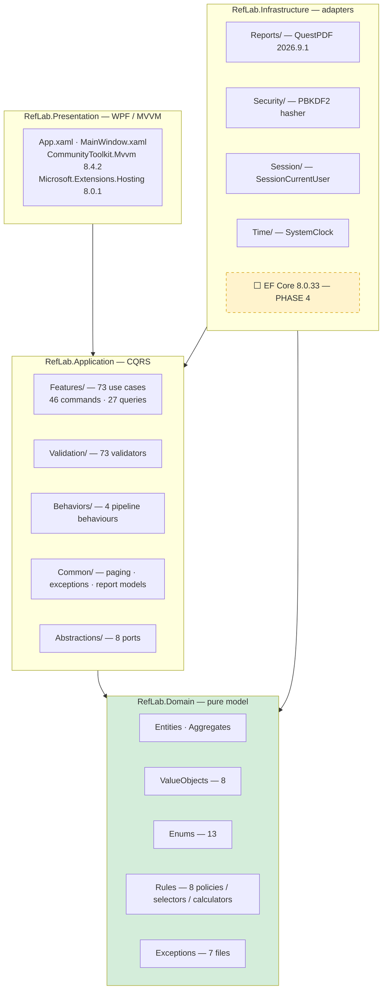

# Ref Lab — From Phase 0 to Phase 3: Engineering Handoff

**Document ID:** `RL-HANDOFF-001`
**Version:** 1.0
**Generated:** 2026-11-10
**Scope:** Ref Lab, Phase 0 (Discovery) through Phase 3 (Application layer), including the completed audit trail, the confirmed project decisions, and the exact point at which work stopped.
**Audience:** a new AI agent or engineer taking over the project in a fresh session.

> ## UPDATE — PHASE 4 IS NOW COMPLETE (2026-11-10).
>
> The stop notice below was in force while Phase 4 was unauthorised. Phase 4 has
> since been authorised **and delivered**: the branch removal and the Entity
> Framework Core persistence layer are complete, with 0 build errors, 0 build
> warnings and 535 tests passing.
>
> This document is therefore the historical record of the Phase 0 to Phase 3
> handoff. The current state is described in `docs/RL-P4-Completion-Report.md`
> and `docs/LOCAL_AGENT_IMPLEMENTATION_GUIDE.md`. Two decisions taken in Phase 4
> supersede statements below: the laboratory is a **single-site installation**
> with no branches, and the use-case count is **70** rather than 73.
>
> Phases 5, 6 and 7 have **not** started and remain unauthorised.

---

> ## STOP: PHASE 4 HAS NOT BEEN AUTHORISED.
>
> Phases 0, 1, 2 and 3 are **complete**. Phase 4 — Infrastructure and Database implementation — **must not begin** until the project owner gives a separate, explicit, direct authorisation.
>
> Do not write Infrastructure code. Do not create a `DbContext`, entity configurations or migrations. Do not modify the existing source. Do not start Phase 5, 6 or 7. Do not reintroduce SMS or NATIGH. Do not reimplement completed functionality. Do not make unapproved architectural decisions.

---

## Table of Contents

1. [Executive Project Summary](#1-executive-project-summary)
2. [Project Overview and Technical Stack](#2-project-overview-and-technical-stack)
3. [Original Project Roadmap: Phases 0–7](#3-original-project-roadmap-phases-07)
4. [Phase 0 – Discovery and Initial Analysis](#4-phase-0--discovery-and-initial-analysis)
5. [Phase 1 – Solution Scaffolding and Architectural Foundations](#5-phase-1--solution-scaffolding-and-architectural-foundations)
6. [Phase 2 – Domain Layer Implementation](#6-phase-2--domain-layer-implementation)
7. [Phase 3 – Application Layer Implementation](#7-phase-3--application-layer-implementation)
8. [Critical Documentation Discrepancies and Reverse-Engineering Corrections](#8-critical-documentation-discrepancies-and-reverse-engineering-corrections)
9. [Six Critical Phase 3 Defects Discovered and Fixed](#9-six-critical-phase-3-defects-discovered-and-fixed)
10. [Complete Questions, Answers and Decisions by Phase](#10-complete-questions-answers-and-decisions-by-phase)
11. [Pending Questions and Unresolved Decisions](#11-pending-questions-and-unresolved-decisions)
12. [Complete Solution Structure and Seven Projects](#12-complete-solution-structure-and-seven-projects)
13. [Current Project State and Build/Test Results](#13-current-project-state-and-buildtest-results)
14. [Phase 4 Preview – Infrastructure and Database](#14-phase-4-preview--infrastructure-and-database)
15. [Remaining Roadmap: Phases 5–7](#15-remaining-roadmap-phases-57)
16. [Architectural Rules and Established Constraints](#16-architectural-rules-and-established-constraints)
17. [Exact Handover Point and Instructions for the New AI Agent](#17-exact-handover-point-and-instructions-for-the-new-ai-agent)
18. [Source Documents and Project Reference Index](#18-source-documents-and-project-reference-index)

---

## 1. Executive Project Summary

### 1.1 What Ref Lab is

Ref Lab is a **medical laboratory management system** — a Windows desktop application for running the clinical and administrative workflow of a diagnostic laboratory. It is a **new implementation**, not a modification of the legacy product.

The functional reference is **RealLab**, a Visual Basic 6 laboratory information system that existed in two versions:

| Legacy version | Identity | Notes |
|---|---|---|
| `V-ROOT-1.00` | `real lab system.exe`, FileVersion 1.00 | 2013-12-27 PE timestamp, 93 tables / 1,527 columns in `Patients.mdb` |
| `V-CD-2019` | `real lab system.exe`, FileVersion **1.605**, PE description `RLS 1.605` | 72.76 MiB, 103 tables / 1,682 columns in `Patients.mdb` |

The two versions were reverse-engineered from static artefacts only — no binary was ever executed, and the reference installation directory `F:\REAL_LAB_COPY` was treated as strictly read-only.

### 1.2 Objectives

- Reimplement the verified laboratory workflow on a modern, maintainable stack.
- Carry across **unchanged** the parts the legacy product got right — above all the clinical knowledge layer (609 tests, 852 reference ranges, 46 clinical sub-groups, 69 units, 167 conversion factors, 650 abbreviations, 29 method sheets).
- **Rebuild** the parts that were structurally defective: the schema, the permission model, the deployment model.
- **Replace, never reproduce**, the PDF path (it was a hard-coded external printer driver, not vendor code).
- Correct only what is a security or data-integrity defect; otherwise reproduce legacy behaviour exactly.

### 1.3 Intended functionality

Patient registration and search · ordering tests with a frozen reference range · result entry with automatic abnormal/critical classification · clinical derivation (haematocrit, haemoglobin percentage, ISI, clotting-control interpolation) · review gate and release · reporting and printing · patient invoice and identity card · consolidated and empty reports · accounting, stock-take and referring-party commission · branches · send-out referrals and sample splitting/withdrawal · microbiology cultures and antibiotic catalogue · farm results · laboratory statistics and performance monitoring · work sheets · operator accounts, permissions and attendance.

### 1.4 Architecture

Clean Architecture in four layers with a strictly enforced dependency direction:

```
RefLab.Presentation   ──▶ RefLab.Application ──▶ RefLab.Domain ◀── RefLab.Infrastructure
        (WPF / MVVM)          (CQRS / MediatR)        (pure model)         (adapters)
```

The **Domain layer has zero package references and zero project references** — it is pure business logic with no framework dependency whatsoever. The **Application layer references no persistence engine**; it reads through `IAppDbContext.Set<T>()`, which returns `IQueryable<T>` rather than `DbSet<T>`, precisely so the layer stays provider-agnostic and every use case is testable without a database.

### 1.5 Development phases and current state

| Phase | Name | Status |
|---|---|---|
| 0 | Discovery and initial analysis | ✅ Complete |
| 1 | Solution scaffolding and architectural foundations | ✅ Complete |
| 2 | Domain layer implementation | ✅ Complete |
| 3 | Application layer implementation | ✅ **Complete** — 73 use cases |
| 4 | Infrastructure and Database | ⛔ **Not authorised** |
| 5 | WPF presentation layer | ⛔ Not started |
| 6 | Integration and verification | ⛔ Not started |
| 7 | Incremental feature development (M1–M9) | ⛔ Not started |

### 1.6 Exact stage reached and what happens next

Phase 3 ended with the Application layer fully implemented, independently audited and packaged as a single verified ZIP archive. The solution builds with **0 errors and 0 warnings** and the test suite is green. The next step would be Phase 4, which begins by implementing `IAppDbContext` and `IUnitOfWork` over Entity Framework Core and SQL Server — **but that step has not been authorised and must not be started on the strength of this document.**

---

## 2. Project Overview and Technical Stack

### 2.1 Technology and responsibilities

| Technology | Version | Layer | Responsibility |
|---|---|---|---|
| C# | 12 (`LangVersion`) | all | The implementation language |
| .NET | 8 (`net8.0`; Presentation `net8.0-windows10.0.17763.0`) | all | Runtime |
| WPF | — | Presentation | Windows desktop UI, MVVM |
| CommunityToolkit.Mvvm | 8.4.2 | Presentation | `ObservableObject`, `RelayCommand`, source generators (no reflection) |
| Microsoft.Extensions.Hosting | 8.0.1 | Presentation | Generic host: DI, configuration, logging, lifetime |
| Clean Architecture | — | all | Layering and dependency direction |
| Domain-Driven Design | — | Domain | Aggregates, value objects, invariants, domain services |
| MediatR | **12.5.0** | Application | CQRS request dispatch, request pipeline behaviours |
| FluentValidation | 11.11.0 (+ `FluentValidation.DependencyInjectionExtensions` 11.11.0) | Application | Request validation |
| Entity Framework Core | 8.0.33 (`.Relational`, `.SqlServer`) | Infrastructure | SQL Server persistence (declared; the context is Phase 4 work) |
| QuestPDF | 2026.9.1 | Infrastructure | PDF rendering and export |
| Microsoft.Extensions.DependencyInjection.Abstractions | 8.0.2 | Application | `IServiceCollection` registration |
| Microsoft.Extensions.Logging.Abstractions | 8.0.3 | Application | Behaviour logging |
| Microsoft.Extensions.Options | 8.0.2 | Infrastructure | Typed configuration |
| xUnit | 2.9.3 (+ `xunit.runner.visualstudio` 2.8.2) | all test projects | Test framework |
| Microsoft.NET.Test.Sdk | 17.11.1 | all test projects | VSTest host |
| coverlet.collector | 6.0.2 | all test projects | Coverage collection |
| Microsoft.Extensions.DependencyInjection | 8.0.1 | Application.Tests, Infrastructure.Tests | Container implementation for the test host |

> **MediatR licensing:** the 12.x line is MIT. MediatR 13 and later require a commercial licence. **Do not upgrade MediatR without checking the licence.**
>
> **QuestPDF licensing:** the Community licence applies below the vendor's revenue threshold. **Confirm the licence before shipping a commercial laboratory product.**

### 2.2 Established technical constraints

| Constraint | Where it lives |
|---|---|
| `TreatWarningsAsErrors=true` — a warning fails the build | `Directory.Build.props` |
| `Nullable=enable`, `ImplicitUsings=enable`, `LangVersion=12.0` | `Directory.Build.props` |
| `CheckEolTargetFramework=false` — .NET 8 reaches end of support on **2026-11-10**; the setting is deliberate and documented in-file | `Directory.Build.props` |
| SDK baseline `8.0.100`, `rollForward: latestMajor` — permits any newer SDK on the workstation | `global.json` |
| The Domain project must contain **no** `PackageReference` and **no** `ProjectReference` | `src/RefLab.Domain/RefLab.Domain.csproj` + `DomainLayerBoundaryTests` |
| The Application project must reference **no** persistence engine | `src/RefLab.Application/RefLab.Application.csproj` + `ApplicationLayerBoundaryTests` |
| `RefLab.Application` as a namespace shadows `System.Windows.Application` inside `RefLab.Presentation` — the WPF application class must use the fully qualified base type | `src/RefLab.Presentation/App.xaml.cs` |

---

## 3. Original Project Roadmap: Phases 0–7

This is the roadmap agreed during Phase 0, reproduced from `docs/RL-P0-RPT-001-Discovery-Report.md` §7. **The sequence is fixed; it has not been redesigned.**

| Phase | Content (as originally stated) | Deliverables | Verification gate | Approval | Status |
|---|---|---|---|---|---|
| **0** | Discovery and initial analysis | Discovery report · roadmap | All inputs verified | — | ✅ Complete |
| **1** | Solution scaffolding — 4 projects + 2 test projects + `.sln` + `Directory.Build.props` | A solution that opens in VS 2022 and builds | Clean build on the owner's machine | Approval | ✅ Complete |
| **2** | Domain layer — entities · value objects · enums · business rules · domain exceptions | `RefLab.Domain` + xUnit tests | Domain tests green, no database required | Approval | ✅ Complete |
| **3** | Application layer — CQRS · MediatR · DTOs · validation · interfaces | `RefLab.Application` + tests | Use-case tests green with fakes | Approval | ✅ **Complete** |
| **4** | Infrastructure layer — DbContext · EF Core configurations · repositories · PDF engine · SMS | `RefLab.Infrastructure` | Successful build + `dotnet ef migrations` produces a schema matching the approved data model | Approval **+ schema approval** | ⛔ **Not authorised** |
| **5** | WPF layer — MVVM · navigation · screens · localisation | `RefLab.Presentation` | Application launches, sign-in window works | Approval | ⛔ Not started |
| **6** | Integration and verification — full build · tests · SQL Server connection · core workflow | A real verification report | Clean build + all tests green | Approval | ⛔ Not started |
| **7** | Incremental module development, P0 → P1 → P2 | M1–M9 in turn | Acceptance criteria per module | Approval before each module | ⛔ Not started |

**Deviations from the original roadmap, and why:**

- **Phase 1 shipped 2 test projects, not 2 + 1.** `tests/RefLab.Infrastructure.Tests` was added during Phase 3 when the QuestPDF, PBKDF2 and session adapters were implemented in `RefLab.Infrastructure`; it could not be tested without it. The solution therefore has **7 projects**, one more than Phase 1 planned. See §12.
- **Phase 4's "SMS engine" scope item was withdrawn.** The owner removed SMS and NATIGH from the project before Phase 3 was completed, so the Phase 4 scope is persistence and reporting only. See §7.4.

### 3.1 Phase 2 execution sequence (as originally planned)

| Unit | Types | Note from the original plan |
|---|---|---|
| 2.1 | `TestDefinition` · `ReferenceRange` · `ClinicalConstant` · `ClinicalSubGroup` · `TestUnit` · `ConversionFactor` · `Abbreviation` | Verbatim transfer of the clinical layer |
| 2.2 | `Operator` · `Permission` · `Branch` | 17 permissions → named model |
| 2.3 | `Patient` · `PatientOrder` · `OrderIdentifier` · `OrderTest` · `ReferenceSnapshot` | Separating patient identity from order identity |
| 2.4 | `Payment` · `ReferringParty` · `TreatingPhysician` · `PriceList` | Commission `Σ(omola × base / 100)` |
| 2.5 | `PrintAudit` · `DeliveryRecord` · `AttendanceEntry` | `DeliveryRecord` was later removed with SMS/NATIGH |
| 2.6 | `SendOutRequest` · `SampleDisposition` | Two settlement states |

### 3.2 Definition of Done (per module, from the original plan)

1. Build succeeds in Visual Studio 2022 — with an actual report.
2. All tests green — with an actual report.
3. No warnings (`TreatWarningsAsErrors`).
4. Every new entity wired to the `DbContext` + `Configuration` + integration test *(Phase 4)*.
5. No duplicated business rule (Domain reviewed against Application).
6. Every Arabic string used is documented in `ui-labels-verified.md`.
7. Schema history traceable — no modification of a committed migration.

---

## 4. Phase 0 – Discovery and Initial Analysis

### 4.1 Investigation and inputs

Eight inputs were supplied and all were verified before any design work began:

| Input | Verification result |
|---|---|
| `IDEA.md` | Read in full (281 lines). Authoritative for the technology stack, the four-layer decomposition, the read-only treatment of `F:\REAL_LAB_COPY`, the requirement to analyse both legacy versions independently, the phase-gate workflow, and the instruction not to read `Docs/Audit/Plan for completing the implementation of the project.md` — **that file does not exist in the supplied material**, so the restriction was satisfied vacuously. |
| `RealLab-Deliverables-B01-B11.zip` | Extracted cleanly (exit 0), 12,091,120 bytes, **550 files**, no password, no corruption. |
| B01–B11 archive | 11 batch directories; manifests for all 11; 10 of 11 have `files.csv`/`files.txt`; 9 of 11 have an ingest report; `analysis/` for BATCH-01…07, 10, 11, plus `CUMULATIVE/` (11 documents) and `V-CD-2019/` (15 documents); `inventory/` with 837 records. |
| Five V2 documents | All read individually: `RL-V2-REF-001` (1,192 lines), `RL-V2-FUN-001` (1,006), `RL-V2-BR-001` (1,104), `RL-V2-DM-001` (707), `RL-V2-FRM-001` (2,476). |
| `ui-labels-verified.md` | Read in full (322 lines). `RL-UI-001` — Arabic labels transcribed verbatim from 106 frames of `RLS_Learn.wmv`. |

### 4.2 Reverse-engineering findings that shaped every later phase

| Finding | Evidence | Consequence for Ref Lab |
|---|---|---|
| The clinical knowledge layer is **byte-identical between 2013 and 2020** | `testtable` 609 rows, `normalrange` 852 rows, `subgrouptable` 46, `testunits` 69, `converts` 167, `abbreviations` 650 — all unchanged | Carry the clinical layer across verbatim as data |
| The legacy database has **no patient master table**; the table named `patients` holds **operators** | `patients` carries `patientusname`, `patientword`, `grant1`…`grant17`, `branche`, `SecWord`, `startwork`/`endwork`/`breakyorn`/`breaktime` | Separate `Patient` from `Operator`; rename to avoid a name that mis-maps the schema |
| `patientid` (Text 13) is a **composite order identifier**, not a patient key | `MID(patientid,3,2)` = person key, `MID(patientid,9,1)` = branch, `mid(patientid,10,3)` = display code | Model `OrderIdentifier` as a value object; keep the positional layout as a hard contract |
| The branch digit comes from the **operator's** branch | `patients.branche` (Integer) written into position 9 | Branch assignment belongs to the operator, and the identifier layout is a data contract |
| Reference ranges are banded by **sex and age** | `normalrange.sex` (Male 422 / Female 421 / All 5 / empty 4) and `ageunit` (Years 708 / Days 70 / Mons. 65) | `AgeBand` + `SexScope` value objects; a deterministic selection rule |
| Result classification is **three-valued and ordered**, critical overriding abnormal | `CHM 004A.htm`: «عالٍ أو منخفضة أو حرجة» | `ResultClassification` with `Normal/High/Low/Critical` |
| The reference range is **frozen onto the order row** | `patienttest.normalrang`, `lowlimit`, `highlimit`, `nolowexe`, `nohighexe`; 112 of 222 rows carry a frozen range | `ReferenceSnapshot` value object |
| Clinical constants are **data, not code** | `constanttable`: `CBCCONS` = 3.3 / 6.25 / 6.75 / 7.5 / 8.25, `PTCONS` = 12 / 35 / 1.33 / `2CVJW` | `ClinicalConstant` + `ClinicalDerivationPolicy` |
| The PDF path is a **hard-coded external driver** | UTF-16LE literal `Bullzip PDF Printer` at `0x6A2486`; `Bullzip PDF Printer 11.1 - Create File` at `0x6A255E` | Replace wholesale with QuestPDF behind `IPdfExporter` |
| Credentials are stored **in clear text** | `BASE.ini` / `data_connection1.udl` → `UserID=sa` / `Password=12345678`; `patients.patientword` in clear; `MyLabSetting.accuntpw` in clear | One of the two approved categories of correction |
| The shipped database is a **partial deployment** of the executable's schema | 109 of 132 added columns applied; `FMF`, `LBC`, `useraccounts`, `IgEallergy` absent entirely | Do not copy the legacy schema; design it independently |
| The Arabic interface is **deliberately bilingual** | `ui-labels-verified.md`: patient panel Arabic, test catalogue English, printed report English headings + Arabic branding | Preserve the localisation boundary exactly |

### 4.3 Architectural decisions taken in Phase 0

| Decision | Rationale |
|---|---|
| Clean Architecture with four layers, domain at the centre | The legacy product has all its logic welded to VB6 forms and raw SQL; separation is the point of the rebuild |
| `IAppDbContext` exposes `IQueryable<T>`, not `DbSet<T>` | Keeps EF Core out of the Application layer entirely and makes every use case testable with no database |
| A generic `Repository<T>` was **deliberately not introduced** | A generic repository over a CQRS read/write split adds an abstraction with no leverage; handlers query the context and mutate through the unit of work |
| Domain has zero package references | The business model must not be able to acquire a framework dependency by accident |
| MediatR 12.x | The 13.x line requires a commercial licence, which is unsuitable for a product of this kind without a deliberate decision |
| `decimal` for money and measurements | The legacy `Double` columns cannot represent decimal currency exactly |
| The schema is **designed**, not copied | The legacy shipped database is itself a partial, inconsistent deployment |

### 4.4 Deliverables produced

- `docs/RL-P0-RPT-001-Discovery-Report.md` — the Phase 0 report: input verification table, legacy findings, architectural assessment, the Phases 0–7 roadmap, quality strategy, open questions, and the 21 questions put to the owner.
- `scripts/` — none yet at this stage.
- The Phase 0 → 3 handoff document (this file).

---

## 5. Phase 1 – Solution Scaffolding and Architectural Foundations

### 5.1 What was created

| Path | Purpose |
|---|---|
| `RefLab.sln` | Solution, with `src` and `tests` solution folders |
| `Directory.Build.props` | Shared build settings: `net8.0`, `LangVersion 12.0`, `Nullable enable`, `ImplicitUsings enable`, `TreatWarningsAsErrors true`, `EnableNETAnalyzers true`, `Deterministic true`, `CheckEolTargetFramework false`, `NeutralLanguage en`, `SatelliteResourceLanguages en;ar` |
| `global.json` | SDK baseline `8.0.100`, `rollForward: latestMajor`, `allowPrerelease: false` |
| `.gitignore` | Build output, IDE, NuGet, test results, WPF publish, OS and local-secret patterns (later extended with `__pycache__/` and `*.pyc`) |
| `src/RefLab.Domain/` | Empty shell — **zero** package references, **zero** project references |
| `src/RefLab.Application/` | Shell with MediatR, FluentValidation, DI abstractions and logging abstractions |
| `src/RefLab.Infrastructure/` | Shell with EF Core 8.0.33 and `Microsoft.Extensions.Options` |
| `src/RefLab.Presentation/` | `net8.0-windows10.0.17763.0`, `UseWPF`, `OutputType WinExe`, `EnableWindowsTargeting` (so it also compiles on a non-Windows build agent), CommunityToolkit.Mvvm, Hosting |
| `tests/RefLab.Domain.Tests/` | xUnit project, `xunit` v2 implicit-usings workaround (`<Using Include="Xunit" />`) |
| `tests/RefLab.Application.Tests/` | xUnit project, same workaround |

### 5.2 Dependency direction established

```
RefLab.Presentation ──▶ RefLab.Application ──▶ RefLab.Domain ◀── RefLab.Infrastructure
                             ▲                                     │
                             └─────────────────────────────────────┘
                       (composition root only)
```

`RefLab.Infrastructure` references both `RefLab.Application` and `RefLab.Domain`. `RefLab.Presentation` references all three. `RefLab.Application` references only `RefLab.Domain`. `RefLab.Domain` references nothing.

### 5.3 Conventions established

- One namespace per layer; feature folders inside `RefLab.Application/Features/<Area>/`.
- Nullable reference types on across the solution.
- XML documentation comments on every public type and member.
- Every class named with its role suffix (`…Command`, `…Query`, `…Handler`, `…Validator`, `…Dto`).
- Tests named in the `Given_the_action_it_should…` style, in plain descriptive English.

### 5.4 Deliverables

Phase 1 was delivered as `RefLab-Phase1-Scaffolding.zip` and integrated by the owner. The owner reported a successful build with **6 projects succeeded, 0 failed, 0 skipped**.

### 5.5 A naming collision that was found and fixed here

Adding the `RefLab.Application` namespace introduced a compile error in the WPF project:

```
error CS0118: 'Application' is a namespace but is used like a type
```

`App.xaml.cs` originally declared `public partial class App : Application`. The fix — mandated by the owner and preserved ever since — is the fully qualified form:

```csharp
public partial class App : System.Windows.Application
```

Any future WPF file in `RefLab.Presentation` that needs `Application` must use the same fully qualified name.

---

## 6. Phase 2 – Domain Layer Implementation

### 6.1 Structure

```
src/RefLab.Domain/            66 .cs files, ~6,200 lines, 0 package references
├── Auditing/                 AttendanceEntry · PrintAudit
├── Billing/                  Payment · PriceList · ReferringParty · TreatingPhysician
├── ClinicalKnowledge/        Abbreviation · ClinicalConstant · ClinicalSubGroup ·
│                             ConversionFactor · ProthrombinControlCalibration ·
│                             ReferenceRange · TestDefinition · TestUnit
├── Configuration/            LaboratorySettings (+ PrinterRole, PaperSize)
├── Enums/                    AgeUnit · AttendanceEventType · RecordStatus · ReportCategory ·
│                             ResultClassification · ResultState · SampleDispositionAction ·
│                             SendOutState · Sex · SexScope
├── Exceptions/               DomainException + 6 grouped exception files
├── Farming/                  Farm · FarmTransaction
├── Identity/                 Branch · Operator · PasswordPolicy · Permission
├── Microbiology/             Antibiotic · CultureResult (+ AntibioticSensitivity)
├── Patients/                 OrderTest · Patient · PatientHistory · PatientOrder ·
│                             PatientPicture · ReferenceSnapshot
├── Rules/                    ClinicalConstantResolver · ClinicalDerivationPolicy ·
│                             CommissionCalculator · IdentifierAllocator ·
│                             InvalidClinicalDerivationException · ProthrombinControlPoint ·
│                             ReferenceRangeSelector · ResultClassificationPolicy
├── SendOut/                  SampleDisposition · SendOutRequest
└── ValueObjects/            AgeBand · CriticalInterval · Money · OrderIdentifier ·
                              PatientId · Percentage · ReferenceInterval · ResultValue
```

13 enumerations, 8 value objects, 8 rule types, 7 exception files.

### 6.2 How the model was derived

Every entity traces to a legacy table or to an explicit architectural decision:

| Domain type | Legacy source |
|---|---|
| `TestDefinition` | `testtable` (38 columns) |
| `ReferenceRange` | `normalrange` (18 columns) |
| `ClinicalConstant` | `constanttable` (8 columns) |
| `ClinicalSubGroup` | `subgrouptable` (4 columns) |
| `TestUnit` | `testunits` (2 columns) |
| `ConversionFactor` | `converts` (6 columns) |
| `Abbreviation` | `abbreviations` (3 columns) |
| `Operator` | `patients` (the legacy **operator** table, 33 columns) |
| `Branch` | `Labbranch` (2 columns) |
| `Patient` | `patientinfo` demographics (39 columns) |
| `PatientOrder` | `patientinfo` order header |
| `OrderTest` | `patienttest` (46 columns) — the transactional centre |
| `ReferenceSnapshot` | the frozen range carried on `patienttest` |
| `PatientHistory` | `history` (25 columns: 20 free-form slots) |
| `Payment` | `payment` (10 columns) |
| `ReferringParty` | `Gehats` (21 columns) |
| `TreatingPhysician` | `mowzaf` / `Gehats.ReferredPW` / `Gehats.ReferredID` |
| `PriceList` | `pricelist` (4 columns) + `pricemenu` |
| `PrintAudit` | `resultprint` / `printuser` / `printdate` / `printnum` |
| `AttendanceEntry` | `loger` + the operator attendance columns |
| `SendOutRequest` | `patienttest.sentout` / `.send` / `.otherlabname` |
| `SampleDisposition` | the microbiology `sample` tables |
| `CultureResult` · `Antibiotic` | `cultures` / `cultureanti` / `antibiotic` / `antibio` |
| `Farm` · `FarmTransaction` | `sharekat` / `sharekathesab` |
| `LaboratorySettings` | `SETTING.ini` + `Data\*.ini` + `IDCARD.INI` |
| `ProthrombinControlCalibration` | `PTC` (3 columns) |

### 6.3 Business rules encoded in the Domain

| Rule | Where |
|---|---|
| A result inside the inclusive reference interval is normal; outside is high or low | `ResultClassificationPolicy` |
| A critical limit **overrides** the abnormal classification | `ResultClassificationPolicy` |
| A critical comparison is **strict** (the method sheets read «Hgb < 5», «> 20 g/dL») | `ResultClassificationPolicy` |
| A non-numeric or qualitative result cannot be classified | `ResultClassificationPolicy` |
| The reference range is selected by analyte, sex and age; the most specific band wins | `ReferenceRangeSelector` |
| `Hct = Hgb × 3.3`; `Hgb% = Hgb × factor` with the factor chosen by sex and age band | `ClinicalDerivationPolicy` |
| The clotting-control concentration is linearly interpolated between adjacent calibration points | `ClinicalDerivationPolicy` |
| The commission is `Σ(omola × base ÷ 100)` | `CommissionCalculator` |
| The order identifier is exactly 13 characters with the branch digit at position 9 | `OrderIdentifier`, `IdentifierAllocator` |
| Test number 4 (the urine analysis) may not be renumbered or renamed | `TestDefinition.Rename` / `.ChangeCode` |
| A reference range's lower limit may not exceed its upper limit | `ReferenceInterval`, `ReferenceRange.UpdateLimits` |
| A branch identifier is a single digit (0–9) | `Branch` |
| The operator password must satisfy the length/complexity policy | `PasswordPolicy` |
| A send-out sample cannot be settled before it is dispatched | `SendOutRequest` |
| A culture may carry only one susceptibility per antibiotic symbol | `CultureResult` |

### 6.4 Domain corrections and improvements made during Phase 2

| # | Correction | Reason |
|---|---|---|
| 1 | `OrderIdentifier` carries an explicit **13th character** (`TrailingCharacter`) | The extracted legacy segments account for only 12 of the 13 characters; the thirteenth was being dropped silently |
| 2 | `Money` uses `decimal` and requires an ISO 4217 currency code | The legacy `Double` columns cannot represent decimal currency exactly; the legacy system has no currency column at all |
| 3 | `Permission` became a **named** enumeration | The 17 legacy bits are anonymous and their capability mapping was never established |
| 4 | `Operator` replaces the legacy name `patients` | The legacy name is a pre-rebranding artefact that would mis-map the entire schema |
| 5 | `Patient` was introduced as a separate aggregate | The legacy system has no patient master table |
| 6 | `CriticalInterval` is a first-class value object | The shipped database lost the critical-limit columns its own backup still holds (see §8) |
| 7 | `LaboratorySettings` became an aggregate rather than loose INI keys | The settings carry business meaning and need one persistence target |
| 8 | `TestDefinition.UpdateDetails` treats a `null` argument as "not supplied" | The first implementation cleared every field whose argument was `null`, silently wiping the Arabic name on a partial update |

### 6.5 Deliverables

`RefLab-Phase2-Domain-Layer.zip`, containing the Domain project, its tests, the manifest `docs/RL-P2-MAN-001-Domain-Layer-Manifest.md`, and the Phase 0 report. The owner integrated it successfully.
---

## 7. Phase 3 – Application Layer Implementation

### 7.1 Application Architecture

#### 7.1.1 Project responsibilities

`src/RefLab.Application` owns **use cases**, not business rules. Its responsibility is to orchestrate the Domain: validate an incoming request, load the aggregates it needs, invoke domain behaviour, persist the result through the unit of work, and project the outcome into a DTO. It contains **no** persistence engine, **no** SQL, **no** UI concern and **no** business rule of its own.

Structure:

```
src/RefLab.Application/          124 .cs files, ~8,300 lines
├── Abstractions/          8 files  — the ports the Infrastructure layer implements
├── Behaviors/             4 files  — the MediatR request pipeline
├── Common/               10 files  — paging, the application exception hierarchy, report models
├── Features/            15 areas   — one file per use case, plus a Dtos.cs per area
├── Validation/          15 files  — the FluentValidation validators
├── ApplicationServiceCollectionExtensions.cs
└── RefLab.Application.csproj
```

#### 7.1.2 Commands, queries and handlers

A use case is a **single file** under `Features/<Area>/` containing the request record and its MediatR handler. There are 46 commands and 27 queries.

```csharp
public sealed record OrderTestsCommand(
    Guid OrderId,
    IReadOnlyList<int> TestCodes,
    IReadOnlyDictionary<int, int>? GroupMembers = null)
    : IRequest<IReadOnlyList<OrderTestDto>>, IRequirePermission
{
    public Permission Permission => Permission.OrderTests;
}

public sealed class OrderTestsHandler
    : IRequestHandler<OrderTestsCommand, IReadOnlyList<OrderTestDto>>
{
    private readonly IAppDbContext _db;
    private readonly IUnitOfWork _unitOfWork;
    private readonly ICurrentUser _currentUser;
    private readonly IClock _clock;

    // … constructor and Handle body
}
```

**Conventions:**

- Request records are `public sealed record`, named `<UseCase>Command` or `<UseCase>Query`.
- Every handler is `public sealed class <UseCase>Handler : IRequestHandler<TRequest, TResponse>`.
- A use case that needs a specific operator capability implements `IRequirePermission` and names the `Permission`. **46 of the 73 do.**
- Queries are **not** `async` — they are synchronous projections over `IQueryable<T>` and return `Task.FromResult<T>(…)`. Commands are `async` where they commit or call an external gateway.
- `CancellationToken` is accepted and propagated on every `async` path, including `SaveChangesAsync` and the gateway calls.

#### 7.1.3 The request pipeline

Four open behaviours are registered in `ApplicationServiceCollectionExtensions.AddApplicationLayer()`:

| Order | Behaviour | Responsibility |
|---|---|---|
| 1 (outermost) | `LoggingBehavior<TRequest,TResponse>` | Logs the request name, the duration and any failure |
| 2 | `ValidationBehavior<TRequest,TResponse>` | Runs every registered `IValidator<TRequest>`; raises `RequestValidationException` on failure |
| 3 | `AuthorizationBehavior<TRequest,TResponse>` | If the request implements `IRequirePermission` and the signed-in operator lacks it, raises `ForbiddenException` |
| 4 (innermost) | `DomainExceptionBehavior<TRequest,TResponse>` | Translates any `DomainException` raised by the domain into `ConflictException`, so the presentation layer never sees a domain exception |

#### 7.1.4 Application abstractions (the ports)

| Abstraction | Responsibility | Infrastructure implementation |
|---|---|---|
| `IAppDbContext` | **Read side.** `IQueryable<T> Set<T>()` | **Not implemented — Phase 4** |
| `IUnitOfWork` | **Write side.** `Add<T>`, `Update<T>`, `Remove<T>`, `SaveChangesAsync` | **Not implemented — Phase 4** |
| `IClock` | The current instant, so timestamps are testable | `SystemClock` ✅ |
| `ICurrentUser` | The signed-in operator: id, name, branch, `HasPermission` | `SessionCurrentUser` ✅ |
| `IPasswordHasher` | Hash and verify operator passwords | `Pbkdf2PasswordHasher` ✅ |
| `IReportRenderer` | Build a printable report from domain data | `QuestPdfReportRenderer` ✅ |
| `IPdfExporter` | Write a rendered report to a PDF file | `QuestPdfExporter` ✅ |
| `IPrintSequenceGenerator` | Allocate report sequence numbers (origin 1984) | `PrintSequenceGenerator` ✅ |

**There is no generic `Repository<T>`.** This is deliberate: handlers read through `IAppDbContext` and mutate through `IUnitOfWork`, which keeps the CQRS read/write split explicit and avoids an abstraction with no leverage.

#### 7.1.5 Error handling

| Exception | Raised when |
|---|---|
| `NotFoundException` | A required record does not exist |
| `RequestValidationException` | A validator rejected the request; carries every failure message |
| `ForbiddenException` | The operator lacks the required permission |
| `ConflictException` | The change conflicts with the current state (including any translated domain exception) |
| `ConcurrencyException` | A record was modified by another user between read and write |
| `ApplicationException` | Abstract base of the hierarchy |

#### 7.1.6 Relationship to the Domain and the future Infrastructure layer

The Application layer calls domain methods and never re-implements a rule. Where a use case needs to know something the domain owns — the applicable reference range, the classification of a value, the commission — it calls the domain service (`ReferenceRangeSelector`, `ResultClassificationPolicy`, `CommissionCalculator`) rather than re-deriving it. The Infrastructure layer will implement the two outstanding ports and register them in `AddInfrastructureLayer()`; no Application code changes will be required, because the Application layer already depends only on the abstractions.

#### 7.1.7 Testing approach

`tests/RefLab.Application.Tests` runs every use case **through the real MediatR pipeline**, not by calling handlers directly. `ApplicationTestHost` builds a `ServiceProvider` from the production registration plus in-memory fakes:

| Fake | Stands in for |
|---|---|
| `FakeAppDbContext` | `IAppDbContext` — in-memory sets, `Set<T>()` over `IQueryable<T>` |
| `FakeUnitOfWork` | `IUnitOfWork` |
| `FakeCurrentUser` | `ICurrentUser` — settable permission set, `GrantAllPermissions` flag |
| `FakeClock` | `IClock` — frozen instant |
| `FakePasswordHasher` | `IPasswordHasher` — reversible, test-only |
| `FakeReportRenderer` | `IReportRenderer` — records the request it was given |
| `FakePdfExporter` | `IPdfExporter` — records the destination directory |
| `FakePrintSequenceGenerator` | `IPrintSequenceGenerator` — starts at 1984 |

Because the whole pipeline runs, validation, authorisation and domain-exception translation are genuinely exercised on every use-case test. Two sweeps close the coverage gaps an independent audit identified: `DependencyInjectionTests` enumerates **every** handler and **every** validator from the compiled assembly and asserts each is registered, and `PermissionEnforcementTests` proves that **every** permission-gated use case is refused when the operator lacks the permission.

---

### 7.2 Complete Use Case Inventory: 73 Use Cases

The final use case count is **73**. The inventory is **generated from the compiled source** by `scripts/generate_use_case_inventory.py`, which scans `src/RefLab.Application/Features` for request records and their handlers, cross-references the validators and the test suite, and fails with a non-zero exit code if the count or the coverage drifts. It writes `docs/USE_CASE_INVENTORY.md`.

#### 7.2.1 Master inventory

| ID | Use case | Area | Kind | Permission | Handler | Validator | Legacy requirement |
|---|---|---|---|---|---|---|---|
| UC-001 | `GetPrintAuditTrailQuery` | Auditing | Query | — | `GetPrintAuditTrailHandler` | `GetPrintAuditTrailValidator` | V2-REQ-041 |
| UC-002 | `RecordAttendanceCommand` | Auditing | Command | — | `RecordAttendanceHandler` | `RecordAttendanceValidator` | V2-REQ-056 |
| UC-003 | `ComputeCommissionQuery` | Billing | Query | — | `ComputeCommissionHandler` | `ComputeCommissionValidator` | V2-REQ-019 |
| UC-004 | `GetPaymentsQuery` | Billing | Query | — | `GetPaymentsHandler` | `GetPaymentsValidator` | V2-REQ-025 |
| UC-005 | `GetReferringPartiesQuery` | Billing | Query | — | `GetReferringPartiesHandler` | `GetReferringPartiesValidator` | V2-REQ-037 |
| UC-006 | `RecordPaymentCommand` | Billing | Command | ManageAccounting | `RecordPaymentHandler` | `RecordPaymentValidator` | V2-REQ-018 |
| UC-007 | `RunMultiBranchStockTakeQuery` | Billing | Query | ManageAccounting | `RunMultiBranchStockTakeHandler` | `RunMultiBranchStockTakeValidator` | V2-REQ-026 |
| UC-008 | `RunPeriodStockTakeQuery` | Billing | Query | ManageAccounting | `RunPeriodStockTakeHandler` | `RunPeriodStockTakeValidator` | V2-REQ-025 |
| UC-009 | `RunStockTakeByPhysicianOrPartyQuery` | Billing | Query | ManageAccounting | `RunStockTakeByPhysicianOrPartyHandler` | `RunStockTakeByPhysicianOrPartyValidator` | V2-REQ-027 |
| UC-010 | `SetDefaultAccountTypeCommand` | Billing | Command | ManageAccounting | `SetDefaultAccountTypeHandler` | `SetDefaultAccountTypeValidator` | V2-REQ-066 |
| UC-011 | `CreateBranchCommand` | Branches | Command | ManageBranches | `CreateBranchHandler` | `CreateBranchValidator` | V2-REQ-051 |
| UC-012 | `GetBranchesQuery` | Branches | Query | — | `GetBranchesHandler` | `GetBranchesValidator` | V2-REQ-051 |
| UC-013 | `CreateReferenceRangeCommand` | Catalogue | Command | ManageReferenceRanges | `CreateReferenceRangeHandler` | `CreateReferenceRangeValidator` | V2-REQ-021 |
| UC-014 | `CreateTestDefinitionCommand` | Catalogue | Command | ManageTestCatalogue | `CreateTestDefinitionHandler` | `CreateTestDefinitionValidator` | V2-REQ-020 |
| UC-015 | `GetReferenceRangeForPatientQuery` | Catalogue | Query | — | `GetReferenceRangeForPatientHandler` | `GetReferenceRangeForPatientValidator` | V2-REQ-022 |
| UC-016 | `GetTestCatalogueQuery` | Catalogue | Query | — | `GetTestCatalogueHandler` | `GetTestCatalogueValidator` | V2-REQ-020 |
| UC-017 | `GetTestProfileQuery` | Catalogue | Query | — | `GetTestProfileHandler` | `GetTestProfileValidator` | V2-REQ-012 |
| UC-018 | `ManageAbbreviationsCommand` | Catalogue | Command | ManageTestCatalogue | `ManageAbbreviationsHandler` | `ManageAbbreviationsValidator` | V2-REQ-030 |
| UC-019 | `ManageClinicalSubGroupsCommand` | Catalogue | Command | ManageTestCatalogue | `ManageClinicalSubGroupsHandler` | `ManageClinicalSubGroupsValidator` | V2-REQ-031 |
| UC-020 | `ManageUnitsAndConversionsCommand` | Catalogue | Command | ManageTestCatalogue | `ManageUnitsAndConversionsHandler` | `ManageUnitsAndConversionsValidator` | V2-REQ-029 |
| UC-021 | `UpdateReferenceRangeCommand` | Catalogue | Command | ManageReferenceRanges | `UpdateReferenceRangeHandler` | `UpdateReferenceRangeValidator` | V2-REQ-021 |
| UC-022 | `UpdateTestDefinitionCommand` | Catalogue | Command | ManageTestCatalogue | `UpdateTestDefinitionHandler` | `UpdateTestDefinitionValidator` | V2-REQ-020 |
| UC-023 | `ConfigureConnectionReceiptCommand` | Configuration | Command | ManageSettings | `ConfigureConnectionReceiptHandler` | `ConfigureConnectionReceiptValidator` | V2-REQ-067 |
| UC-024 | `ConfigureLaboratorySettingsCommand` | Configuration | Command | ManageSettings | `ConfigureLaboratorySettingsHandler` | `ConfigureLaboratorySettingsValidator` | V2-REQ-035 |
| UC-025 | `CustomiseReportLayoutCommand` | Configuration | Command | ManageSettings | `CustomiseReportLayoutHandler` | `CustomiseReportLayoutValidator` | V2-REQ-023, V2-REQ-036 |
| UC-026 | `DeriveHematocritQuery` | Derivation | Query | — | `DeriveHematocritHandler` | `DeriveHematocritValidator` | V2-REQ-015 |
| UC-027 | `DeriveHemoglobinPercentageQuery` | Derivation | Query | — | `DeriveHemoglobinPercentageHandler` | `DeriveHemoglobinPercentageValidator` | V2-REQ-015 |
| UC-028 | `DeriveInternationalSensitivityIndexQuery` | Derivation | Query | — | `DeriveInternationalSensitivityIndexHandler` | `DeriveInternationalSensitivityIndexValidator` | V2-REQ-015 |
| UC-029 | `InterpolateProthrombinControlQuery` | Derivation | Query | — | `InterpolateProthrombinControlHandler` | `InterpolateProthrombinControlValidator` | V2-REQ-015 |
| UC-030 | `AssignOperatorPermissionsCommand` | Identity | Command | ManageOperators | `AssignOperatorPermissionsHandler` | `AssignOperatorPermissionsValidator` | V2-REQ-032 |
| UC-031 | `ChangePasswordCommand` | Identity | Command | — | `ChangePasswordHandler` | `ChangePasswordValidator` | V2-REQ-033 |
| UC-032 | `CreateOperatorCommand` | Identity | Command | ManageOperators | `CreateOperatorHandler` | `CreateOperatorValidator` | V2-REQ-032 |
| UC-033 | `GetOperatorsQuery` | Identity | Query | — | `GetOperatorsHandler` | `GetOperatorsValidator` | V2-REQ-032 |
| UC-034 | `SignInCommand` | Identity | Command | — | `SignInHandler` | `SignInValidator` | V2-REQ-004 |
| UC-035 | `UpdateOperatorCommand` | Identity | Command | ManageOperators | `UpdateOperatorHandler` | `UpdateOperatorValidator` | V2-REQ-032 |
| UC-036 | `GetCultureResultsQuery` | Microbiology | Query | — | `GetCultureResultsHandler` | `GetCultureResultsValidator` | V2-REQ-016 |
| UC-037 | `ManageAntibioticCatalogueCommand` | Microbiology | Command | ManageTestCatalogue | `ManageAntibioticCatalogueHandler` | `ManageAntibioticCatalogueValidator` | V2-REQ-060 |
| UC-038 | `ManageFarmResultsCommand` | Microbiology | Command | EnterResults | `ManageFarmResultsHandler` | `ManageFarmResultsValidator` | V2-REQ-059 |
| UC-039 | `RecordCultureResultCommand` | Microbiology | Command | EnterResults | `RecordCultureResultHandler` | `RecordCultureResultValidator` | V2-REQ-016 |
| UC-040 | `ManagePriceListsCommand` | Parties | Command | ManagePricing | `ManagePriceListsHandler` | `ManagePriceListsValidator` | V2-REQ-064 |
| UC-041 | `ManageTreatingPhysiciansCommand` | Parties | Command | ManagePricing | `ManageTreatingPhysiciansHandler` | `ManageTreatingPhysiciansValidator` | V2-REQ-037 |
| UC-042 | `PrintPriceListCommand` | Parties | Command | ManagePricing | `PrintPriceListHandler` | `PrintPriceListValidator` | V2-REQ-065 |
| UC-043 | `AllocateOrderIdentifierQuery` | Patients | Query | — | `AllocateOrderIdentifierHandler` | `AllocateOrderIdentifierValidator` | V2-REQ-008 |
| UC-044 | `AttachPatientPictureCommand` | Patients | Command | EditPatient | `AttachPatientPictureHandler` | `AttachPatientPictureValidator` | V2-REQ-038 |
| UC-045 | `FollowUpCaseQuery` | Patients | Query | — | `FollowUpCaseHandler` | `FollowUpCaseValidator` | V2-REQ-071 |
| UC-046 | `GeneratePatientBarcodeCommand` | Patients | Command | RegisterPatient | `GeneratePatientBarcodeHandler` | `GeneratePatientBarcodeValidator` | V2-REQ-009 |
| UC-047 | `GetPatientHistoryQuery` | Patients | Query | — | `GetPatientHistoryHandler` | `GetPatientHistoryValidator` | V2-REQ-011 |
| UC-048 | `GetPatientOrderQuery` | Patients | Query | — | `GetPatientOrderHandler` | `GetPatientOrderValidator` | V2-REQ-011 |
| UC-049 | `RegisterPatientCommand` | Patients | Command | RegisterPatient | `RegisterPatientHandler` | `RegisterPatientValidator` | V2-REQ-007 |
| UC-050 | `SearchPatientsQuery` | Patients | Query | — | `SearchPatientsHandler` | `SearchPatientsValidator` | V2-REQ-010 |
| UC-051 | `ConfigurePrintersCommand` | Reporting | Command | ManageSettings | `ConfigurePrintersHandler` | `ConfigurePrintersValidator` | V2-REQ-034 |
| UC-052 | `ConfigureReportHeaderFooterCommand` | Reporting | Command | ManageSettings | `ConfigureReportHeaderFooterHandler` | `ConfigureReportHeaderFooterValidator` | V2-REQ-035, V2-REQ-070 |
| UC-053 | `PrintPatientIdCardCommand` | Reporting | Command | PrintReports | `PrintPatientIdCardHandler` | `PrintPatientIdCardValidator` | V2-REQ-042 |
| UC-054 | `PrintPatientInvoiceCommand` | Reporting | Command | HandOverResults | `PrintPatientInvoiceHandler` | `PrintPatientInvoiceValidator` | V2-REQ-042 |
| UC-055 | `ProduceConsolidatedReportCommand` | Reporting | Command | PrintReports | `ProduceConsolidatedReportHandler` | `ProduceConsolidatedReportValidator` | V2-REQ-062 |
| UC-056 | `ProduceEmptyReportCommand` | Reporting | Command | PrintReports | `ProduceEmptyReportHandler` | `ProduceEmptyReportValidator` | V2-REQ-063 |
| UC-057 | `EnterAdditionalResultCommand` | Results | Command | EnterResults | `EnterAdditionalResultHandler` | `EnterAdditionalResultValidator` | V2-REQ-013 |
| UC-058 | `EnterResultCommand` | Results | Command | EnterResults | `EnterResultHandler` | `EnterResultValidator` | V2-REQ-013 |
| UC-059 | `GetCriticalValuesQuery` | Results | Query | — | `GetCriticalValuesHandler` | `GetCriticalValuesValidator` | V2-REQ-039 |
| UC-060 | `GetMethodSheetQuery` | Results | Query | — | `GetMethodSheetHandler` | `GetMethodSheetValidator` | V2-REQ-039 |
| UC-061 | `HandOverResultsCommand` | Results | Command | HandOverResults | `HandOverResultsHandler` | `HandOverResultsValidator` | V2-REQ-018 |
| UC-062 | `OrderTestsCommand` | Results | Command | OrderTests | `OrderTestsHandler` | `OrderTestsValidator` | V2-REQ-007 |
| UC-063 | `PrintResultReportCommand` | Results | Command | PrintReports | `PrintResultReportHandler` | `PrintResultReportValidator` | V2-REQ-041, V2-REQ-043 |
| UC-064 | `ReviewResultCommand` | Results | Command | ReviewResults | `ReviewResultHandler` | `ReviewResultValidator` | V2-REQ-017 |
| UC-065 | `CreateSendOutRequestCommand` | SendOut | Command | ManageAccounting | `CreateSendOutRequestHandler` | `CreateSendOutRequestValidator` | V2-REQ-024 |
| UC-066 | `DispatchSendOutSampleCommand` | SendOut | Command | ManageAccounting | `DispatchSendOutSampleHandler` | `DispatchSendOutSampleValidator` | V2-REQ-024 |
| UC-067 | `GetSendOutQueueQuery` | SendOut | Query | — | `GetSendOutQueueHandler` | `GetSendOutQueueValidator` | V2-REQ-024 |
| UC-068 | `SettleSendOutSampleCommand` | SendOut | Command | ManageAccounting | `SettleSendOutSampleHandler` | `SettleSendOutSampleValidator` | V2-REQ-024 |
| UC-069 | `SplitOrWithdrawSampleCommand` | SendOut | Command | ManageAccounting | `SplitOrWithdrawSampleHandler` | `SplitOrWithdrawSampleValidator` | V2-REQ-061 |
| UC-070 | `GetLaboratoryStatisticsQuery` | Statistics | Query | — | `GetLaboratoryStatisticsHandler` | `GetLaboratoryStatisticsValidator` | V2-REQ-054 |
| UC-071 | `GetPerformanceStatisticsQuery` | Statistics | Query | — | `GetPerformanceStatisticsHandler` | `GetPerformanceStatisticsValidator` | V2-REQ-055 |
| UC-072 | `BuildPatientGroupWorkSheetCommand` | Worksheets | Command | PrintReports | `BuildPatientGroupWorkSheetHandler` | `BuildPatientGroupWorkSheetValidator` | V2-REQ-057 |
| UC-073 | `BuildTestGroupWorkSheetCommand` | Worksheets | Command | PrintReports | `BuildTestGroupWorkSheetHandler` | `BuildTestGroupWorkSheetValidator` | V2-REQ-058 |

#### 7.2.2 Contracts, domain dependencies and tests

| ID | Request contract | Response contract | DTOs | Domain dependencies | Tests |
|---|---|---|---|---|---|
| UC-001 | `Guid? OrderTestId, PageRequest Page` | `PagedResult<PrintAuditDto>` | `PrintAuditDto` | `PrintAudit` | `The_audit_trail_is_returned_newest_first`; `The_trail_is_filtered_by_requested_test` |
| UC-002 | `AttendanceEventType EventType` | `AttendanceEntryDto` | `AttendanceEntryDto` | `AttendanceEntry`, `AttendanceEventType`, `Operator` | `A_work_start_is_recorded_on_the_operator_and_in_the_log`; `An_unsigned_operator_is_rejected` |
| UC-003 | `int ReferringPartyId, IReadOnlyList<Guid> OrderIds` | `CommissionDto` | `CommissionDto` | `CommissionCalculator`, `Money`, `PatientOrder`, `ReferringParty` | `The_commission_is_the_rate_applied_to_the_base_amount`; `A_party_without_a_commission_rate_is_rejected`; `An_empty_order_list_is_rejected_by_validation`; `An_unknown_party_is_rejected` |
| UC-004 | `Guid? OrderId = null, DateTimeOffset? From = null, DateTimeOffset? To = null` | `IReadOnlyList<PaymentDto>` | `PaymentDto` | `Payment` | `The_payments_are_listed_newest_first`; `The_payments_are_filtered_by_order`; `Every_payment_is_returned_when_no_order_is_selected` |
| UC-005 | `string? Name = null` | `IReadOnlyList<ReferringPartyDto>` | `ReferringPartyDto` | `ReferringParty` | `The_referring_parties_are_listed`; `The_referring_parties_are_found_by_name_or_code`; `An_empty_search_returns_every_party` |
| UC-006 | `Guid OrderId, decimal Amount, int PaymentType = 0, string? ReferringPartyCode = null, string? TestSimpleName = null, string? TreatingPhysicianCode = null, string? Comment = null` | `PaymentDto` | `PaymentDto` | `Money`, `PatientOrder`, `Payment`, `Permission` | `A_payment_is_recorded_against_the_order`; `The_payment_number_advances_with_every_receipt`; `A_zero_amount_is_rejected_by_validation`; `An_unknown_order_is_rejected` |
| UC-007 | `DateTimeOffset From, DateTimeOffset To, IReadOnlyList<int> BranchIds, string CurrencyCode` | `StockTakeDto` | `StockTakeDto` | `PatientOrder`, `Payment`, `Permission`, `ReferringParty` | `The_multi_branch_stock_take_covers_the_selected_branches`; `A_multi_branch_stock_take_without_a_branch_is_rejected_by_validation` |
| UC-008 | `DateTimeOffset From, DateTimeOffset To, string CurrencyCode` | `StockTakeDto` | `StockTakeDto` | `PatientOrder`, `Payment`, `Permission`, `ReferringParty` | `The_period_stock_take_reports_the_income_and_the_commission`; `A_period_that_ends_before_it_starts_is_rejected_by_validation` |
| UC-009 | `DateTimeOffset From, DateTimeOffset To, string CurrencyCode, string? ReferringPartyCode = null, string? TreatingPhysicianCode = null` | `StockTakeDto` | `StockTakeDto` | `PatientOrder`, `Payment`, `Permission`, `ReferringParty` | `The_stock_take_of_a_referring_party_covers_only_its_orders`; `A_stock_take_without_a_party_or_a_physician_is_rejected_by_validation`; `An_unknown_referring_party_is_rejected` |
| UC-010 | `string? AccountType = null` | `LaboratorySettingsDto` | `LaboratorySettingsDto` | `LaboratorySettings`, `Permission` | `The_default_account_type_is_stored_in_the_laboratory_settings` |
| UC-011 | `int Id, string Name` | `BranchDto` | `BranchDto` | `Branch`, `Permission` | `A_branch_is_created`; `A_duplicate_branch_identifier_is_rejected`; `A_branch_identifier_that_cannot_be_one_digit_is_rejected_by_validation` |
| UC-012 | `IAppDbContext db` | `IReadOnlyList<BranchDto>` | `BranchDto` | `Branch` | `The_branches_are_listed_in_identifier_order` |
| UC-013 | `int TestCode, string TestSimpleName, int SubGroupCode, SexScope SexScope, AgeUnit AgeUnit, decimal? AgeFrom = null, decimal? AgeTo = null, decimal? LowLimit = null, decimal? HighLimit = null, string? LowExceptionText = null, string? HighExceptionText = null, string? RangeText = null, string? Unit = null` | `ReferenceRangeDto` | `ReferenceRangeDto` | `AgeBand`, `AgeUnit`, `Permission`, `ReferenceInterval`, `ReferenceRange`, `SexScope` | `The_range_is_added_with_its_limits`; `An_age_window_that_ends_before_it_starts_is_rejected_by_validation` |
| UC-014 | `int Code, string Name, string SimpleName, int SubGroupCode, decimal PatientPrice, decimal LabPrice, decimal OtherLabPrice, string? SampleType = null, string? ArabicName = null, string? Abbreviation = null` | `TestDefinitionDto` | `TestDefinitionDto` | `Abbreviation`, `Permission`, `TestDefinition` | `The_test_is_added_to_the_catalogue_with_its_prices`; `A_duplicate_test_code_is_rejected`; `An_empty_name_is_rejected_by_validation` |
| UC-015 | `Guid PatientId, int TestCode` | `ReferenceRangeDto` | `ReferenceRangeDto` | `AgeUnit`, `Patient`, `PatientId`, `ReferenceRange`, `ReferenceRangeSelector`, `Sex` | `The_reference_range_of_a_patient_is_resolved`; `A_patient_without_a_matching_range_is_rejected` |
| UC-016 | `string? Name = null, int? SubGroupCode = null, bool ActiveOnly = true, PageRequest? Page = null` | `PagedResult<TestDefinitionDto>` | `TestDefinitionDto` | `TestDefinition` | `Only_active_tests_are_returned_by_default`; `Tests_are_found_by_name_or_simple_name`; `Tests_are_filtered_by_sub_group` |
| UC-017 | `int TestCode` | `TestProfileDto` | `ClinicalSubGroupDto`, `ReferenceRangeDto`, `TestDefinitionDto`, `TestProfileDto` | `ClinicalSubGroup`, `ReferenceRange`, `SexScope`, `TestDefinition` | `A_test_profile_carries_every_reference_range`; `An_unknown_test_profile_is_rejected` |
| UC-018 | `int Id, string Text, string Meaning` | `AbbreviationDto` | `AbbreviationDto` | `Abbreviation`, `Permission` | `The_abbreviation_is_added_and_then_amended` |
| UC-019 | `int Code, string Name, string? ArabicName = null, bool? IsDeleteProtected = null` | `ClinicalSubGroupDto` | `ClinicalSubGroupDto` | `ClinicalSubGroup`, `Permission` | `The_clinical_sub_group_is_added_and_then_amended` |
| UC-020 | `string? UnitName = null, string? ConversionTestSimpleName = null, string? FromUnit = null, string? ToUnit = null, decimal? Factor = null, int FromDecimals = 0, int ToDecimals = 0` | `UnitsAndConversionsDto` | `ConversionFactorDto`, `TestUnitDto`, `UnitsAndConversionsDto` | `ConversionFactor`, `Permission`, `TestUnit` | `A_unit_and_a_conversion_factor_are_added`; `Nothing_supplied_is_rejected_by_validation` |
| UC-021 | `int Id, decimal? LowLimit = null, decimal? HighLimit = null, string? LowExceptionText = null, string? HighExceptionText = null, string? RangeText = null` | `ReferenceRangeDto` | `ReferenceRangeDto` | `Permission`, `ReferenceRange` | `The_limits_of_an_existing_range_are_amended`; `Inverted_limits_are_rejected_by_validation`; `An_unknown_range_is_rejected` |
| UC-022 | `int Code, string? Name = null, string? SimpleName = null, string? Abbreviation = null, string? ArabicName = null, string? SampleType = null, string? Description = null, decimal? PatientPrice = null, decimal? LabPrice = null, decimal? OtherLabPrice = null, bool? IsActive = null` | `TestDefinitionDto` | `TestDefinitionDto` | `Abbreviation`, `Permission`, `TestDefinition` | `The_descriptive_attributes_and_the_prices_are_amended`; `The_urine_analysis_cannot_be_renamed`; `An_unknown_test_is_rejected` |
| UC-023 | `string? Header = null, string? Footer = null` | `LaboratorySettingsDto` | `LaboratorySettingsDto` | `LaboratorySettings`, `Permission` | `The_connection_receipt_is_configured`; `A_receipt_without_a_header_or_a_footer_is_rejected_by_validation`; `An_operator_without_the_settings_permission_is_rejected` |
| UC-024 | `PaperSize? PaperSize = null, int? ReportSequenceStart = null, bool? IsBranchScoped = null, bool? IsBarcodeAutoCreated = null, bool? IsWorkSheetPrinted = null, int? HistoryDisplayMode = null, string? DefaultAccountType = null` | `LaboratorySettingsDto` | `LaboratorySettingsDto` | `LaboratorySettings`, `PaperSize`, `Permission` | `The_operating_settings_are_set`; `The_settings_are_created_when_they_do_not_exist_yet` |
| UC-025 | `decimal? LeftMargin = null, decimal? RightMargin = null, decimal? TopMargin = null, decimal? BottomMargin = null, string? BackgroundColour = null, string? LayoutText = null` | `LaboratorySettingsDto` | `LaboratorySettingsDto` | `LaboratorySettings`, `Permission` | `The_report_margins_and_the_background_are_set`; `A_negative_margin_is_rejected_by_validation` |
| UC-026 | `decimal Hemoglobin` | `DerivationResultDto` | `DerivationResultDto` | `ClinicalConstant`, `ClinicalConstantResolver`, `ClinicalDerivationPolicy` | `The_haematocrit_is_the_haemoglobin_multiplied_by_the_configured_factor`; `A_missing_constant_group_is_rejected`; `A_negative_haemoglobin_is_rejected_by_validation` |
| UC-027 | `decimal Hemoglobin, Sex Sex, decimal AgeYears` | `DerivationResultDto` | `DerivationResultDto` | `ClinicalConstant`, `ClinicalConstantResolver`, `ClinicalDerivationPolicy`, `Sex` | `The_haemoglobin_percentage_uses_the_adult_male_factor`; `The_haemoglobin_percentage_uses_the_infant_factor_below_one_year` |
| UC-028 | `decimal PatientProthrombinTime, decimal ControlProthrombinTime, decimal NormalProthrombinTime, decimal ControlIndex` | `DerivationResultDto` | `DerivationResultDto` | `ClinicalDerivationPolicy` | `The_international_sensitivity_index_is_derived`; `A_prothrombin_time_that_is_not_positive_is_rejected_by_validation` |
| UC-029 | `decimal ControlTime` | `DerivationResultDto` | `DerivationResultDto` | `ClinicalDerivationPolicy`, `ProthrombinControlCalibration` | `The_control_concentration_is_interpolated_from_the_calibration_curve`; `A_missing_calibration_curve_is_rejected`; `A_control_time_outside_the_calibrated_range_is_rejected` |
| UC-030 | `int OperatorId, IReadOnlyList<string> Permissions` | `OperatorDto` | `OperatorDto` | `Operator`, `Permission` | `The_granted_permissions_are_replaced`; `An_unknown_permission_is_rejected_by_validation`; `An_unknown_operator_is_rejected` |
| UC-031 | `int OperatorId, string CurrentPassword, string NewPassword` | `NoResult` | `—` | `Operator`, `PasswordPolicy`, `WeakPasswordException` | `The_password_is_replaced_when_the_current_one_is_correct`; `An_incorrect_current_password_is_rejected`; `A_weak_new_password_is_rejected`; `An_unknown_operator_is_rejected` |
| UC-032 | `string Name, string Password, string? RoleCaption, int? BranchId, bool IsAdministrator, IReadOnlyList<string> Permissions` | `OperatorDto` | `OperatorDto` | `Operator`, `PasswordPolicy`, `Permission`, `WeakPasswordException` | `An_operator_is_created_with_the_requested_permissions`; `A_duplicate_operator_name_is_rejected`; `An_unknown_permission_is_rejected`; `A_weak_password_is_rejected`; `An_operator_without_the_management_permission_is_rejected` |
| UC-033 | `string? Name = null, bool ActiveOnly = true` | `IReadOnlyList<OperatorDto>` | `OperatorDto` | `Operator` | `The_active_operators_are_listed`; `The_operators_are_found_by_name` |
| UC-034 | `string OperatorName, string Password` | `SignInResultDto` | `OperatorDto`, `SignInResultDto` | `AttendanceEntry`, `AttendanceEventType`, `Operator` | `A_valid_sign_in_returns_the_operator`; `A_sign_in_records_the_attendance_start`; `An_unknown_operator_is_rejected`; `An_incorrect_password_is_rejected`; `An_inactive_operator_is_rejected`; `A_sign_in_without_an_operator_name_is_rejected_by_validation` |
| UC-035 | `int OperatorId, string Name, string? RoleCaption, int? BranchId, bool IsActive` | `OperatorDto` | `OperatorDto` | `Operator`, `Permission` | `The_operator_is_renamed_and_reassigned`; `An_unknown_operator_is_rejected`; `An_empty_name_is_rejected_by_validation`; `A_branch_that_cannot_be_one_digit_is_rejected_by_validation`; `An_operator_without_the_management_permission_is_rejected` |
| UC-036 | `Guid? PatientId = null, string? CultureId = null` | `IReadOnlyList<CultureResultDto>` | `CultureResultDto` | `CultureResult`, `PatientId` | `The_culture_results_are_returned_for_a_patient` |
| UC-037 | `int Id, string Symbol, string ScientificName, IReadOnlyList<string> CommonNames, bool IsAllowedInPregnancy = false, bool IsAllowedInChildren = false, string? CultureType = null, string? Sensitivity = null, string? SensitivityUnit = null` | `AntibioticDto` | `AntibioticDto` | `Antibiotic`, `Permission` | `The_antibiotic_is_added_to_the_catalogue`; `An_empty_symbol_is_rejected_by_validation` |
| UC-038 | `int Id, int FarmId, string FarmName, DateTimeOffset TransactionDate, decimal IssuedAmount = 0, decimal ReceivedAmount = 0, string? Note = null, string? Address = null, string? Phone = null` | `FarmTransactionDto` | `FarmTransactionDto` | `Farm`, `FarmTransaction`, `Permission` | `The_farm_transaction_is_recorded_and_the_farm_is_created`; `An_empty_farm_name_is_rejected_by_validation` |
| UC-039 | `Guid PatientId, string CultureId, string Organism, IReadOnlyList<AntibioticSensitivityDto> Susceptibilities, Guid? OrderId = null, string? SecondOrganism = null, string? Condition = null, string? Colony = null, string? Reactions = null` | `CultureResultDto` | `AntibioticSensitivityDto`, `CultureResultDto` | `AntibioticSensitivity`, `CultureResult`, `Patient`, `PatientId`, `Permission` | `The_culture_result_is_recorded_with_its_susceptibilities`; `An_empty_organism_is_rejected_by_validation` |
| UC-040 | `long Id, string PriceListName, string TestSimpleName, decimal Price` | `PriceListDto` | `PriceListDto` | `Permission`, `PriceList` | `The_price_is_added_to_the_price_list`; `The_price_is_amended_when_the_line_is_already_known`; `A_negative_price_is_rejected_by_validation` |
| UC-041 | `int Id, string Code, string Name, string? Phone = null` | `TreatingPhysicianDto` | `TreatingPhysicianDto` | `Permission`, `TreatingPhysician` | `The_physician_is_added_to_the_register`; `The_physician_is_amended_when_it_is_already_known`; `An_empty_code_is_rejected_by_validation` |
| UC-042 | `string PriceListName, string DestinationDirectory` | `RenderedDocumentDto` | `RenderedDocumentDto` | `Permission`, `PriceList` | `The_price_list_is_printed`; `An_unknown_price_list_is_rejected` |
| UC-043 | `string PersonKey, string LeadingSegment, string MiddleSegment, string DisplayCode` | `OrderIdentifierDto` | `OrderIdentifierDto` | `Branch`, `IdentifierAllocator` | `The_identifier_carries_the_branch_of_the_signed_in_operator`; `A_person_key_of_the_wrong_length_is_rejected_by_validation`; `An_operator_without_a_branch_is_rejected` |
| UC-044 | `Guid PatientId, int Slot, string ImagePath, string? Caption = null, Guid? OrderId = null, int? TestCode = null` | `PatientPictureDto` | `PatientPictureDto` | `Patient`, `PatientId`, `PatientPicture`, `Permission` | `The_picture_is_attached_to_the_patient`; `An_occupied_slot_is_rejected`; `A_slot_outside_the_available_range_is_rejected_by_validation` |
| UC-045 | `DateTimeOffset? From = null, DateTimeOffset? To = null, bool OpenOnly = false` | `IReadOnlyList<CaseFollowUpDto>` | `CaseFollowUpDto` | `OrderTest`, `Patient`, `PatientId`, `PatientOrder` | `The_register_reports_the_next_action_of_every_case`; `A_completed_case_is_reported_as_complete`; `The_open_cases_only_are_returned_when_requested`; `A_period_that_ends_before_it_starts_is_rejected_by_validation` |
| UC-046 | `Guid OrderId` | `BarcodeDto` | `BarcodeDto` | `PatientOrder`, `Permission` | `The_barcode_is_allocated_and_stored_on_the_order`; `An_unknown_order_is_rejected` |
| UC-047 | `Guid PatientId` | `IReadOnlyList<PatientHistoryDto>` | `PatientHistoryDto` | `PatientHistory`, `PatientId` | `The_history_sheets_of_a_patient_are_returned`; `A_patient_without_a_history_returns_no_sheet` |
| UC-048 | `Guid OrderId` | `PatientOrderDto` | `OrderTestDto`, `PatientOrderDto` | `OrderTest`, `PatientOrder` | `An_order_is_returned_with_its_requested_tests`; `An_unknown_order_is_rejected` |
| UC-049 | `string Name, Sex Sex, decimal? Age, AgeUnit? AgeUnit, DateOnly? BirthDate, string? Address, string? Phone, string? Mobile, string? Fax, string? Email, string? ReferringPhysicianCode, string? ReceptionNote, string CurrencyCode, bool CreateOrder` | `PatientOrderDto` | `PatientOrderDto` | `AgeUnit`, `Patient`, `PatientOrder`, `Permission`, `Sex` | `A_patient_and_an_order_are_created`; `An_unsigned_operator_is_rejected`; `An_empty_patient_name_is_rejected_by_validation`; `An_invalid_currency_code_is_rejected_by_validation` |
| UC-050 | `string? Name, string? Phone, PageRequest Page` | `PagedResult<PatientDto>` | `PatientDto` | `Patient` | `Patients_are_found_by_name`; `Patients_are_found_by_phone_or_mobile`; `An_empty_search_returns_every_patient`; `The_paging_metadata_is_reported`; `An_invalid_page_is_rejected_by_validation` |
| UC-051 | `PrinterRole Role, string? PrinterName = null` | `LaboratorySettingsDto` | `LaboratorySettingsDto` | `LaboratorySettings`, `Permission`, `PrinterRole` | `A_printer_is_bound_to_a_role`; `A_printer_is_unbound_when_no_name_is_supplied`; `An_unknown_printer_role_is_rejected_by_validation` |
| UC-052 | `PaperSize? PaperSize = null, string? GlobalHeaderText = null, string? GlobalHeaderSecondaryText = null, string? FooterText = null` | `LaboratorySettingsDto` | `LaboratorySettingsDto` | `LaboratorySettings`, `PaperSize`, `Permission` | `The_paper_size_and_the_header_texts_are_set` |
| UC-053 | `Guid PatientId, string DestinationDirectory` | `IdCardDto` | `IdCardDto`, `RenderedDocumentDto` | `Patient`, `PatientId`, `PatientOrder`, `Permission`, `Sex` | `The_identity_card_carries_the_patient_details`; `An_unknown_patient_is_rejected` |
| UC-054 | `Guid OrderId, string DestinationDirectory` | `InvoiceDto` | `InvoiceDto`, `RenderedDocumentDto` | `OrderTest`, `Patient`, `PatientId`, `PatientOrder`, `Permission` | `The_invoice_carries_the_order_total_and_the_lines`; `An_unknown_order_is_rejected` |
| UC-055 | `DateTimeOffset From, DateTimeOffset To, string DestinationDirectory, Guid? OrderId = null` | `ConsolidatedReportDto` | `ConsolidatedReportDto`, `ConsolidatedReportRowDto`, `RenderedDocumentDto` | `OrderTest`, `Patient`, `PatientId`, `PatientOrder`, `Permission`, `TestUnit` | `The_report_covers_every_order_in_the_period`; `A_period_that_ends_before_it_starts_is_rejected_by_validation` |
| UC-056 | `string Title, IReadOnlyList<string> ColumnNames, string DestinationDirectory, string? Subtitle = null` | `EmptyReportDto` | `EmptyReportDto`, `RenderedDocumentDto` | `Permission` | `The_empty_template_is_produced_with_its_column_headings`; `A_report_without_column_headings_is_rejected_by_validation` |
| UC-057 | `Guid OrderTestId, int SlotIndex, string? Value` | `OrderTestDto` | `OrderTestDto` | `OrderTest`, `Permission` | `The_additional_slot_is_written`; `A_slot_outside_the_available_range_is_rejected_by_validation`; `An_unknown_requested_test_is_rejected` |
| UC-058 | `Guid OrderTestId, string Value, string? Unit = null, string? Comment = null` | `OrderTestDto` | `OrderTestDto` | `OrderTest`, `Permission`, `ResultValue` | `A_entered_result_is_classified_against_the_frozen_range`; `A_qualitative_result_is_entered_without_a_classification`; `An_empty_result_value_is_rejected_by_validation`; `An_unknown_requested_test_is_rejected` |
| UC-059 | `int TestCode` | `CriticalValueDto` | `CriticalValueDto` | `CriticalInterval`, `TestDefinition` | `The_critical_values_are_returned_on_their_own` |
| UC-060 | `int TestCode` | `MethodSheetDto` | `CriticalValueDto`, `MethodSheetDto` | `CriticalInterval`, `TestDefinition` | `The_method_sheet_carries_the_sample_type_and_the_critical_values`; `An_unknown_test_is_rejected` |
| UC-061 | `Guid OrderId, decimal? Amount = null, int PaymentType = 0` | `IReadOnlyList<OrderTestDto>` | `OrderTestDto` | `Money`, `OrderTest`, `PatientOrder`, `Payment`, `Permission` | `Reviewed_results_are_handed_over_and_the_account_is_settled`; `An_unreviewed_result_cannot_be_handed_over`; `An_order_without_a_test_cannot_be_handed_over` |
| UC-062 | `Guid OrderId, IReadOnlyList<int> TestCodes, IReadOnlyDictionary<int, int>? GroupMembers = null` | `IReadOnlyList<OrderTestDto>` | `OrderTestDto` | `Abbreviation`, `AgeUnit`, `Money`, `OrderTest`, `Patient`, `PatientId`, `PatientOrder`, `Permission`, `ReferenceRange`, `ReferenceRangeSelector`, `ReferenceSnapshot`, `Sex`, `TestDefinition` | `A_requested_test_freezes_the_applicable_reference_range`; `The_catalogue_price_is_attached_to_the_requested_test`; `An_empty_request_is_rejected_by_validation`; `An_unknown_test_is_rejected`; `An_unknown_order_is_rejected` |
| UC-063 | `Guid OrderTestId, ReportCategory Category, string DestinationDirectory` | `PrintResultReportDto` | `PrintResultReportDto` | `OrderTest`, `Patient`, `PatientId`, `PatientOrder`, `Permission`, `PrintAudit`, `ReportCategory`, `Sex`, `TestUnit` | `A_reviewed_result_is_rendered_exported_and_audited`; `An_unreviewed_result_cannot_be_printed`; `The_print_sequence_advances_with_every_report` |
| UC-064 | `Guid OrderTestId` | `OrderTestDto` | `OrderTestDto` | `OrderTest`, `Permission` | `A_result_is_confirmed_as_reviewed`; `A_result_that_was_never_entered_cannot_be_reviewed` |
| UC-065 | `Guid OrderTestId, string DestinationLabName, decimal? OutPrice = null, decimal? OutPriceBeforeDiscount = null` | `SendOutRequestDto` | `SendOutRequestDto` | `OrderTest`, `Permission`, `SendOutRequest` | `The_test_is_enrolled_on_the_send_out_list`; `A_test_cannot_be_enrolled_twice`; `An_unknown_requested_test_is_rejected` |
| UC-066 | `Guid SendOutRequestId` | `SendOutState` | `—` | `Permission`, `SendOutRequest`, `SendOutState` | `A_dispatched_sample_is_dispatched_but_not_settled`; `An_unknown_send_out_request_is_rejected` |
| UC-067 | `bool PendingOnly = false, Guid? OrderTestId = null` | `IReadOnlyList<SendOutRequestDto>` | `SendOutRequestDto` | `SendOutRequest` | `The_queue_lists_the_unsettled_referrals` |
| UC-068 | `Guid SendOutRequestId` | `SendOutState` | `—` | `Permission`, `SendOutRequest`, `SendOutState` | `A_settled_sample_is_settled`; `A_sample_cannot_be_settled_before_it_is_dispatched` |
| UC-069 | `Guid OrderTestId, SampleDispositionAction Action, string? DestinationLabName = null` | `SampleDispositionDto` | `SampleDispositionDto` | `OrderTest`, `Permission`, `SampleDisposition`, `SampleDispositionAction` | `A_sample_withdrawal_is_recorded`; `An_unknown_disposition_action_is_rejected_by_validation` |
| UC-070 | `DateTimeOffset From, DateTimeOffset To` | `LaboratoryStatisticsDto` | `LaboratoryStatisticsDto`, `PatientCountDto` | `OrderTest`, `Patient`, `PatientId`, `PatientOrder`, `Sex` | `The_laboratory_statistics_count_the_orders_and_the_requests`; `A_period_that_ends_before_it_starts_is_rejected_by_validation` |
| UC-071 | `DateTimeOffset From, DateTimeOffset To` | `PerformanceStatisticsDto` | `PerformanceStatisticsDto` | `OrderTest`, `PatientOrder`, `ReferenceSnapshot`, `ResultClassification`, `ResultClassificationPolicy` | `The_performance_statistics_count_the_reviewed_and_the_printed_results`; `A_critical_result_is_counted_in_the_performance_statistics` |
| UC-072 | `DateTimeOffset From, DateTimeOffset To, IReadOnlyList<Guid> PatientIds, string DestinationDirectory` | `WorkSheetDto` | `WorkSheetDto`, `WorkSheetRowDto` | `OrderTest`, `Patient`, `PatientId`, `PatientOrder`, `Permission` | `The_patient_group_work_sheet_lists_every_case_in_the_period`; `The_work_sheet_is_narrowed_to_the_selected_patients` |
| UC-073 | `DateTimeOffset From, DateTimeOffset To, string DestinationDirectory, int? TestCode = null, int? SubGroupCode = null` | `WorkSheetDto` | `WorkSheetDto`, `WorkSheetRowDto` | `OrderTest`, `Patient`, `PatientId`, `PatientOrder`, `Permission`, `TestUnit` | `The_test_group_work_sheet_lists_the_results_of_a_test`; `A_work_sheet_without_a_test_or_a_group_is_rejected_by_validation` |

---

### 7.3 Implemented Functional Areas

#### 7.3.1 Statistics

`GetLaboratoryStatistics` computes the patient counts by month, by sex and by clinical sub-group over a period, together with the order count and the requested-test count. `GetPerformanceStatistics` reports the reviewed, printed and handed-over result counts, the number of critical results (recomputed through `ResultClassificationPolicy` against the frozen snapshot), and the average turnaround in minutes between the request date and the print date. Both are read-only projections over the transactional tables, matching the legacy behaviour — the legacy system keeps no aggregate store, so neither does Ref Lab.

#### 7.3.2 Worksheets

`BuildPatientGroupWorkSheet` produces a work sheet over a group of patients in a period, one row per order with the patient name, the legacy identifier, the request date and the requested / reviewed / handed-over counts. `BuildTestGroupWorkSheet` produces a work sheet over a test or a test group in a period, one row per result with the patient, the test, the value, the unit and the classification. Both render through `IReportRenderer` and export through `IPdfExporter`.

#### 7.3.3 Microbiology and cultures

`RecordCultureResult` records a culture with its isolated organism, the optional second organism, the condition, the colony description and the reactions, together with any number of antimicrobial susceptibilities; a second susceptibility for the same antibiotic symbol is rejected by the domain. `GetCultureResults` lists cultures by patient or by culture identifier. `ManageAntibioticCatalogue` adds an antibiotic or amends its susceptibility, its common names and its pregnancy and child flags. `ManageFarmResults` records a farm transaction and creates the farm register entry when the farm is not yet known.

#### 7.3.4 Send-out

The send-out workflow is complete rather than a bare create/read/update:

| Use case | Behaviour |
|---|---|
| `CreateSendOutRequest` | Enrols a requested test on the send-out list with its destination and prices; refuses a duplicate enrolment |
| `DispatchSendOutSample` | Records dispatch; the domain refuses to dispatch a settled referral |
| `SettleSendOutSample` | Records settlement; the domain refuses to settle an undispatched sample |
| `GetSendOutQueue` | Lists the queue, optionally pending-only, so that an unsettled referral stays visible |
| `SplitOrWithdrawSample` | Records that a sample was split or withdrawn, with the destination laboratory |

Dispatch and settlement are tracked separately, exactly as the legacy system does with `send` and `sentout`.

#### 7.3.5 Patient workflows

`RegisterPatient` creates the patient and the first order, capturing the demographics, the contact details and the referring physician. `AllocateOrderIdentifier` allocates the 13-character composite identifier with the branch digit at position 9 for the branch of the signed-in operator. `GeneratePatientBarcode` allocates and stores the barcode on the order. `AttachPatientPicture` attaches a picture in one of the fifteen legacy slots and refuses an occupied slot. `FollowUpCase` returns the follow-up register: every case in a period with its progress and the next action required.

#### 7.3.6 Orders and tests

`OrderTests` orders tests onto an order and **freezes the applicable reference range onto each requested test** at the moment of ordering, resolved through `ReferenceRangeSelector` against the patient's sex and age. `EnterResult` records a result value, which the domain classifies against the frozen snapshot. `EnterAdditionalResult` writes one of the four additional result slots. `ReviewResult` confirms a result as reviewed — the single quality gate before release. `GetTestProfile` returns a test with every reference range that applies to it.

#### 7.3.7 Results, reporting and settings

`PrintResultReport` renders the laboratory report for a reviewed result, exports it to PDF, allocates the report sequence number and writes the print audit — and refuses to print an unreviewed result. `ProduceConsolidatedReport` merges the results of several orders into one document. `ProduceEmptyReport` produces a blank laboratory report form. `PrintPatientInvoice` prints the invoice with the total, the discount and the line items. `PrintPatientIdCard` prints the patient identity card. `CustomiseReportLayout` sets the margins, the background colour and the layout text. `ConfigureReportHeaderFooter` sets the paper size and the two global header texts. `ConfigurePrinters` binds a printer to one of the six legacy printer roles. `ConfigureConnectionReceipt` sets the receipt header and footer. `ConfigureLaboratorySettings` sets the operating flags — the report sequence origin, the branch scoping, the automatic barcode creation and the work-sheet printing.

#### 7.3.8 Clinical derivation

`DeriveHematocrit`, `DeriveHemoglobinPercentage`, `DeriveInternationalSensitivityIndex` and `InterpolateProthrombinControl` expose the legacy clinical computations as use cases. Every factor is read from the configured `constanttable` group at run time, never hard-coded, so a laboratory can correct a factor without a software change.

#### 7.3.9 Accounting, branches, parties and auditing

`RecordPayment` and `GetPayments` handle receipts. `RunPeriodStockTake`, `RunMultiBranchStockTake` and `RunStockTakeByPhysicianOrParty` implement the three legacy stock-take scopes. `ComputeCommission` applies the referring party's rate to the patient-level base amount. `SetDefaultAccountType` sets the laboratory default. `ManageReferringParties`, `ManageTreatingPhysicians`, `ManagePriceLists` and `PrintPriceList` maintain the commercial registers. `GetBranches` and `CreateBranch` maintain the branch master. `GetPrintAuditTrail` returns the paged print audit, optionally filtered by a requested test. `RecordAttendance` records an operator attendance event.

---

### 7.4 Removal of SMS and NATIGH

#### 7.4.1 The requirement

The project owner issued an explicit, permanent instruction: **the SMS notification and NATIGH.COM result-delivery features are removed from the project scope.** This was a deliberate architectural and scope decision, not an accident, not a local correction, and not an implementation defect. **They must not be reintroduced.** The instruction was given during Phase 3 and applied across the Domain layer, the Application layer and the test suite.

#### 7.4.2 What was removed

**Domain layer**

| Removed item | Location |
|---|---|
| `DeliveryChannel` enumeration (`HandOver`, `NatighWebPublication`, `SmsNotification`) | `src/RefLab.Domain/Enums/DeliveryChannel.cs` — deleted |
| `DeliveryRecord` entity | `src/RefLab.Domain/Auditing/DeliveryRecord.cs` — deleted |
| `Permission.DeliverDigitalResults` | `src/RefLab.Domain/Identity/Permission.cs` — removed; the permission count fell from **17 to 16** because the digital-delivery capability no longer exists |

**Application layer**

| Removed item | Location |
|---|---|
| `ISmsGateway` | `src/RefLab.Application/Abstractions/ISmsGateway.cs` — deleted |
| `INatighGateway` | `src/RefLab.Application/Abstractions/INatighGateway.cs` — deleted |
| `SmsSendResult` | `src/RefLab.Application/Common/GatewayModels.cs` — deleted with the file |
| `NatighResultLine`, `NatighPublicationRequest`, `NatighPublicationResult` | same file — deleted |
| `SendSmsResultNotification` use case (command, handler, validator) | `src/RefLab.Application/Features/Delivery/` — folder deleted |
| `PublishResultToNatigh` use case (command, handler, validator) | same folder — deleted |
| `DeliveryRecordDto` | `src/RefLab.Application/Features/Auditing/Dtos.cs` — removed |
| `SendSmsResultNotificationValidator`, `PublishResultToNatighValidator` | `src/RefLab.Application/Validation/DeliveryValidators.cs` — deleted |

**Test suite**

| Removed item | Location |
|---|---|
| `DeliveryRecordTests` | `tests/RefLab.Domain.Tests/Auditing/DeliveryRecordTests.cs` — deleted |
| `SendSmsResultNotificationHandlerTests`, `PublishResultToNatighHandlerTests` | `tests/RefLab.Application.Tests/Features/Delivery/DeliveryHandlerTests.cs` — deleted |
| `FakeSmsGateway`, `FakeNatighGateway` | `tests/RefLab.Application.Tests/Fakes/Fakes.cs` — removed |
| The gateway registrations in the test host | `tests/RefLab.Application.Tests/Fakes/ApplicationTestHost.cs` — removed |

**Configuration and registrations.** No SMS or NATIGH provider was ever configured, so no configuration entry, connection string, credential or environment variable required removal. `AddApplicationLayer()` and `AddInfrastructureLayer()` contain no SMS or NATIGH registration.

#### 7.4.3 Verified end state

```
$ grep -rniE "sms|natigh|DeliverDigital" --include='*.cs' --include='*.csproj' src tests
  src/RefLab.Domain/Identity/Permission.cs:22  — a prose XML comment recording why the
                                             digital-delivery permission was removed
```

**One occurrence remains, and it is intentional**: an XML documentation comment in `Permission.cs` explaining that the seventeenth legacy permission governed a capability that is now out of scope. It exists so the decision is not lost. No type, interface, handler, DTO, validator or test referencing SMS or NATIGH survives.

#### 7.4.4 Architectural impact

- The Application layer lost two abstractions and two use cases; the abstraction count fell from ten to eight.
- The Domain layer lost one entity, one enumeration and one permission member.
- `DeliveryChannel` had no replacement — the legacy `give` flag still marks a hand-over on `OrderTest`, which remains the physical release path.
- The `Permission` enumeration now has **16** members, not 17. `PermissionTests` asserts exactly 16.
- No future phase should reintroduce either feature without a fresh, explicit owner instruction.

---

### 7.5 QuestPDF and PDF Export

#### 7.5.1 The Application abstraction

```csharp
public interface IPdfExporter
{
    Task<ExportedDocument> ExportAsync(
        ReportDocument document,
        string destinationDirectory,
        CancellationToken cancellationToken = default);
}
```

`IPdfExporter` is a **port**: it belongs to the Application layer and knows nothing about QuestPDF. It receives a `ReportDocument` (title, subtitle, sections of rows, header and footer text) and a destination directory, and returns an `ExportedDocument` (file name, full path, bytes, category).

`IReportRenderer` is the companion abstraction: `ReportDocument RenderLaboratoryReport(ReportRenderRequest request)`. It builds the document model from the domain data; `IPdfExporter` turns that model into a file. The separation lets the renderer be tested without a PDF engine and the exporter without a database.

#### 7.5.2 The Infrastructure responsibility — already implemented

| Component | File | What it does |
|---|---|---|
| `QuestPdfReportRenderer` | `src/RefLab.Infrastructure/Reports/QuestPdfReportRenderer.cs` | Builds the QuestPDF document: A4 page, 2 cm margins, the header and footer, one table per section |
| `QuestPdfExporter` | `src/RefLab.Infrastructure/Reports/QuestPdfExporter.cs` | Creates the destination directory, renders the PDF with `Document.Create(...).GeneratePdf()`, writes the file with a timestamped name |
| `QuestPDF 2026.9.1` | `src/RefLab.Infrastructure/RefLab.Infrastructure.csproj` | The approved PDF library |

Both adapters set `QuestPDF.Settings.License = LicenseType.Community`.

#### 7.5.3 What remains

Nothing for the PDF path itself — it is complete and tested. The remaining Phase 4 work is that the Infrastructure layer must also supply `IAppDbContext` and `IUnitOfWork`; once those are registered, the WPF shell can resolve the reporting use cases end to end.

#### 7.5.4 The preserved decision

QuestPDF is the **approved** PDF library. The legacy PDF path — a hard-coded `Bullzip PDF Printer` device name and a version-pinned default filename — is **replaced, never reproduced**. `IPdfExporter` must not be replaced or redesigned; it is the stable seam between the Application layer and the PDF engine.


---

## 8. Critical Documentation Discrepancies and Reverse-Engineering Corrections

The reverse-engineering corpus for this project was produced by static analysis of a legacy VB6 product and was largely accurate, but several statements in the V2 documents do not survive direct verification against the extracted schema. The discrepancies below were found during implementation and are the reason the Domain model looks the way it does.

### 8.1 `patients` — the operator table is 33 columns, not 35

| Field | Information |
|---|---|
| **Issue** | The V2 documents state that the legacy operator table `patients` has 35 columns in V-CD-2019. The shipped table has **33**. |
| **Original documentation** | `Complete_Reverse_Engineering_Reference_V2.md` §8.1: "*the **Access**-mode operator table is `patients` — **26 columns in Version 1, 35 in V-CD-2019***". `Data_Model_and_Workflow_Entities_V2.md` §2.2 (V2-ENT-003) gives the column count as **35**, and §3.3 is titled "*### 3.3 `patients` — V2-ENT-003 — ★ THE OPERATOR TABLE (35 columns)*". |
| **Actual finding** | Counting the column declarations in the extracted schema dump gives **26 columns in V-ROOT-1.00** (the documents are correct here) and **33 columns in V-CD-2019** (the documents overstate by two). The extra two columns claimed by the documents are the `grant16` and `grant17` permission bits in the version-2 DDL; the **shipped** V2 table does not contain them. |
| **Correction** | The Domain models `Operator` with the 17 permission bits as a **named** `Permission` enumeration rather than as 17 stored columns, so the discrepancy has no effect on the model. Where the shipped schema was consulted directly, 33 was used. |
| **Evidence** | `analysis/BATCH-07/db/v1-Patients.mdb.sql` and `v2019-Patients.mdb.sql` — column count 26 and 33 respectively. Re-verified during Phase 2. |
| **Impact** | Low for the Domain; the count was never used as a schema assertion. It does mean the V2-ENT-003 column count is wrong and should not be quoted onward. |
| **Status** | **Corrected in understanding** — the Domain does not depend on the figure. The source documents themselves remain as delivered and still state 35. |

### 8.2 `normalrange` — the shipped database is missing the critical-limit columns

| Field | Information |
|---|---|
| **Issue** | The critical limits that the rule catalogue relies on have **no storage** in either shipped `Patients.mdb`. |
| **Original documentation** | `Business_Rules_V2.md` V2-BR-035 lists the relevant fields as "*Critical range, Critical comment, Critical flag*", and `Data_Model_and_Workflow_Entities_V2.md` §2.2 records `normalrange` as **18 columns** without the critical fields. The two documents are not reconciled with each other. |
| **Actual finding** | `normalrange` has **18 columns** in both the shipped V1 and V2 databases. The `Patients_backup.mdb` variant has **22** — it additionally carries `criticalrang` (memo), `lowlcrit` (double), `highlcrit` (double), `criticalexe` (text 20) and `criticalcomment` (memo). The critical thresholds survive in the live product only inside the method sheets `Cache\*.rtf`, which state them as «Hgb < 5» or «> 20 g/dL». |
| **Correction** | Ref Lab models `CriticalInterval` as a value object with exactly those five legacy semantics — `LowCriticalLimit`, `HighCriticalLimit`, `CriticalRangeText`, `CriticalExceptionText`, `CriticalComment` — and carries it on `TestDefinition`. The critical comparison is **strict**, matching the method sheets. |
| **Evidence** | `analysis/BATCH-02/db/Patients_backup/columns.csv` (22 columns for `normalrange`) against `analysis/BATCH-07/db/v2019-Patients.mdb.sql` (18 columns). |
| **Impact** | High and structural. It explains why the legacy product has no critical-result escalation path, and it is the reason `CriticalInterval` exists as a first-class concept rather than being folded into `ReferenceInterval`. |
| **Status** | **Corrected** — the model preserves the lost semantics. |

### 8.3 `constanttable` — 8 columns in V2, not 7

| Field | Information |
|---|---|
| **Issue** | The constant table's column count is understated for V2. |
| **Original documentation** | `Data_Model_and_Workflow_Entities_V2.md` V2-ENT-006 gives **7** columns; `Business_Rules_V2.md` V2-BR-037 describes "*seven columns (`constantdiscrp`, `constant1`…`constant6`)*". |
| **Actual finding** | **7 columns in V-ROOT-1.00** (`constantdiscrp` + `constant1`…`constant6`) and **8 columns in V-CD-2019** (`constantdiscrp` + `constant1`…`constant7`). The documents describe the version-1 shape and apply it to version 2. |
| **Correction** | `ClinicalConstant` exposes `SlotCount = 7` constant slots and `GetText` / `GetNumber` / `TryGetNumber` accessors that read `constant1`…`constant7` — the superset, so both versions are representable. |
| **Evidence** | `v1-Patients.mdb.sql` (7) and `v2019-Patients.mdb.sql` (8). |
| **Impact** | Low. The seventh slot is unused by the documented constants but is available. |
| **Status** | **Corrected** — the model covers both shapes. |

### 8.4 The thirteenth character of the order identifier was never accounted for

| Field | Information |
|---|---|
| **Issue** | The reverse-engineering documents describe the 13-character `patientid` by three extracted segments, which account for only **12** characters. |
| **Original documentation** | `Business_Rules_V2.md` V2-BR-008 and V2-BR-040 describe positions 3–4 (person key), 9 (branch) and 10–12 (display code). The remaining segments are not described. |
| **Actual finding** | 2 (positions 1–2) + 2 (3–4) + 4 (5–8) + 1 (9) + 3 (10–12) = **12**. The identifier is `Text (13)`. Position 13 is therefore occupied but its meaning was never recovered. |
| **Correction** | `OrderIdentifier` exposes the thirteen characters explicitly, including `TrailingCharacter` for position 13, and `FromSegments` requires it. The first implementation of `FromSegments` silently produced a 12-character identifier; the Domain unit test caught it. |
| **Evidence** | `v2019-Patients.mdb.sql` — `patientid` is `Text (13)`; `analysis/BATCH-01/sql/statements.csv` — the `MID` calls. |
| **Impact** | High for data integrity. A dropped character would corrupt every order identifier and break the turnover counts. |
| **Status** | **Corrected** — the position is carried explicitly and its unknown semantics are documented. |

### 8.5 The `mowzaf` table structure was never extracted

| Field | Information |
|---|---|
| **Issue** | A treating-physician table is referenced throughout the functional specification, but its field-level structure was never documented. |
| **Original documentation** | `Functional_Specification_V2.md` §5 refers to "`mowzaf`, `Gehats.ReferredPW`, `Gehats.ReferredID`" as the physician split; the data-model document does not carry a `mowzaf` entry. |
| **Actual finding** | The table is referenced by `patientinfo.mowzaf` (Text 40) and `payment.mowzaf` (Text 40) and is reachable from `Gehats.ReferredPW` (Text 20) and `Gehats.ReferredID` (Long), but no field-level extraction of `mowzaf` exists in the corpus. |
| **Correction** | `TreatingPhysician` is modelled with **only** the attributes the evidence establishes — `Id`, `Code`, `Name`, `Phone` — and its XML documentation states that the legacy table's structure was not extracted so no further attributes are asserted. |
| **Evidence** | `v2019-Patients.mdb.sql` — `patientinfo.mowzaf`, `payment.mowzaf`, `Gehats.ReferredPW`, `Gehats.ReferredID`; absence of a `mowzaf` entry in the data-model document. |
| **Impact** | Low. The physician register is a minor entity in the current scope. |
| **Status** | **Deliberately limited** — no further attributes invented. |

### 8.6 Findings that are documented rather than discrepant

For completeness, these are reverse-engineering findings already recorded in the V2 documents and confirmed during implementation. They are **not** documentation errors:

| Finding | Confirmation |
|---|---|
| The shipped `Patients.mdb` is a partial deployment of the v1.605 schema | Confirmed: 109 of 132 added columns applied; `FMF`, `LBC`, `useraccounts` and `IgEallergy` absent entirely |
| `useraccounts` exists in no `.mdb` in either version | Confirmed — the Access-mode operator table is `patients` |
| The clinical knowledge layer is byte-identical between the two versions | Confirmed for `testtable` (609), `normalrange` (852), `subgrouptable` (46), `testunits` (69), `converts` (167), `abbreviations` (650) |
| `patientinfo` grew 33 → 39 columns and `patienttest` 44 → 46 | Confirmed directly against both schema dumps |
| The database grew 93 → 103 tables | Confirmed directly against both schema dumps |

---

## 9. Six Critical Phase 3 Defects Discovered and Fixed

These six defects were identified by an **independent adversarial audit** of the Phase 3 delivery. The auditor ran every command itself, enumerated the compiled assemblies by reflection, and applied **mutation testing** — deliberately breaking the code to prove the test suite would detect the breakage. All six were subsequently fixed and the fixes were re-verified by a second independent audit.

### Defect 1 — The correct use case count is 73, not 72

| | |
|---|---|
| **Original problem** | The inventory generator `scripts/generate_use_case_inventory.py` used the regular expression `public sealed record (\w+)(Command\|Query)\s*\(([^)]*)\)\s*:\s*IRequest<([^>]+)>`, which **required a parameter list**. `GetBranchesQuery` — a genuine, implemented, tested use case — is declared parameterless, so it was silently skipped. The script then hard-coded `EXPECTED_TOTAL = 72`, which meant it validated its own error and could never report it. The "72" figure was therefore a measurement artefact, not a fact. |
| **Correction** | The record pattern was rewritten to accept a parameterless declaration, and the expected total was corrected to 73. The scanner now fails with a non-zero exit code if the count, the validator coverage, the test coverage or the legacy mapping ever drifts. It also gained a depth-aware generic extractor, because the previous `IRequest<([^>]+)>` capture truncated nested generics such as `IRequest<IReadOnlyList<OrderTestDto>>` in 13 rows. |
| **Resulting verified state** | Independent reflection over the compiled `RefLab.Application.dll` reports **73** `IRequest<>` implementors, **73** `IRequestHandler<,>` implementors and **73** validator targets, with zero missing and zero orphaned. The scanner prints `use cases found: 73 (expected 73)` and exits 0. |
| **Technical significance** | The project's headline completeness figure was wrong, and the mechanism that produced it was incapable of detecting its own error. The inventory is now generated from the compiled source and self-policing. |

### Defect 2 — Missing validator for `GetBranchesQuery`

| | |
|---|---|
| **Original problem** | `GetBranchesQuery` had no FluentValidation validator, so the claim "every use case has a validator" was 72 of 73, not 73 of 73. The auditor confirmed the gap by enumerating `AbstractValidator<>` subclasses by reflection and diffing them against the request set. |
| **Correction** | `GetBranchesValidator` was added to `src/RefLab.Application/Validation/BranchValidators.cs`, deriving from `AbstractValidator<GetBranchesQuery>`. Its XML documentation explains that the request carries no input and that the validator keeps the "every use case is validated" invariant and leaves a place for the listing options that will be added when branch filtering is introduced. |
| **Resulting verified state** | **73 of 73** use cases now have a registered validator. The auditor proved the new test has teeth by deleting the class and observing `Every_validator_is_registered` fail with *"Only 72 validators were found."* |
| **Technical significance** | A use case with no validator is a hole in the request-validation contract. Closing it restores uniformity across the layer. |

### Defect 3 — The legacy-requirement column was not populated

| | |
|---|---|
| **Original problem** | The `LEGACY` dictionary in the inventory generator is keyed by the **base name** (`"SignIn"`, `"RegisterPatient"`), but the lookup used `LEGACY.get(request_name, "—")` where `request_name` is the **full** record name (`"SignInCommand"`). The lookup therefore never matched, and every one of the 72 rows showed `—` in the "Legacy requirement" column. The whole traceability link from a Ref Lab use case back to the verified legacy requirement was dead, while the document appeared complete. |
| **Correction** | The lookup was changed to use the base name. The generator was additionally given a tripwire: it now exits with code 3 and prints a warning naming any use case that has no legacy mapping, so the column cannot silently go blank again. |
| **Resulting verified state** | **73 of 73** rows are populated. The auditor removed one `LEGACY` entry and confirmed the generator reports *"no legacy requirement is mapped for ['ManageFarmResultsCommand']"* and exits 3. |
| **Technical significance** | The column is the audit trail between the new design and the evidence base. A blank column is worse than a missing column, because it looks populated. |

### Defect 4 — The dependency-injection tests could not fail

| | |
|---|---|
| **Original problem** | `DependencyInjectionTests` asserted `Assert.NotNull(provider.GetRequiredService<ISender>())` and `Assert.NotNull(provider.GetRequiredService<IRequestHandler<...>>())`. `GetRequiredService` **throws** when the service is missing, so `Assert.NotNull` after it is dead code — the assertion can never fail. Worse, only **2 of 73** handlers and **1** of 73 validators were checked at all. The test name `Every_command_handler_is_registered` was a claim the test did not support. |
| **Correction** | The tests now enumerate every handler and every validator **from the compiled assembly** by reflection, resolve each one's closed contract from the container, and assert that the specific implementation is present. Any unregistered handler or validator is reported by name. The pipeline behaviour count is asserted as exactly four, and the two spot-checked handlers are retained alongside the sweep. |
| **Resulting verified state** | The auditor proved the corrected tests have teeth with three mutations: removing the `GetBranchesHandler` descriptor → `Every_use_case_handler_is_registered` fails; removing the `GetBranchesValidator` descriptor → `Every_validator_is_registered` fails; dropping `AuthorizationBehavior` → the behaviour-count assertion fails with *"Expected: 4, Actual: 3"*. |
| **Technical significance** | A DI misconfiguration is a runtime failure in a desktop application, not a compile error. Without a real registration test it would surface only when the user exercised that screen. |

### Defect 5 — `The_payments_are_filtered_by_order` passed with the filter removed

| | |
|---|---|
| **Original problem** | The test seeded a **single** payment and asserted `Assert.Single(result)`. With only one payment in the store, the assertion holds whether or not the `OrderId` filter is applied. The filter could have been deleted entirely and the test would still have passed — so it verified nothing about filtering. The auditor found the same weakness in the audit-trail filter test, which asserted only that one record survived but never which one. |
| **Correction** | The payment test now creates **two orders and two payments**, requests the payments of one order, and asserts the count, the surviving `OrderId` and the surviving amount. The audit-trail test now asserts the surviving record's `OrderTestId` and `SequenceNumber`. A companion test asserts that omitting the filter returns both payments, which pins the behaviour in both directions. |
| **Resulting verified state** | The auditor deleted the `request.OrderId` filter from `GetPayments.cs` and confirmed the test now fails with *"Assert.Single() Failure: The collection contained 2 items"*. |
| **Technical significance** | A test that cannot fail is worse than no test, because it inflates the apparent coverage. This is the defect class that a mutation probe exposes and a green build report conceals. |

### Defect 6 — `Features/Farming/` was an empty area

| | |
|---|---|
| **Original problem** | The Application project contained a `Features/Farming/` folder whose only content was `Dtos.cs` — `FarmDto` and `FarmTransactionDto`. The one use case that uses them, `ManageFarmResults`, lives in `Features/Microbiology/`. The folder therefore inflated the apparent feature-area count while containing no behaviour, and it invited the reader to believe a farming feature existed that did not. |
| **Correction** | The DTOs were moved to `src/RefLab.Application/Features/Microbiology/FarmDtos.cs` and the empty folder was deleted. The namespace of the DTOs changed from `RefLab.Application.Features.Farming` to `RefLab.Application.Features.Microbiology` accordingly. |
| **Resulting verified state** | All **15** `Features/*` directories now contain at least one use-case file. The inventory reports 15 feature areas, and every one of them corresponds to implemented behaviour. |
| **Technical significance** | A directory that exists but holds no behaviour is a small lie about the shape of the system. It also breaks any tooling that infers features from folder names. |

### 9.7 Two further weaknesses closed

| Weakness | Closure |
|---|---|
| Only 4 of the 46 permission-gated use cases had a "permission denied" test | A new `PermissionEnforcementTests` sweep proves that **every** permission-gated use case is refused when the operator lacks the permission, by invoking the authorisation behaviour directly for each request type |
| `ReportRenderRequest` overloaded the patient name as the report title, so a report could not carry its own title, header or footer | The request model was extended with `Title`, `Subtitle`, `HeaderText` and `FooterText` |

---

## 10. Complete Questions, Answers and Decisions by Phase

### 10.1 Phase 0 – Discovery Questions and Decisions

The Phase 0 report closed with 21 numbered questions. The five that required a decision before implementation could begin were:

| Question | Context | Options presented | Owner's answer | Final decision | Impact |
|---|---|---|---|---|---|
| **Q1 — How should the 51 legacy profile result tables be modelled?** | The legacy schema stores every profile's results in its own table (`cbc`, `liver`, `urine`…), each with bespoke columns (`t01`…`t55`, `wbc11`…`wbc32`) | (a) reproduce the 51 tables faithfully; (b) a unified result model paired with a descriptive test definition | **(b)** | **Unified `OrderTestResult` with `TestDefinition`**; the 51 tables are not replicated | The whole Domain and Application design follows from this; the schema for Phase 4 is entirely new |
| **Q2 — Match the legacy behaviour exactly, or fix what is wrong?** | The legacy product has 15 documented defects, most of them security | (a) match exactly; (b) fix everything; (c) **fix only security vulnerabilities and data-integrity flaws** | **(c)** | **Security and data-integrity corrections only**; all other business logic, workflows and clinical behaviour reproduced exactly | Permitted: password hashing, real foreign keys, encryption, `decimal` money, deterministic range selection. Not permitted: any change to clinical or accounting behaviour |
| **Q3 — Which .NET version?** | .NET 8 was mandated by `IDEA.md`; .NET 8 reaches end of support on 2026-11-10 | (a) stay on .NET 8; (b) move to .NET 10 LTS | **(a)** | **.NET 8 retained**; `CheckEolTargetFramework=false` suppresses the end-of-life warning; .NET 10 remains the recommended path | Every project targets `net8.0`; `global.json` pins `8.0.100` with `rollForward: latestMajor` |
| **Q4 — How should files be delivered?** | The user is the communication bridge between the cloud agent and the local agent | (a) paste each file into the chat; (b) **a ready-to-download ZIP** | **(b)** | **One ZIP per phase**, containing the complete delta plus the Local Agent implementation guide | Phases 1, 2 and 3 were each delivered as a single ZIP and each was extracted and integrated by the owner |
| **Q5 — Is the project path confirmed?** | The local repository location | — | **Confirmed**: `C:\Users\LAP LINK\source\repos\Ref Lab` | Unchanged since Phase 1 | All Local Agent instructions target this path |

The remaining Phase 0 questions were either answered from the evidence (for example the currency, the barcode format and the account-type value domain, none of which the legacy evidence establishes) or were deferred with their assumptions written into the code.

### 10.2 Phase 1 – Scaffolding Questions and Decisions

| Question | Owner's answer | Decision and impact |
|---|---|---|
| **Confirm the Phase 1 delivery and the delivery protocol** | Approved | The `.sln`, `Directory.Build.props`, `global.json`, four production projects and two test projects were delivered as one ZIP; the owner reported *6 projects succeeded, 0 failed, 0 skipped* |
| **Should MediatR be upgraded?** (raised by the architect, not the user) | Not an owner decision — a technical constraint | MediatR stays on **12.5.0**; the 13.x line requires a commercial licence, which is unsuitable for a commercial laboratory product without a deliberate business decision |
| **How should the WPF `CS0118` namespace collision be resolved?** | **Explicitly instructed**: use `public partial class App : System.Windows.Application` | Applied to `src/RefLab.Presentation/App.xaml.cs`; the instruction is repeated in the Phase 3 Local Agent guide and must be preserved |
| **Should the domain layer be allowed any package reference?** | Not put to the user — fixed by the architecture | Zero package references, zero project references, enforced by `DomainLayerBoundaryTests` |

### 10.3 Phase 2 – Domain Questions and Decisions

The owner directed a single-ZIP delivery for Phase 2 and approved the Domain scope as planned. Two findings were raised during the phase; both were resolved from the evidence rather than by decision, and both changed the model:

| Finding | Resolution |
|---|---|
| The 13-character order identifier was only 12 characters in the first implementation | `OrderIdentifier` now carries an explicit `TrailingCharacter`; the defect was caught by the Domain unit tests, not by inspection |
| The critical-limit columns exist only in `Patients_backup.mdb`, not in the shipped database | `CriticalInterval` was modelled as a first-class value object preserving all five legacy column semantics |

### 10.4 Phase 3 – Application Questions and Decisions

| Question | Context | Owner's answer | Decision and impact |
|---|---|---|---|
| **Should SMS and NATIGH be removed?** | The owner withdrew both features from the scope | **"Remove completely"** — interfaces, implementations, handlers, DTOs, validators, tests, registrations, configuration and references | Applied across the Domain, Application and test layers. `Permission` fell from 17 to 16. **They must not be reintroduced** (§7.4) |
| **Which PDF library?** | The legacy path was a hard-coded external driver | **QuestPDF approved**; `IPdfExporter` preserved unchanged | `QuestPDF 2026.9.1` in Infrastructure; `QuestPdfExporter` and `QuestPdfReportRenderer` implemented and tested |
| **How should Phase 3 be delivered?** | The owner required no intermediate sub-phases | **One ZIP, all 73 use cases in a single response** | The 49 new use cases were generated from one declarative specification and emitted from a single template, then audited |
| **Should the use case count be forced to 72?** | The instruction named 72; the audit proved 73 | The owner had already established the principle that a truthful count outranks a stated one | Reported as **73**, with the reason set out in §9 Defect 1. No use case was deleted to fit the number |
| **Should the Infrastructure layer be implemented now?** | QuestPDF and the password hasher need a home | **No** — Phase 4 remains unauthorised | Only the non-persistence adapters were written; `IAppDbContext` and `IUnitOfWork` were deliberately left unimplemented |

### 10.5 Important Confirmed Decisions

| # | Decision | Phase | Status |
|---|---|---|---|
| **Q1** | Unified `OrderTestResult` with `TestDefinition`; the 51 legacy profile tables are not replicated | 0 | **Confirmed by the owner** |
| **Q2** | Correct only security vulnerabilities and data-integrity flaws; reproduce all other behaviour exactly | 0 | **Confirmed by the owner** |
| — | Retain .NET 8 | 0 | **Confirmed by the owner** |
| — | Complete removal of SMS and NATIGH | 3 | **Confirmed by the owner** |
| — | Approval of QuestPDF | 3 | **Confirmed by the owner** |
| — | Single-ZIP delivery per phase, with a Local Agent implementation guide inside the archive | 1 | **Confirmed by the owner** |
| — | Domain layer: zero package references, zero project references | 1 | Architect decision, technically enforced by a test |
| — | `IAppDbContext` exposes `IQueryable<T>`, not `DbSet<T>` | 1 | Architect decision, technically enforced by a test |
| — | No generic `Repository<T>` | 1 | Architect decision |
| — | Money and measurements use `decimal` | 1 | Architect decision, following Q2's data-integrity category |
| — | MediatR pinned to the 12.x MIT line | 1 | Architect decision, licensing-driven |
| — | The reference range is selected deterministically (sex-specific first, then the narrowest band, then the lowest identifier) | 1 | Architect decision — the legacy rule was never established |
| — | `Permission` modelled as 16 named capabilities rather than 17 anonymous bits | 1 | Architect decision, following the owner's removal instruction |
| — | The order-identifier layout is a hard contract; position 13 is carried explicitly | 2 | Architect decision, evidence-driven |
| — | Critical limits are modelled on the test definition | 2 | Architect decision, evidence-driven |
| — | The clinical knowledge layer is carried across verbatim | 0 | Architect decision, evidence-driven |

> **Distinguishing owner decisions from architectural recommendations.** The instructions for this project required that an AI recommendation must never be recorded as an approved user decision. The table above marks the decisions the **owner explicitly confirmed** (Q1, Q2, .NET 8 retention, the single-ZIP delivery format, the SMS/NATIGH removal, and QuestPDF) separately from the **architect's technical decisions**, which are listed with their rationale in §16 and are enforced by tests rather than by owner approval.

---

## 11. Pending Questions and Unresolved Decisions

### 11.1 Questions explicitly raised and not answered

| # | Question | Origin | Why it matters | Options known | Answered? | Impact on later phases |
|---|---|---|---|---|---|---|
| 1 | **Which PDF library should be used in production?** | Phase 3 | QuestPDF is implemented and approved in principle, but its **licence terms** depend on the vendor's revenue threshold; a commercial laboratory may exceed it | QuestPDF (Community licence, revenue-limited) · PdfSharp (MIT, lower fidelity) | **Partially** — the library was approved; the **licence tier** has not been confirmed | Phase 4/5 must ship a correctly licensed PDF engine |
| 2 | **What is the exact SMS message wording?** | Phase 2/3 | SMS was removed, so this is **moot** for SMS; it survives for the printed report and for any future notification channel | — | Removed from scope | None |
| 3 | **Which barcode symbology and format?** | Phase 1/2 | The legacy barcode format was never established; Ref Lab derives it from the order identity | — | **No** — Ref Lab's own format is documented in code | The printed barcode must be readable by the laboratory's scanners |
| 4 | **What is the laboratory's currency?** | Phase 1/2 | The legacy system has no currency column; `Money` requires an ISO 4217 code that the caller supplies | — | **No** — a configuration decision, not a code one | Phase 4 must seed the configured currency |

### 11.2 Decisions that require the owner's selection

| # | Decision | Origin | Options | Consequence |
|---|---|---|---|---|
| A | **The clinical currency and the accounting defaults** | Phase 1 | Configurable in `LaboratorySettings`, but the seed values are the owner's | Determines the seeded `LaboratorySettings` row in Phase 4 |
| B | **The schema approval gate** | Phase 0 roadmap | The roadmap requires "approval + **schema approval**" before Phase 4 proceeds | The owner must approve the generated schema before any migration is applied |
| C | **The Phase 4 scope item "SMS engine"** | Phase 0 roadmap | Withdrawn — SMS and NATIGH are removed | The roadmap entry must be read as withdrawn, not as pending |
| D | **Whether to move to .NET 10** | Phase 0/1 | Stay on .NET 8 (end of support 2026-11-10) · move to .NET 10 LTS (supported to 2028-11-14) | Affects the target framework, `global.json` and the `CheckEolTargetFramework` suppression |

### 11.3 Technical matters still unresolved

| # | Matter | Status |
|---|---|---|
| E | **`IAppDbContext` and `IUnitOfWork` have no implementation.** Every handler depends on `IAppDbContext`, so the WPF shell cannot resolve handlers at run time | **Open by design** — Phase 4 |
| F | **`PrintSequenceGenerator` holds its counter in memory**, so the report sequence restarts with the process | **Open** — the legacy origin (1984) lives in `SETTING.ini`; Phase 4 must persist it |
| G | **`SessionCurrentUser` holds the session in the process.** Appropriate for a single-workstation desktop application, but it will need revisiting if the product becomes multi-user over a network | **Open** — a deliberate Phase 3 simplification, documented in the code |
| H | **`LaboratorySettings` is a singleton aggregate with a fixed identifier of 1** | **Open** — Phase 4 decides whether it is a keyless row or a table with a unique constraint |
| I | **The `PTC` calibration curve is read from a table with no key strategy defined** | **Open** — Phase 4 |
| J | **`PatientHistory` stores its 20 slots as fixed columns** in the legacy schema; Ref Lab models them as an indexed list | **Open** — Phase 4 chooses the mapping |
| K | **The order identifier's positions 1–2, 5–8 and 13 remain semantically unknown** | **Open** — deliberately carried verbatim |

### 11.4 Documentation matters still requiring clarification

| # | Matter |
|---|---|
| L | The V2 reverse-engineering documents still state 35 columns for `patients` and 7 for `constanttable` (§8.1, §8.3). The source documents are unchanged; the corrections live in this handoff and in the Domain comments |
| M | The "Cloud 504 / Local 507" test-count difference (§13.2) is unexplained by the available material and needs one line of confirmation from the owner |

### 11.5 Decisions specifically relevant to Phase 4

| # | Decision | Why it matters |
|---|---|---|
| N | **How the 60+ domain entities are mapped** — owned value objects versus plain columns, and the treatment of `OrderIdentifier`, `ReferenceInterval`, `CriticalInterval`, `Money` and `Percentage` | Determines the entire migration |
| O | **Whether the branch is a discriminator column on the shared tables or a separate schema per branch.** The legacy system seeded a whole 49-table schema per branch from `Branch_Data.mdb` | A major architectural decision with real cost implications |
| P | **The report and audit tables** — the legacy `reportview` table held 30 text blocks and 10 flags per saved view; the equivalent shape in Ref Lab is not yet decided | Affects the schema |
| Q | **Whether the clinical knowledge layer is seeded from the legacy data.** The 609 tests, 852 ranges and 46 sub-groups are known to be byte-identical across the legacy versions and were designed to be carried across as data | Determines whether Phase 4 includes a data-import step |

---

## 12. Complete Solution Structure and Seven Projects

### 12.1 Architecture diagram



### 12.2 The seven projects

| # | Project | Path | Layer | Responsibilities | Key components | Dependencies | Tests | Status |
|---|---|---|---|---|---|---|---|---|
| 1 | `RefLab.Domain` | `src/RefLab.Domain/RefLab.Domain.csproj` | Domain | Entities, aggregates, value objects, enumerations, domain services, domain exceptions, business invariants | 66 `.cs`; 13 enums; 8 value objects; 8 rule types; 7 exception files | **none — 0 package references, 0 project references** | `RefLab.Domain.Tests` — 277 tests | ✅ Complete |
| 2 | `RefLab.Application` | `src/RefLab.Application/RefLab.Application.csproj` | Application | Use cases (commands, queries, handlers), DTOs, validators, pipeline behaviours, ports, the application exception hierarchy | 124 `.cs`; 15 feature areas; 8 abstractions; 4 behaviours; 15 validator files | MediatR 12.5.0 · FluentValidation 11.11.0 (+ DI extensions) · DI.Abstractions 8.0.2 · Logging.Abstractions 8.0.3 · **→ Domain only** | `RefLab.Application.Tests` — 210 tests | ✅ Complete |
| 3 | `RefLab.Infrastructure` | `src/RefLab.Infrastructure/RefLab.Infrastructure.csproj` | Infrastructure | Adapters that implement the Application ports | `QuestPdfExporter` · `QuestPdfReportRenderer` · `Pbkdf2PasswordHasher` · `SessionCurrentUser` · `SystemClock` · `PrintSequenceGenerator` · `AddInfrastructureLayer()` | EF Core 8.0.33 (+ Relational, SqlServer) · QuestPDF 2026.9.1 · Options 8.0.2 · DI.Abstractions 8.0.2 · **→ Application + Domain** | `RefLab.Infrastructure.Tests` — 17 tests | ⚠️ Partially complete — **the EF Core adapter is Phase 4** |
| 4 | `RefLab.Presentation` | `src/RefLab.Presentation/RefLab.Presentation.csproj` | Presentation | WPF shell, MVVM, navigation, localisation | `App.xaml` · `App.xaml.cs` · `MainWindow.xaml` · `MainWindow.xaml.cs` | CommunityToolkit.Mvvm 8.4.2 · Microsoft.Extensions.Hosting 8.0.1 · **→ Application + Domain + Infrastructure** | none yet | ⚠️ Shell only — **Phase 5** |
| 5 | `RefLab.Domain.Tests` | `tests/RefLab.Domain.Tests/RefLab.Domain.Tests.csproj` | Test | Domain unit tests and the architectural boundary guard | 37 `.cs` | xUnit 2.9.3 · Test.Sdk 17.11.1 · coverlet 6.0.2 · **→ Domain** | 277 tests | ✅ Complete |
| 6 | `RefLab.Application.Tests` | `tests/RefLab.Application.Tests/RefLab.Application.Tests.csproj` | Test | Use-case tests through the real MediatR pipeline, DI registration sweeps, authorisation sweeps | 28 `.cs` | xUnit 2.9.3 · DI 8.0.1 · Logging 8.0.1 · **→ Application + Domain** | 210 tests | ✅ Complete |
| 7 | `RefLab.Infrastructure.Tests` | `tests/RefLab.Infrastructure.Tests/RefLab.Infrastructure.Tests.csproj` | Test | Proves QuestPDF really produces a PDF and that the PBKDF2 hashing behaves | 3 `.cs` | xUnit 2.9.3 · DI 8.0.1 · **→ Application + Domain + Infrastructure** | 17 tests | ✅ Complete — **added during Phase 3** |

### 12.3 Verified against the actual solution

`RefLab.sln` contains exactly these seven projects, plus the `src` and `tests` solution folders:

```
RefLab.Domain              src\RefLab.Domain\RefLab.Domain.csproj
RefLab.Application         src\RefLab.Application\RefLab.Application.csproj
RefLab.Infrastructure      src\RefLab.Infrastructure\RefLab.Infrastructure.csproj
RefLab.Presentation        src\RefLab.Presentation\RefLab.Presentation.csproj
RefLab.Domain.Tests        tests\RefLab.Domain.Tests\RefLab.Domain.Tests.csproj
RefLab.Application.Tests   tests\RefLab.Application.Tests\RefLab.Application.Tests.csproj
RefLab.Infrastructure.Tests tests\RefLab.Infrastructure.Tests\RefLab.Infrastructure.Tests.csproj
```

**Difference from the earlier report, explained.** The Phase 1 plan was *four production projects plus two test projects* — six in total. `RefLab.Infrastructure.Tests` was added during Phase 3, when the QuestPDF, PBKDF2 and session adapters were implemented and had to be tested. The Infrastructure project itself was created in Phase 1 as a shell, so the project count moved from six to seven, and the delivery now contains **seven** projects.

---

## 13. Current Project State and Build/Test Results

### 13.1 Cloud Execution Report

Produced by the architect in the Linux build environment, from a clean-room restore with a cold NuGet cache:

```
restore          → 7/7 projects restored
build Debug      → 0 Warning(s), 0 Error(s)
build Release    → 0 Warning(s), 0 Error(s)
test  Release    → 277 (Domain) + 210 (Application) + 17 (Infrastructure)
                 = 504 passed, 0 failed, 0 skipped
test  Debug      → identical: 504 passed, 0 failed, 0 skipped
inventory        → "use cases found: 73 (expected 73)", exit code 0
```

**504 tests discovered and executed; build succeeded; 0 build errors; 0 build warnings.**

### 13.2 Local Visual Studio Report

As reported by the project owner from the integrated solution on the Windows workstation:

**507 tests discovered; all 507 tests passed; build succeeded; tests succeeded.**

> **These two figures are recorded separately and are not merged.**
>
> The cloud run executed **504** test cases. The local Visual Studio run discovered **507**. The difference of three is **not** treated as a confirmed defect — the available project material does not explain it. A plausible, *unverified* explanation is a difference in test-data expansion between the VSTest console host and the Visual Studio test runner, since the suite contains `[Theory]` cases whose expansion depends on the runner; this has **not** been confirmed and must not be treated as a finding. **One line of confirmation from the owner is requested** (§11.4, item M). The authoritative functional statement is that **no test fails and none is skipped in either environment**.

### 13.3 Status of each area

| Area | Status | Notes |
|---|---|---|
| **Application layer** | ✅ Complete | 73 use cases, 73 validators, 8 abstractions, 4 behaviours, 10 shared types |
| **Domain layer** | ✅ Complete | 66 files; no framework dependency; all business rules in the domain |
| **Solution structure** | ✅ Complete | 7 projects, clean dependency direction, enforced by tests |
| **Use case implementation** | ✅ 73 / 73 | Every use case has a real command or query, a real handler, a validator and at least one behaviour-asserting test |
| **Dependency injection** | ✅ Complete for the delivered scope | `AddApplicationLayer()` and `AddInfrastructureLayer()`; every handler and validator proven registered by reflection sweep |
| **Validation** | ✅ 73 / 73 | FluentValidation; every validator proven registered by reflection sweep |
| **Testing** | ✅ 504 (cloud) / 507 (local) | 0 failed, 0 skipped in both environments |
| **SMS and NATIGH removal** | ✅ Complete | See §7.4; no residual type, interface, handler, DTO, validator, test or registration |
| **QuestPDF and `IPdfExporter`** | ✅ Complete | `QuestPDF 2026.9.1`; a real PDF is produced and its `%PDF` magic asserted |
| **`IAppDbContext`** | ⛔ **Not implemented** | Phase 4. The read-side port: `IQueryable<T> Set<T>()`. The EF Core implementation must expose `DbSet<T>` **as `IQueryable<T>`** so that no EF type appears in an Application signature |
| **`IUnitOfWork`** | ⛔ **Not implemented** | Phase 4. The write-side port: `Add<T>`, `Update<T>`, `Remove<T>`, `SaveChangesAsync`. The EF Core implementation must share the same `DbContext` instance as `IAppDbContext` so that a use case reads and writes within one unit of work |

> These two abstractions are **not** the only outstanding work. The full Phase 4 scope is in §14 and §15.

---

## 14. Phase 4 Preview – Infrastructure and Database

> **Informational only. No Phase 4 implementation is authorised or begun.**

### 14.1 Established requirements

| Requirement | Source | Status |
|---|---|---|
| The Application layer must remain free of EF Core | Phase 1 architecture | **Established** — enforced by `ApplicationLayerBoundaryTests` |
| `IAppDbContext` exposes `IQueryable<T> Set<T>()` | Phase 1 architecture | **Established** — the interface already exists |
| `IUnitOfWork` provides `Add`/`Update`/`Remove`/`SaveChangesAsync` | Phase 1 architecture | **Established** — the interface already exists |
| Both must be registered by `AddInfrastructureLayer()` | Phase 1 architecture | **Established** — the extension method already exists and already registers the other six ports |
| The schema must be **designed, not copied** from the legacy database | Phase 0, `IDEA.md` §8 | **Established** — the legacy shipped database is itself a partial, inconsistent deployment |
| The clinical knowledge layer is carried across as data | Phase 0 findings | **Established** — 609 tests, 852 ranges, 46 sub-groups, 69 units, 167 conversion factors, 650 abbreviations are unchanged in the legacy product |
| Money and measurements are `decimal` | Phase 0 decision Q2 | **Established** |
| The order identifier keeps its 13-character positional layout | Phase 2 | **Established** |
| Migrations are never applied automatically; never modify a committed migration | `IDEA.md` §8 | **Established** |
| The Phase 4 roadmap gate is "approval **+ schema approval**" | Phase 0 roadmap | **Established** |
| No SMS or NATIGH adapter is to be created | Phase 3 owner decision | **Established — withdrawn scope** |

### 14.2 Expected Phase 4 responsibilities

Derived from the established architecture and the Phase 0 roadmap:

1. **`RefLabDbContext`** — the EF Core `DbContext`; implements `IAppDbContext` by exposing `Set<T>()` as `IQueryable<T>`.
2. **The unit of work** — a second adapter over the **same** `DbContext` instance, so a use case's reads and writes share one transaction boundary.
3. **Entity configurations** — Fluent API configuration for the 60+ domain types. Value objects that are owned rather than referenced (`OrderIdentifier`, `ReferenceInterval`, `CriticalInterval`, `Money`, `Percentage`, `AgeBand`, `ResultValue`, `PatientId`) map with `OwnsOne`/`OwnsMany`; the reference-range freeze on `OrderTest` becomes an owned type on the order row.
4. **Table and column naming** — a decision, not yet taken: the legacy names are lower-case and inconsistent (`patientinfo`, `patienttest`, `Gehats`, `Labbranch`). Ref Lab has so far used Pascal-case type names without committing to a table-naming convention.
5. **Constraints** — real foreign keys, unique indexes on the order identifier and the barcode, and check constraints where the domain enforces a rule the database can also enforce.
6. **Transaction management** — one `SaveChangesAsync` per use case, with the transaction boundary owned by the unit of work.
7. **The `LaboratorySettings` singleton** — a single row, with the sequence origin persisted so `PrintSequenceGenerator` survives a restart.
8. **The barcode and session stores** — the barcode allocation must be durable and unique; the session is process-scoped by design and needs no store unless the product becomes multi-user.
9. **Migrations** — the initial migration generated from the model, then **reviewed and approved before it is applied**. `IDEA.md` forbids automatic application.
10. **SQL Server provisioning** — the connection configuration, the database creation, and the branch-scoping decision (§11.5, item O).
11. **Integration tests** — a test project against a real SQL Server instance, or against the SQLite provider where the mapping permits it.
12. **Seeding** — deciding whether the clinical knowledge layer is imported from the legacy data or seeded from a script (§11.5, item Q).

### 14.3 Matters that still require confirmation before Phase 4 starts

| # | Matter | Why it needs a decision |
|---|---|---|
| O | **Branch storage strategy** — a discriminator column on shared tables, or a separate schema per branch | The legacy system seeded a 49-table schema per branch from `Branch_Data.mdb`. The decision drives the whole schema |
| P | **The saved-report-view table** — the legacy `reportview` held 30 text blocks and 10 flags per view | The equivalent shape in Ref Lab is undefined |
| Q | **Clinical knowledge seeding** — import versus script | Determines whether Phase 4 includes a data-import step |
| N | **Value-object mapping conventions** | Affects every table |
| B | **Schema approval** | The roadmap requires explicit owner approval of the schema before any migration is applied |

---

## 15. Remaining Roadmap: Phases 5–7

### Phase 5 – WPF Presentation layer

| Aspect | Content |
|---|---|
| **Original objective** | Build the Windows desktop interface over the completed Application layer |
| **Expected scope** | MVVM with CommunityToolkit.Mvvm · navigation between screens · the patient screen, the result-entry screens, the catalogue screens, the accounting screens, the settings screens · Arabic/English localisation · the on-screen keypad observed in the legacy recording · the six printer-role settings |
| **Dependencies** | Phase 4 (the handlers must be resolvable, which requires `IAppDbContext` and `IUnitOfWork`) · the `ui-labels-verified.md` terminology · the Phase 0 catalogue of screens |
| **Expected deliverables** | `RefLab.Presentation` populated: view models, views, navigation, localisation resources, the connection to `ISender` |
| **Verification gate** | The application launches; the sign-in window works; the Arabic patient screen renders with the verified labels |
| **Status** | ⛔ Not started. Only the shell exists (`App.xaml`, `MainWindow.xaml`) |

### Phase 6 – Integration and verification

| Aspect | Content |
|---|---|
| **Original objective** | Prove the whole system works end to end against a real database |
| **Expected scope** | Full build · complete test suite · a real SQL Server connection · the core workflow exercised end to end: register a patient → order tests → enter results → review → print → hand over and settle |
| **Dependencies** | Phase 5 |
| **Expected deliverables** | A real verification report, in the same style as the Phase 1 and Phase 3 reports |
| **Verification gate** | Clean build with all tests green |
| **Status** | ⛔ Not started |

### Phase 7 – Incremental module development

| Aspect | Content |
|---|---|
| **Original objective** | Deliver the laboratory's functional modules in priority order |
| **Expected scope** | M1–M9 in P0 → P1 → P2 order (identity, catalogue, patient loop, reporting, accounting, branches, statistics, work sheets, microbiology) — each developed as an incremental unit with its own acceptance criteria |
| **Dependencies** | Phase 6 |
| **Expected deliverables** | Each module accepted against its criteria before the next begins |
| **Verification gate** | Per-module acceptance criteria, with owner approval before each module |
| **Status** | ⛔ Not started. The underlying use cases are already implemented in Phase 3; Phase 7 is about completing the *feature depth* of each module against the legacy behaviour, and adding anything the legacy system does that Phase 3 did not yet model |

> **Note on Phase 7 and the use-case coverage.** Phase 3 implemented 73 use cases covering the verified functional requirement set. Phase 7 is where the remaining depth of each module is built out and signed off module by module; it is not a fresh implementation of the use cases that already exist.

---

## 16. Architectural Rules and Established Constraints

### 16.1 Rules the next agent must not break

| # | Rule | Enforced by |
|---|---|---|
| 1 | The Domain layer has **zero** package references and **zero** project references | `DomainLayerBoundaryTests` (reflects over the compiled assembly) |
| 2 | The Application layer references **no** persistence engine and **no** WPF assembly | `ApplicationLayerBoundaryTests` |
| 3 | The Application layer does **not** reference the Infrastructure project | `ApplicationLayerBoundaryTests` |
| 4 | `IAppDbContext.Set<T>()` returns `IQueryable<T>`, **never** `DbSet<T>` | The interface signature; `ApplicationLayerBoundaryTests` |
| 5 | Business rules live in the Domain and are **never** re-implemented in a handler | Review against `RefLab.Domain/Rules` |
| 6 | A domain exception must never escape to the presentation layer | `DomainExceptionBehavior` translates it to `ConflictException` |
| 7 | Every use case has a request record, a handler, a validator and at least one behaviour-asserting test | `scripts/generate_use_case_inventory.py`, which exits non-zero on drift |
| 8 | Every handler and every validator must be registered in the container | `DependencyInjectionTests`, by reflection sweep |
| 9 | Every permission-gated use case must be refused without the permission | `PermissionEnforcementTests`, by reflection sweep |
| 10 | **SMS and NATIGH are permanently out of scope** | Owner decision, §7.4 |
| 11 | QuestPDF is the PDF engine; `IPdfExporter` is the stable seam and is not to be replaced | Owner decision, §10.5 |
| 12 | `RefLab.Presentation` must use `System.Windows.Application` fully qualified | `App.xaml.cs`; the `CS0118` collision |
| 13 | `TreatWarningsAsErrors` stays on — a warning is a failure | `Directory.Build.props` |
| 14 | The .NET 8 target and the `CheckEolTargetFramework` suppression stay until the owner decides otherwise | Owner decision, §10.5 |
| 15 | The order identifier's 13-character positional layout is a hard contract | `OrderIdentifier`; `IdentifierAllocator` |
| 16 | The clinical knowledge layer is carried across verbatim, not redesigned | Phase 0 findings |
| 17 | Money and measurements are `decimal` | Phase 0 decision Q2 |
| 18 | The Domain has **no** domain events in the current model; do not introduce an event bus without a requirement | Phase 2 scope |

### 16.2 Confirmed owner decisions versus technical recommendations

**Confirmed by the owner** — preserve without re-litigating: the unified result model (Q1); security-and-integrity-only corrections (Q2); .NET 8 retention; complete SMS/NATIGH removal; QuestPDF approval; single-ZIP delivery per phase.

**Architect's technical decisions**, each enforced by a test and each documented in code — they may be revisited only with a reason, and they are not owner decisions: the `IQueryable<T>` port shape; the absence of a generic repository; the named-permission model; the deterministic range-selection rule; the `CriticalInterval` value object; the four-behaviour pipeline order; the single-digit branch identifier.

### 16.3 Compatibility requirements for future work

- **Domain:** new entities must be justified against the verified legacy evidence, and each must state its legacy source in XML documentation. `Data_Model_and_Workflow_Entities_V2.md` and `Business_Rules_V2.md` are the reference, with the corrections in §8 taking precedence.
- **Application:** new use cases must follow the `Features/<Area>/<UseCase>.cs` shape, implement `IRequirePermission` where a capability is involved, and carry a validator. The inventory generator will reject a use case that does not.
- **Infrastructure:** the adapters must implement the Application ports exactly; the Application layer must not be modified to accommodate an adapter.
- **Reverse engineering:** the legacy installation is read-only; no reference binary is to be executed; conclusions must cite the artefact they came from.

### 16.4 Things not to do

- Do not re-implement a use case that already exists — check `docs/USE_CASE_INVENTORY.md` first.
- Do not introduce a repository abstraction, an event bus, a mapper library, or a caching layer "for symmetry". Each adds a dependency without a requirement.
- Do not upgrade MediatR to 13+ without checking the licence.
- Do not apply a migration or touch a database.
- Do not resolve an open question from §11 on the owner's behalf.
- Do not let a new agent's convenience rewrite the settled decisions in §10.5.

---

## 17. Exact Handover Point and Instructions for the New AI Agent

### 17.1 Where the work stopped

Phase 3 was completed and packaged as `RefLab-Phase3-Application-Layer.zip`. At the moment of this handoff:

- The Application layer contains **73 use cases**, each with a request record, a MediatR handler, a FluentValidation validator and at least one behaviour-asserting test.
- The Domain layer contains the complete business model with **no** framework dependency.
- The Infrastructure layer contains the QuestPDF, PBKDF2 and session adapters, and declares EF Core 8.0.33 ready for Phase 4.
- The Presentation layer contains the WPF shell only.
- The solution builds with **0 errors and 0 warnings** and the suite is green in both the cloud and on the owner's workstation.
- Two independent adversarial audits were run; twelve defects were found in total and **all were fixed**.

### 17.2 What the new agent must do first

1. **Read this entire document.**
2. **Read `docs/USE_CASE_INVENTORY.md`** — it is generated from the source and lists all 73 use cases with their handlers, validators, contracts, domain dependencies and tests.
3. **Read `docs/RL-P3-Completion-Report.md`** — the Phase 3 report, including the audit trail and the Domain changes.
4. **Read `docs/LOCAL_AGENT_IMPLEMENTATION_GUIDE.md`** — the integration and verification instructions.
5. **Read `docs/RL-P0-RPT-001-Discovery-Report.md`** — the Phase 0 evidence base and the original roadmap.

### 17.3 What the new agent must acknowledge

> ## STOP: PHASE 4 HAS NOT BEEN AUTHORISED.
>
> Phases 0, 1, 2 and 3 are complete. **Phase 4 must not begin** until the project owner gives a separate, explicit, direct authorisation.
>
> The next development phase can begin **only** after that authorisation is given.

### 17.4 What the new agent must preserve

- Every decision in §10.5 marked as confirmed by the owner.
- The complete SMS and NATIGH exclusion.
- The QuestPDF / `IPdfExporter` arrangement.
- The .NET 8 target and the `System.Windows.Application` fully qualified form.
- The Domain layer's zero-dependency invariant.
- The 13-character order identifier contract.
- The existing implementation: **do not rewrite what works.**

### 17.5 What the new agent must NOT do

- Begin Phase 4, or any later phase.
- Write Infrastructure implementation code, a `DbContext`, entity configurations, repositories or migrations.
- Implement database persistence.
- Create or apply a migration.
- Modify the existing source code.
- Start Phase 5, 6 or 7.
- Reimplement completed functionality.
- Reintroduce SMS or NATIGH.
- Make architectural decisions that have not been approved.
- Answer the open questions in §11 on the owner's behalf.

### 17.6 What the new agent should do instead

Surface the open matters in §11 for the owner's decision, propose an approach for Phase 4 **without writing it**, and wait for the instruction. If asked to begin Phase 4, obtain the explicit authorisation first and confirm the two Phase 4 scope decisions that the roadmap gates on — the branch storage strategy (§11.5, item O) and the schema approval (item B).

### 17.7 Purpose of this document

This file exists so that a new AI session does not have to reconstruct the project through repeated questions to the owner. Everything needed to understand the project — its purpose, its evidence base, its architecture, its 73 use cases, its six corrected Phase 3 defects, its confirmed decisions, its open questions and its exact stopping point — is in these eighteen sections. **Read it, acknowledge the stopping point, and wait for the owner's instruction.**

---

## 18. Source Documents and Project Reference Index

### 18.1 Project documentation

| Path | Description | Phase | Importance |
|---|---|---|---|
| `docs/RL-P0-RPT-001-Discovery-Report.md` | The Phase 0 discovery report: input verification, the legacy findings, the architectural assessment, the Phases 0–7 roadmap, the quality strategy, and the 21 questions put to the owner | 0 | **Primary** — the evidence base and the original roadmap |
| `docs/USE_CASE_INVENTORY.md` | The generated inventory of all 73 use cases with handlers, validators, contracts, domain dependencies, tests and legacy-requirement mapping | 3 | **Primary** — the authoritative use-case index |
| `docs/RL-P3-Completion-Report.md` | The Phase 3 completion and verification report: acceptance criteria, measured results, the 49 new use cases, the Domain changes, the SMS/NATIGH removal, the two audits, the six defects, the Phase 4 needs and the assumptions | 3 | **Primary** — the Phase 3 audit trail |
| `docs/LOCAL_AGENT_IMPLEMENTATION_GUIDE.md` | The integration guide: prerequisites, structure, dependencies, restore/build/test commands, integration steps, DI configuration, the 72/73 verification procedure, the SMS/NATIGH removal check, the WPF fix check, the Phase 4 work list and the known assumptions | 3 | **Primary** — the operational instructions |
| `docs/RL-P2-MAN-001-Domain-Layer-Manifest.md` | The Phase 2 delivery manifest: file inventory with SHA-256 per file | 2 | Supporting — the Domain delivery record |
| `docs/RL-P3-MAN-001-Application-Layer-Manifest.md` | The Phase 3 delivery manifest: verification status and a file inventory with SHA-256 per file | 3 | Supporting — **generated at packaging time and therefore present in the delivered ZIP, not in the working tree** |
| `README.md` | The repository readme: the stack, the layout, the dependency rule, the build commands, the approved decisions and the Phase 3 status | 1–3 | Supporting — the front door |

### 18.2 Source code

| Path | Description | Importance |
|---|---|---|
| `src/RefLab.Domain/` | The complete business model — 66 files, no dependencies | **Primary** |
| `src/RefLab.Application/` | The complete use-case layer — 124 files, 73 use cases | **Primary** |
| `src/RefLab.Infrastructure/` | The QuestPDF, PBKDF2, session and clock adapters | **Primary** for the delivered scope |
| `src/RefLab.Presentation/` | The WPF shell | Supporting — Phase 5 work |
| `tests/RefLab.Domain.Tests/` | 277 Domain tests | **Primary** |
| `tests/RefLab.Application.Tests/` | 210 Application tests, including the DI and authorisation sweeps | **Primary** |
| `tests/RefLab.Infrastructure.Tests/` | 17 Infrastructure tests | Supporting |

### 18.3 Configuration and tooling

| Path | Description | Importance |
|---|---|---|
| `RefLab.sln` | The solution, with the `src` and `tests` folders | **Primary** |
| `Directory.Build.props` | The shared build configuration, including `TreatWarningsAsErrors` and the documented `CheckEolTargetFramework` suppression | **Primary** |
| `global.json` | The SDK baseline | Supporting |
| `.gitignore` | Ignore rules | Supporting |
| `scripts/generate_use_case_inventory.py` | The source-scanning inventory generator; the enforcement mechanism for the 73-use-case count, the validator coverage, the test coverage and the legacy mapping | **Primary** |

### 18.4 Reverse-engineering source material

Located in the delivery workspace at `/workspace/work/reallab`, extracted from `RealLab-Deliverables-B01-B11.zip` (550 files).

| Path | Description | Importance |
|---|---|---|
| `analysis/BATCH-07/db/v1-Patients.mdb.sql` | The extracted schema of the legacy V1 database — 93 tables | **Primary** — the authority for the §8 discrepancies |
| `analysis/BATCH-07/db/v2019-Patients.mdb.sql` | The extracted schema of the legacy V2 database — 103 tables | **Primary** |
| `analysis/BATCH-02/db/Patients_backup/columns.csv` | The column inventory of the legacy backup database — the source of the critical-limit columns | **Primary** |
| `analysis/BATCH-01/sql/statements.csv` | The 1,337 extracted SQL statements — the source of the `MID(patientid,…)` segment positions | **Primary** |
| `analysis/BATCH-01/data-model.md` | The original data-model analysis | Supporting |
| `analysis/BATCH-01/architecture.md` | The original architecture analysis | Supporting |
| `analysis/BATCH-01/capability-inventory.md` | The original capability inventory | Supporting |
| `analysis/CUMULATIVE/` | Ten documents consolidating the V1 path, including `cross-version-matrix.md` and `04-clinical-rules.md` | Supporting |
| `analysis/V-CD-2019/` | Fifteen documents consolidating the V2 path, including `02-schema.md` and `09-vendor-capability-catalogue.md` | Supporting |
| `analysis/BATCH-11/` | The PDF and print-stack analysis — the evidence that the legacy PDF path was an external driver | Supporting |
| `analysis/BATCH-06/video/` | The 106 frames of the legacy screen recording behind the Arabic labels | Supporting |
| `inventory/files.json`, `inventory/ledger.csv` | The 837-file inventory with hashes and the accountability ledger | Supporting |
| `10-Issues/Open-Issues-and-Limitations.md` | The 39 recorded constraints, the corrected errors and the open questions from the reverse-engineering phase | Supporting |

### 18.5 V2 specification documents

Supplied at the start of the project and read in full during Phase 0. Not stored in the repository; they are the source of the legacy-requirement mapping used in the inventory.

| Document | ID | Role |
|---|---|---|
| `Complete_Reverse_Engineering_Reference_V2.md` | `RL-V2-REF-001` | The architectural reference — primary |
| `Functional_Specification_V2.md` | `RL-V2-FUN-001` | The 48 functions and 7 workflows — primary |
| `Business_Rules_V2.md` | `RL-V2-BR-001` | The 45 business rules — primary |
| `Data_Model_and_Workflow_Entities_V2.md` | `RL-V2-DM-001` | The 40 entities and 19 observed relationships — primary, **subject to the corrections in §8** |
| `Functionality_Requirements_Matrix_V2.md` | `RL-V2-FRM-001` | The 72 requirements — primary, the basis of the legacy-requirement column |

### 18.6 External specification

| Document | Role |
|---|---|
| `IDEA.md` | The authoritative project specification: the fixed technology stack, the four-layer decomposition, the read-only treatment of the legacy installation, the database-engineering rules, the phase-gate workflow, and the instruction not to read `Docs/Audit/Plan for completing the implementation of the project.md` — **a file that does not exist in the supplied material** |
| `ui-labels-verified.md` (`RL-UI-001`) | The verified Arabic interface terminology — the binding source for every Arabic string in the Presentation layer from Phase 5 onwards |

### 18.7 Delivered archives

| Archive | Phase |
|---|---|
| `RefLab-Phase1-Scaffolding.zip` | 1 |
| `RefLab-Phase2-Domain-Layer.zip` | 2 |
| `RefLab-Phase3-Application-Layer.zip` | 3 — the current delivery |
| `RL-Phase0-Discovery-Report.md` | 0 — the Phase 0 report, also at `docs/RL-P0-RPT-001-Discovery-Report.md` |

---

## Document control

| Field | Value |
|---|---|
| Document ID | `RL-HANDOFF-001` |
| Version | 1.0 |
| Generated | 2026-11-10 |
| Covers | Ref Lab Phase 0 → Phase 3 |
| Authoritative use case count | **73** |
| Cloud build result | 0 errors, 0 warnings, 504 tests passed, 0 failed, 0 skipped |
| Local build result (owner-reported) | build succeeded, 507 tests discovered, all passed |
| Next phase | Phase 4 — Infrastructure and Database — **NOT AUTHORISED** |
| Authorisation state | **STOP. Awaiting the owner's explicit instruction.** |
