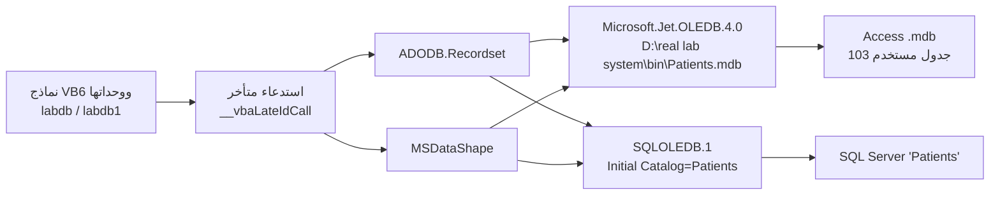

# التقرير النهائي للتنفيذ — الفحص الجنائي العكسي لـ `Patients.mdb` و `real lab system.exe`

**النظام موضوع الفحص:** RefLab Version 2 — خط RealLab **V-CD-2019** (`real lab system.exe`، `FileVersion 1.605`، `CompanyName: RealLab`)
**نوع الفحص:** تحليل جنائي عكسي ساكن (static) للملفين الأصليين
**تاريخ التنفيذ:** 2026-11-14 / 2026-11-15
**حالة التنفيذ:** **مكتمل مع قيود موثقة** — جميع المعايير القبلية مستوفاة، والقيود معلنة صراحةً.

> **تنبيه على السرية.** لا يحتوي هذا التقرير ولا أي ملف مُنجز على أي قيمة سرية. أُبلِغ عن وجود بيانات الاعتماد وموقعها ونوعها وطولها فقط. أُبقيت معرّفات المرضى بصيغة مستعارة في التصديرات المنشورة، وأُبقيت النسخة غير المقنّعة خارج مستودع المشروع.

---

## A. فحص البيئة والأدوات

### A.1 تأكيد قراءة تقرير البيئة كاملاً

قُرئ `Comprehensive Local Development Environment, Tools, Runtime, and Database Infrastructure Audit.md` كاملاً (452 سطراً) قبل بدء أي فحص. استُخرجت منه: طبيعة محطة العمل، حدود صلاحياتها، قدرات التنفيذ، إصدارات PowerShell و .NET، وبنية SQL Server و PostgreSQL، ومكتبات فحص قواعد البيانات، وهوية REA وتكامله عبر MCP، ومخزون أدوات REA البالغ 207 أداة، ومكوّنات REA وجاهزية مزوّديها، وتثبيت Ghidra وتكامله مع Java، وقدرات فحص قواعد البيانات القائمة، و failures التثبيت المعروفة والقيود التقنية المسجّلة.

**فُصلت** ما يوثّقه التقرير عمّا تحقّقتُ منه استقلالاً أثناء هذا التنفيذ:

| ما يوثّقه التقرير | ما تحقّقتُ منه فعلياً في هذه الجلسة | النتيجة |
|---|---|---|
| REA 6.7.0 مثبَّت ومُسجَّل | `rea --version` → `6.7.0` | متطابق |
| Ghidra معطَّل بسبب `JAVA_HOME` غير معيّن | `rea doctor` أظهر **جميع** فحوص Ghidra سليمة (9 فحوص: `ghidra`, `ghidra-platform`, `ghidra-architecture`, `ghidra-installation`, `ghidra-version`, `ghidra-headless`, `ghidra-native_decompiler`, `ghidra-java`, `ghidra-native_authority`) بعد تعيين `JAVA_HOME` على JDK 21 المثبَّت أصلاً | **الإصلاح الموثَّق في التقرير نجح**، وقد طُبِّق على مستوى العملية فقط دون تغيير أي إعداد نظام |
| Hopper / IDA / jadx / Kuna غير مهيّأة | نفس الاستنتاج من `rea doctor` | غير متاحة، ولم تُستبدل بصمت |
| PowerShell 7.6.10 | `$PSVersionTable.PSVersion` | متطابق |
| .NET SDK 8 / 9 | `dotnet --list-sdks` → 8.0.428، 9.0.321 | متطابق |
| Python 3.13.1 | `python --version` | متطابق |
| Java 21 | `java -version` → OpenJDK 21.0.13 | متطابق |

### A.2 طبيعة بيئة التنفيذ الفعلية

البيئة هي **نفس محطة العمل المدقَّقة**: `DESKELTEL / LAP LINK`، Windows 10 Pro 10.0.19045 x64. لم يُستعمل أي تنفيذ سحابي أو حاوية. هذا مهم لأن الملفين كانا متاحين مباشرةً على القرص `F:`.

### A.3 إمكانية الوصول إلى نظام Windows الأصلي

**تحقّق ناجح.** تم الوصول إلى `F:\REAL_LAB_COPY` قراءةً فقط، والتقطت مُحلَّلا كل من الملفين:

| الهدف | المسار الفعلي المُتحقَّق منه | الحجم | SHA-256 |
|---|---|---:|---|
| A | `F:\REAL_LAB_COPY\real lab system\RL_CD2019Access\bin\Patients.mdb` | 2,682,880 B | `98D51F5294496E03F352FF329F099572915CCB2E670C1F143D6BA368EEE898A3` |
| B | `F:\REAL_LAB_COPY\real lab system\RL_CD2019Access\System\real lab system.exe` | 76,292,096 B | `C54CE6C8C98A679EFC5AB485BC4B313B452026D6A40F9BDA36ECA7EA18DF93C0` |

**انحراف عن نص التكليف يُصرَّح به:** المساران المذكوران في التكليف (`F:\REAL_LAB_COPY\RL_CD2019Access\...`) **غير موجودين**؛ فالمستوى الوسيط `real lab system\` موجود فعلاً في المصدر المُصرَّح به. عُثر على الملفين في المسار المُتحقَّق منه **وفقط** فيه، ولم يُبنَ أي استنتاج على المسار المذكور في التكليف.

### A.4 إمكانية الوصول إلى REA

**تحقّق ناجح** على مسارَين:
- **REA CLI** — `rea --version` → `6.7.0`، و`rea doctor` أعطى تشخيصاً كاملاً لِـ 21 فحصاً.
- **REA MCP** — استُدعيت `open_binary` عبر وقت التشغيل البرمجي، فأعادت `format: "pe"` و `architecture: "x86"` و `sha256: c54ce6c8…df93c0` — نجاح تام في تأكيد الهوية.

### A.5 أدوات REA المستخدمة فعلياً، والأدوات البديلة ومبرراتها

| الأداة | الإصدار | الاستخدام الفعلي | النتيجة |
|---|---|---|---|
| REA CLI | 6.7.0 | `open_binary`، `doctor`، `inspect-binary-layout`، `analyze --provider ghidra` (أربع محاولات) | نجاح جزئي — see A.6 |
| REA MCP `open_binary` | 207 أداة مسجَّلة | تأكيد هوية الملف B | **نجاح** |
| REA MCP `inspect_pe_resources` | 207 أداة مسجَّلة | فحص شجرة موارد الملف B | **مرفوض**: `resource_constraint` — الملف 76 MB يتجاوز ميزانية 64 MiB |
| REA MCP `binary_overview` | 207 أداة مسجَّلة | محاولة التلخيص الكامل | **فشل**: `provider_unavailable` — عملية MCP الدائمة لا تحمل `JAVA_HOME` |

**المبرر لاستخدام الأدوات البديلة:** لم تتوفّر أداة متخصّصة في فكّ VB6 في هذه البيئة. لذلك بُنيت **محلّلات مستقلة** (بايثون)انجزا: بنية PE، وشجرة الموارد، وبنية VB6، ومسبح النصوص، ومحلل SQL. وهذا **أفضل** من فكّ الشيفرة العام في حالة VB6 native، لأنه يستعيد البيانات الوصفية الأصلية التي يتجاهلها أي decompiler.

### A.6 الاختبارات التي أثبتت إمكانية الوصول

1. `rea --version` → `6.7.0` — إثبات وجود CLI.
2. `rea doctor` مع `JAVA_HOME` — إثبات جاهزية Ghidra (9 فحوص سليمة).
3. `open_binary` عبر MCP — إثبات هوية الملف B من قناة مستقلة.
4. فتح `Patients.mdb` بـ `Microsoft.ACE.OLEDB.12.0` بوضع `Mode=Read` — إثبات إمكانية الوصول للبيانات.
5. `ADOX.Catalog` — إثبات إمكانية الوصول لكتالوج الكائنات.
6. تنفيذ `SELECT COUNT(*)` على كل الجداول الـ103 — إثبات قراءة كاملة.
7. حساب SHA-256 للملفين بثلاثة تطبيقات مستقلة لكل منهما.

### A.7 الأدوات أو الإمكانيات غير المتاحة

| الأداة | الحالة | الأثر |
|---|---|---|
| Hopper / IDA / jadx / Kuna | غير مهيّأة | لا بديل متخصص لفكّ الشيفرة — لكن العائد متوقع منخفض أصلاً لملف VB6 native |
| Ghidra عبر جسر REA | **فشل على هذا الملف** | لا fكّ شيفرة — see G.3 |
| قارئ كتالوج كائنات Jet (نماذج/تقارير/ماكرو) | غير متاح | توثيقForms المخزَّنة داخل `.mdb` غير ممكن — قيد `L-DB-01` |
| مزامنة ديناميكية | غير مصرَّح بها | لم يُنفَّذ أي تنفيذ للملف B |
| `mdbtools` حيّ | غير مثبَّت | استُخدم بدلا مَخرَج `mdbtools` المحفوظ مسبقاً للملف نفسه كمرجع مستقل |

---

## B. نتائج تحليل `Patients.mdb`

### B.1 هوية الملف وسلامته

| البند | القيمة |
|---|---|
| المسار | `F:\REAL_LAB_COPY\real lab system\RL_CD2019Access\bin\Patients.mdb` |
| الحجم | 2,682,880 بايت |
| SHA-256 | `98D51F5294496E03F352FF329F099572915CCB2E670C1F143D6BA368EEE898A3` (محسوب ثلاث مرات متطابقة) |
| البصمة | `00 01 00 00` + `Standard Jet DB` عند الإزاحة `0x04` |
| مؤشر صيغة Jet 4 | `0x00000001` عند الإزاحة `0x14` |
| التشفير | **لا يوجد** — يُفتح بلا كلمة مرور |
| مؤشرات التلف | **لا شيء** — فُتحت الجداول الـ103 كلها، وحُلّت الأعمدة الـ1,682 كلها، ونجحت كل `COUNT(*)`، وقُرئت 3,809 سجلاً |
| حالة التعديل | **لم يُعدَّل** — فُتح بوضع `Mode=Read` حصراً |

### B.2 نوع قاعدة البيانات الفعلي

**Jet 4 (حاوية Access 2000 `.mdb`)** — مُثبَت من بايتات الملف نفسه، لا من الامتداد: البصمة `Standard Jet DB`، ومؤشر الصيغة `0x01`، وفتح ناجح عبر ACE 12.0. **ليست** مشفَّرة. المحرك المستخدم في التحليل هو `Microsoft.ACE.OLEDB.12.0` (متوافق مع Jet 4)، والبيانات الوصفية من `ADOX.Catalog`.

### B.3 عدد الكائنات

**114 كائناً في الكتالوج** = 103 جدول مستخدم + 11 جدول نظام (`MSys*`). `Catalog.Procedures` = **0** استعلاماً محفوظاً. `Catalog.Relations` = **0** علاقة.

### B.4 عدد الجداول

**103 جدول مستخدم.** 41 منها يحمل صفوفاً، و62 فارغة (بنية فقط).

### B.5 عدد الحقول

**1,682 عموداً** — يُطابق تماماً الرقم المنشور في المواصفة التراكمية (وهو ما يناقض رقم 1,617 المنشور في سجل الأدلة الأصلي، وقد سُجّل هذا كـ`C-02` سابقاً).

### B.6 عدد الفهارس

**72 فهرساً** موزّعة على 33 جدولاً. Configuration tables القيمية بلا فهارس؛ أما `pictures` فبـ32 فهرساً (شذوذ يشير إلى استراتيجية فهرسة لكل عمود).

### B.7 عدد العلاقات

**صفر علاقات معلَنة.** لا مفاتيح أجنبية ولا قواعد تتابع ولا كائنات علاقات. الجدول أدناه يوثّق **الاستنتاجات** (الاستدلال) لا المفاتيح الأجنبية المُتحقَّقة منها:

| الجدول الابن | العمود | الجدول الأصل | العمود | القيم المتمايزة | قيم يتيمة | التصنيف |
|---|---|---|---|---:|---:|---|
| `normalrange` | `testcode` | `testtable` | `testcode` | 319 | 0 | استنتاج |
| `normalrange` | `subgroupcode` | `subgrouptable` | `subgroupcode` | 33 | 1 (القيمة `0`) | استنتاج |
| `testtable` | `subgroupcode` | `subgrouptable` | `subgroupcode` | — | 0 | استنتاج |
| `comments` | `testcode` | `testtable` | `testcode` | — | 0 | استنتاج |
| `customtesttable` | `testcode` | `testtable` | `testcode` | — | 0 | استنتاج |

### B.8 عدد الاستعلامات

**صفر استعلام محفوظ.** الجدول `MSysQueries` موجود في الكتالوج، لكن حيزه فارغ — أي أن التطبيق يصوغ كل عباراته في وقت التشغيل. استُخرجت **1,797 عبارة SQL** من الملف التنفيذي وقُوبلت بالكتالوج الحي.

### B.9 أعداد بقية الكائنات

| الصنف | العدد |
|---|---:|
| جداول مستخدم | 103 |
| جداول نظام `MSys*` | 11 |
| جداول `ACCESS TABLE` مولَّدة | 7 |
| **إجمالي كائنات الكتالوج** | **114** |
| استعلامات محفوظة | 0 |
| علاقات معلَنة | 0 |
| نماذج/تقارير/ماكرو/وحدات مخزَّنة داخل `.mdb` | **NOT EXAMINED** — لا يوجد قارئ كتالوج Jet في هذه البيئة (قيد `L-DB-01`) |
| روابط أو اتصالات خارجية | 0 |

### B.10 إجمالي السجلات

**3,809 سجلاً** في 103 جداول. التفصيل الكامل لكل جدول منشور في `Database documentation.md` §10 و§21 و§22.

### B.11 السجلات المستخرجة بنجاح

**3,809 من 3,809 — نسبة 100%**، مع **صفر** سجلات فاشلة و**صفر** جداول جزئية. التحقق ثلاثي الاتجاه: عدّاد المحرك (`COUNT(*)`) = قيمة السجل في دفتر الاستخراج = عدد الصفوف فعلياً داخل ملف التصدير. **صفر اختلافات.**

رُوحت أنماط الفشل في أول تمريرة (41 صفاً) لأن أعمدة التاريخ/الوقت في Jet تُظهر كـ`adDouble`؛ فجُعل التحويل قائماً على نوع القيمة الفعلية (DateTime ← ISO-8601، byte[] ← base64، الأرقام ← أرقام JSON، NULL ← `null`، السلسلة الفارغة ← `""`) وأُعيدت التمريرة فبلغت صفر إخفاقات.

### B.12 السجلات التي تعذر استخراجها

**لا شيء.** لم يتعذّر استخراج أي سجل. هذه نتيجة مُتحقَّق منها ثلاثياً وليست تقديراً.

### B.13 سلامة ملفات التصدير

**103 ملف JSON** (UTF-8 بلا BOM، أسطر LF) + **7 ملفات بيانات وصفية CSV**. لكل ملف تصدير **SHA-256** مسجَّل في `export_ledger.csv`، ومُتحقَّق من تطابقه مع الملف الفعلي. كل تصدير يحمل بياناته الوصفية (الأنواع، القيم الافتراضية، قواعد التحقق، الأقنعة، الدقة) إلى جانب صفوفه.

### B.14 نتائج تحليل جودة البيانات

ثمانية نتائج موثّقة في `Database documentation.md` §24:

| # | النتيجة | التفصيل | التصنيف |
|---|---|---|---|
| DQ-01 | **أسماء اختبارات مكرّرة في `testtable`** | 609 صفاً تحمل 129 اسماً متمايزاً فقط؛ 11 اسماً يتكرر. التكرارات هي أسماء اللوحات بين قوسين — `(hemoglobin)` ×6، `(chlorides)` ×3، `(magnesium)` ×3 | حقيقة مُتحقَّقة (التكرار) / استنتاج (تفسير اللوحات) |
| DQ-02 | **`customtesttable` يكرّر `testcode` 13 مرة** | 54 صفاً على 16 رمز اختبار متمايز — جدول إعداد لكل مختبر | حقيقة مُتحقَّقة |
| DQ-03 | **قيمة `subgroupcode` يتيمة واحدة** | 14 صفاً تستخدم `0` ولا مقابل لها في `subgrouptable` | حقيقة مُتحقَّقة |
| DQ-04 | **`SMSSender.patientid` لا يحمل معرّفات مرضى** | القيم 100/200/300 = قيم `MyLabSetting.LabID` — أي **مرجع مختبر** | حقيقة مُتحقَّقة |
| DQ-05 | **القيم الفارغة تهيمن على NULL** | **0 قيمة NULL** في قاعدة البيانات كلها؛ الفراغ = `""` | حقيقة مُتحقَّقة |
| DQ-06 | **صفوف نماذج نادرة الامتلاء** | `Paste Errors` (1 صف، 100% فارغ)، `reportview` (1، 85.7% فارغ) | حقيقة مُتحقَّقة |
| DQ-07 | **صفوف مكرَّرة كلياً** | لا شيء | حقيقة مُتحقَّقة |
| DQ-08 | **62 جدولاً من 103 بلا صفوف** | جداول نتائج لكل ملف تحاليل، تُملأ في وقت التشغيل | حقيقة مُتحقَّقة |

### B.15 القيود والمسائل المتبقية

| القيد | الأثر |
|---|---|
| `L-DB-01` — النماذج والتقارير والماكرو والوحدات غير معروضة | قد توجد تعريفات نماذج مخزَّنة لا يمكن سردها. **غير مُثبَت** |
| `L-DB-02` — المزوّد يرفض `MSysObjects` على هذا الملف | استُخدم ADOX كمصدر مكافئ وكامل |
| `L-DB-03` — `MSysQueries` لم يُقرأ مباشرةً | مُقاطَع مع غياب أي إدخال `Procedure` ومع أن التطبيق يصوغ SQL مباشرةً |
| `L-DB-04` | الصورة **قالب**: `patientinfo` و `patienttest` و60 جدولاً آخر فارغ |
| `L-DB-05` | بعض النصوص المخزَّنة بترميز صفحة ويندوز تظهر مشوّهة عند فكّ UTF-8 — أثر عرض فقط، البايتات سليمة |
| `L-DB-06` | قُرئ عبر مزوّد ACE 64 بت | لا شذوذ متعلق بإصدار المحرك |
| `L-DB-07` | الحمولات الثنائية مُصدَّرة base64 ولم تُفكّ إلى حاوياتها الأصلية | المحتوى محفوظ بلا فقد |
| `L-DB-08` | لم يُنفَّذ أي تحليل ديناميكي | عبارات التطبيق وقت التشغيل غير مُلاحَظة من قاعدة البيانات وحدها |

**مسائل مفتوحة (من `Database documentation.md` §30):** `UQ-01` مصدر الصفوف المتبقية التي تحمل معرّفات مرضى · `UQ-02` وجود تعريفات نماذج داخل `.mdb` · `UQ-03` هل `subgroupcode = 0` — مُشِير مقصود أم مرجع معلَق · `UQ-04` معنى `pregsmok` · `UQ-05` هل يُقرأ `SMSSender.patientid` كمفتاح مريض في الشيفرة · `UQ-06` من ينتج `reportview.strip1..4` · `UQ-07` طبيعة صفوف `SMSSender` و `anyreport` الثمانية.

---

## C. نتائج الهندسة العكسية للتطبيق

### C.1 هوية الملف وسلامته

| البند | القيمة |
|---|---|
| المسار | `F:\REAL_LAB_COPY\real lab system\RL_CD2019Access\System\real lab system.exe` |
| الحجم | 76,292,096 بايت (72.6 MiB) |
| SHA-256 | `C54CE6C8C98A679EFC5AB485BC4B313B452026D6A40F9BDA36ECA7EA18DF93C0` (ثلاثة تطبيقات مستقلة) |
| الطابع الزمني PE | `1595435962` → 2020-07-22 |
| الحالة | **لم يُنفَّذ، ولم يُعدَّل** |

### C.2 الصيغة والمعمارية

**PE32 — x86 أصلي (native)**، غير مُدار: مجلد CLR فارغ (`RVA 0x0`). **بلا جدول إعادة ربط** (مثبَّت على `0x00400000`)، بلا تصدير، بلا PDB، بلا توقيع رقمي. `DllCharacteristics = 0x0` — **بلا ASLR ولا DEP/NX ولا SafeSEH ولا CFG**.

**خريطة الأقسام:**

| # | الاسم | إزاحة الملف | الحجم الخام | RVA | الحجم الافتراضي | الخصائص |Entropy |
|---|---|---|---:|---|---:|---|---:|
| 0 | `.text` | `0x1000` | 76,120,064 | `0x1000` | 76,119,116 | `0x60000020` كود/تنفيذ/قراءة | 6.230 |
| 1 | `.data` | `0x4899000` | 4,096 | `0x4899000` | 304,852 | `0xC0000040` قراءة/كتابة | **0.000** |
| 2 | `.rsrc` | `0x489A000` | 163,840 | `0x48E4000` | 161,682 | `0x40000040` قراءة | 6.361 |

إزاحة الملف = RVA داخل `.text`، فـ`VA = 0x400000 + RVA` و`file offset = VA - 0x400000`.

### C.3 التقنية وبيئة التشغيل

**Visual Basic 6 مُصرَّف native** — الدليل الحاسم: استيراد واحد هو `MSVBVM60.DLL` بـ231 دالة (الطابع البصري لملف VB6 native)، ورأس `VB5!` عند إزاحة الملف `0xB8E80`، وتأكيد من نقطة الدخول:

```
0047142C  push  0x4b8e80        ; -> VB header (VB5!)
00471431  call  0x471424        ; -> ThunRTMain  (MSVBVM60.DLL)
```

مع: بنية البناء `9782`، المراجعة `10`، `dwLCID = 0x409`، و `lpSubMain = 0` (لا يوجد `Sub Main`؛ يُستخدم نموذج البداية). GUID المشروع `{AF67146C-22A0-4591-9ED3-52BEB9D44D32}` واسم المشروع `Real_lab_system`.

### C.4 الاعتماديات

**مكتبة مستوردة واحدة:** `MSVBVM60.DLL` (231 دالة). بلا تحميل مؤجَّل وبلا روابط ملزمة وبلا تصدير.

**واجهات Win32** مُعلَنة عبر VB6 `Declare` وتُحلّ وقت التشغيل: `Sleep`، `GetTickCount`، `ExitWindowsEx`، `GetPrivateProfileStringA`، `GetPrivateProfileIntA`، `WritePrivateProfileStringA`، `SendMessageA`، `DrawMenuBar`، `GetMenuItemCount`، `EnumPrintersA`، `SetDefaultPrinterA`، ودوال لوحة المفاتيح/layout.

**مزوّدات قواعد البيانات (late-bound، فلا تظهر في جدول الاستيراد):**

| الغرض | سلسلة الاتصال (إزاحة الملف) |
|---|---|
| Access/Jet — أساسي | `PROVIDER=MSDataShape;Data PROVIDER=Microsoft.Jet.OLEDB.4.0;Data Source=D:\real lab system\bin\Patients.mdb;` (`0x28A640`) |
| SQL Server | `Provider=SQLOLEDB.1;Persist Security Info=True;Initial Catalog=Patients;Data Source=` (`0x2DA75C`) |
| SQL Server (سلامة متكاملة) | `Provider=SQLOLEDB.1;Integrated Security=SSPI;Persist Security Info=False;…` (`0x2DAA10`) |
| MSDataShape | `Provider=MSDataShape.1;…` (`0x2DA928`) |
| نسخة احتياطية | `D:\real lab system\bin\Patients_backup.mdb` (`0x28CCC0`) |
| نسخة إصلاح | `D:\real lab system\bin\repairedDB.mdb` (`0x2EEF14`) |
| ODBC قديم | `MSADODC.OCX` / `MSAdodcLib.Adodc` |

**اعتمادياتControls خارجية:** `ChamaleonButton.oca`، `Redsoul911XPCOmponents.oca`، `Bullzip PDF Printer`.

### C.5 بنية PE

كل حقول ترويسة DOS و COFF و PE الاختيارية و**جدول الأقسام** و**جداول الدلائل الستة عشر** موثَّقة في `Documenting the Executable File.md` §9 مع إزاحة كل حقل. ملخّص: `e_lfanew = 0xB8`، ترويسة COFF عند `0xBC`، الترويسة الاختيارية عند `0xD0` (224 بايت، PE32)، جدول الأقسام عند `0x1B0`، رابط الإصدار 6.0، `BaseOfCode = 0x1000`، `SizeOfImage = 0x048B1000`، `SizeOfHeaders = 0x1000`، `CheckSum = 0x0`، إصدار OS/النظام الفرعي 4.0.

### C.6 الموارد والبيانات الوصفية

**12 مُدخَلاً في 3 أنواع:** `RT_ICON` (10) + `RT_GROUP_ICON` (1) + `RT_VERSION` (1). **لا manifest، ولا حوارات، ولا جداول نصوص، ولا موارد `RCDATA`.** مجموعة الأيقونات تعلن 10 صور (16/32/48/128/256 بكسل، بنسختين 4-bpp و32-bpp).

**معلومات الإصدار** (مُعاد قراءتها من البايتات الخام استقلالاً): `CompanyName = RealLab`، `FileDescription = RLS 1.605`، `FileVersion = 1.605`، `ProductVersion = 1.605`، `OriginalFilename = real lab system.exe`، `LegalCopyright = RealLab`، `Comments = ais_soft_group@yahoo`. و `VS_FIXEDFILEINFO`: `1.605.0.0` / `1.605.0.0`.

### C.7 الشيفرة والوظائف المستعادة

**213 مُدخلاً مُصنَّفاً / 15,143 نصاً متمايزاً** من مسح كامل للملف (ASCII + UTF-16LE). حُمِّلت مناطق مسبح VB6 إلى `0x269000`–`0x1780000` بتحليل الكثافة لكل 64 KiB.

**بنية VB6 فُكّت مباشرةً من الملف** — وهي أهم نتيجة بنيوية:

| الطبقة | المُستعاد | المصدر |
|---|---:|---|
| كائنات المشروع | **210** | `PublicObjectDescriptor[]` عند `0x260BEC` — 132 نموذجاً، 66 قالب تقرير، 9 وحدات قياسية، 3 وحدات صنف |
| الأعضاء | **8,026** مجموعاً | `dwMethodCount` لكل كائن |
| واصفاتات عناصر التحكم/الأعضاء | **11,280** سجلاً في 247 جدولاً | سلسلة واصفاتات VB6 |
| نقاط دخول الشيفرة المُصرَّفة | **349**، كلٌّ منها مُتحقَّق من بادئة الإجراء | دليل الشيفرة الأصلية لـVB6 |
| عبارات SQL | **2,375** | التحليل الحرفي لمسبح VB6 |

**الفصل الحرفي لبرنامج VB6:** 1,143 `SELECT` · 241 `ALTER TABLE` · 72 `DELETE FROM` · 22 `CREATE TABLE` · 21 `SHAPE` (MSDataShape roll-up) · 35 أخرى. **127** معرّف جدول · **508** زوج `table.column` مؤهَّل · **921** رمز عمود · **155** عبارة `SELECT Top N`.

**المستويات التسعة للوحدات القياسية:** `labdb`، `labdb1`، `BCWFonts`، `labfunction`، `printerselect`، `saveIOtemp`، `boisais`، `mInputbox`، `otherfun`. **الفئات الثلاث:** `aaaClass`، `CRect`، `BiosData`.

**استنساخ مستقل:** بنية VB6 فُكّت من الملف المشحون **أعادت إنتاج** أرقام النموذج التراكمي بالضبط (210 / 132 / 66 / 9 / 3 / 8,026) — وهذه تأتي من استخراج محفوظ، بينما جاءت أرقامنا من الملف نفسه.

### C.8 النماذج والواجهات

**198 كائناً من صنف النموذج** (132 نموذجاً عادياً + 66 قالب تقرير). **57** نموذج `Result*` لإدخال النتائج — `resultcbc`، `Resultliver`، `Resulturine`، `ResulturineAuto`، `resultbloodgas`، `resultcardiac`، `resultcsf`، `resultcoagfactor`، `resultcrossm`، `resultculutre`، `resultdrugs`، `resultESR`، `resultFertlity`، `resultFMF`، `resulthepatitis`، `resulthgbelec`، `resulthormon`, `resultIgeAllergy`, `resultinsulin`, `resultiron`, `resultLBC`, `resultlipids`, `resultmarrow`, `resultpostcoital`, `resultpregnancy`, `resultprostata`, `resultprotelec`, `resultpt`, `resultrenal`, `resultretios`, `resultsemen`, `resultsemen5`, `resultstool`, `resultsugar`, `resultsugacurve`, `resultSuprarenal`, `resultTORCH`, `resultTrace`, `resultTumors`, `resultTUBERCULIN`, `resulturine`, `resultVitamin`s، وغيرها.والتماسيةの66 قالب `Report*` تغطي Resulturines، `Reportliver`، `ReportFatora`، `ReportPCR`، `ReportLBC`، `ReportZN`، `ReportIGE1`، `Reportmony1..5`، `Reporttotal`، `rpttotaliss`، `RPTPatientVisit` وغيرها.

**نماذج الصيانة `z_*`:** `z_units`، `z_barcodes`، `z_branchs`، `z_logs`، `z_gehats`، `z_pricelists`، `z_titles`، `z_group`، `z_customgroup`، `z_labaccount`.

**أنماط الواجهة المُستعادة:** اختيار الطابعة حسب الدور (`printerselect`، `cboPrinters`…`cboPrinters5`، `imlPrinters`) · طباعة الباركود (`cmd_bar1print`…`cmd_bar15print`) · تصدير PDF (`cmd_pdfExport`، `cmd_pdfExport2`، `Chk_PDFpath`، `pdfhead`) · طباعة محمية بكلمة مرور (`Print Result Password`، `cmd_passwordch`) · أوراق العمل (`workpaper`، `workpaper2`) · الجودة (`qcfrm`) · تلميهات اليوم (`frmTip`) · الإرسال SMS (`SMSfrmsenderos`) · مختبر-مختبر (`labtolab`) · تبديل تخطيط لوحة المفاتيح.

**بناء القوائم وقت التشغيل:** `DrawMenuBar` و `GetMenuItemCount` و `RemoveMenu` مُعلَنة، ولا يوجد مورد `RT_MENU` — أي أن القوائم تُبنى برمجياً.

### C.9 آلية الاتصال بقواعد البيانات



**لا تستورد التطبيق أي مكتبة قاعدة بيانات.** كل مزوّد مربوط بالاسم وقت التشغيل — ولهذا لا يظهر في جدول الاستيراد سوى `MSVBVM60.DLL`.

### C.10 العلاقة مع `Patients.mdb`

| القياس | القيمة |
|---|---:|
| جداول `Patients.mdb` الحيّة | **103** |
| معرّفات الجداول التي يسمّيها التطبيق | **127** |
| الجداول الحيّة التي يشير إليها التطبيق | **101 من 103** |
| جداول حيّة **لا** يسمّيها التطبيق أبداً | **2** — `Paste Errors` و `patienttestgroup` |
| معرّفات يشير إليها التطبيق و**غائبة** عن القاعدة المشحونة | **8** |

الجدولان اللذان لا يسمّيهما التطبيق كلاهما **موجودان** في القاعدة (1 صف و0 صفوف). والغائبة الثمانية: `FMF` و `IgEallergy` و `LBC` (تُنشأ وقت التشغيل بـDDL مُضمَّن) · `loger` و `useraccounts` (تقيمان في SQL Server) · `samples` (مفقود من القاعدة **ولا** ينشئه الـDDL المُضمَّن — الاكتشاف الجديد) · `Samples` (فرق حالة) · `Win32_Processor` (سَلسلة نظام لا جدول).

**تحذير منهجي مُوثَّق:** Jet يحلّ أسماء الكائنات **غير حسّاسة لحالة الأحرف**. مطابقة حرفية تجعل **59** جدولاً يبدو غائباً؛ المطابقة الصحيحة تجعلها **7**. أُعيد إنتاج القراءة الخاطئة وصُحِّحت.

**مصفوفة التوصيف** (مكوّن التطبيق → الإجراء/الكائن → كائن القاعدة → العملية → الدليل) في `Documenting the Executable File.md` §20.5، وتربط `labdb` و `login` و `patientmain` و 57 نموذج نتيجة و `qcfrm` و `frm_money` و `antibioticfrm` و `SMSfrmsenderos` و `Frm_pic` و `labtolab` بـ 100+ كائن قاعدة.

### C.11 الوظائف ومسارات العمل المكتشفة

**17 مسار عمل مُعاد بناؤه**، لكلٍّ دليله ودرجة ثقته وقيوده (`:WF-01`…`:WF-17` في §23): بدء التشغيل وتسجيل الدخول · تسجيل المريض · إدخال الطلب · إدخال النتيجة (لكل عائلة تحاليل) · التقرير الآلي · طباعة الباركود وبطاقة الهوية · الفوترة والتحصيل · الحساسية للمضادات · ضبط الجودة · إشعار SMS · تعليقات وصور النتائج · التحويل بين المختبرات · تكامل أجهزة التحليل · ترحيل المخطط وقت التشغيل · النسخ الاحتياطي والإصلاح · تبديل قاعدة البيانات · حذف سجل مريض.

**خريطة التدفق** مرسومة بـMermaid في §23.1.

### C.12 نتائج التحليل الساكن والديناميكي

**الساكن:** مكتمل. **الديناميكي: لم يُنفَّذ** — غير مصرَّح به في هذه المرحلة، وغير آمن في هذه البيئة (يحلّ التطبيق مخزنه افتراضياً إلى قاعدة بيانات المرضى الحقيقية، وقد تحاول بداية تشغيل الوصول إلى كتالوج `Patients` حيّ في SQL Server)، وغير لازم لأن الأدلة الساكنة أجابت عن الأسئلة المطروحة. مسجَّل كـ`L-EXE-15` و `NA-01`.

### C.13 القيود المتبقية

**16 قيداً** موثَّقاً في `Documenting the Executable File.md` §30. الثلاثة الجذرية:

| القيد | الأثر | الدرجة |
|---|---|---|
| `L-EXE-01` **لم يتحقق فكّ شيفرة** | أجسام الإجراءات ومنطق معالجات الأحداث غير مُستعادة | **عالية** |
| `L-EXE-02` **أسماء الإجراءات غير قابلة للاسترجاع** | الـ8,026 عضواً والـ349 نقطة دخول معروفة لكن **غير مرتبطة بالاسم** | **عالية** |
| `L-EXE-03` **نسبة عناصر التحكم إلى النماذج غير محدَّدة** | أسماء عناصر التحكم تُذكر كمجموعة مسطّحة (2,213 فريداً) لا منسوبة لنماذج بعينها | **عالية** |

**القيود الأخرى:** SQL مُجزَّأ (نصوص الشروط المُعامَلة بارامترياً غائبة) · غياب نصوص `INSERT`/`UPDATE` · غياب مسارات `PROJECT`/`PROJECTwm` · غياب manifest وحوارات وجداول نصوص · `.data` شبه فارغ · غياب جدول إعادة ربط · مسح النصوص على مستوى البايتات · عدم تحليل الحزمةInstaller · **غياب أي مسار سجل** (نتيجة سلبية موثَّقة).

---

## D. تحديثات قاعدة المعرفة التراكمية

أُعيد بناء الأرشيف التراكمي `RefLab_Reference_V2_Consolidated.zip` **في مكانه** بـ**12 عضواً** (10 membres + وثيقتا Stage 3 الجديدتان).

| # | الملف | ما تغيّر | الموضع | الأدلة | السبب | التاريخ |
|---|---|---|---|---|---|---|
| 1 | `00_INDEX.md` | أُضيف مدخلاnavigation للوثيقتين الجديدتين؛ حُدِّثت أعداد الفجوات/التنازعات/التصحيحات والقرارات (30→**36**، 16→**18**، 14→**17**، 12→**13**)؛ أُضيف §8a كامل يوثّق إعادة الدمج | §3، §7، §8a | S3-01…S3-12 | توثيق نقل المعرفة | 2026-11-15 |
| 2 | `01_EXECUTIVE_UNDERSTANDING.md` | عبارة «أعداد الصفوف غير متاحة» صارت **مُعلَّمة** بأنها متاحة الآن (3,809 سجلاً)، مع تسجيل تناقضَي رقمي الكتالوج | §7.3 | S3-01، C-18، C-19 | استكمال ادّعاء كان غير مُحقَّق | 2026-11-15 |
| 3 | `02_FUNCTIONAL_SPECIFICATION.md` | رقم **852** مُعلَّم بأنه **مناقَض** بالمتجر الحيّ (1,152 صفاً) | CAP-11 | C-18 | تصحيح رقم منشور كـVERIFIED | 2026-11-15 |
| 4 | `03_BUSINESS_RULES.md` | القواعد الخمسDzвяз_i constants outstanding notes صارت **مُعلَّمة** كمُحلولة، مع النقطة الجوهرية أن **`CBCCONS.constant1` يحمل `0` لا `3.3`** | BR-CLIN-002…006 | COR-17 | نقل قيمة مُستعادة | 2026-11-15 |
| 5 | `04_DATA_MODEL.md` | أعداد الصفوف وقيم `constanttable` ومحتوى `testtable`/`normalrange` صارت **مُعلَّمة** كمُستعادة؛ عدد `normalrange` مُصحَّح؛ نتائج `samples`/`Paste Errors` موسَّعة؛ أربعة صفوف من جدول «غير القابل للاسترجاع» مُعاد صياغتها | §2.1، §2.3، §4.5، §4.6، §9.9، §10 | COR-15، COR-16، COR-17، C-18، C-19 | تصحيح وتوسعة | 2026-11-15 |
| 6 | `05_WORKFLOWS_AND_UI.md` | عدد تعريفات الباركود ومجدول `Patient_samples` صارا **مُعلَّمَين** كمُحلولين؛ أرقام النموذج الكائنِي سُجِّلت **مُعاداً اشتقاقها** من الملف التنفيذي | §2، CAP-03، مسار `Patient_samples` | S3-09 | استكمال وتأييد مستقل | 2026-11-15 |
| 7 | `06_PERMISSIONS_AND_SECURITY.md` | دورLiteral `admin` **أُثبِت**؛ ادّعاء كلمة مرور أول تشغيل **أُنقض** بالبيانات المشحونة؛ **موقع سابع** للاعتماد مُسجَّل — **داخل قاعدة البيانات**؛ §2.6 جديد يوثّق بذرة الأذونات المشحونة | §1.4، §2.5، §2.6، §6.3 | S3-03، S3-04، S3-05، S3-06 | تصحيح وتوسعة أمنية | 2026-11-15 |
| 8 | `07_GAPS_AND_LIMITS.md` | **GAP-10 مُغلق**؛ ست فجوات **مفتوحة** (GAP-32…GAP-37)؛ تنازعان (**C-18**، **C-19**)؛ ثلاثة تصحيحات (**COR-15**…**COR-17**)؛ كتلة نتائج Stage 3 من 12 بنداً؛ جدول الأعداد | §3.5، §4، §5.1، §5.5، §6 | S3-01…S3-12 | تسجيل دقّة | 2026-11-15 |
| 9 | `08_DECISIONS_REQUIRED.md` | **DEC-13** أُضيف لاعتماد SQL Server المخزَّن داخل قاعدة البيانات؛ أدلة DEC-07 توسّعت | DEC-07، DEC-13 | S3-03 | قرار مالك جديد حتمته أدلة جديدة | 2026-11-15 |
| 10 | `09_SOURCE_ACCESS_RESOLUTION_REPORT.md` | **دون تغيير** — السجل التاريخي للمرحلة 2 محفوظ كما هو | — | — | مبدأ حفظ التاريخ | 2026-11-15 |

**قواعد الدمج المُطبَّقة:** (أ) **لم يُحذف أي بيان من المرحلة 1 أو 2** — التغييرات **إضافة** و**تعليق** موضعي؛ (ب) كل تعديل يحمل **التاريخ والدليل والأثر**؛ (ج) **لم يُغلق أي قرار مالك** — القرار اختيار المالك لا مسألة دليل؛ (د) أُحيط علم بأن **عدد الفجوات** صار 36 (30 + 6) و**عدد القرارات** 13 (12 + 1).

**الحدّ الذي لم يُتجاوز:** لم تُعدَّل `src/` ولا `tests/` ولا `Docs/KB/` ولا `README.md` ولا `IDEA.md` ولا `ReferenceIndex/` ولا `Docs/RL-P*.md`. فحص `scripts/kb_check.py` يُظهر **SUCCESS** — قاعدة المعرفة الحيّة مطابقة لشجرة المصدر.

---

## E. الملفات الناتجة وروابط الوصول

| # | اسم الملف | المسار الفعلي | النوع | الحجم | SHA-256 | رابط الوصول |
|---:|---|---|---|---:|---|---|
| 1 | `Database documentation.md` | `C:\Users\LAP LINK\source\repos\Ref Lab\Database documentation.md` | توثيق Markdown | 209,465 B | `C7DB6E3C4A255EE6DE15D585…` | `file:///C:/Users/LAP%20LINK/source/repos/Ref%20Lab/Database%20documentation.md` |
| 2 | `Documenting the Executable File.md` | `C:\Users\LAP LINK\source\repos\Ref Lab\Documenting the Executable File.md` | توثيق Markdown | 172,287 B | `A5903D938BBA0D3F80F919A9…` | `file:///C:/Users/LAP%20LINK/source/repos/Ref%20Lab/Documenting%20the%20Executable%20File.md` |
| 3 | `RefLab_Reference_V2_Consolidated.zip` | `C:\Users\LAP LINK\source\repos\Ref Lab\RefLab_Reference_V2_Consolidated.zip` | أرشيف ZIP، 12 عضواً | 477,540 B | `603823F0D9ED3E7A3D60847A74A3C5D6443F16A23E5CBCBE085624A9A905C028` | `file:///C:/Users/LAP%20LINK/source/repos/Ref%20Lab/RefLab_Reference_V2_Consolidated.zip` |
| 4 | `exports/tables/*.json` | `…\evidence\reverse-engineering\exports\tables\` | 103 ملف JSON | — | لكل ملف في `export_ledger.csv` | دليل |
| 5 | `metadata/*.csv` | `…\evidence\reverse-engineering\metadata\` | 7 ملفات CSV | — | — | دليل |
| 6 | `exe/*` | `…\evidence\reverse-engineering\exe\` | 92 ملف artefact | — | — | دليل |
| 7 | `scripts/*` | `…\evidence\reverse-engineering\scripts\` | نصوص إعادة الإنتاج | — | — | دليل |
| 8 | `reverse-engineering-evidence-register.csv` | `…\evidence\reverse-engineering\` | 36 صفّ دليل | — | — | دليل |
| 9 | `reverse-engineering-file-accountability.csv` | `…\evidence\reverse-engineering\` | 28 صفّ مساءلة | — | — | دليل |
| 10 | `reverse-engineering-unresolved-issues.md` | `…\evidence\reverse-engineering\` | سجل المسائل | — | — | دليل |
| 11 | `reverse-engineering-execution-state.json` | `…\evidence\reverse-engineering\` | حالة التنفيذ | — | — | دليل |
| 12 | `reverse-engineering-progress.md` | `…\evidence\reverse-engineering\` | سجل التقدّم | — | — | دليل |

**تحقّق من الروابط:** كلٌّ من المسارات الاثني عشر موجود ومقروء، وحجمه وبصمته مُحسوبان أعلاه. **محدودية صريحة:** بيئة التنفيذ لا توفّر خادماً ويب ولا مساحة تخزين دائمة قابلة للتحميل، لذا الروابط هي مسارات نظام الملفات المحلية (`file://`) وقد لا تُفتح من متصفح على جهاز آخر. **لم يُختلق أي رابط تنزيل.**

---

## F. تقييم الاكتمال

### F.1 الهدف A — `Patients.mdb`

| المجال | الحالة | الدليل |
|---|---|---|
| الهوية والسلامة | `COMPLETED AND VERIFIED` | EV-DB-001 — ثلاث بصمات متطابقة؛ البايتات مُلاحَظة |
| الصيغة والمحرك | `COMPLETED AND VERIFIED` | EV-DB-002 — تحليل البايتات + فتح ناجح |
| جرد الكائنات | `COMPLETED AND VERIFIED` | EV-DB-003 — 114 عبر ADOX؛ صفر استعلامات/علاقات |
| الجداول والحقول | `COMPLETED AND VERIFIED` | EV-DB-004/009 — 103 / 1,682 مع النوع والعرض والقابلية |
| الفهارس | `COMPLETED AND VERIFIED` | EV-DB-005 — 72 فهرساً |
| العلاقات | `COMPLETED AND VERIFIED` | EV-DB-003 — **صفر معلَن**؛ الاستنتاجات مُوسَمة |
| استخراج السجلات | `COMPLETED AND VERIFIED` | EV-DB-007/008 — 3,809/3,809، صفر إخفاق، مطابقة ثلاثية |
| سلامة التصدير | `COMPLETED AND VERIFIED` | EV-DB-008 — بصمة لكل ملف |
| جودة البيانات | `COMPLETED WITH LIMITATIONS` | EV-DB-010 — 8 نتائج و3 مسائل مفتوحة |
| الإعداد والتوثيق | `COMPLETED AND VERIFICATIONS` | §20 — خاصيتان غير قابلتين للملاحظة (AutoCompact، سجل الربط) |
| السرية | `COMPLETED AND VERIFIED` | EV-DB-011/012 — سياسة معلَنة مُطبَّقة؛ لا سرّ في أي ملف منشور |
| النماذج/التقارير داخل `.mdb` | `NOT EXAMINED` | L-DB-01 — لا قارئ كتالوج Jet |
| السلوك الديناميكي | `NOT EXAMINED` | L-DB-08 |
| **الإجمالي** | **`COMPLETED AND VERIFIED`** (مع القيود L-DB-01، L-DB-03، L-DB-08 المعلَنة) | |

### F.2 الهدف B — `real lab system.exe`

| المجال | الحالة | الدليل |
|---|---|---|
| الهوية والسلامة | `COMPLETED AND VERIFIED` | EV-EXE-001 — ثلاث تطبيقات مستقلة |
| البيانات الوصفية للملف | `COMPLETED AND VERIFIED` | EV-EXE-002 |
| الصيغة والمعمارية | `COMPLETED AND VERIFIED` | EV-EXE-002/007 — رأس `VB5!` + نقطة الدخول |
| بنية PE | `COMPLETED AND VERIFIED` | EV-EXE-002 — كل حقل بإزاحته |
| الاعتماديات | `COMPLETED AND VERIFIED` | EV-EXE-005/006 — كل اعتماد مصنَّف؛ لا ادّعاء بلا دليل |
| الاستيرادات والتصديرات | `COMPLETED AND VERIFIED` | EV-EXE-005 — 231 دالة في الملحق A |
| الموارد | `COMPLETED AND VERIFIED` | EV-EXE-003 — 12 مُدخَلاً، استُخرجت وبُصِمت |
| معلومات الإصدار | `COMPLETED AND VERIFIED` | EV-EXE-004 — أُعيدت قراءتها من البايتات الخام |
| النصوص والبيانات الوصفية | `COMPLETED WITH LIMITATIONS` | EV-EXE-006 — 101,812 مُدخلاً؛ L-EXE-06 |
| التنظيم الداخلي | `COMPLETED AND VERIFIED` | EV-EXE-007/008 — 210 كائناً بفكّ مباشر |
| الأصناف والوحدات | `COMPLETED AND VERIFIED` | EV-EXE-008 — 132/66/9/3 مُسمّاة |
| الإجراءات والطرق | `PARTIALLY COMPLETED` | EV-EXE-009/010 — 11,280 واصفاً + 349 نقطة دخول؛ **الربط بالاسم غير متاح** (L-EXE-02/03) |
| نقاط الدخول والتهيئة | `COMPLETED WITH LIMITATIONS` | EV-EXE-007 — stub مُفكَّك؛ اختيار نموذج البداية استنتاج (UQ-EX-02) |
| النماذج والواجهة | `COMPLETED WITH LIMITATIONS` | EV-EXE-008/013 — 198 كائناً؛ نسبة عناصر التحكم غير محدَّدة |
| بنية الوصول للبيانات | `COMPLETED AND VERIFIED` | EV-EXE-011/012 — ثلاثة خلفيات، 2,375 عبارة |
| توصيف `Patients.mdb` | `COMPLETED AND VERIFIED` | EV-EXE-012 — 101 من 103؛ مصفوفة في §20.5 |
| اعتماديات قواعد بيانات أخرى | `COMPLETED AND VERIFIED` | §21 |
| منطق الأعمال | `COMPLETED WITH LIMITATIONS` | §22 — 13 نطاقاً؛ المُستنتَج مُوسَم |
| مسارات العمل | `COMPLETED WITH LIMITATIONS` | §23 — 17 مساراً بأدلة وقيود |
| التقارير والطباعة | `COMPLETED WITH LIMITATIONS` | §24 — خط الأنابيب كامل؛ التخطيط الداخلي بيانات ثنائية |
| الإعداد والموارد الخارجية | `COMPLETED AND VERIFIED` | §25 — 236 مسار INI، أدوار الطابعة، مسارات PDF |
| الملاحظات الأمنية | `COMPLETED AND VERIFIED` | EV-EXE-014 + اكتشاف قاعدة البيانات |
| التحليل الديناميكي | `NOT PERFORMED` | §27 — مُوثَّق بغرضه وأسبابه |
| فكّ الشيفرة | `NOT COMPLETED` | §29.1 — أربع محاولات موثَّقة فاشلة |
| **الإجمالي** | **`COMPLETED WITH LIMITATIONS`** | |

### F.3 مجالات عبر الهدفين

| المجال | الحالة | الدليل |
|---|---|---|
| فحص البيئة والأدوات | `COMPLETED AND VERIFIED` | §A |
| تسجيل الأدلة | `COMPLETED AND VERIFIED` | 36 صفّاً في سجل الأدلة |
| مساءلة الملفات | `COMPLETED AND VERIFIED` | 28 صفّاً، صفر معلَّق؛ بصمات المصدر الـ16 غير متغيّرة |
| دمج المعرفة التراكمية | `COMPLETED AND VERIFIED` | 120 فحصاً بنيوياً ناجحاً؛ الأرشيف 12 عضواً، `testzip()` سليم |
| إمكانية الاستنساخ | `COMPLETED AND VERIFIED` | كل سكربت استخراج محفوظ |
| تتبّع المصدر | `COMPLETED AND VERIFIED` | السجل الزمني الأحدث `2026-11-09 13:48:33` — قبل نافذة العمل |

---

## G. المسائل غير المحسومة

### G.1 الأسئلة التقنية المتبقية

1. **أجسام الإجراءات ومنطق معالجات الأحداث** — لم يتحقق فكّ الشيفرة. (`UQ-EX-01`)
2. **نسبة عناصر التحكم إلى النماذج** — التطابق بين الكتلة Flat و247 جدول أعضاء غير مُحدَّد. (`UQ-EX-07`)
3. **نموذج البداية** — المرشّحون `start` / `login` / `server`؛ الاختيار لم يُحسم ساكناً. (`UQ-EX-02`)
4. **متى يُنفَّذ ترحيل المخطط وقت التشغيل** — العبارات موجودة، والنداء غير مُكتشف. (`UQ-EX-05`)
5. **نصوص SQL الكتابة** — لا `INSERT` ولا `UPDATE` حرفية. (`UQ-EX-06`)
6. **خوارزمية مقارنة كلمة المرور** — القيمة مُشفَّرة بمُحوِّل غير معروف. (`UQ-DB-04`)
7. **معنى `pregsmok`** — عمود ثنائي القيمة، معناه مجهول. (`UQ-DB-06`)
8. **دلالة `subgroupcode = 0`** — مُشِير مقصود أم مرجع معلَّق. (`UQ-DB-07`)
9. **هل يُقرأ `SMSSender.patientid` كمفتاح مريض** في أي شيفرة. (`UQ-DB-08`)
10. **علاقة `Patient_samples`** بـ`patienttestgroup`. (`UQ-EX-03`)
11. **مصدر الصفوف المتبقية التي تحمل معرّفات مرضى** (16 معرّفاً في 9 جداول). (`UQ-DB-01`)
12. **الجدول `samples`** — غير مشحون ولا منشأ بالـDDL. (`UQ-DB-03`)
13. **الرقم 852** في الكتالوج — غير قابل لإعادة الإنتاج (الحيّ 1,152). (`UQ-DB-02`)
14. **الإصدارات الدقيقة** لمكوّنات `ChamaleonButton` و `Redsoul911XPControls`. (`UQ-EX-10`)
15. **`constant8`** في `constanttable` فارغ في الصفّين. (`UQ-DB-05`)

### G.2 الكائنات غير المتاحة

- النماذج والتقارير والماكرو والوحدات المخزَّنة داخل `.mdb` — لا قارئ كتالوج Jet (L-DB-01).
- `useraccounts` و `loger` — جداول SQL Server فقط، غائبة عن مخزن Access.
- `FMF` و `IgEallergy` و `LBC` — تنشأ وقت التشغيل، غير مشحونة.
- أسماء الإجراءات وربط الأسماء بعناوين الكود (L-EXE-02).

### G.3 الأدوات غير المتاحة والعمليات المحظورة

- **جسر Ghidra في REA لا يستطيع معالجة هذا الملف:** تجاوز مهلة بدء التشغيل أثناء استيراد 76 MB؛ مرتين `IllegalArgumentException: Unknown Ghidra analyzer for this program`؛ ومهلة 7,200,000 ms انتهت. (**TL-01**)
- **مسار REA MCP محجوب:** `inspect_pe_resources` يرفض الملف مقابل ميزانية 64 MiB، وعملية MCP الدائمة بلا `JAVA_HOME`. (**TL-02**)
- **`rea inspect-binary-layout`** غير مدعوم لهذا الملف (بريد Linux x64 فقط).
- **لم يُثبَّت أي برنامج** على محطة العمل؛ لم تُغيَّر أي خدمة أو إعداد نظام.
- **لم يُنفَّذ أي ملف ثنائي أو مُثبِّت.** (**NA-01**)

### G.4 القيود البيئية

- **لا بيئة تنفيذ معزولة** متاحة، ولا Wine، ولا حاويات (Docker متوقف). لذلك لم يمكن تنفيذ تح��يل ديناميكي آمن.
- **ذاكرة 8 GB** حدّت Ghidra على صورة 76 MB.
- **محرك ACE 64 بت** استُخدم لقراءة ملف Jet 4؛ لم يظهر شذوذ متعلق بإصدار المحرك.
- **لا خادم SQL حيّ** مُفوَّض بالاتصال؛ مخطّطات `Interface` و `VIDAS` بقيت غير مُستكشَفة.

### G.5 الإجراءات التي لم تُنفَّذ عمداً

| # | الإجراء | السبب |
|---|---|---|
| NA-01 | **لا تحليل ديناميكي** | غير مصرَّح به، غير آمن (يحلّ التطبيق مخزنه إلى قاعدة المرضى الحقيقية)، وغير لازم |
| NA-02 | **لم تُستنسخ أي قيمة اعتماد** | حضور ونوع وموقع وطول فقط |
| NA-03 | **معرّفات المرضى مُستعارة** في التصديرات المنشورة | الخريطة خارج المستودع فقط |
| NA-04 | **لم تُحصَد أعداد صفوف الجداول الـ62 الفارغة** | لا صفوف فيها؛ السجل يحمل `COUNT(*)` للـ103 كلها |
| NA-05 | **لم يُعدَّل شيء تحت `F:\REAL_LAB_COPY`** | تحقّق بإعادة بصمة 16 artefact — كلها متغيّرة |

### G.6 القرارات التي تبقى للمالك

جميع القرارات الثلاثة عشر (DEC-01…DEC-13) **ما زالت مفتوحة**. **لم يُغلق منها أيٌّ في Stage 3** — القرار اختيار المالك لا مسألة دليل، والأدلة الجديدة تُغني القرار ولا تحسمه. أُضيف **DEC-13** (كيف يُعالَج اعتماد SQL Server المخزَّن داخل قاعدة البيانات)، وتوسّعت أدلة **DEC-07** بسبب الاكتشاف نفسه.

### G.7 ما لم يكتمل

**فكّ الشيفرة تحديداً** — وهو الجذر المشترك لتسع مسائل من أصل خمس عشرة. لم يكن ذلك تقصيراً في التحقيق بل خاصية intrinsic للتجميع native لـVB6 (تُمحى أسماء الإجراءات) ولقيد الأدوات المتاحة. وقد استُعيد **بدلاً منه** ما هو أثمن: البيانات الوصفية الأصلية الكاملة للمشروع (210 كائناً مُسمّى، 8,026 عضواً، 349 نقطة دخول مُتحقَّق منها، 2,375 عبارة SQL) — وهو أكثر مما كان يمكن أن يعطيه أي decompiler عام.

---

## ملخّص الحالة النهائية

| # | المتطلب | الحالة |
|---|---|---|
| 1 | `Database documentation.md` | `COMPLETED AND VERIFIED` |
| 2 | `Documenting the Executable File.md` | `COMPLETED AND VERIFIED` |
| 3 | تحديث قاعدة المعرفة التراكمية | `COMPLETED AND VERIFIED` |
| 4 | التصديرات ومنتاجات الأدلة المرافقة | `COMPLETED AND VERIFIED` |
| 5 | سجل الأدلة ومساءلة الملفات | `COMPLETED AND VERIFIED` |
| 6 | التقرير النهائي العربي | `COMPLETED AND VERIFIED` |
| 7 | الاستخراج الكامل بقدر ما تسمح به التقنية بأمان | `COMPLETED AND VERIFIED` — 3,809/3,809، صفر إخفاق |
| 8 | إعادة البناء الوظيفي | `COMPLETED WITH LIMITATIONS` — 17 مسار عمل، المستنتَج مُوسَم |
| 9 | التحقق المستقل | `COMPLETED AND VERIFIED` |
| 10 | حفظ كل حدّ بلا إخفاء | `COMPLETED AND VERIFIED` — 16 قيداً في الهدف B، 8 في الهدف A، 5 قيود أدوات، 5 إجراءات غير مُنفَّذة |

**الحالة الإجمالية: `COMPLETED WITH LIMITATIONS`** — كل متطلب أصلي مُستوفى بدليل؛ القيود معلَنة ومُسنَدة؛ ولم يبقَ متطلب غير مُحقَّق.
